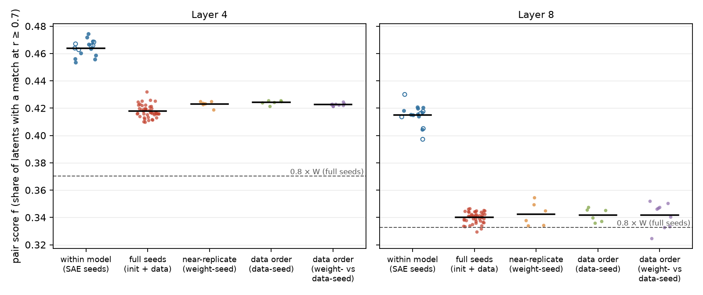
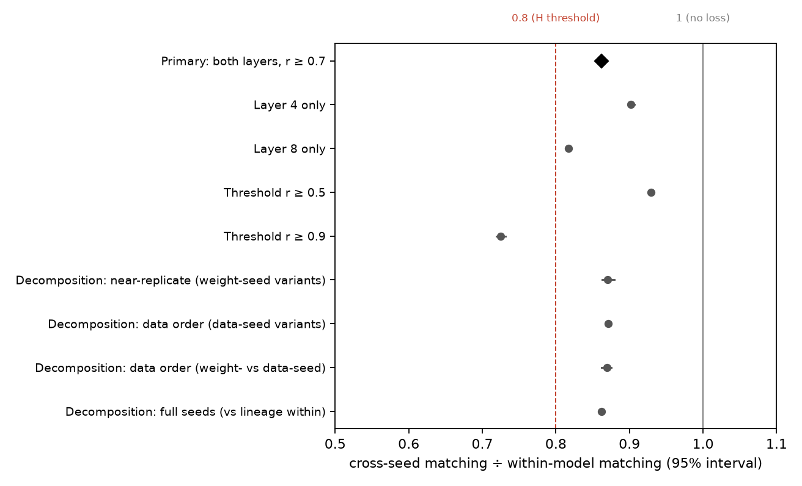
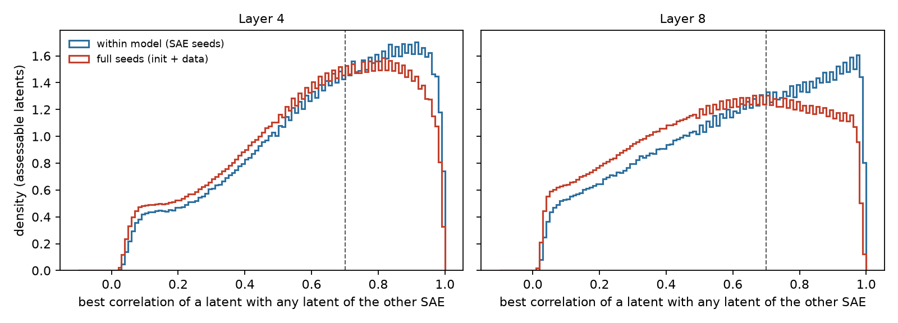
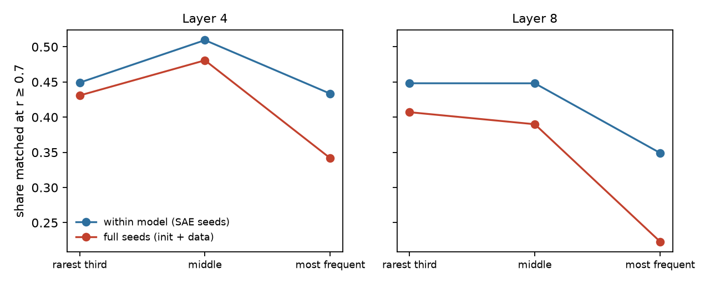
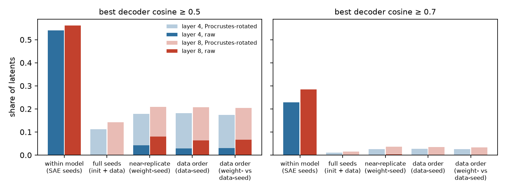

# Are SAE features properties of the model or of the training run?

*A preregistered test on PolyPythia-160M. 96 sparse autoencoders, three per model on 16 independently pretrained
versions of the same language model, were matched latent by latent by their activations on held-out text. The test
compares how often a feature recurs across pretraining seeds with how often it recurs across SAE seeds on one model.*

Run directory: `research-lab/runs/ai-evaluation-science-sae-pretraining-seed-universality` · Preregistration:
[`plan.md`](plan.md) (commit 3e34053) · Departures from it: [`deviations.md`](deviations.md) (D1-D7) · 13 October 2026,
pre-review draft

**Verdict: Refuted.**

- **The ratio.** Features recur across independently pretrained models at 0.862 times the rate at which they recur
  across SAE retrainings on one model (95% interval 0.859-0.866). The hypothesis needed a ratio below 0.8.
- **Where the irreproducibility lies.** Mostly in the SAE, not in the pretraining run. Two SAEs on the same model share
  46% (layer 4) and 42% (layer 8) of their latents at a correlation of at least 0.7. SAEs on different pretraining
  runs share 42% and 34%.
- **Where the extra loss across runs is concentrated:**
  - in near-exact matches (ratio 0.725 at r ≥ 0.9);
  - in the most frequently firing latents;
  - in the deeper layer.
- **Two further findings:**
  - Latents that both of a model's other SAE seeds re-find recur in 85% and 78% of the other pretraining runs.
  - The "weight-seed" variants, released as differing from the original only in their initialisation, were in fact
    trained from the original's initialisation (a known defect, EleutherAI/pythia #203). The decomposition is
    relabelled accordingly.

## In plain terms

Sparse autoencoders (SAEs) are a popular tool for looking inside language models. They split a model's internal
activity into tens of thousands of "features", each meant to stand for one recognisable pattern. A worry is that these
features describe one particular training run rather than what models of that kind learn.

We tested this on Pythia-160M, a small open model that EleutherAI trained several times from different random
starting points. We trained three SAEs on each of 16 versions of the model. Then we asked how often a feature in one SAE
has a near-twin in another, meaning that the two are active on the same words (correlation at least 0.7) across 2
million tokens of held-out text.

- **Same model, different SAE.** The two share only 46% of their features in the middle of the model and 42% deeper
  in. That is the noise of SAE training itself.
- **Different training run of the model.** They share 42% and 34%.

The prediction was that features would recur across runs at less than 0.8 times the rate within a run. They recurred at
0.86 times. **The prediction is refuted.** Most of the irreproducibility of SAE features comes from the SAE, not from
which training run of the model it examines.

The extra loss across runs is concentrated in three places:

- near-exact twins;
- the most frequently active features;
- the deeper layer.

There is also a practical test. A feature that two other SAEs on the same model both find again turns up in about four
of every five other training runs.

Along the way we found that three of the models released as differing only in their starting point actually started
from the original's. That problem had already been reported to EleutherAI. We relabelled those models.

## What was done

### Models and SAEs

- **Models.** 16 Pythia-160M variants at their final checkpoint (`step143000`):
  - the original (seed 0);
  - nine full pretraining seeds (`pythia-160m-seed1..9`, which differ in initialisation and batch composition);
  - six PolyPythia "decoupled" variants: `weight-seed1..3` ("only parameters") and `data-seed1..3` ("only data").
- **SAEs.** EleutherAI's `sparsify` 1.3.3:
  - TopK SAEs with k = 32 and 32,768 latents, on the residual stream after blocks 4 and 8 of 12;
  - three SAE seeds per model and layer, so 96 SAEs;
  - 200 million tokens each, from the Pile (uncopyrighted) validation split, in the same shuffled order for every SAE.
  - The plan's other settings were kept: signum optimizer, automatic learning rate, FVU loss, batch 32 × 2,048 tokens.
- **Training.** One A100 GPU, about 50 minutes per model and 13.3 GPU-hours in all (D4).

### Matching

Every SAE was applied to its own model's residual stream on a held-out set H: 1,025 sequences of the Pile test split,
with position 0 of each sequence dropped, which leaves 2,098,175 tokens.

- **Correlation.** For a pair of SAEs, the Pearson correlation between every latent of one and every latent of the
  other was computed exactly over H. A latent's activation counts as 0 where it is not in the top k.
- **Assessable latents.** Only latents that fire at least 20 times on H count.
- **Directional score.** f(A→B) is the share of A's assessable latents whose best correlation with an assessable
  latent of B is at least 0.7.
- **Pair score.** The mean of the two directions.

### Pairs

There are 246 pairs per layer (`code/pairs.py`):

- 48 within-model pairs: each model's three SAE-seed pairs;
- 135 full-seed pairs: the 45 pairs of full-seed models, each in three SAE-seed combinations;
- 54 pairs among the decoupled variants.

**Different SAE seeds across models.** The two SAEs of a cross-model pair never share an SAE seed. A shared SAE
initialisation could otherwise inflate matching in models whose residual bases happen to align.

### Primary statistic and decision rule

The primary statistic uses the 10 full-seed models only.

**R = (X₄ + X₈) / (W₄ + W₈)**, where for each layer:

- W is the mean within-model pair score;
- X is the mean cross-model pair score.

The interval comes from a dyadic bootstrap over models: 2,000 draws, each resampling the 10 models.

- **Supported:** the upper bound is below 0.8.
- **Refuted:** the lower bound is at least 0.8.
- **Inconclusive:** otherwise.

**Power.** A simulation before the study (`results/power.txt`) gave the rule a probability of at least 0.99 of
returning Supported for a true R ≤ 0.75 and Refuted for a true R ≥ 0.85.

### Checks before any outcome

- **Matching code.** Tested on pilot SAEs (D1):
  - an SAE against itself, and against itself with its latents permuted, gives f = 1;
  - against a random SAE it gives f = 0.003.
  - The test caught and fixed a bug that would have undercounted matches.
- **Step-0 checkpoints and tokenizers.** Checked in D2.
- **Order of commits.** The analysis code and the figure code were committed before any pair score existed.

## Results

### Primary: refuted



| | Layer 4 | Layer 8 | Pooled |
|---|---:|---:|---:|
| W: within one model (SAE seeds), 10 full-seed models | 0.463 | 0.416 | |
| X: across full pretraining seeds, 45 model pairs | 0.418 | 0.340 | |
| Ratio X / W | 0.902 (0.898-0.907) | 0.817 (0.813-0.822) | **R = 0.862 (0.859-0.866)** |

- **The verdict.** The whole interval lies above 0.8, so H is refuted.
- **Some loss.** The upper bound is below 1: pretraining seeds do cost some reproducibility, but less than the
  hypothesis claimed.
- **Separation.** At both layers every one of the 45 cross-model pairs scores below every one of the 10 models' within
  scores:
  - layer 4: cross 0.410-0.432 against within 0.453-0.474;
  - layer 8: cross 0.329-0.347 against within 0.404-0.421.
- **Per model.** Each model's own cross-to-within ratio lies between 0.888 and 0.915 at layer 4, and between 0.810 and
  0.827 at layer 8. That is why the interval is narrow.
- **Assessable latents.** About 31,700 of 32,768 at layer 4, and 25,300-29,300 at layer 8, where up to 19% of latents
  never fire on H (SAE quality below).

### The threshold matters



| Match criterion | W₄ | W₈ | X₄ | X₈ | R (95% interval) | By the rule |
|---|---:|---:|---:|---:|---:|---|
| r ≥ 0.5 | 0.721 | 0.651 | 0.687 | 0.588 | 0.929 (0.927-0.932) | Refuted |
| **r ≥ 0.7 (primary)** | 0.463 | 0.416 | 0.418 | 0.340 | **0.862 (0.859-0.866)** | **Refuted** |
| r ≥ 0.9 | 0.147 | 0.144 | 0.115 | 0.096 | 0.725 (0.719-0.731) | Supported |

The preregistered criterion is r ≥ 0.7, and the verdict rests on it. The secondary thresholds show where the loss is:

- **Loose matches** survive a change of pretraining run almost intact.
- **Near-exact matches** do not. Within a model, about one latent in seven has a twin at r ≥ 0.9 in another SAE seed.
  Across runs, about one in ten does.
- **The distributions** of each latent's best correlation show the same thing (figure below). Within-model pairs
  peak near 0.92 (layer 4) and 0.97 (layer 8), while cross-model pairs peak lower, near 0.82 and 0.66.



### The most frequent latents and the deeper layer lose the most



The table gives the directional match rate at r ≥ 0.7 by tercile of the latent's firing count on H.

| | Rarest third | Middle third | Most frequent third |
|---|---:|---:|---:|
| Layer 4, within model | 0.449 | 0.510 | 0.433 |
| Layer 4, across full seeds | 0.431 | 0.481 | 0.342 |
| Layer 4, ratio | 0.96 | 0.94 | 0.79 |
| Layer 8, within model | 0.448 | 0.448 | 0.349 |
| Layer 8, across full seeds | 0.407 | 0.390 | 0.223 |
| Layer 8, ratio | 0.91 | 0.87 | 0.64 |

- **Rare and middling latents** recur across runs almost as often as across SAE seeds.
- **The frequent third** loses most, especially at layer 8, where under a quarter of them have a match in another
  run's SAE.
- **The within row** pools all 16 models; the full-seed row uses the 10 full seeds.

### Latents that replicate within a model replicate across models (exploratory, D7)

For each SAE of the 10 full-seed models, every assessable latent was classified by how many of the model's other two
SAE seeds re-find it at r ≥ 0.7.

| Re-found by the model's other SAE seeds | Layer 4: share of latents | Layer 4: recur in other runs | Layer 8: share of latents | Layer 8: recur in other runs |
|---|---:|---:|---:|---:|
| neither | 46% | 6% | 51% | 4% |
| one | 15% | 42% | 16% | 34% |
| both | 39% | 85% | 34% | 78% |

"Recur in other runs" is the mean share of the 9 other full-seed models in which the latent has a match.

- **The practical rule.** Latents that are stable across SAE seeds are mostly stable across pretraining runs too.
  Latents that are not are almost never found in another run.
- **What it implies.** Running a few SAE seeds on one model and keeping the latents they agree on is a cheap filter for
  features likely to be properties of the model rather than of the run.

### Initialisation against data order, and what the decoupled checkpoints are (D6)

**The plan's intention.** The plan (7.2) meant to use PolyPythia's decoupled variants to separate the two sources of
pretraining randomness.

**What the checkpoints show (D6).**

- **The weight-seed variants** were not trained from their own released step-0 checkpoints. Their weights at step 1
  correlate 1.000 with the original's step-0 weights, and 0.000 with their own step-0 checkpoints. Their final weights
  carry the original's initialisation exactly as strongly as the original's own final weights do: median correlation
  0.068-0.069 against 0.068.
- **The independent full seed** (`seed1`) correlates 0.000 with every one of these step-0 checkpoints.
- **This is a known defect.** It was reported in EleutherAI/pythia issue #203 on 21 July 2026. The issue's 3 October
  comment adds two points:
  - the published step-0 branches are copies of `seed4..6`;
  - the weight-seed runs saw the original run's first batch.
- **My pre-plan checks missed the issue.** D2 compared only step-0 checkpoints and wrongly concluded that the labels
  held.
- **Which runs share an initialisation.** All seven models of the seed-0 lineage share the original's initialisation.
  The data-seed variants differ from it in batch composition. The weight-seed variants differ in something the
  artifacts do not identify, so the report calls them "near-replicates".
- **How far they drift apart.** At step 1000 they are closer to the original (median weight correlation 0.977-0.980)
  than data-seed1 is (0.964). By the end all are about equally far apart (0.17-0.21).

**The decomposition** (pooled layers; each kind's mean score relative to the mean within score of the seven lineage
models, 0.440; intervals resample model pairs and are descriptive):

| Kind (preregistered label → what the checkpoints show) | Model pairs | Ratio (95% interval) | Layer 4 | Layer 8 |
|---|---:|---:|---:|---:|
| `init` (only initialisation) → near-replicates: same initialisation and first batch | 6 | 0.871 (0.862-0.879) | 0.908 | 0.828 |
| `data` (only data order) → same initialisation, different batch composition | 6 | 0.871 (0.867-0.875) | 0.911 | 0.827 |
| `both_dc` (weight-seed vs data-seed) → same initialisation, different batch composition | 9 | 0.869 (0.862-0.876) | 0.907 | 0.826 |
| `full` → different initialisation and batch composition | 45 | 0.862 (0.859-0.864) | 0.897 | 0.822 |

**What the decomposition shows:**

- **Shared initialisation buys little.** Two runs that share the original's initialisation and differ only in batch
  composition lose almost as much matching as two runs that differ in both (0.871 against 0.862). Sharing the
  initialisation is worth about one point.
- **Near-replicates lose as much.** The weight-seed variants share the initialisation and, at least at the start, the
  data. Yet they lose as much as the data-order pairs.
- **The likely reading.** Whatever perturbs a pretraining run, its SAE features end up about equally dissimilar.
  Training appears to amplify small differences until the runs are as far apart, feature-wise, as independent seeds.
- **Caveats.** These are small sets of model pairs within one lineage. No comparison in the study varies the
  initialisation alone.

### Decoder geometry and the rotation claim (secondary 7.5; exploratory D5)



McCann (arXiv 2605.24577) reports three things for Pythia-70m:

- across pretraining seeds, decoder columns match at 98% by cosine;
- an SAE from one seed reconstructs another seed's activations at negative explained variance;
- an orthogonal Procrustes rotation restores reconstruction to within 0.025 of the within-seed ceiling.

**Decoder cosine** (the share of latents whose decoder direction has a cosine ≥ 0.5 with some decoder direction of the
other SAE):

| | Layer 4: raw | Layer 4: rotated | Layer 8: raw | Layer 8: rotated |
|---|---:|---:|---:|---:|
| Within a model (same basis) | 0.541 | (same) | 0.561 | (same) |
| Across full seeds | 0.000 | 0.113 | 0.000 | 0.143 |
| Lineage pairs (shared initialisation) | 0.028-0.042 | 0.175-0.182 | 0.064-0.080 | 0.204-0.209 |

- **Raw cosine.** Across independently initialised models it is never ≥ 0.5 for any latent of any of the 135 pairs at
  either layer.
  - That agrees with the residual bases differing by an arbitrary rotation.
  - It does not reproduce a 98% raw decoder match: in this setting raw decoder cosine finds nothing.
  - The lineage pairs' small raw alignment comes from their shared initialisation. Its trace is visible in the
    residual stream too: all seven lineage models have the same top outlier dimensions (393, 684, 411, …), and each
    full seed has its own (`results/tables/exploratory_outliers.csv`).
- **The rotation.** It recovers only a fraction of the decoder matches: 11-14% against 54-56% within a model.

**Reconstruction across models** (D5, exploratory). This used B's seed-0 SAE on A's residual stream. The maps were
fitted on 128 sequences of H and evaluated on 128 others. Means over the 45 full-seed pairs:

| | Layer 4 | Layer 8 |
|---|---:|---:|
| B's SAE on B's own stream (FVU) | 0.146 | 0.128 |
| B's SAE on A's raw stream | 2.53 | 2.04 |
| B's SAE on A's stream after Procrustes rotation | 0.413 | 0.304 |
| Rotation as a predictor of B's stream from A's (FVU) | 0.60 | 0.90 |
| Least-squares linear map as a predictor of B's stream | 0.40 | 0.48 |

- **Negative explained variance replicates.** The raw cross-model FVU of 2.0-2.5 means an explained variance of −1.0
  to −1.5.
- **The rotation helps, but much less than McCann reports.** Explained variance rises to 0.59 (layer 4) and 0.70
  (layer 8), still 0.27 and 0.18 below the within-model ceiling, not within 0.025.
- **No single linear map links the residual streams.** Even the best linear map leaves 40-48% of B's residual variance
  unexplained.
- **Why matching by activations still works.** Activation correlation needs no common basis, and it finds 86% as many
  shared features as within a model. So the feature-level correspondence between runs is much stronger than any global
  linear correspondence between their residual streams.
- **Caveats.**
  - Model size (160M against 70M), SAE type (TopK against ReLU with L1) and matching (best match against Hungarian)
    all differ from McCann's.
  - The rotation was fitted on raw activations, where a few outlier dimensions carry 30-50% of the variance; a
    standardised fit might do better.

### SAE quality and the reference SAE

- **Reconstruction.** FVU on H: median 0.153 at layer 4 (range 0.122-0.159), median 0.133 at layer 8 (range
  0.092-0.177). No SAE was flagged by the plan's rule (FVU above twice the median, or more than half its latents
  dead).
- **Dead latents.** The largest dead fraction is 19% (`seed5`, layer 8).
- **Scores do not track quality.** Pair scores have no consistent relation to the SAEs' FVU. Spearman correlations are
  0.27 and 0.21 at layer 4 for full and within pairs, and −0.13 and −0.29 at layer 8.
- **The reference SAE.** EleutherAI's `sae-pythia-160m-32k` (same architecture, 8.2 billion training tokens, about 40
  times this study's budget) has FVU 0.110 and 0.114 on the original model.
  - Its match score with this study's three SAEs on the same model is 0.476 at layer 4 and 0.417 at layer 8, about the
    same as this study's own within-model scores (0.463 and 0.416).
  - So the shorter training budget does not appear to depress within-model reproducibility.
- **Prior work.** The within-model level, about 42-46% of latents, is close to the 42% that Paulo & Belrose report for
  SAE seeds on Pythia-160M with a different matching criterion.

## What this means

**For the hypothesis.**

- Measured against the noise of SAE training itself, independently pretrained Pythia-160M models share most SAE
  features: 86% as many as two SAEs on the same model at the preregistered criterion.
- The hypothesis that features are largely properties of the training run is refuted at this threshold.

**For interpretability practice.** The binding constraint on reproducible features is the SAE, not the language model.

- More than half of a TopK SAE's latents are not re-found by another SAE seed on the same model.
- Those latents are almost never found in another run.
- Latents that do replicate across SAE seeds mostly replicate across runs.

**Where the pretraining run does matter:**

- near-exact correspondence (r ≥ 0.9, ratio 0.725);
- the most frequently firing latents (ratio 0.64 for the top third at layer 8);
- the deeper of the two layers (0.817 against 0.902).

A claim that a specific, frequently active, deep-layer feature is "the model's" deserves a check on a second
pretraining run.

**For geometry-based universality claims.**

- Decoder cosine without alignment finds no shared features at all across independently initialised models.
- A global orthogonal alignment finds only some of them.
- Basis-free activation matching is the more reliable instrument here.

## Limitations

- **One setting.** One model size (160M), two residual layers, one SAE recipe (TopK, k = 32, 32,768 latents) and
  200 million training tokens per SAE. The reference SAE suggests the budget does not limit within-model matching. Other
  architectures, sizes and layers may differ.
- **Best-match criterion.** Matching is by best correlation, not one-to-one assignment, so one latent may match several.
  The threshold (0.7) and the 0.8 cut-off come from the lead. Because the result depends on the threshold, all three
  thresholds are reported.
- **Assessable latents only.** Latents firing fewer than 20 times on H (2-4% of an SAE's latents at layer 4, 11-23%
  at layer 8) are left out of both numerator and denominator.
- **The interval.** It reflects model-to-model variation among the 10 full seeds. It is narrow because every model's
  own ratio is close to the average. It does not cover variation in the SAE recipe, the held-out text or the layer
  choice.
- **The decomposition.** It was relabelled after the results were seen (D6) because of a defect in the released
  checkpoints that the pre-plan checks should have found. The study has no initialisation-only comparison.
- **Exploratory analyses.** The outlier dimensions, cross-model reconstruction and conditional replication analyses
  (D5, D7) were not preregistered.

## Deviations

- **D1.** Pilot: the 200M-token budget kept (projected 12.5 GPU-hours, against a 72-hour limit). A matching-fraction
  bug was caught by the test and fixed before any SAE existed.
- **D2.** Step-0 and tokenizer checks. The step-0 conclusion is corrected by D6.
- **D3.** Matching dry run on pilot SAEs.
- **D4.** Training finished. A docstring corrected: decoder cosine is the signed maximum.
- **D5.** Post-hoc exploratory checks: outlier dimensions and cross-model reconstruction.
- **D6.** The weight-seed variants were trained from the original's initialisation (issue #203); the decomposition is
  relabelled per plan section 2.
- **D7.** Post-hoc conditional replication analysis.

Nothing changed the primary statistic, its inputs or the decision rule.

## Reproduce

```
venv/bin/python code/fetch.py models; venv/bin/python code/fetch.py step0; venv/bin/python code/fetch.py pile
venv/bin/python code/fetch.py ref; venv/bin/python code/tokenize_pile.py
NSEQ=97657 SAVE=data/sae code/run_train.sh p160m p160m-seed1 ... p160m-data-seed3   # 16 models, ~13 GPU-hours
code/run_match.sh                                                                    # ~30 minutes
venv/bin/python code/analysis.py; venv/bin/python code/figures.py
venv/bin/python code/fetch.py early; venv/bin/python code/lineage_check.py           # D6
venv/bin/python code/exploratory.py; venv/bin/python code/exploratory_conditional.py # D5, D7
```

## Released

- **Tables.** Pair tables (`results/tables/pairs_L4.csv`, `pairs_L8.csv`), SAE quality and reference tables,
  `primary.json`, `secondary.json`, and the exploratory and lineage tables.
- **Per-latent arrays.** Each pair's per-latent best-correlation arrays and each SAE's firing counts on H are in
  `results/match_arrays_L4.npz` and `results/match_arrays_L8.npz` (about 30 MB each; `code/release_arrays.py`).
- **SAE weights.** The 96 SAEs (about 19 GB) are not released, because the lab has no hosting for them. Their exact
  training configuration is in `code/run_train.sh` and each SAE's `cfg.json`, so they can be regenerated.

## Data and citations

- **Models.** EleutherAI Pythia and PolyPythias: Biderman et al. 2023; van der Wal et al., ICLR 2025, arXiv
  2503.09543; Hugging Face `EleutherAI/pythia-160m*`. Defect report: <https://github.com/EleutherAI/pythia/issues/203>.
- **Text.** The Pile (uncopyrighted): `monology/pile-uncopyrighted`, commit 3be9033.
- **SAE trainer and reference SAEs.** EleutherAI `sparsify` 1.3.3; `EleutherAI/sae-pythia-160m-32k`, commit 2046768.
- **Related work:**
  - Paulo & Belrose, "Sparse autoencoders trained on the same data learn different features", arXiv 2501.16615.
  - McCann, "Polymorphism Is Rotation", arXiv 2605.24577.
  - Váradi & Kmetty, arXiv 2607.08499.
  - "Unstable Features, Reproducible Subspaces", arXiv 2606.12138.
  - Lan et al., arXiv 2410.06981.
