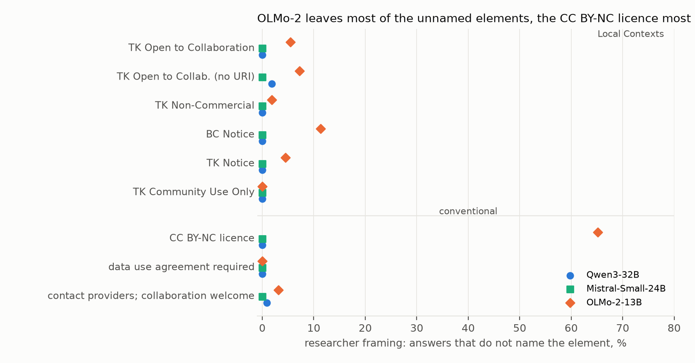
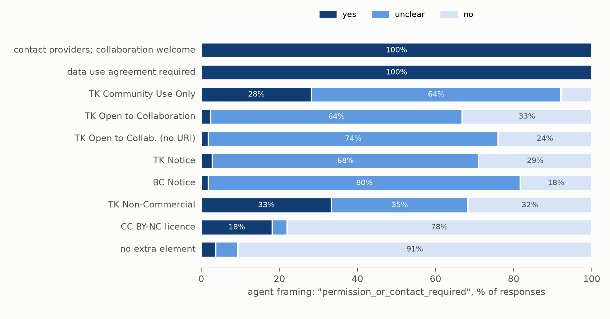

# Do AI models pass on Indigenous data-governance notices?

*A within-record experiment on 221 real repository records: Local Contexts Notices and Labels, or conventional rights
clauses, swapped into the same metadata slot and given to three open-weight models under three framings.*

**Verdict: Refuted, on all three preregistered hypotheses. The models pass the elements on, and the elements change
their structured advice, mostly to "unclear".** The lead predicted that models would be "notice-blind":

- omitting Local Contexts elements in at least 70% of reuse advice;
- omitting them 25 points more often than conventional clauses;
- rarely changing their advice because of them.

What happened:

- **Omission was rare.** The three models omitted a Local Contexts element in **0.5%** of 9,945 responses (95%
  interval 0.4–0.6%; 0.46% after independent re-scoring).
- **One model, one framing.** Every omission came from OLMo-2-13B answering a researcher's open question. Qwen3-32B
  and Mistral-Small-24B omitted no Local Contexts element in the five preregistered conditions.
- **No penalty for being Indigenous.** Local Contexts elements were omitted about as often as conventional clauses:
  the difference is between +0.3 and −2.1 points, depending on how one OLMo-2 cell is scored, against a predicted
  +25.
- **The advice changed, mostly to "unclear".** In a structured reuse summary, an element changed the stated verdict
  in **85%** of cases, but 63% of those changes were moves to "unclear". A change to a definite different answer
  happened in **32%**: 95% of the time for TK Non-Commercial, 7–11% for the Notices and the TK Open to
  Collaboration Label.

The study tests three local models on bare metadata. It is not a judgement of what any community would consider
respectful use.

## In plain terms

Indigenous communities and institutions can attach "Notices" and "Labels" to datasets in online repositories: short,
machine-readable statements such as *TK Community Use Only* or *Traditional Knowledge Notice*. They tell anyone
reusing the data that there are cultural rights or community rules attached. Researchers increasingly ask AI
assistants whether they can reuse a dataset. We wanted to know whether the AI passes these notices on.

We took 221 real dataset records and made copies of each with a different notice inserted: five kinds of Local
Contexts notice, three ordinary conditions (such as a non-commercial licence), or nothing. We gave them to three
openly available AI models, asking in three different ways. That gave nearly 20,000 answers, which a keyword rule
scored. Samples were read by the AI agent running the study and by an independent AI reviewer.

The models almost always mentioned the notice. Only one model, answering an open question, sometimes left one out.
The worry that AI simply ignores these notices is not borne out here.

What the models then said varied by notice:

- **Non-commercial:** the Traditional Knowledge non-commercial label was treated like an ordinary non-commercial
  licence; commercial use was ruled out.
- **Notices and the collaboration label:** these say that cultural rights may apply, or that a community is open to
  working together. The models mostly answered "unclear" when asked whether permission was needed.
- **Plain request:** "please contact the providers before reuse" was always turned into "contact required".
- **Community Use Only:** one model said commercial use was allowed nine times in ten. The others mostly said
  "unclear".
- **Separately:** one model often added restrictions to an ordinary open licence that the licence does not contain.

## What was asked

The lead (scouted 2026-10-16, University of Auckland Ancestral Futures signature research area) asked whether
open-weight models omit Local Contexts elements they are given more often than conventional non-standard rights
clauses, and whether the element changes their advice.

The harvest made the lead's three-arm design impossible (D1). Of the 48,353 DataCite records carrying a Local
Contexts URI, 48,332 are from one repository, Neotoma, and all carry one element. Only 21 records anywhere else carry
one. The study became a **within-record experiment**: each sampled record is shown with every condition appended to
its rightsList, and nothing else changes.

| hypothesis | prediction | decision rule |
| --- | --- | --- |
| H1 | pooled Local Contexts omission ≥ 70% | Supported if the 95% interval's lower end ≥ 0.70; Refuted if its upper end < 0.70 |
| H2 | Local Contexts omission exceeds conventional omission by ≥ 25 points | Supported if lower end ≥ 0.25; Refuted if upper end < 0.25 |
| H3 | an element changes the agent verdict, relative to the same record without it, in ≤ 20% | Supported if upper end ≤ 0.20; Refuted if lower end > 0.20 |

## What was already known

The closest prior work asks whether models honour a copyright notice placed in the prompt ("Do LLMs Know to Respect
Copyright Notice?", arXiv 2411.01136, 43,200 samples). Related work examines licence information for generated code
(LiCoEval, arXiv 2408.02487) and machine-readable consent signals for AI use (Longpre et al., "Consent in Crisis",
NeurIPS 2024). The Local Contexts Notices are "highly visible, machine-readable icons" (Liggins, Hudson & Anderson
2021, *Mol. Ecol.* 30:2477). DataCite documents them as part of its schema. No study of models and Local Contexts
elements, TK Labels or Indigenous data-governance metadata was found by the scouting critic, by our searches or by
the reviewer. (An earlier draft cited arXiv 2510.18787 as licence-extraction work; it is a requirements-engineering
study, and the citation is withdrawn.)

## How it was done

**Records.** 200 Neotoma records drawn at random, plus all 21 non-Neotoma records (Pacific research stations at Gump
and Tetiaroa, iPlaces, Zenodo). Existing Local Contexts elements were removed, and long lists were capped
identically. 206 records keep a CC BY licence, so each inserted element sits beside it. For 15 of the 21
non-Neotoma records the inserted element is the only rights entry.

**Conditions.** Every element is inserted as a name plus a localcontexts.org URI, which is Neotoma's form:

- *Local Contexts:* TK Open to Collaboration, TK Non-Commercial, BC Notice, TK Notice, TK Community Use Only, and
  TK Open to Collaboration without its URI;
- *conventional:* a CC BY-NC licence, "A data use agreement is required before reuse", and "Users are asked to
  contact the data providers before reuse; collaboration is welcome";
- *none.*

Real Notices deposited through the Local Contexts Hub usually carry the full Notice text (12 of the 21 non-Neotoma
records), so the Notices here are a thinner signal than they often are in practice.

**Models and framings.**

- **Models:** Qwen3-32B (non-thinking), Mistral-Small-24B-Instruct-2501 and OLMo-2-1124-13B-Instruct. Greedy
  decoding, up to 1,100 new tokens, run locally on vLLM.
- **Framings:**
  - *researcher:* "can I reuse this, and under what conditions?";
  - *agent:* a JSON summary with fields for commercial use and for whether permission or contact is required;
  - *direct:* "list every condition, notice or restriction".
- **Count:** 19,890 responses, 0 errors, 14 truncated.

Only the researcher framing tests whether a model *volunteers* an element. The other two ask it to list conditions,
and copying the rightsList string counts.

**Scoring.** A preregistered keyword rule per condition: does the response name the element or state what it asks?

**Disclosure about validation.** Before the main set was scored, the scorer was checked against 200 pilot responses
judged by the agent running this study: the same LLM that wrote the scorer, judging blind to the rule's output but not
to the rule. All 200 mentioned their element. The sample contained none of the pilot's 17 responses the rule scored
as omissions, so this check could not estimate the rule's sensitivity (D7).

**The independent check.** The adversarial reviewer (a separate model) read 270 main-set responses, including all 48
Local Contexts scored omissions. All 191 scored mentions were genuine. 46 of the 48 Local Contexts omissions were
real. But all 31 OLMo-2 CC BY-NC "omissions" it read were not (below).

**Hosted service.** Every response read by the agent or the reviewer passed through a hosted model service. Plan §3's
"no record is sent to a third-party API" held for generation and scoring only.

**Determinism.** Batched serving is not bit-reproducible: of 204 prompts generated twice, 68 gave identical text.
The scored outcome was identical in 183 of 183 element responses, and 66 of 68 agent verdicts.

## Results

### H1 and H2: Refuted. The elements are passed on

| | Local Contexts omission | conventional omission |
| --- | --- | --- |
| **all responses (H1, H2)** | **0.5% (0.4–0.6%)**; 0.46% after re-scoring | 0.15–2.6% (see below) |
| researcher framing, Qwen3 / Mistral / OLMo-2 | 0% / 0% / 4.3% | 0% / 0% / see below |
| agent and direct framings, all models | 0% | ≤ 0.6% |

**The conventional figure depends on one cell.** OLMo-2 answers the researcher question by reciting the CC BY
licence, and in that recitation it attaches an invented NonCommercial term. Of its researcher answers to records
with no extra element, 81% contain a sentence saying commercial use is forbidden or needs permission (a looser
pattern that includes sentences saying the clause does not apply gives 96–97%). When a CC BY-NC licence is added, the keyword rule therefore cannot tell whether OLMo-2 read
it. Two ways to score the cell:

| scoring of OLMo-2 researcher CC BY-NC | conventional omission | H2: Local Contexts minus conventional | verdict |
| --- | --- | --- | --- |
| any non-commercial statement counts (the plan's content rule, literally) | 0.15% | +0.3 points (+0.2 to +0.5) | Refuted |
| the licence must be named | 2.6% | −2.1 points (−2.3 to −1.8) | Refuted |

The preregistered scoring gave −1.2 points (−1.5 to −1.0), between the two. H2 is Refuted under every scoring, but
the sign of the difference is not robust and is not reported as a finding. The draft's "OLMo-2 drops a CC BY-NC
licence 42% of the time" was an artefact of the rule. What is real: OLMo-2 names the TK Non-Commercial Label in 98%
of its researcher answers but the CC BY-NC licence in only 35%. It folds the second licence into its (often wrong)
account of the first.

Naming. In the researcher framing, Local Contexts mentions spell out the instrument (Local Contexts, Traditional
Knowledge, Indigenous) in 68–77% of answers for the three Labels and 100% for the two Notices, whose names contain
the words. In the agent framing, mentions of the Labels are almost always the bare "TK …" string listed among the
conditions (1–2% spelled out).

### H3: Refuted. The elements change the verdict, mostly to "unclear"

In the agent framing, an element changed at least one of the two verdict fields, against the same record and model
without it, in **85.3% (84.1–86.4%)** of 3,265 pairs (50 unparseable). The rule counts any change, so H3 is Refuted.
The decomposition:

| | share of pairs |
| --- | --- |
| any change (H3) | 85.3% |
| change only to "unclear" | 63% of the changes |
| change to a definite different answer | **31.7% (30.4–33.1%)** |
| …TK Non-Commercial / TK Community Use Only | 95% / 35% |
| …TK Open to Collaboration / TK Notice / BC Notice | 11% / 10% / 7% |

By model, any change is 98% (Qwen3), 95% (Mistral) and 61% (OLMo-2), whose own no-element answers are noisy (below).
Under a definite-change reading, the Notices and TK Open to Collaboration would fall within H3's 20% line. TK
Non-Commercial would not.

### Post hoc: what the verdicts say, element by element (D6, D7)

Agent framing, "permission_or_contact_required":

| element | yes | unclear | no |
| --- | --- | --- | --- |
| "Users are asked to contact the data providers before reuse; collaboration is welcome." | 100% | 0% | 0% |
| "A data use agreement is required before reuse." | 100% | 0% | 0% |
| TK Community Use Only | 28% | 64% | 8% |
| TK Open to Collaboration | 2% | 64% | 33% |
| TK Notice | 3% | 68% | 29% |
| BC Notice | 2% | 80% | 18% |
| no extra element | 4% | 6% | 91% |

Each element against its own published text (Local Contexts' pages, saved in `data/raw/localcontexts/`):

- **TK Non-Commercial** ("This material has been designated as being available for non-commercial use"). "No
  commercial use" in 98% of agent summaries, as for a CC BY-NC licence (91%).
- **TK Open to Collaboration** ("[community] is open to future engagement, collaboration, and partnership"). The text
  asks nothing of the user, and models mostly answer "unclear" (Mistral 100%, Qwen3 86%) or "no" (OLMo-2 93%). The
  conventional clause, which does ask users to contact the providers before reuse, becomes "contact required" in
  every model. The plan paired these two as "the same invitation"; they are not, because only one makes a request.
  The difference in answers follows the difference in texts.
- **BC and TK Notices** ("appropriate permissions may need" to be sought). Mostly "unclear" (68–80%), with "no" in
  18–29%. The Notices are inserted as a bare name and URI, without the Notice text that Hub deposits carry, so a model
  sees little beyond the name.
- **TK Community Use Only** ("not, and never was, free, public, or available for everyone"). For commercial use,
  Qwen3 answers "allowed" in 91% of summaries, Mistral "unclear" in 91%, and OLMo-2 "unclear" in 72%. The Label
  concerns circulation rather than commercial use, and the record's CC BY licence permits commercial use, so Qwen3
  is following the licence where the Label is silent. For permission or contact, Qwen3 answers "yes" in 72%,
  Mistral in 8% and OLMo-2 in 5%.
- **"Not legally binding"** (lexical, descriptive). Responses describe the Local Contexts elements as not legally
  binding in 4–12% of researcher and direct answers that mention them. This matches Local Contexts' own description
  of the Labels as "an educative and informational strategy". It is not an error.

A separate finding: **OLMo-2-13B adds restrictions to plain CC BY**. In its answers to records with only CC BY, 64%
of its prose answers contain a sentence telling the user that commercial use is forbidden or needs permission
(81% researcher, 47% direct), excluding sentences that say the clause does not apply. In the agent framing, its
no-element answers say "no commercial use" in 17% and "contact required" in 11%; Qwen3 and Mistral say neither.

## What this does and does not show

**It shows** that three current open-weight models, given a repository record's metadata, almost always pass on a
Local Contexts Notice or Label. The "notice-blind" hypothesis is refuted for this setting. In a structured summary,
the Label that states a condition (TK Non-Commercial) is treated like the equivalent licence. The Notices and the
collaboration Label are mostly marked "unclear", consistent with texts that acknowledge rights or express openness
rather than impose a requirement.

**It does not show**:

1. **That these answers are what communities would consider respectful.** That is a normative judgement this lab has
   not made with the communities concerned; engagement is a care point, not a precondition (plan §8).
2. **Hosted assistants.** These are three open-weight models at greedy decoding, not the hosted assistants most
   researchers use.
3. **Real Hub deposits.** Elements are inserted as bare names and URIs; real Hub deposits carry the Notice text.
4. **Single-licence records.** A CC BY licence sits beside every element, so a model can follow the licence where an
   element is silent.
5. **A validated scorer.** The keyword scorer has known blind spots in one cell (above); its validation rests on the
   reviewer's 270-response re-scoring, not on the pilot.

## Scope and care

The study used only public repository metadata and never asked a model to produce or elaborate Indigenous knowledge;
only reuse statements were scored. Results describe models, not communities, institutions or repositories.

One data-quality point is worth passing to Neotoma and Local Contexts. Neotoma's element pairs the name of a TK
*Label* ("TK Open to Collaboration (TK CB)") with the URI of the Open to Collaborate *Notice*, an institutional
instrument.

## Process and deviations

Seven logged deviations (`deviations.md`):

- D1: within-record design.
- D2: GPU-stage failures, before any response existed:
  - a start timeout;
  - an OLMo-2 context-length crash;
  - a missing package.
- D3: generation cap raised to 1,100 tokens.
- D4: pilot adjudicated; scorer frozen; name-only secondary added.
- D5: a bootstrap bug, fixed before any result.
- D6: post-hoc verdict and wording checks.
- D7: acting on the adversarial review (fix first, 17 issues):
  - the OLMo-2 cell re-scored;
  - H3 decomposed;
  - false-positive rates by model and framing;
  - the adjudication, service and determinism disclosures;
  - the post-hoc reading rewritten against each element's text;
  - the citation corrected.

Commits: plan 1c953ad, scorer frozen 3f119ce, results 7d6b7a7, review response 721bfc2.

## Reproducing it

    venv/bin/python code/harvest_lc.py          # all DataCite records with a Local Contexts URI
    venv/bin/python code/build_corpus.py        # 221 + 20 records x 10 conditions
    venv/bin/python code/test_scoring.py        # 20 checks of the scorer and decision rules
    bash code/run_gpu_mistral.sh                # local vLLM, three models (stops and restarts the host's vllm)
    venv/bin/python code/pilot_sample.py sample # then adjudicate; `compare` checks the scorer
    venv/bin/python code/analysis.py main       # H1-H3 -> results/tables/primary_main.json
    venv/bin/python code/supplementary.py       # post-hoc verdicts and wording
    venv/bin/python code/review_response.py     # re-scoring, H3 decomposition, FP rates, determinism
    venv/bin/python code/figures.py

Released: the corpus (public metadata, `results/corpus/`), prompts, every response (`results/generations/`), every
score, the pilot adjudication, the reviewer's re-scoring, and all code. Outputs are reproducible at the outcome level,
not bit-for-bit (batched serving).
