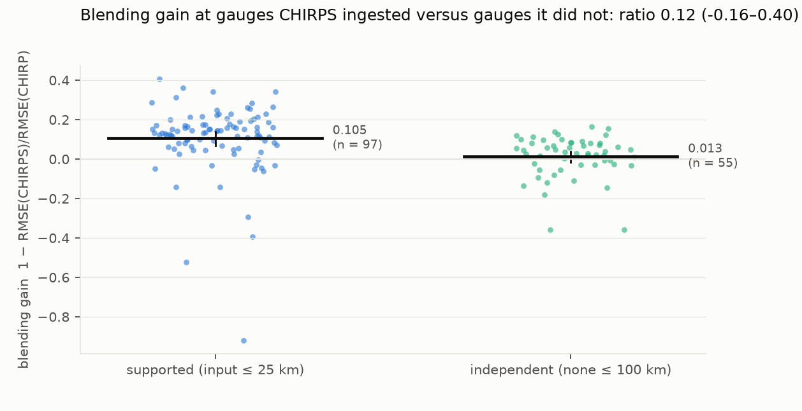
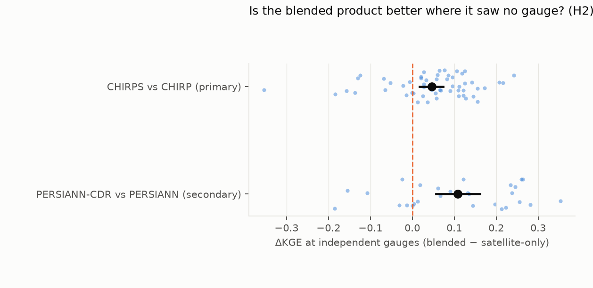
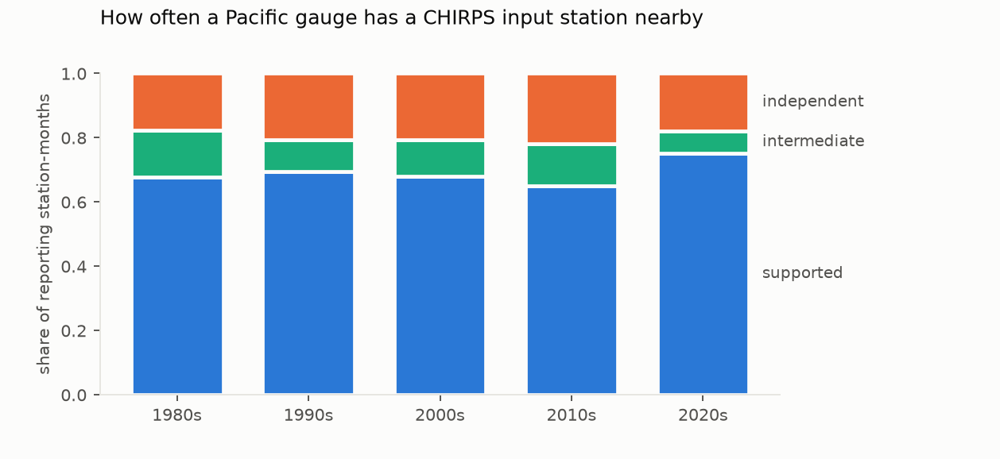

# Is gridded rainfall skill over Pacific Island countries circular?

*Gauge-blended rainfall products look more skilful than their satellite-only twins at Pacific Island gauges. This
study asks how much of that advantage survives at gauges the blend never saw. It compares CHIRPS v2.0 with its
satellite-only twin CHIRP at 112 GHCN-Daily stations across the Pacific Islands, 1981–2025. Nine more stations sit
where neither product carries an estimate, so CHIRPS cannot be evaluated there at all.*

**Verdict: Supported (circularity); the blended product is still marginally better where it saw no gauge.**

- **H1 (the blending gain at independent gauges is at most half the gain at supported gauges): Supported.**
  - **Supported gauges** (CHIRPS ingested a station within 25 km that month): blending cuts the pentad RMSE by 10.5%
    (95% CI 6.9–13.8%).
  - **Independent gauges** (no input station within 100 km): it cuts it by 1.2% (−1.7 to +3.7%).
  - The ratio is 0.12 (−0.17 to 0.39), below the 0.5 bar across the whole interval.
  - It stays below 0.5 under both alternative distance thresholds and on log-transformed rainfall (0.34, 0.24–0.44).
  - **Within the same 45 stations**, measured in both strata, the gain is 12.7% where supported and 1.7% where
    independent — a difference of 11.0 points (7.0–15.1), positive at 87% of stations — so the contrast is not an
    artefact of which stations fall in which stratum.
- **H2 (at independent gauges the satellite-only twin is better): Refuted.**
  - CHIRPS still edges CHIRP on the Kling–Gupta efficiency at independent gauges: ΔKGE +0.046 (+0.017 to +0.073).
  - Under the widest distance threshold the interval includes zero (+0.031, −0.002 to +0.063).
  - The monthly input lists can miss gauges CHIRPS used only at pentad stage. Such hidden inputs would make some
    "independent" gauges supported, which inflates the independent gain and so pushes towards refuting H2 as well as
    against H1.
- **The secondary pair (PERSIANN-CDR against PERSIANN, 2001–2020) points the same way but is weaker.**
  - Its gain ratio is 0.72 (0.49–1.00), which is Inconclusive.
  - At gauge-free cells, CDR is clearly better on KGE (+0.108).
  - This pair also differs in algorithm, and its gauge label is far coarser: a 2.5° GPCC cell, not 25 km.

**What this means for users.** Validating CHIRPS at Pacific gauges overstates its advantage over CHIRP several-fold —
at least threefold on the interval — because 65–75% of reporting station-months sit within 25 km of a station CHIRPS
blended in. Away from input stations,
the blending is close to neutral: it slightly improves the overall skill score, but barely moves the error.

## In plain terms

Satellite rainfall maps are widely used in the Pacific, where rain gauges are few. The best-known maps blend
satellite estimates with the gauges that do exist, and they are usually checked against those same gauges. That is a
bit like marking a test against the answer key the student was given.

We used the fact that one popular product, CHIRPS, has a twin built the same way but without any gauges (CHIRP), and
that CHIRPS publishes which stations it used each month. That let us compare the two products at gauges CHIRPS had
used, and at gauges more than 100 km from any it used.

At gauges CHIRPS had used, the blended map was about 10% more accurate than its satellite-only twin. At gauges it had
not used, the improvement almost disappeared, to about 1%. The same held comparing a single station's supported and
independent months, so it is not about which stations are which.

So the usual checks make the blended map look much better than it is across most of the ocean region, where there
are no gauges. It is not worse than the satellite-only version there, and is still slightly better on one combined
skill score.

In any decade, CHIRPS uses between half and two-thirds of the Pacific gauges that are reporting. A benchmark built
only from the others would give Pacific climate services a fairer test of any rainfall map, and the station lists and
labels from this study are released for that purpose. At Palau and a few atolls, though, neither map has a real
estimate at all, so no gauge there can test them.

## What was asked

Over Pacific islands, rainfall products are validated at the few long-running gauges, mostly airports. Those are also
the gauges blended into products such as CHIRPS. The study asks two preregistered questions (`plan.md`):

- **H1 (circularity).** At gauges CHIRPS did not ingest, is the blending gain at most half what it is at gauges it
  did?
- **H2 (ranking reversal).** At those independent gauges, is the satellite-only twin actually better?

## What was already known

- **Wild, Chua & Kuleshov (2021, *Remote Sensing* 13:3929)** evaluated products over six south-west Pacific
  sub-regions against MSWEP, which is itself gauge-blended. It is not gauge-based and not twin-based.
- **A 2026 Fiji study** evaluated products against national gauges without separating ingested from independent
  ones.
- **No study was found** that uses a twin pair and the published input-station lists to separate circular from
  independent skill over the Pacific (search 2026-10-18).

## How it was done

**Gauges.**
- GHCN-Daily precipitation for every Pacific Island station: 148 stations with data after 1985.
- Only values with a blank quality flag are kept, and runs of five or more identical non-zero days are removed.
- Pentad totals use the CHIRPS calendar (six per month) and complete pentads only.

**Products.**
- **CHIRP and CHIRPS v2.0 pentads** at 0.05°, 1981–2025: 3,240 pentads each, every one read, at all 148 station
  pixels.
  - Pixels were read by HTTP range requests.
  - The data server refused parallel readers partway through (D1 addendum). Extraction resumed as one paced stream.
  - Failed reads were recorded as errors and re-read later, never as zero rain.
  - The plan's pre-check grid masked 14 stations as ocean. The CHIRPS pentad files used here, which use a wider land
    mask, have values at 147 of the 148.
  - The exception (FMC00914251, Micronesia) is masked as ocean, so it has no CHIRPS skill. It is reported as a masked
    station: 410 gauge pentads, all independent.
- **The secondary pair:** PERSIANN (satellite-only) and PERSIANN-CDR (bias-adjusted to GPCP, which uses GPCC gauges),
  daily at 0.25°, 2001–2020: 7,305 days each, complete.

**Timing.** Each station's gauge pentads are formed with a day shift of −1, 0 or +1, chosen to maximise the
correlation with CHIRP (the satellite-only twin) and then applied to every product.
- 67 stations take +1, 53 take 0 and 2 take −1.
- The +1 shifts are consistent with gauges recording rain for the 24 hours to a morning observation.

**Labels.** Each gauge-month is labelled by its distance to the nearest station in CHIRPS's published input list for
that month:
- supported: within 25 km;
- independent: none within 100 km;
- intermediate: in between, excluded.

For the secondary pair, a gauge-month is supported if its 2.5° GPCC cell held at least one gauge.

**Skill.** For each station and stratum with at least 30 pentads:
- the blending gain g = 1 − RMSE(blended)/RMSE(satellite-only);
- ΔKGE = KGE(blended) − KGE(satellite-only).

Stations need at least 100 valid pentads: 122 qualify. H1 uses the ratio of station-mean gains, and both hypotheses
use a station-block bootstrap (2,000 resamples).

**Where there is no estimate, and implausible gauge years** (D2). At some cells the products carry no climatology and
are filled with near-zero values rather than marked missing, so the plan's "masked" test (every value empty) never
fired; there the blending gain is zero by construction. A station is treated as having no estimate if CHIRP averages
under 2 mm/pentad or under 10% of the gauge: nine stations, with CHIRP at 0–6% of the gauge. A well-sampled
station-year (at least 30 matched pentads) in which the gauge and the satellite-only product disagree by more than
fivefold, in either direction, is dropped, because one of the two is wrong. That removes Koumac 1981–2003, whose record
runs about ten times too high; seven French Polynesia stations in 1981, whose gauges run far too low; and ten other
station-years (Vanuatu ×3 and Tonga in 1981, Guam ×4, and one each in the Federated States of Micronesia and the
Marshall Islands). With one ocean-masked station, 112 stations are evaluated.

## Results

### H1: circularity (`results/tables/primary.json`, `results/figures/F1_gain_by_stratum.png`)

| | stations (sup / ind) | gain, supported | gain, independent | ratio (H1) |
|---|---|---|---|---|
| **Primary: 25 / 100 km** | 97 / 55 | **10.5% (6.9–13.8)** | **1.2% (−1.7 to 3.7)** | **0.12 (−0.17 to 0.39)** |
| Thresholds 10 / 50 km | 94 / 61 | 10.4% | 1.5% | 0.14 (−0.10 to 0.40) |
| Thresholds 50 / 150 km | 101 / 42 | 10.4% | −1.4% | −0.14 (−0.51 to 0.19) |
| log(1 + P) pentads | 97 / 55 | 13.4% | 4.5% | 0.34 (0.24 to 0.44) |
| Co-located: input within 5 km (preregistered) | 65 / 55 | 9.9% (4.5–14.5) | 1.2% | 0.12 (−0.19 to 0.49) |
| *Secondary: PERSIANN-CDR vs PERSIANN* | 102 / 28 | 10.7% | 7.7% | 0.72 (0.49 to 1.00) |

- **H1 is Supported.** The ratio's upper bound, 0.39, is below 0.5, and so it is in the three preregistered
  sensitivity variants. The co-located case is borderline: its interval reaches 0.49, and crosses 0.5 under other
  bootstrap seeds.
- **The supported gain is not uniform.** Guam's 14 stations and the Northern Marianas' 5 have negative supported gains
  (−9.3% and −16.6%): there CHIRPS is worse than CHIRP even at ingested gauges. Without them the supported gain is
  15.8%, so they make the contrast smaller, not larger.
- **The farther from an input station, the smaller the gain.** At the 150 km threshold, the independent gain is
  slightly negative.
- **The secondary pair is Inconclusive.** Its "independent" label (no gauge in a 2.5° cell) is much coarser, and it
  has only 28 independent stations.

### H2: ranking reversal (`results/figures/F2_dkge_independent.png`)

| pair / variant | ΔKGE at independent gauges |
|---|---|
| **CHIRPS − CHIRP (primary)** | **+0.046 (+0.017 to +0.073)** |
| thresholds 10 / 50 km | +0.048 (+0.023 to +0.070) |
| thresholds 50 / 150 km | +0.031 (−0.002 to +0.063) |
| log(1 + P) | +0.061 (+0.047 to +0.077) |
| PERSIANN-CDR − PERSIANN (secondary) | +0.108 (+0.056 to +0.161) |

- **H2 is Refuted.** At independent gauges CHIRPS is not worse than CHIRP. It is slightly better on KGE, which
  weighs correlation, bias and variability together, even though it barely improves RMSE there.
- **Where the KGE gain comes from** (`station_skill.csv`, station means at independent gauges):
  - mostly bias and variability: the bias ratio β and variability ratio γ move closer to 1 by 0.030 and 0.040;
  - a little from correlation: r rises by 0.024.

### How often Pacific gauges are independent (`results/figures/F3_label_shares.png`, `by_country`)

Shares are counted over station-months in which the gauge reported (D2).
- **Most reporting station-months are supported:** 65–75% in every decade since the 1980s; 18–22% are independent.
- **In half to two-thirds of reporting station-months the gauge is itself a CHIRPS input.** Within 5 km of a listed
  input, 37–46% by decade; within 10 km, 58–70%. The wider radius matters because 6.7% of Pacific entries in the input lists are rounded
  to 0.1°: Nadi's own entry sits 7.4 km from the Nadi gauge every month.
- **Independent pentads are concentrated in Fiji.** Of 201,750 evaluable station-pentads, 25,322 (12.6%) are
  independent, and 20,275 of those are Fijian; the next largest are the Marshall Islands (1,940) and Vanuatu (1,052).
- **Guam's 14 stations have no independent pentads at all.**

### Where CHIRPS cannot be evaluated

- **No estimate:** all five evaluable Palau stations, Johnston Island, and three Federated States of Micronesia
  stations (Lukunoch, Chuuk WSO AP and Woleai) — 17,270 gauge pentads at which both products sit at 0–6% of the
  gauge. At Koror, CHIRP averages 0.07 mm a pentad against a gauge's 52 mm. That CHIRPS has no real estimate over
  Palau or the Chuuk-lagoon atolls is a finding in its own right.
- **No evaluable station:** Johnston, Palau, Niue and Tokelau; Nauru, Samoa, Wallis and Futuna, and Pitcairn have no
  GHCN-Daily station at all.
- These stations are flagged in `benchmark_stations.csv` and are not offered as benchmarks.
- **A caution for benchmark users:** two Guam cells at Agana pass the rule but are weak — CHIRP runs at about a
  quarter of the gauge there, and CHIRPS is zero in 60% of pentads.

## What this does and does not show

- **It shows that the standard gauge validation of CHIRPS over the Pacific is largely circular.** The blending
  advantage measured at ingested gauges (10.5%) is several times what holds at independent gauges (1.2%) — at least
  three times on the interval — and the same contrast appears within single stations.
- **It does not show that blending hurts away from gauges.** On KGE, CHIRPS is marginally better than CHIRP even at
  independent gauges.
- **The label is monthly.** CHIRPS blends at pentad scale with its own station set, so a monthly list can miss
  pentad-only inputs. That would make some "independent" gauges actually supported, which would bias the independent
  gain upwards: against H1, but towards refuting H2.
- **Independent gauges are not a random sample.** Four in five independent pentads are Fijian. Island
  representativeness affects both twins equally, so it moves skill but not, in principle, the within-pair gain; the
  within-station contrast addresses selection directly.
- **One product family.** CHIRPS and CHIRP are the only twin pair with published input lists. The PERSIANN pair is
  suggestive only, and it was not re-screened for D2: Koumac's bad years remain in it, with no effect on its result.

## Process and deviations

- **Preregistration.** The plan was committed before any product value was compared with any gauge.
- **D1:** faster pixel reads. A direct reader was verified identical to GDAL on 1,776 cells, and parallel workers were
  added.
- **D1 addendum:** the CHC server returned HTTP 403 to the parallel workers. Extraction resumed as one paced stream
  with a resume probe, and every pentad was eventually read.
- **Two fixes in `code/analysis.py` after the results:**
  - **Before any result.** Error rows had made the pentad-value column text, so the analysis now reads it as numbers.
    The first run failed before producing anything (`git log`).
  - **After the results.** The masked-station check missed a station whose CHIRPS pentads were all empty. The count
    went from 0 to 1, with no effect on any skill number.
- **The figures' margins** were adjusted after the results.
- **D2 (after independent review):** the no-estimate rule and the gauge plausibility screen, both added to the
  analysis and re-run; shares recomputed over reporting station-months with a 10 km radius alongside 5 km; the
  preregistered co-located case, the per-country table and the non-evaluable countries now reported; the within-
  station contrast added. Both verdicts are unchanged.

## Reproducing it

`code/gauges.py`, `code/labels.py`, `code/extract_pentads.py chirp` and `chirps`, `code/fetch_persiann.py`,
`code/extract_persiann.py`, `code/analysis.py`, `code/figures.py`.

- **The direct CHIRP reader** is checked by `code/check_chirp_reader.py`.
- **Results** are in `results/tables/`: `primary.json`, `station_skill.csv`, `station_skill_secondary.csv` and
  `benchmark_stations.csv`. The last is the released list of stations with their labels.
