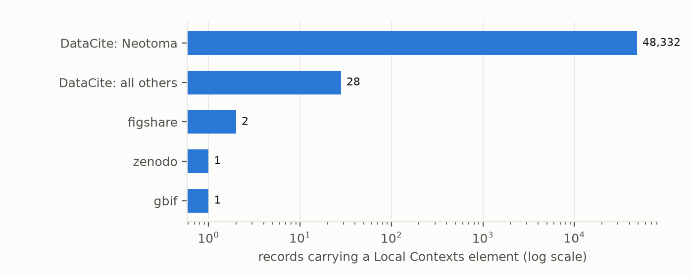
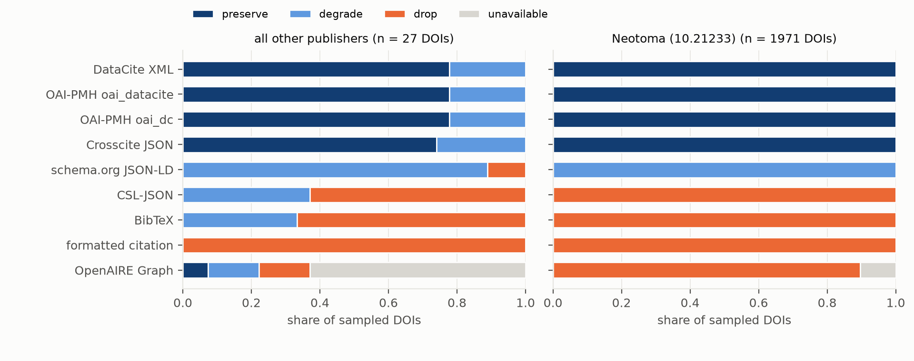

# Does Indigenous-governance metadata survive the open-data pipeline?

*A census of Local Contexts Notices and TK/BC Labels across nine open research-data platforms, and a test of whether
those elements survive the nine machine views through which a DOI's metadata is copied onward.*

**Verdict: Supported, on both counts, with one large caveat.** The open-data layer's Local Contexts metadata is
almost entirely one repository's.

- **Community Labels are vanishingly rare (H1, Supported).**
  - Of 48,361 records carrying any Local Contexts element, **one** carries a TK or BC Label backed by a live Local
    Contexts Hub project: 0.002% (exact 95% CI 0.00005–0.012%), against a threshold of 0.1%.
  - 99.94% of element-bearing records come from one repository, the Neotoma Paleoecology Database. Without Neotoma it
    is 1 of 29 records.
- **Machine views drop the element (H2, Supported).** Across 1,998 sampled DOIs and up to nine views each, the
  element is dropped in **43.6%** of record × view pairs (95% CI 43.5–43.7%), against a threshold of 40%.
  - **For publishers other than Neotoma**, whose records more often carry the element in free text that citation
    formats keep, the share is 30.5% (25.4–35.2%).
- **The loss is set by the format, not by the record.**
  - **Formats that keep it.** DataCite XML, both OAI-PMH formats and Crosscite JSON carry it in every record that has
    it as a rights entry.
  - **Formats that drop it.** BibTeX, CSL-JSON, the formatted citation and the OpenAIRE Graph drop it almost always.
  - **Schema.org JSON-LD**, the format search engines read, merges it into `license`, where it cannot be told apart
    from the licence.
- **No view says anything was dropped (H2b).** None of the 17,762 views that returned a record warns that a rights
  element was dropped.

These counts describe repository systems, not communities. Labels may be meant to live in the Hub and on landing
pages rather than in DOI metadata. The study measures what a machine consumer can see.

## In plain terms

Indigenous communities now have a formal way to attach their own conditions to data about them: "Labels", applied
through a system called Local Contexts. Institutions can also attach "Notices" saying that such conditions may
apply. Repository systems have built support for both. We asked two plumbing questions:
- Do these marks show up in the open research-data layer?
- Do they survive when the record is copied into the standard formats that other systems read?

We searched nine platforms and found about 48,000 records carrying a Local Contexts mark. Almost all came from one
paleoecology database, which marks every record with the same institutional Notice. Only one record anywhere carried
a community Label linked to a live Local Contexts project.

We then followed 2,000 of these records through nine common export formats:
- **The full metadata formats kept the mark.** These are DataCite XML, the OAI-PMH feeds and Crosscite JSON.
- **The citation formats lost it.** BibTeX, CSL-JSON and the plain formatted citation, which reference managers
  use, almost always threw it away.
- **The research graph lost it.** So did OpenAIRE, a large European research-information graph.
- **The search-engine format blurred it.** The schema.org format that search engines read folded it into the
  licence, so a machine cannot tell the two apart.
- **No format ever said that something had been left out.**

This is about the pipes, not the communities. Labels may be meant to live on the Local Contexts Hub, and absence
from DOI records is not, by itself, a failing.

## What was asked

The lead (`ancestral-tk-notice-machine-readability`, Ancestral Futures) asked whether Indigenous-governance metadata
is present but not machine-readable downstream. Preregistered hypotheses (`plan.md`):
- **H1:** fewer than 0.1% of element-bearing records carry a community-authored TK/BC Label resolvable to a Hub
  project.
- **H2:** the element is dropped in at least 40% of record × machine-view pairs.
- **H2b:** no lossy view signals the loss.

## What was already known

| Work | What it established | What it left open |
| --- | --- | --- |
| Local Contexts and the DataCite, Dryad, Dataverse and RAiD integrations (2022 onwards) | a vocabulary of 30 Labels and 12 Notices, and rights-field support in major schemas | no count of uptake across platforms |
| Dataverse GitHub issues #8129, #5920, #4176 | rights fields can be lost in the dc:rights / oai_dc crosswalk | no measurement across formats |
| CARE principles; Te Mana Raraunga | Indigenous data governance requires provenance and protocols to travel with data | no test of whether the machinery carries them |

## How it was done

**Census (limb 1).** Nine platforms were queried through their public APIs for Local Contexts URIs and exact
vocabulary names:
- DataCite: structured rights fields and free text;
- Zenodo, Dryad, Harvard Dataverse, figshare and OSF;
- GBIF, including machine tags;
- RAiD and re3data.

Every raw response is saved.
- **OSF's search failed** with 503s and is reported as unavailable, not as zero.
- **Two paging bugs** (Zenodo's page-size limit; RAiD's cursor) were fixed before the census was scanned (D2, D3).
- **Name-only hits.** All 69 records matched only by a vocabulary name in free text were adjudicated by hand. 2 were
  genuine; the rest were mostly empty template fields and texts about Local Contexts, and are dropped.
- **URIs.** Every distinct Local Contexts URI was resolved: 21 of 24 live, and 3 Hub projects dead.

**Crosswalks (limb 2).**
- **The sample.** All non-Neotoma element-bearing DataCite DOIs, with Neotoma filling the sample to 2,000 (seed
  20261021).
- **The nine views.** Six DOI content-negotiation formats (DataCite XML, schema.org JSON-LD, Crosscite JSON,
  CSL-JSON, BibTeX, formatted citation); DataCite OAI-PMH `oai_dc` and `oai_datacite`; and the OpenAIRE Graph record.
- **Scoring**, by a deterministic parser:
  - **preserve:** the element's URI or name is in a rights-type field, distinct from the licence;
  - **degrade:** it appears only in the licence field or in free text;
  - **drop:** it is absent;
  - views that return nothing are excluded.
- **Exclusion.** Two sampled DOIs whose element was later judged not genuine (a conference abstract) are excluded
  (D4).

**Hand check.** 100 record-views, stratified by view with each view's rare calls oversampled, were checked against
the raw responses. All 100 scorer calls are right under the URI-or-name definition. In one DOI's citation formats,
the Attribution Incomplete Notice's wording survives without its name or URI. That is a drop by definition, and
unidentifiable to a machine.

## Results

### H1: how many records carry a community Label?

| | records with any element | Label with a live Hub project | share (exact 95% CI) |
| --- | --- | --- | --- |
| all platforms | 48,361 | 1 | 0.002% (0.00005–0.012%) |
| without Neotoma | 29 | 1 | 3.4% (0.09–17.8%) |

**H1, Supported.** The upper end of the interval, 0.012%, is below 0.1%.
- **The one record** is a Victoria University of Wellington figshare dataset (10.26686/wgtn.25790481), carrying a BC
  Provenance Label and a live Hub project.
- **Neotoma's records.** Neotoma's 48,332 records each carry the Open to Collaborate *Notice* URI, under the name of
  the *TK Open to Collaboration Label* and with no Hub project. That naming mismatch is why "Label" names appear in
  48,333 records, while none of those carries a community-applied Label.
- **The other 28 element-bearing records:**
  - 27 DataCite DOIs: the Gump South Pacific Research Station and Tetiaroa Society on Mo'orea, iPlaces, ADA
    Dataverse (Dja Dja Wurrung material), Landcare Research's NZ Arthropod Collection, and Zenodo;
  - a second Victoria University of Wellington figshare record.
  - The Zenodo and GBIF platform hits duplicate DataCite DOIs and are counted once.
- **Notices dominate.** Of 28 records with a Hub project link, most carry a BC or TK Notice. Notices are placed by
  researchers or institutions, not by communities.



*Figure 1. Records carrying a Local Contexts element, by platform (log scale). Neotoma is shown separately from every
other DataCite publisher.*

### H2: what survives the crosswalks?

**H2, Supported.** 7,750 of 17,762 record × view pairs drop the element: **43.6%** (record-cluster bootstrap 95% CI
43.5–43.7%).
- **Why the interval is so narrow.** Nearly every record behaves the same way in each view.
- **By stratum.** The share is 43.8% for Neotoma's 1,971 DOIs and 30.5% (25.4–35.2%) for the 27 DOIs of other
  publishers.
- **What drives the difference.** The other publishers' records put the notice text in fields that CSL-JSON and
  BibTeX carry as `copyright` or a note, so those views degrade instead of dropping it.

| view | preserve | degrade | drop | unavailable |
| --- | --- | --- | --- | --- |
| DataCite XML | 1,992 | 6 | 0 | 0 |
| OAI-PMH oai_datacite | 1,992 | 6 | 0 | 0 |
| OAI-PMH oai_dc | 1,992 | 6 | 0 | 0 |
| Crosscite JSON | 1,991 | 7 | 0 | 0 |
| schema.org JSON-LD | 0 | 1,995 | 3 | 0 |
| CSL-JSON | 0 | 10 | 1,988 | 0 |
| BibTeX | 0 | 9 | 1,989 | 0 |
| formatted citation | 0 | 0 | 1,998 | 0 |
| OpenAIRE Graph | 2 | 4 | 1,772 | 220 |

- **The rights-bearing views keep it.** These are DataCite's own XML, both OAI-PMH formats (including `oai_dc`,
  despite the Dataverse crosswalk issues) and Crosscite JSON. Their few "degrade" calls are records whose repository
  put the notice in the description in the first place; the crosswalk did not cause them.
- **Schema.org JSON-LD**, the format read by dataset search engines, lists the Local Contexts URI in `license`,
  alongside the Creative Commons licence. A consumer cannot tell a governance notice from a licence.
- **The citation formats drop it,** as they were not designed to carry rights.
- **The OpenAIRE Graph,** an aggregator copy, drops it in 99.7% of the records it holds.

**H2b.** None of the 17,762 views that returned a record contains a warning that a rights element was omitted.



*Figure 2. Whether each machine view preserves, degrades or drops the element, by view, for sampled DOIs. Other
publishers (left) and Neotoma (right).*

## What this does and does not show

- **Uptake in the DOI layer is one institution's Notice.** Community-applied Labels, the element designed to carry a
  community's own conditions, are almost absent: one record across nine platforms. This may reflect where Labels are
  meant to live, on the Hub and on landing pages, and the newness of the system. Absence from DOI metadata is not by
  itself a failing.
- **Where the element is a proper rights entry, DataCite's own formats carry it faithfully.** The loss happens in the
  formats that most downstream tools use: citation formats, the schema.org markup search engines read, and an
  aggregator graph. None of them says so.
- **The verdicts are dominated by one repository.** H2's pooled share is effectively Neotoma's. Other publishers'
  practice (free-text notices, Hub project links) is too sparse, 27 DOIs, to generalise.
- **Not shown:** whether any community wants more visibility; landing pages and the Hub itself; non-DataCite DOI
  registries; full-text recall outside the searched fields (counts are lower bounds).
- **Care note.** No community's data was analysed, and no collection is judged. Engagement with Local Contexts, the
  repositories and Te Mana Raraunga / Pacific data-governance advisers is recommended before these counts are used to
  rank platforms.

## Process and deviations

Preregistered in `plan.md`, with all code committed before the outputs it produces. Deviations are in
`deviations.md`:
- **D1:** testing on neutral terms only; OSF unavailability recorded; the aggregator is OpenAIRE only; the H2 unit;
  the care note.
- **D2:** the Zenodo page-size bug, fixed before the census was scanned.
- **D3:** RAiD cursor paging.
- **D4:** H2 excludes DOIs whose element was judged not genuine; the hand check.

## Reproducing it

```
venv/bin/python code/census.py; venv/bin/python code/census.py scan      # limb 1 (all raw responses saved)
venv/bin/python code/precision.py                                       # adjudication of name-only hits
venv/bin/python code/resolve_uris.py; venv/bin/python code/views.py      # limb 2 (18,000 record-views)
venv/bin/python code/handcheck.py                                       # hand-check sheet
venv/bin/python code/analysis.py; venv/bin/python code/figures.py
```

**Released** in `results/tables/`:
- `primary.json`;
- the census and view matrices, including by stratum;
- `precision.csv`, `handcheck.csv` and `vocabulary.json`.
