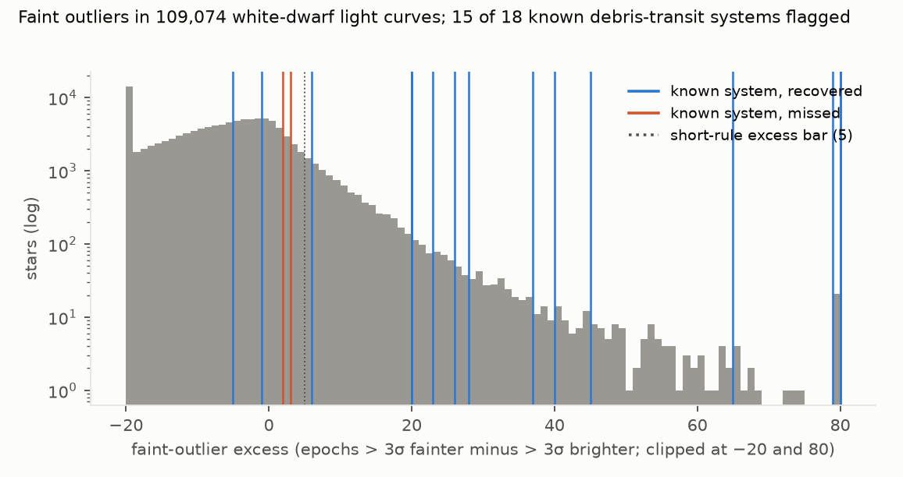
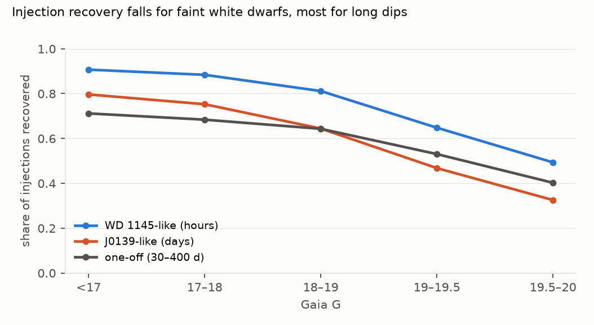
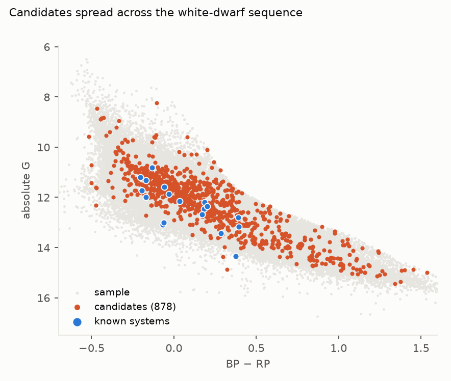

# How common are debris transits around white dwarfs? Known systems alone give about 1 in 5,000 within 500 pc after correcting for what ZTF can detect, but nearly 900 unvetted candidates leave the rate unbounded above

*109,074 Gaia white dwarfs within 500 pc with at least 100 good ZTF epochs were searched blind with two preregistered
rules: recurring faint outliers (hour-scale dips) and runs of faint 30-day bins (day- to year-scale dimming). The 20
known debris-transiting white dwarfs were compiled from the discovery papers and committed before detection was run.
Completeness comes from 150,000 injected signals. The plan was committed before any light curve was fetched.*

**Verdict: H1 Inconclusive.** The rate of ZTF-detectable debris transits lies between 2.1 × 10⁻⁴ (known systems
alone) and 1.2 × 10⁻² (every unvetted candidate counted). The bar of 5 × 10⁻⁴ falls between those two bounds.

- **H1 (the occurrence of ZTF-detectable debris transits, all classes combined, is below 5 × 10⁻⁴):
  Inconclusive.**
  - **Lower rate:** 15 recovered known systems over a completeness-weighted sample of 72,748 stars gives
    **2.1 × 10⁻⁴** (95% Poisson 1.2 × 10⁻⁴ to 3.4 × 10⁻⁴). Its lower limit is below 5 × 10⁻⁴, so H1 is not
    Refuted.
  - **Upper rate:** adding the 878 unexplained candidates gives **1.2 × 10⁻²** (1.15 × 10⁻² to 1.31 × 10⁻²). Its
    upper limit is above 5 × 10⁻⁴, so H1 is not Supported.
  - Read on its own, the lower rate says that known systems alone already amount to about 1 in 5,000 white dwarfs
    once detectability is accounted for. A rate below 5 × 10⁻⁴ is plausible, but only vetting the candidates could
    show it.
- **The positive controls work.** 18 of the 20 known systems are in the sample (one is fainter than G = 20, one
  beyond 500 pc), and the rules flag 15 of them.
  - The three missed are SDSS J0107+2107 (continuous shallow dips), SBSS 1232+563 (sporadic dimming) and WD 1054−226
    (dips of a few per cent, with only 207 epochs).
  - Of the 15 recovered, three are flagged by the short-dip rule alone, six by the long-dip rule alone, and six by
    both.
- **Completeness.** Injected signals are recovered 66% of the time for WD 1145-like hour-scale dips, 50% for
  J0139-like day-scale dips and 53% for one-off dimming lasting 30–400 days. Recovery falls for fainter stars (F2).
- **The candidates are mostly long-dip flags.**
  - 914 stars are flagged, and 21 of them are CVs in Gaia DR3's variability classification. That leaves 878
    candidates beside the 15 known systems: 653 flagged by the long-dip rule only, 205 by the short-dip rule only,
    and 20 by both.
  - The long-dip rule is sensitive to its threshold. At 3 standard errors instead of 5 it flags 7,130 stars, at 7 it
    flags 138, so most long-dip flags are probably slow photometric trends rather than dimming events.
  - The list is not vetted. It is in `results/tables/candidates.csv` (Gaia DR3 source IDs, public facts).
- **Implied geometry.** If a quarter to a half of white dwarfs are metal-polluted, the lower rate implies a transit
  probability × duty cycle of 4 × 10⁻⁴ to 8 × 10⁻⁴ among polluted stars (descriptive).

## In plain terms

When a white dwarf, the dense remnant of a star like the Sun, tears apart an asteroid or small planet, the dusty
debris can pass in front of it and make it dim. About twenty such stars are known, most found in the last five years
in data from the Zwicky Transient Facility (ZTF), a telescope that photographs the northern sky every few nights. How
common are they?

We took about 110,000 white dwarfs within 500 parsecs (about 1,600 light-years) that ZTF has observed at least 100
times. We searched each one's brightness record with two simple rules fixed in advance: repeated sudden faint
measurements, and months-long stretches of dimming. The rules found 15 of the 18 known debris-transit stars in our
sample. By planting fake dimming events into real light curves, we measured how often the rules would catch such
a star: about half to two-thirds of the time.

Counting only the known systems, and correcting for what the search can catch, about 1 in 5,000 of these white
dwarfs shows detectable debris transits. The rules also flagged nearly 900 other stars. Most are probably slow
drifts in the measurements rather than debris, but until each is checked, the true rate could be anywhere from
about 1 in 5,000 to about 1 in 80. So the study cannot say whether the rate is below the 1-in-2,000 bar the lead
proposed.

## What was asked

The lead (`astronomy-ztf-wd-debris-transit-occurrence`) asked how common debris transits are among white dwarfs,
predicting an occurrence below 5 × 10⁻⁴ for ZTF-detectable systems.
- **Known systems** have come from targeted discoveries: WD 1145+017 (Vanderburg et al. 2015), ZTF J0139+5245
  (Vanderbosch et al. 2020), ZTF J0328−1219 (Vanderbosch et al. 2021), candidates from a ZTF and Gaia variability
  survey (Guidry et al. 2021), WD 1054−226 (Farihi et al. 2022), SBSS 1232+563 (Hermes et al. 2025), six ZTF
  candidates (Bhattacharjee et al. 2025) and six long-lived obscuration events (van Roestel et al. 2026, an
  unrefereed preprint listing 20 systems in total).
- **No completeness-corrected occurrence rate** across a volume-limited white-dwarf sample was found. This study
  provides bounds with an explicit injection-recovery completeness.

## How it was done

- **Sample** (`code/sample.py`): Gentile Fusillo et al. (2021) Gaia EDR3 white dwarfs with P_WD > 0.75, G < 20,
  declination > −28° and parallax > 2 mas: 121,838 stars. Positions were propagated to epoch 2019.0.
- **Light curves** (`code/fetch_lc.py`): the IRSA ZTF light-curve service (DR23) within 2 arcsec, good epochs only
  (catflags = 0, magerr < 0.25). Per filter, the ZTF object with the most good epochs is kept.
  - 117,193 stars returned good epochs (13 queries failed; the rest had no ZTF object or no good epochs).
  - 109,074 have at least 100 good epochs (median 1,049) and form the eligible sample.
- **Rules** (`code/detect.py`, as preregistered):
  - **Short dips:** robust σ (1.4826 × MAD) per filter; faint and bright 3σ outliers pooled over g and r. A star is
    flagged if faint − bright ≥ 5, the one-sided binomial p < 10⁻⁶, and the faint epochs fall on at least 3 nights.
  - **Long dips:** flux relative to each filter's median, pooled into 30-day bins of at least 5 epochs. A star is
    flagged if at least 2 bins sit more than 5 standard errors and at least 5% below the global median.
- **Known variables removed:** Gaia DR3 `vari_classifier_result` classes ECL, CV, RS and SOLAR_LIKE (21 CVs among
  the flagged stars). Name lists of known CVs and AM CVn systems were not obtained.
- **Positive controls** (`results/tables/known_systems.csv`): the 20 known systems, compiled from the papers' tables
  by a separate agent session that never saw the light curves, and committed before detection.
- **Completeness:** 5,000 random eligible stars that were not flagged × 3 signal classes × 10 injections, with
  parameters drawn as in the plan. Box-shaped dips were applied as flux multipliers, with errors scaled by
  (flux)^−½; injected epochs fainter than 21.0 mag were dropped as non-detections. These details were fixed in the
  code before any detection run. Completeness C_k is tabulated by G and number of epochs and assigned to every
  eligible star.
- **Rates:** N / Σ C_k with Poisson (Garwood) intervals; the combined rate takes each star's best class.

## Results (`results/figures/F1_excess.png`, `F2_completeness.png`, `F3_cmd.png`)

| class | Σ completeness | known recovered | lower rate (95%) | upper rate (95%) |
|---|---|---|---|---|
| WD 1145-like (hours) | 72,581 | 4 | 5.5 × 10⁻⁵ (1.5–14) × 10⁻⁵ | 1.2 × 10⁻² |
| J0139-like (days) | 54,537 | 5 | 9.2 × 10⁻⁵ (3.0–21) × 10⁻⁵ | 1.6 × 10⁻² |
| one-off dimming | 58,201 | 6 | 1.0 × 10⁻⁴ (3.8–22) × 10⁻⁵ | 1.5 × 10⁻² |
| **combined (best class per star)** | **72,748** | **15** | **2.1 × 10⁻⁴ (1.2–3.4) × 10⁻⁴** | **1.2 × 10⁻² (1.15–1.31) × 10⁻²** |

Known systems are assigned to a class by the dip type their papers describe; the upper rates add all 878 candidates
to every class.

- **By distance** (known recovered / candidates / Σ completeness): ≤ 100 pc 2 / 101 / 7,857; 100–200 pc
  7 / 222 / 21,543; 200–500 pc 6 / 555 / 43,348.
- **Threshold variants** (secondary): the short-dip rule flags 326 stars at 2.5σ and 158 at 3.5σ; the long-dip rule
  flags 7,130 at 3 standard errors and 138 at 7.
- **Faint-outlier asymmetry.** Most stars (77%) have more bright than faint outliers (median excess −6). Near ZTF's
  detection limit, faint epochs go missing while bright ones are kept, which works against the short-dip rule for
  faint stars.

## What this does and does not show

- **Known systems alone set a floor of about 2 × 10⁻⁴.** That is a completeness-corrected rate of ZTF-detectable
  debris transits among white dwarfs within 500 pc. Most known systems (all but WD 1145+017 and WD 1054−226) were
  themselves found in ZTF data, so the floor reflects what has been found, not what exists.
- **The ceiling is set by unvetted flags, not by debris.** Without vetting, the 878 candidates make the upper bound
  60 times the lower. Most are long-dip flags on faint stars, a pattern that systematics produce as easily as dust.
- **Completeness is moderate and falls with magnitude.** Shallow or sporadic dimming, like the three missed known
  systems, is often missed.
- **Not shown:**
  - **Vetting of the candidates** (follow-up photometry, spectroscopy, or inspection of neighbours and image
    artefacts).
  - **Systems fainter than G = 20, beyond 500 pc, or south of −28°.**
  - **Transits too shallow or too rare for ZTF's cadence,** which these rates do not count.
  - **Physical rates.** Geometry and duty cycle are not separated; the polluted-star figure is descriptive.

## Process and deviations

- **Preregistration:** `plan.md`, committed before any light curve was fetched. The detection, injection and
  occurrence rules were committed before detection was run; the positive-control list was committed after the code
  and before detection.
- **Deviations** (`deviations.md`): D1, the float-rounded Gaia IDs found after the first detection pass and fixed
  before any result was written up; implementation details of light-curve selection and injections.
- **Quality gates:** G1 (plan section 3), G2 (coverage counts above and in `results/tables/coverage.json`), G5
  (`review/overclaim_check.md`) and G6 (`results/attribution_ledger.csv`).
- **Independent review:** queued (Fable), per the lab's pacing rule.

## Reproducing it

1. Download the Gentile Fusillo et al. (2021) catalogue FITS into `data/raw_cat/`.
2. `code/sample.py`, then `code/fetch_lc.py 16` (days; IRSA serves one star per query).
3. `code/fix_ids.py` (only needed for light curves fetched before the ID fix).
4. `code/detect.py detect`, `code/variables.py`, `code/detect.py inject`, `code/detect.py occurrence`.
5. `code/figures.py`.
