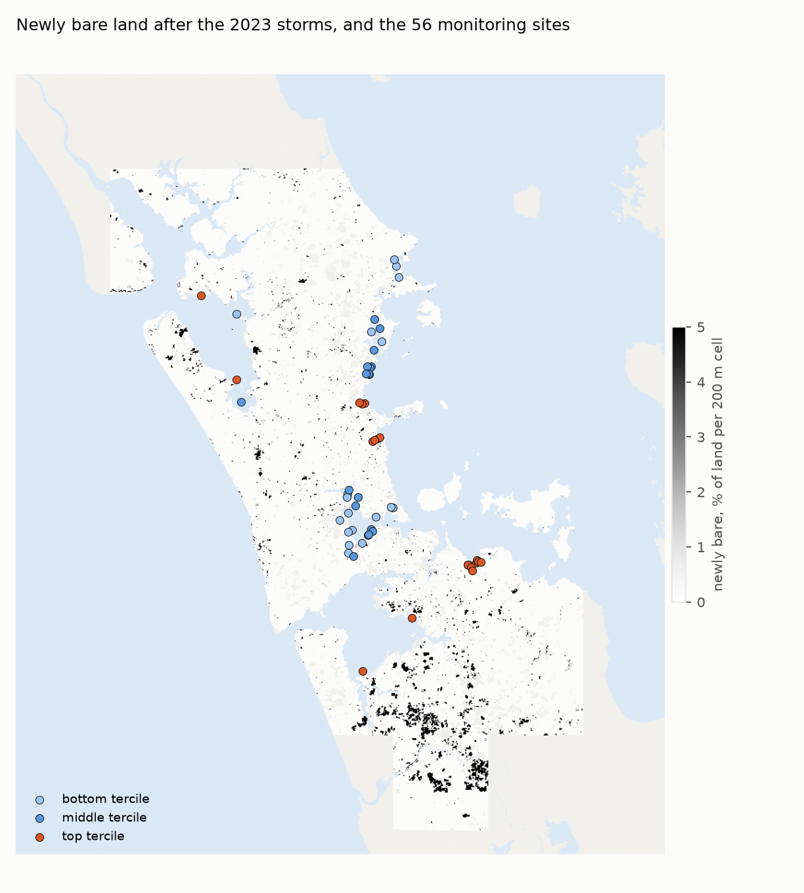
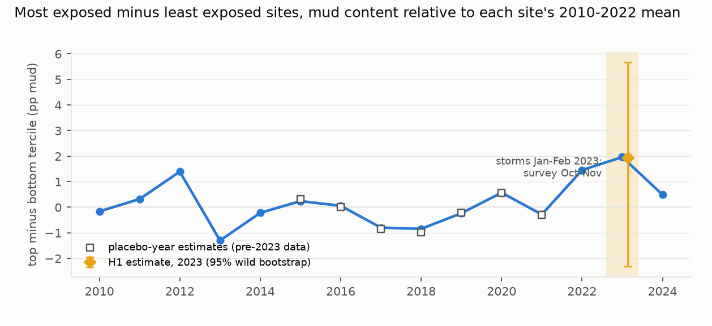
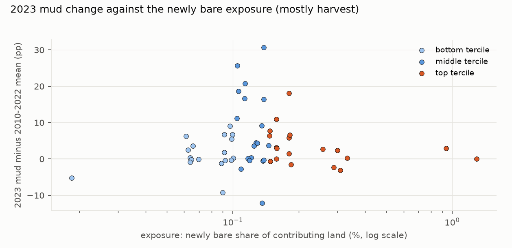

# Auckland's estuary sites were muddier in the spring after the 2023 storms; a satellite exposure measure, which mostly captured harvest rather than slips, did not explain where

*56 Auckland Council estuary monitoring sites (13 harbours) with mud content in at least 5 years from 2010 to 2022 and
a survey in October–November 2023. Each site was given a storm exposure: the share of land draining to the coast
within 5 km of it that turned from vegetated to bare between November–December 2022 and February–April 2023, mapped
from Sentinel-2. The site list, the exposure and its terciles were frozen and committed before any outcome was read.
This version incorporates an independent review (`review/review.md`; D5).*

**Verdict: Inconclusive (H1 and H2).**

- **H1 (the most exposed third of sites gained at least 4 percentage points more mud in 2023 than the least exposed
  third): Inconclusive.**
  - The difference is **+1.9 pp** (95% wild cluster bootstrap −2.3 to +5.7; CR2 −1.7 to +5.5), on 37 sites in 11
    harbours.
  - It is below the 4 pp threshold, but the interval does not exclude 4. By 2024 the difference is +0.5 pp (−3.4 to
    +3.8).
- **H2 (mud rose with exposure, as a dose-response): Inconclusive.**
  - The estimate is **−0.2 pp** per interquartile range of exposure (wild bootstrap −3.1 to +3.2), on all 56 sites.
  - **It is in effect a two-site test.** 87% of the identifying variation comes from two Manukau sites beside the
    Pukekohe market-garden belt (Auckland Airport and Clarks Beach). The effective number of clusters is about 1 of
    13.
  - The CR2 interval (−0.6 to +0.1) is anti-conservative with so few effective clusters. The wild bootstrap governs.
- **The 2023 difference.**
  - The top-minus-bottom difference of +1.96 is the largest in the 15-year series and larger than every placebo year
    (2015–2021, −1.0 to +0.6).
  - But 2022, before the storms, was already +1.45, so 2023 exceeds the pre-storm year by only about 0.5 pp.
- **What did happen (post hoc): a region-wide 2023 mud pulse.**
  - Across all 56 sites, 2023 mud content was **+4.3 pp** above each site's own 2010–2022 mean (site bootstrap 2.3 to
    6.3; harbour-clustered 2.3 to 7.0). Every earlier year's mean lies between −1.3 and +1.7.
  - 70% of sites rose. By 2024 the excess was +1.1, and that fade holds within the same 42 sites.
  - **It is concentrated, not universal.** Six harbours rose by 4–16 pp, seven by 2.6 or less, and the site median
    is +2.6.
  - It survives the review's artefact checks: continuously sampled sites, leaving each year out, and the change of
    value format (2020).
  - The fixed-effects design absorbs any shared jump into the year effect, so H1 and H2 cannot see it.
  - With no clean control region, the pulse is consistent with the storms but cannot be attributed to them.
- **The exposure measure is mostly harvest, not slips, so H1 and H2 did not test storm exposure.**
  - 63% of newly bare area is in patches over 5 ha: market-garden and plantation harvest.
  - Newly bare density is 3.3% around Pukekohe and 1.1% at Woodhill forest, against 0.02–0.12% in the known slip
    clusters (Muriwai, Piha, Titirangi, Birkenhead).
  - The two most exposed sites sit beside the Pukekohe market-garden belt.
  - An added exposure counting only slip-sized patches (1 ha or less; D3) gives the same answer: +1.2 pp (−4.7 to
    +8.3) and −0.05 pp per IQR (−3.7 to +5.1).

## In plain terms

In January and February 2023, record rain and Cyclone Gabrielle set off thousands of slips around Auckland. Mud
smothers estuary life, so we asked whether the estuaries that received the most stripped land got muddier.

Auckland Council samples the mud at dozens of estuary sites every spring. We used satellite images to measure, for
each site, how much nearby land had gone from green to bare over the storm summer. We fixed those numbers and wrote
them down before looking at any 2023 mud results.

In the spring after the storms, Auckland's estuary sites were muddier than usual, by about 4 percentage points on
average. That is a larger jump than in any year since 2010, concentrated in about half the harbours. A year later most
of that extra mud was gone. We cannot prove the storms caused it, because there is no clean comparison region, but
nothing else about 2023 stands out in the record.

Our satellite measure turned out mostly to capture vegetable gardens and pine plantations being harvested, not storm
slips. So the main test, whether the most exposed sites got muddiest, was really a test of land near harvest, not near
slips. The sites nearest harvested land gained about 2 points more than the least exposed, but they were already about
that much muddier in 2022, before the storms. The study cannot rule out an effect of the size we looked for. It could
not test whether slips specifically fed the extra mud, and a single survey each spring may miss mud that washed
through within weeks.

## What was asked

The lead (`auckland-nz-2023-storms-estuary-mud-natural-experiment`, Auckland signature area) asked whether the 2023
storms produced an exposure-graded step change in estuary mud. It was framed as a natural experiment on a monitoring
network with a 13-year pre-period. No exposure-graded test was found in the literature or in Auckland Council's
reporting. Auckland Council's pilot mapped bare-earth sources in five catchments, but did not link them to estuary
outcomes.

The plan (`plan.md`) was committed before any 2023 or 2024 value was viewed.

## How it was done

- **Sites and outcome:**
  - LAWA Estuary Health v2 (data to September 2025): Auckland Council sites with mud content (% finer than 63 µm) in
    at least 5 years from 2010 to 2022 and a 2023 survey. That gives 56 sites, 42 of which also have 2024.
  - Every 2023 and 2024 survey is dated October or November, after both storms.
- **Exposure (frozen in commit d2411cf before any outcome was read):**
  1. **Elevation.** The LINZ national LiDAR mosaic, read at 20 m (D1). Harbour water is hydro-flattened in the DEM,
     so the sea is DEM no-data, cells at or below 0 m, or Sentinel-2 water, wherever connected to the open sea (D1
     addendum).
  2. **Routing** by priority-flood (D2), after pysheds left interior sinks that absorbed 23% of the land.
     - 91.8% of land drains to the sea, and the rest off the domain edge.
     - Each site's contributing land is every land cell whose coastal outlet lies within 5 km of it (median 67 km²).
  3. **Newly bare.** Per-pixel median Sentinel-2 NDVI at 10 m over clear land observations:
     - at least 0.5 in 1 November – 31 December 2022, and at most 0.3 in 15 February – 30 April 2023;
     - at least 2 clear observations in each window;
     - 115 and 163 scenes; 24 blocks of 20 km.
  4. **Exposure:** newly bare pixels as a share of valid pixels in the contributing land. The median valid share is
     0.81.
- **Models:**
  - Site and year fixed effects, 2010–2024.
  - **H1:** top against bottom tercile, with Top × 2023 and Top × 2024 terms.
  - **H2:** all sites, with Exposure × 2023 and Exposure × 2024 terms, scaled to the exposure IQR.
  - **Inference:** a wild cluster restricted bootstrap by harbour (Webb weights, 9,999 draws, interval by test
    inversion). CR2 (Bell–McCaffrey) intervals alongside.
- **Secondary analyses:**
  - an event study and seven placebo years;
  - leaving out each harbour;
  - exposure radius 2 and 10 km, and radius-only exposure without routing;
  - dropping year-only rows;
  - macrofauna and metals;
  - the slip-sized exposure (D3).
- **Validation against the pilot.** The council's pilot bare-earth layer could not be used. Its terms restrict it to
  the pilot viewer.

## Results

### Exposure (`results/figures/F1_exposure_map.png`)

- **Size.** Newly bare land is a small share of the land draining to each site:
  - median 0.13% (range 0.02% to 1.29%);
  - tercile cuts at 0.100% and 0.147%.
- **What it is.** It is concentrated in large rectangular patches:
  - market gardens around Pukekohe and the Manukau's southern shore;
  - plantation-forest harvest on the west coast.
- **Patch sizes.** Slip-sized patches (1 ha or less) hold 14% of newly bare area, and patches over 5 ha hold 63%.
- **Sensitivity to the definition.** Exposure at 5 km correlates only moderately with exposure at 2 km (Spearman
  0.57) or with radius-only exposure at 5 km (0.40).

### H1 and the event study (`results/figures/F2_event_study.png`)

| | estimate (pp) | 95% wild bootstrap | 95% CR2 |
|---|---|---|---|
| top − bottom tercile, 2023 (H1) | +1.93 | −2.33 to +5.67 | −1.68 to +5.55 |
| top − bottom tercile, 2024 | +0.48 | −3.38 to +3.77 | −2.86 to +3.81 |

- **Placebo years** (2015–2021, pre-2023 data only): −0.99 to +0.56. None is as large as 2023.
- **The event study** (top minus bottom tercile, each site against its own 2010–2022 mean):
  - +1.45 in 2022, before the storms;
  - +1.96 in 2023;
  - +0.49 in 2024.

  The 2012 and 2013 values swing by similar amounts (+1.39 and −1.30).
- **Leaving out one harbour at a time:** H1 runs from +1.0 to +2.8.
- **Dropping year-only rows:** +1.45 (−3.21 to +5.81). This removes the 11 biennially sampled Waitematā Central
  sites, 7 of them in the bottom tercile.
- **Other exposure definitions:**
  - routed 2 km: −2.56; routed 10 km: +1.52;
  - radius-only: −2.15 (2 km), −2.06 (5 km), +2.54 (10 km);
  - every interval includes 0.

### H2: dose-response (`results/figures/F3_dose_response.png`)

- **Estimate:** −0.21 pp per IQR of exposure (wild bootstrap −3.06 to +3.20; CR2 −0.57 to +0.15). For 2024: −0.09
  (−1.09 to +1.10).
- **Why the two intervals differ.** The wild bootstrap interval is about ten times the CR2 interval. Two Manukau sites
  have far more exposure than the rest (Auckland Airport 1.29% and Clarks Beach 0.94%, against an IQR of 0.06%), and
  with 13 harbours the bootstrap is sensitive to them. Dropping the Airport site gives −0.18 (CR2 ±0.75).
- **Leaving out one harbour at a time:** −0.38 to −0.14 per IQR.

### A region-wide 2023 pulse (post hoc; `code/regional.py`, `results/tables/regional_2023.json`)

This analysis was added after the H1 and H2 results were read, because F3 showed large 2023 rises at middle-tercile
sites that H1 leaves out.

| | 2023 mean deviation from 2010–2022 site mean (pp) | range of 2010–2022 yearly means | 2024 |
|---|---|---|---|
| all 56 sites | +4.26 (site bootstrap 2.26 to 6.30) | −1.27 to +1.68 | +1.10 |

The regional table's Auckland row (2024: +2.26) uses all Auckland sites with at least 5 pre-2023 years; the +1.10
here uses the 56 frozen sites.
| bottom / middle / top tercile | +1.39 / +7.88 / +3.36 | | |

- **Breadth:** 70% of sites rose in 2023.
- **Why H1 and H2 miss it:** the year fixed effects absorb a shared 2023 jump. H1 and H2 test only whether it was
  graded by exposure.
- **Other regions** (sites with at least 5 pre-2023 years; exploratory) give no clean control:
  - Waikato (Firth of Thames, Raglan, Tairua), sampled October–November, as Auckland is: +5.4 (6 sites), driven by
    one site at +24.6.
  - Wellington: +4.1 (20 sites).
  - Northland (−3.1) and Hawke's Bay (−7.1) were sampled January to April 2023, around or just after Gabrielle.
  - Canterbury (−2.1) and Southland (+0.4) were not storm-hit.
  - Pre-2023 yearly means swing widely in these small samples.
- **Reading.** The pulse fits a storm effect that reached most of Auckland's estuaries, but it cannot be separated from
  a region-wide change in sampling or analysis.

### Slip-sized exposure (D3)

Counting only newly bare patches of 1 ha or less (Spearman 0.56 with the primary exposure):
- H1 contrast: +1.24 pp (−4.67 to +8.26);
- H2: −0.05 pp per IQR (−3.72 to +5.13).

Both are Inconclusive by the same rules.

### Other outcomes

- **Macrofauna.** LAWA's "Macrofauna – benthic health score" (values 0.3–6.0; by its range an AMBI-type disturbance
  score) shows no
  2023 contrast (+0.09, −0.45 to +0.42) and no 2024 contrast (−0.20, −0.59 to +0.20).
- **Copper, zinc and lead** were sampled at 12 sites in 2023: 8 in the bottom tercile and none in the top. These
  contrasts are therefore not estimable (D4).

## What this does and does not show

- **A region-wide jump.**
  - Mud content at Auckland's monitoring sites rose by about 4 pp in the spring after the storms, more than in any
    year since 2010, and most of the rise had faded by 2024.
  - It is concentrated in about half the harbours.
  - This is post hoc and descriptive, with no control region.
- **The exposure test did not test storm exposure.**
  - The frozen exposure mostly measures harvest.
  - The most-exposed-minus-least-exposed difference (+1.9 pp) is the largest in the series, but barely above the
    pre-storm 2022 value.
  - The dose-response rests on two sites, so its interval (±3 pp per IQR) cannot show its absence.
- **An effect of the preregistered size (4 pp) is not ruled out.**
  - The H1 upper bound is +5.7 pp (p = 0.21 at 4 pp).
  - The design is weaker than planned: co-located sites share almost all their contributing land, so the top tercile
    holds about 7 distinct exposures, not 19.
- **The exposure measure is the weakest link.**
  - **Mixed causes.** Optical "newly bare" mixes storm slips with harvest and construction, and harvest dominates.
  - **Gaps.** Cloudy post-storm imagery leaves about a fifth of contributing land without a valid comparison.
  - **Distance.** The sediment reaching a site may come from far up a harbour.
  - **Slip-only test.** The slip-sized exposure removes most harvest. It does not change the answer, but it is
    noisier.
- **Timing.** Annual October–November surveys measure mud 8–10 months after the storms. Fine sediment delivered in
  January–February may have been flushed or redistributed by then, and a transient pulse would be invisible here.
- **Not shown:**
  - that the storms left estuaries unharmed;
  - anything about sites outside the monitoring network, about subtidal or channel sediments, or about sediment
    accumulation rates.
- **Care.** No Māori data were used. The Kaipara and Manukau harbours are taonga under active mana whenua
  kaitiakitanga. Results like these belong with the forums that care for them, such as Kaipara Moana Remediation
  and the Manukau Harbour Forum. The lab cannot do that engagement itself.

## Process and deviations

- **Preregistration:** `plan.md`. The site list was frozen from dates and counts only.
- **Deviations** (`deviations.md`):
  - **D1:** national LiDAR mosaic at 20 m and a sea mask. Its addendum adds cells at or below 0 m, after the first
    sea mask missed the Waitematā.
  - **D2:** priority-flood routing, after pysheds left interior sinks.
  - **D3:** the slip-sized exposure. It was added after the exposure froze and the harvest problem was seen, and
    before any outcome result was read.
  - **D4:** metals reported as not estimable, after the analysis ran. No verdict depends on them.

  D1–D3 were made before any outcome was read.
- **Post hoc and descriptive:**
  - the region-wide 2023 pulse and the regional comparison (`code/regional.py`), added after the H1 and H2 results
    were read;
  - the high-leverage check for H2;
  - the patch-size shares;
  - the macrofauna scale description.
  - D5: framing after the review (the exposure is harvest, so H1/H2 did not test storm exposure; H2 is a two-site
    test; the 2023 difference is the series maximum but barely above 2022; the pulse is concentrated; smaller wording
    fixes).
- **Independent review:** Fable, 2026-10-23, "publish with edits" (`review/review.md`). The verdicts and every number
  were reproduced. A confirmation pass follows.

## Reproducing it

1. **Site list:** `code/sites.py`.
2. **Exposure pipeline:** `code/dem.py`, `code/seamask.py`, `code/route.py`, `code/bare.py` (about 8 hours of
   Sentinel-2 reads), `code/exposure.py` and `code/exposure_slips.py`.
3. **Analysis:** `code/analysis.py` (H1, H2 and secondary analyses → `results/tables/primary.json`,
   `event_study.csv`), `code/analysis_slips.py` (→ `slips.json`) and `code/regional.py` (→ `regional_2023.json`).
4. **Figures:** `code/figures.py`.
