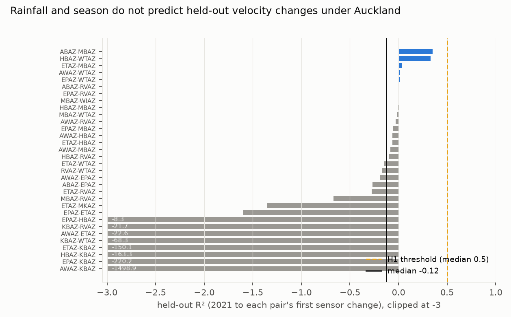
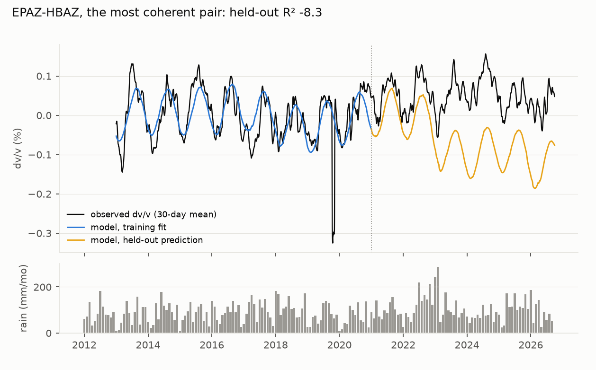

# Rainfall and season do not predict seismic velocity changes under the Auckland Volcanic Field: no hydrological baseline at 0.5–2 Hz, and a noise floor near 0.14%

*Daily ambient-noise cross-correlations for 55 vertical-component pairs of 11 GeoNet stations, 2013 to September
2026. dv/v is measured by stretching the coda at 0.5–2 Hz. A rainfall-diffusion, annual and drift model is fitted on
2013–2020 and tested, unchanged, from 2021. The plan was committed before any waveform was correlated.*

**Verdict: H1 Refuted.**

- **H1 (the hydrological model explains most of the held-out dv/v): Refuted.**
  - The median held-out R² across the 32 scored pairs is **−0.12** (95% pair bootstrap −0.67 to −0.03). No pair
    reaches 0.5.
  - The model explains little even in training: median R² 0.19.
- **It is not one modelling choice.** All of these leave the median between −0.12 and −0.14:
  - temperature in place of the annual sinusoid;
  - every sensor-epoch boundary treated as a break;
  - holding the drift term fixed (post hoc);
  - a draining instead of a cumulative rainfall kernel (post hoc).
- **The noise floor is 0.14%,** twice the held-out residual SD as a median across pairs. That is nearly three times
  the 0.05% the lead hoped for, and 0.09% even with every sensor change treated as a break.
- **Neither the March 2020 lockdown nor the record-wet January–February 2023 shows up.**
  - Lockdown: median step +0.007%; 2 of 32 pairs beyond twice their residual SD.
  - 2023 storms: median held-out residual +0.017% in 18 pairs; 1 beyond twice its residual SD.

## In plain terms

Volcanoes can announce themselves by subtly changing how fast seismic waves travel through the ground. Background
"noise" from waves, wind and traffic can be used to track those changes day by day. Before such a signal can warn of
anything under Auckland, we need to know how much it moves for ordinary reasons, mainly rain soaking into the ground
and the seasons.

We processed 13 years of continuous recordings from 11 GeoNet seismometers across Auckland's volcanic field. We
built a model of how rain and the seasons should change the wave speeds, trained it on 2013–2020, and checked
whether it predicted 2021–2026.

It did not. On the 32 station pairs with clean enough signals, the model predicted the later years worse than
simply guessing the average. The wave speeds wander by about 0.14% for reasons the model cannot account for. Even
the very wet 2023 summer, including Cyclone Gabrielle, left no clear mark. A volcanic signal would need to stand out
above that level to be seen with this method, so Auckland's monitoring cannot yet rely on a simple rain-and-season
baseline at these frequencies.

## What was asked

The lead (`auckland-nz-avf-dvv-hydrological-baseline`, Auckland and NZ signature area) asked whether ambient-noise
dv/v across the Auckland Volcanic Field has a predictable hydrological baseline, as at other volcanoes. Such a
baseline would set the noise floor for unrest detection. No dv/v monitoring of the field was found.

The critic's design fix: the model is trained on 2013–2020 and tested from 2021, with nothing refitted.

## How it was done

- **Correlations.** GeoNet day files are streamed from S3. Each station-day is:
  - decimated to 20 Hz and bandpassed at 0.3–5 Hz;
  - spectrally whitened, then normalised with a running absolute mean;
  - screened with a transient mask on 30-minute windows.

  30-minute cross-correlations (±100 s) are stacked daily for the 55 vertical-component pairs, needing at least 24
  windows a day.
- **dv/v.**
  - Stretching at 0.5–2 Hz on the symmetric coda, from t₁ = max(5 s, 2d / 1.5 km s⁻¹) to t₁ + 20 s.
  - The current stack is a 10-day moving stack, and the reference is the segment's 2013–2020 mean.
  - The result is smoothed with a 30-day running mean.
  - 53 pairs give dv/v.
- **The model:** segment constants + a · P_τ (rainfall diffused to depth, erfc kernel, τ from 1 to 500 days) + an
  annual sinusoid + a linear drift. It is ordinary least squares, with τ chosen by training fit.
  - Training runs 2013–2020. The held-out period runs from 2021 to the first sensor change of either station.
  - Pairs are scored with mean training coherence of at least 0.5 and at least 180 held-out days: 32 of 53.
- **Forcing:** ERA5 daily rainfall and temperature at the field's centre, from the Open-Meteo archive.

## Results

### H1 (`results/figures/F1_heldout_r2.png`)

| analysis | scored pairs | median held-out R² (95% CI) | median noise floor (2 SD) |
|---|---|---|---|
| **preregistered** | 32 | **−0.12 (−0.67 to −0.03)** | **0.136%** |
| every epoch boundary a break (secondary 4) | 32 | −0.12 (−0.44 to −0.01) | 0.094% |
| temperature in place of the sinusoid (secondary 5) | 32 | −0.13 | 0.134% |
| drift held at its end-of-training value (post hoc) | 32 | −0.14 | — |
| draining rainfall kernel exp(−lag/τ) (post hoc) | 32 | −0.12 (−0.83 to −0.06) | 0.141% |

- **The fitted τ** piles up at the ends of its grid (1 day for 11 pairs, 500 days for 9), as expected when the rain
  term has no stable relation to dv/v.
- **By pair type:**
  - borehole–borehole pairs: −0.23 (20 pairs);
  - pairs with a surface sensor: −0.01 (12 pairs).
- **Coherence.** Median training coherence is 0.51 across 53 pairs, and the most coherent pair reaches 0.98.

### What fails (`results/figures/F2_example_pair.png`)

- **In training.** On the most coherent pair (EPAZ–HBAZ), the model captures an annual cycle in 2013–2020.
- **From 2021.** The observed dv/v drifts upward. Meanwhile the model's rain term, carrying the wet 2022–23 anomaly,
  pulls its prediction down. The cycle is real, but neither its phase in later years nor the slower changes are
  predicted.
- **Not just the kernel.** A draining kernel, which forgets old rain, does no better, so the failure is not only the
  preregistered kernel's lack of drainage.

## What this does and does not show

- **No simple rainfall-and-season baseline for Auckland at 0.5–2 Hz.** A volcanic velocity change would have to
  exceed about 0.14% over a month to stand out with this processing.
- **Not shown:**
  - that hydrology does not affect velocities. ERA5 rain at one point stands in for heterogeneous basalt aquifers,
    and the groundwater bores, which have click-through terms, were not used;
  - other frequency bands, cross-components or single-station methods;
  - anything about volcanic hazard. This is a methods baseline.
- **Urban noise and sensor changes** cut the usable pairs to 32. Several held-out windows end early at sensor
  changes (KBAZ 2023, RVAZ and WTAZ 2022).
- **Care.** The maunga of the Auckland Volcanic Field are taonga of Ngā Mana Whenua o Tāmaki Makaurau, co-governed
  by the Tūpuna Maunga Authority. These results belong with the Authority, Auckland Emergency Management and GeoNet.

## Process and deviations

- **Preregistration:** `plan.md`. The correlation and model code were committed before any dv/v was computed.
- **Deviations** (`deviations.md`): technical only (a missing package, an import path), plus two post hoc checks,
  labelled as such.
- **Independent review:** queued (Fable), per the lab's pacing rule.

## Reproducing it

1. `code/correlate.py run --workers 8`.
2. `code/forcing.py`.
3. `code/dvv.py`.
4. `code/model.py`, then `code/model.py every_epoch`.
5. `code/secondary.py`.
6. `code/posthoc_drift.py` and `code/posthoc_kernel.py`.
7. `code/figures.py`.
