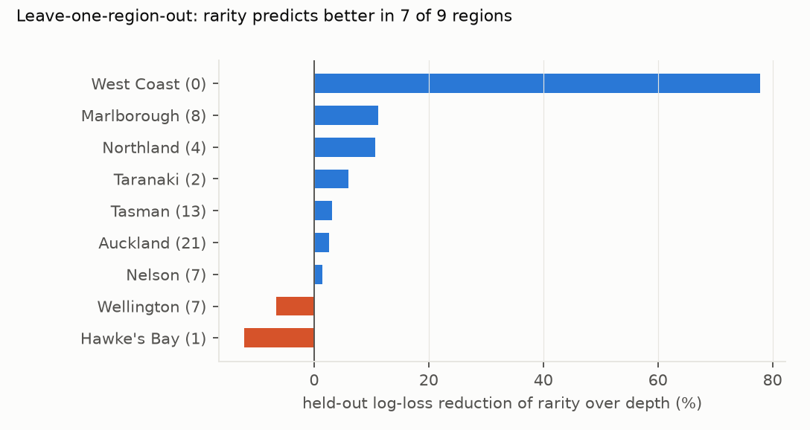
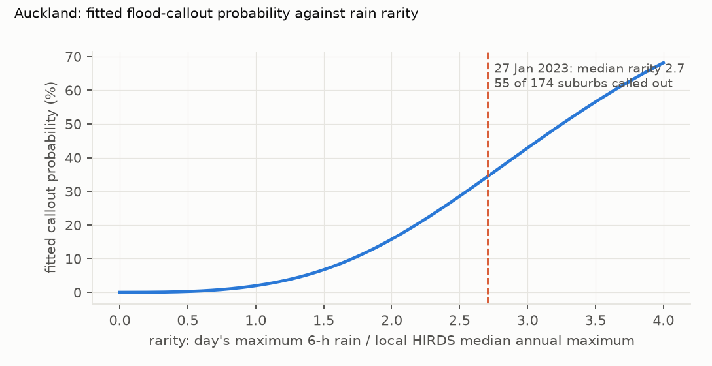

# Flood callouts track how rare the rain is for a place slightly better than its depth: the preregistered test passes, but on one held-out year whose margin comes from a single storm

*FENZ incident records FY2017/18–2024/25 (679,485 exposures), geocoded to 954 suburbs with a council rain gauge
within 10 km (gauges from eight councils): 2.65 million suburb-days. Rain comes from the HIRDS lead's gauge series. Rarity is the
day's maximum 6-hour rain divided by the gauge's HIRDS v4 median annual maximum, HIRDS's own index. Models were
trained on FY2017/18–2023/24 and tested once on FY2024/25. The plan was committed before any FENZ outcome row was
read.*

**Verdict: H1 Supported (preregistered rule), with a fragile margin.**

- **H1 (rarity predicts flood callouts better than depth): Supported.** All three preregistered conditions hold:
  - **Held-out log-loss.** The rarity model's is lower: D_LL = 3.9×10⁻⁵ (95% storm-day interval 0.6×10⁻⁵ to
    8.3×10⁻⁵), 3.4% of the depth model's log-loss.
  - **Skill.** Rarity's skill over a no-rain baseline is 1.076 times depth's (bar: 1.05).
  - **Regions.** Leave-one-region-out, rarity predicts better in 7 of 9 regions.
- **The margin is thin.**
  - **One storm.** The held-out year has 64 flood suburb-days, 24 of them in the Nelson–Tasman floods of 25–30 June
    2025. Without those six days, D_LL is 0.9×10⁻⁵ and its interval includes zero (post hoc).
  - **The regions.** One of the 7 regional "wins" is the West Coast, which had no held-out flood. Without it rarity
    still wins 6 of 8.
- **The secondaries are mixed:**
  - **24-hour rain:** rarity is better (S 1.12, interval excluding zero).
  - **1-hour rain:** depth is marginally better (S 0.99).
  - **Broader callout definitions,** adding flood-related water-removal callouts or natural-disaster dispatch codes:
    neither model is clearly better.
  - **Other rain measures:** the AEP form, the 5 km and inverse-distance assignments, and dropping unverified data
    all favour rarity, though not all meet every bar.

## In plain terms

The same downpour can be routine in one place and a disaster in another. Using eight years of Fire and Emergency callout records, we tested whether flood callouts
follow how unusual the rain is for a place (its depth compared with that place's typical yearly maximum) rather than
the raw amount.

On the year we held back for testing, the "how unusual" version predicted callouts a little better, and it did so in
most regions. That is what our preregistered test asked for. But the test year had only 64 suburb-days with flood
callouts, and about three-quarters of the advantage comes from one event, the Nelson–Tasman floods of late June
2025.

Across all years, flood callouts become ten times more likely than on a dry day once six-hour rain reaches about a
fifth of a place's typical yearly maximum. On 27 January 2023, Auckland suburbs had 2.7 times their typical yearly
maximum in six hours, and about a third of them called out the fire service for flooding.

## What was asked

- **The question.** The lead (`auckland-nz-fenz-impact-rainfall-thresholds`) asked whether flood impacts in New
  Zealand track rain rarity rather than depth, using Fire and Emergency New Zealand's open incident records as an
  objective, time-stamped impact series.
- **Analogues.** Elsewhere, studies use insurance claims (Spekkers et al., 2013) and evaluate rainfall alerts
  against reported surface-water flooding (Hurford et al., 2012).
- **The index.** HIRDS v4 uses the median annual maximum as the index of its regional frequency analysis, which
  defines rarity here.

## How it was done

- **Callouts.**
  - FENZ exposures with natural-disaster type "Flood", by suburb and NZST day (records are converted from civil
    time).
  - Suburbs are geocoded to NZ Gazetteer points by normalised name, rejecting candidates whose nearest gauge belongs
    to an unrelated council (D2).
  - The geocoding audit finds no suburb assigned to a gauge in a distant council (G4).
- **Rain.**
  - The HIRDS lead's council gauge series (seven Hilltop councils and Auckland Council), with its completeness and
    quality rules.
  - Unverified (2xx) data are kept (sensitivity Q drops them), and physically impossible records are screened out
    (D1).
  - Each suburb-day takes the nearest gauge within 10 km that is usable that day.
- **Models.** Two logistic regressions, identical except for the rain term: a natural spline in log(1 + depth)
  against one in log(1 + rarity). Shared terms:
  - 72-hour antecedent rain;
  - month and weekend;
  - region;
  - each suburb's background (non-flood) callout rate.
- **Test.**
  - Held-out mean log-loss on FY2024/25, with a storm-day block bootstrap (2,000 resamples).
  - The skill ratio S.
  - Leave-one-region-out.

## Results

### Held-out comparison

| analysis | D_LL (×10⁻⁵, 95% CI) | S | held-out floods |
|---|---|---|---|
| **primary (6 h)** | **3.9 (0.6 to 8.3)** | **1.076** | **64** |
| 1 h | −0.8 (−4.4 to 2.5) | 0.986 | 64 |
| 24 h | 5.1 (1.6 to 9.7) | 1.118 | 64 |
| AEP form (log ARI above the 1.58-year depth) | 2.7 (−0.9 to 6.8) | 1.053 | 64 |
| outcome V1 (adds flood water-removal callouts) | 1.4 (−1.7 to 4.7) | 1.022 | 260 |
| outcome V2 (adds natural-disaster dispatch codes) | −9.5 (−23.6 to 1.8) | 0.953 | 765 |
| Q: unverified rain data excluded | 3.8 (1.1 to 7.1) | 1.089 | 60 |
| gauge within 5 km | 2.7 (0.3 to 5.3) | 1.045 | 48 |
| inverse-distance mean of up to 3 gauges | 3.9 (0.7 to 8.1) | 1.075 | 64 |
| primary without 25–30 June 2025 (post hoc) | 0.9 (−0.5 to 2.6) | — | 40 |

### Leave-one-region-out (`results/figures/F2_loro.png`)

- **Rarity wins** in Auckland, Marlborough, Nelson, Northland, Taranaki, Tasman and the West Coast.
- **Depth wins** in Wellington and Hawke's Bay.
- **Few held-out floods.** Hawke's Bay had 1 and the West Coast none, so those comparisons are mostly about
  calibration on dry days.

### Three storm days, observed against fitted (`results/tables/posthoc.json`)

| day | panel suburbs | called out | median 6-h rain | median rarity | depth model | rarity model |
|---|---|---|---|---|---|---|
| Auckland, 27 Jan 2023 | 174 | 55 (32%) | 135 mm | 2.71 | 33% | 35% |
| Hawke's Bay, 14 Feb 2023 (Cyclone Gabrielle) | 91 | 10 (11%) | 61 mm | 1.56 | 8% | 10% |
| Nelson and Tasman, 27 Jun 2025 | 70 | 8 (11%) | 56 mm | 0.97 | 3% | 4% |

Both models underpredict the Nelson–Tasman day badly. Its 6-hour rain was only moderately rare (median rarity 0.97),
so whatever drove its callouts, plausibly longer-duration rain, is outside a 6-hour term. Rarity is the less wrong of
the two.

### Onset thresholds (`results/tables/onset.csv`, `results/figures/F1_auckland_curve.png`)

- **One curve shape for every region.** The models share one rain curve across regions (regions shift only the
  baseline), so the rain at which callouts reach 10 times the dry-day rate is the same everywhere by construction:
  - a rarity of 0.20 under the rarity model;
  - 10 mm in 6 hours under the depth model.

  The plan's "region-specific" thresholds are therefore not region-specific in these models.
- **What the rarity model implies in depth.** The local depth threshold runs from 8–9 mm (Bay of Plenty, Hawke's Bay,
  Marlborough, Wellington) to 12–13 mm (Northland, West Coast), against a flat 10 mm.

## What this does and does not show

- **Rarity is at least as good a predictor as depth, and slightly better on the preregistered test.** The evidence
  for "better" rests on one held-out year dominated by one storm. It is not robust to the broader outcome definitions
  or to the 1-hour duration.
- **The practical difference is small** at the thresholds where most callouts happen. The two models agree within a
  few percentage points on the big storm days. Regional depth thresholds implied by rarity vary by only about ±25%.
- **Limits.**
  - **Callouts are not damage.** They reflect drainage, exposure, reporting and FENZ capacity as well as rain.
    Capacity saturation on extreme days caps counts.
  - **Coverage.**
    - 954 of 2,768 geocoded suburbs enter the panel (963 have a gauge within 10 km), mainly in Auckland,
      Wellington, Northland, Hawke's Bay and Taranaki.
    - Canterbury, Otago, Southland, Waikato and Bay of Plenty are barely represented.
  - **Points, not polygons.** Suburbs are gazetteer points, because the LINZ suburb polygons need an account the lab
    cannot create. 907 FENZ suburb names did not match the gazetteer (8% of exposure-days).
  - **Model form.** The models are logistic GLMs with a suburb-background term, not the lead's GLMM.
  - **Rain duration.** The 6-hour term can miss storms whose rain is unusual over longer durations, possibly 27 June
    2025.
  - **Data assembly.** It needed two rounds of fixes before any result was read (D1, D2). A first analysis on the
    flawed panel was stopped and opened only after the final result: it also met the H1 rule (S 1.059, 5 of 9
    regions).
  - **Care note.** No ethnicity or iwi data were used, and results are aggregate.

## Process and deviations

- **Preregistration:** `plan.md`, committed before any FENZ outcome row was read.
- **Deviations** (`deviations.md`):
  - **D1:** a physical screen for rain records (shared with the HIRDS lead's D6); one region per suburb; file
    encoding and date formats.
  - **D2:** geocoding and suburb-key fixes from the G4 audit; the stopped first run.
- **Post hoc:** `code/posthoc.py`: the result without late June 2025, and the storm-day traces.
- **Gates:**
  - G1: in the plan (the test year used once; activity from training years only).
  - G2: `results/tables/coverage.json`.
  - G3: `results/plausibility.md`.
  - G4: `results/tables/g4_geocode.json` and `g4_window.csv`.
  - G5: `review/overclaim_check.md`.
  - G6: `results/attribution_ledger.csv`.
  - G7: does not apply.
- **Independent review:** queued (Fable), per the lab's pacing rule.
- **Data:** Fire and Emergency New Zealand Incident Data (CC BY 4.0, New Zealand Government); the NZ Gazetteer
  (LINZ, CC BY 4.0); council rain gauges, including Auckland Council's; HIRDS v4 (NIWA / Earth Sciences New Zealand).

## Reproducing it

1. The HIRDS lead's series and depths (its "Reproducing it").
2. `code/build_fenz.py`, `code/geocode.py`, `code/rain_daily.py`, `code/panel.py`.
3. `code/analyse.py` (about 20 minutes), `code/posthoc.py`, `code/g4_check.py`, `code/figures.py`.
