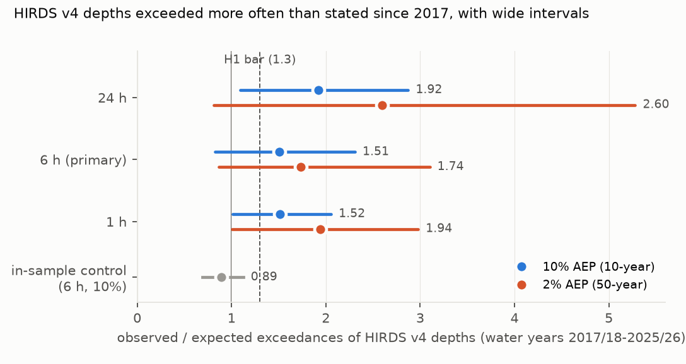
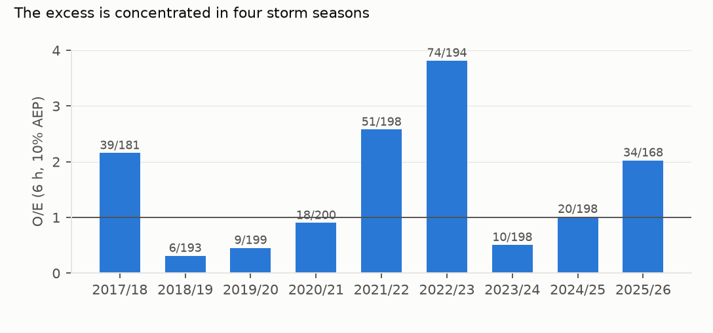

# New Zealand's 10-year design rainfalls have been exceeded about 1.5 times as often as stated since HIRDS v4 was fitted, but nine years of clustered storms cannot rule out chance

*201 council rain gauges in seven regions (open Hilltop servers), water years 2017/18–2025/26, after every HIRDS v4
fitting record. Auckland Council's gauges were also harvested, but none met the preregistered inclusion rule. Annual-maximum 6-hour rainfall is compared with HIRDS v4's own depths at each
gauge's coordinates, from ESNZ's HIRDS API. The plan was committed before any rainfall value or HIRDS depth was read.
A data-reader bug found after the first full run was fixed and every series refetched (D5).*

**Verdict: H1 Inconclusive.**

- **H1 (6-hour, 10% AEP depths exceeded at least 1.3 times as often as stated, out of sample): Inconclusive.**
  - 261 exceedances against 172.9 expected, over 1,729 complete gauge-years: **O/E 1.51**, with a 95% water-year
    block interval of **0.82 to 2.35**.
  - The point estimate passes the 1.3 bar, but the interval includes 1.0. Nine water years give few independent
    blocks, and one storm season contributes much of the count.
- **The in-sample control holds.** Over the years HIRDS was fitted to (up to 2014/15), O/E is 0.89 (0.69–1.12):
  this harvest and HIRDS agree where they should.
- **Every duration and level points the same way.**
  - At 1 hour: 1.52 (1.01–2.06).
  - At 24 hours: 1.92 (1.09–2.87).
  - At 2% AEP: 1.94, 1.74 and 2.60 for 1, 6 and 24 hours, with wide intervals.
  - None of these is confirmatory.
- **The excess sits in four storm seasons.** It is concentrated in 2017/18, 2021/22, 2022/23 (O/E 3.8, mostly Cyclone
  Gabrielle in Hawke's Bay) and 2025/26. Without January–February 2023, O/E is 1.19 (0.72–1.72).
- **HIRDS's own mid-century depths fit the observations.** Against HIRDS v4's climate-adjusted depths for
  2031–2050, the observed frequency is at the stated rate: O/E 1.02 under RCP4.5 and 0.99 under RCP8.5
  (descriptive).

## In plain terms

Engineers size pipes, culverts and stormwater ponds from New Zealand's national "design rainfall" tables (HIRDS),
which say how often big downpours should happen. The current tables were built from rainfall records ending around
2016. We checked what has happened since.

At 201 council rain gauges, a downpour the tables say should come once in ten years at a site has happened about 1.5
times as often as expected since 2017. A similar or larger excess appears at 1-hour and 24-hour durations, and for rarer storms. The
same method finds no such excess in the years the tables were built from. The observed rate also matches what HIRDS
itself projects for the 2030s and 2040s under climate change.

But the evidence is not yet decisive. Nine years is short, and a few huge storms, above all Cyclone Gabrielle in
February 2023, hit many gauges at once. Our statistical range, from 0.8 to 2.4 times the stated rate, still includes
"no change". Auckland's own gauges could not be scored on the preregistered rules. Too many of their recent years are
still unaudited, and HIRDS used Auckland data into 2017, which shortens Auckland's test window.

## What was asked

- **The question.** The lead (`auckland-nz-hirds-out-of-sample-exceedance-audit`) asked whether HIRDS v4's stated
  exceedance probabilities hold out of sample. HIRDS v4 (Carey-Smith, Henderson and Singh, NIWA client report
  2018022CH, 2018) is used for design-storm assessment and the design of flood-protection works and other waterway
  structures. It was fitted to records ending in 2015–2017.
- **The template.** Wright, Bosma and López-Cantú (2019) found US "100-year" storms more frequent than design
  standards assume. No New Zealand counterpart was found.
- **The caution.** Serinaldi and Kilsby (2015) warn that sampling uncertainty usually swamps apparent non-stationarity
  in short windows.

## How it was done

- **Gauges.**
  - Sources:
    - every rainfall site on seven open council Hilltop servers (Northland, Hawke's Bay, Wellington, Marlborough,
      Tasman, Taranaki, West Coast);
    - Auckland Council's Environment Auckland portal (D4).
  - Candidates are the 443 gauges whose records span the out-of-sample window. Native-resolution data (tips and
    logged intervals) with NEMS quality codes were fetched for water years 1995/96–2025/26.
- **Completeness and quality** (D2, D3).
  - Records coded missing, unverified or synthetic count as unknown time.
  - Rain logged at intervals coarser than 15 minutes is unresolved for 6 hours.
  - In gauge-years that log at least hourly, silences over an hour are outages.
  - A water year counts if at least 90% of its time is known and its median wet interval is no more than 15
    minutes.
  - Sensitivities S1–S4 bracket the choices.
- **Annual maxima.** These are sliding 6-hour totals on a 5-minute grid. They are within 0.4% of the exact maximum,
  checked independently for 30 gauge-years (G4).
- **HIRDS depths.** HIRDS v4 historical depths at each gauge's coordinates come from ESNZ's HIRDS API point report
  (D1). AEP = 1/ARI, confirmed by the API.
- **Inclusion.**
  - A gauge needs at least 8 complete out-of-sample years.
  - Co-located duplicates are dropped.
  - Leakage (G1): where HIRDS's site list shows a gauge's data used into 2017, its out-of-sample window starts in
    2018/19. This applies to 46 Auckland gauges.
- **Test.**
  - O/E is the observed exceedance count over 10% of complete gauge-years.
  - Its interval comes from a water-year block bootstrap (2,000 resamples), which keeps each storm's spatial
    footprint together.
  - Supported needs O/E ≥ 1.3 with a lower bound above 1.0.

## Results

### Observed over expected, by duration (`results/figures/F1_oe_by_duration.png`)

| duration | AEP | O/E (95% CI) | observed | expected | gauges |
|---|---|---|---|---|---|
| 1 h | 10% | 1.52 (1.01–2.06) | 121 | 79.8 | 93 |
| **6 h** | **10%** | **1.51 (0.82–2.35)** | **261** | **172.9** | **201** |
| 24 h | 10% | 1.92 (1.09–2.87) | 362 | 188.5 | 219 |
| 1 h | 2% | 1.94 (1.01–2.98) | 31 | 16.0 | 93 |
| 6 h | 2% | 1.74 (0.86–3.10) | 60 | 34.6 | 201 |
| 24 h | 2% | 2.60 (0.81–5.28) | 98 | 37.7 | 219 |
| 6 h, in sample (control) | 10% | 0.89 (0.69–1.12) | 173 | 193.5 | 113 |

Fewer gauges qualify at 1 hour, because that needs 5-minute resolution, which excludes most 15-minute loggers.

### Year by year (`results/figures/F2_year_by_year.png`)

- **The four storm seasons.** O/E is above 2 in 2017/18 (led by Tasman in February 2018), 2021/22, 2022/23 (3.8) and
  2025/26, and below 1 in the other five years. January 2023, the month of Auckland's floods, adds only 3
  exceedances, because no Auckland gauge is in the primary.
- **Storm clustering.** Exceedances within 72 hours of each other across gauges form 74 storms. The largest holds
  52 of the 261, from February 2023, 48 of them in Hawke's Bay. Resampling storms instead of years gives
  1.51 (0.96–2.23).

### Sensitivities and strata (6 h, 10% AEP)

| analysis | O/E (95% CI) | gauges |
|---|---|---|
| primary | 1.51 (0.82–2.35) | 201 |
| S1: undetermined gauge-years counted as exceedances (2 gauge-years) | 1.52 (0.87–2.29) | 201 |
| S2: zero-closed silences over 14 days count as unknown | 1.54 (0.76–2.44) | 160 |
| S3: unverified (2xx) data kept | 1.47 (0.81–2.19) | 285 |
| S4: uncoded and poor (0, 4xx) data excluded too | 1.37 (0.70–2.05) | 39 |
| without January–February 2023 | 1.19 (0.72–1.72) | 201 |
| depths minus one HIRDS standard error | 2.41 (1.42–3.42) | 201 |
| depths plus one HIRDS standard error | 0.96 (0.49–1.58) | 201 |
| against HIRDS RCP4.5 2031–2050 depths | 1.02 (0.54–1.63) | 201 |
| against HIRDS RCP8.5 2031–2050 depths | 0.99 (0.52–1.57) | 201 |
| gauges among HIRDS v4's fitting sites | 1.47 (0.66–2.33) | 84 |
| gauges not among them | 1.54 (0.91–2.23) | 117 |

- **By council:**
  - Hawke's Bay 1.83 (66 gauges);
  - Taranaki 1.95 (9);
  - Tasman 1.49 (42);
  - Northland 1.37 (34);
  - Marlborough 1.31 (14);
  - West Coast 1.25 (8);
  - Wellington 0.98 (28).

  Every council interval includes 1.0.
- **Auckland.**
  - No Auckland gauge meets the preregistered rule. G1 starts Auckland's window in 2018/19, leaving exactly 8
    years, and its 2021/22–2022/23 data are mostly graded unverified.
  - Post hoc, with unverified data kept and at least 6 complete years, 54 Auckland gauges give O/E 2.35 (0.45–4.60).
    With at least 8 years, 12 gauges give 1.65 (0.49–3.14). Both are exploratory and very uncertain.

## What this does and does not show

- **The direction is consistent; the evidence is not decisive.**
  - Every duration and level, every data-quality sensitivity (S1–S4) and every council except Wellington puts O/E
    above 1, and the in-sample control does not.
  - Only shifting HIRDS's depths up by one standard error, or comparing against its mid-century depths, brings it
    to about 1.
  - The preregistered test cannot exclude the stated rate, because nine years of spatially clustered storms give few
    independent samples. That is Serinaldi and Kilsby's warning in practice.
- **HIRDS's standard errors matter as much as the excess.** Moving the depths by one standard error moves O/E
  between 0.96 and 2.41. One HIRDS standard error is about 10% of a 10-year 6-hour depth.
- **The mid-century comparison is descriptive.** Observed frequencies matching HIRDS's 2031–2050 projections is
  consistent with a warming signal arriving ahead of schedule. It is also consistent with a cluster of unlucky years.
  This study cannot separate the two.
- **Limits.**
  - **Councils are not a random sample.**
    - The primary covers seven regions, weighted towards Hawke's Bay (66 gauges) and Tasman (42). Auckland
      contributes none.
    - Canterbury, Otago, Southland, Waikato, Bay of Plenty, Manawatū-Whanganui and Gisborne are not in the
      harvest. The plan fixed its sources to the open servers found before it was written.
    - The national climate network was not used, since its data are per-station orders.
  - **Recent data are partly unaudited.**
    - The last months of 2025/26 are graded unverified, so that year often fails completeness (168 gauge-years
      against about 195).
    - S3, which keeps unverified data, gives 1.47.
  - **Hidden outages.** In gauges that log only around rain, an outage closed by a zero looks like a dry spell (D2).
    That biases exceedances down, and the in-sample 0.89 is consistent with a small downward bias.
  - **A first run used corrupted series** and is superseded (D5). A reader bug dropped tips sharing a minute,
    losing up to 16% of a gauge-year's rain in fine-resolution records.
    - That run gave O/E 1.29 (0.65–2.07) and an in-sample 0.81.
    - The bug was found because Wellington's O/E (0.13) was implausible.
    - Its tables are kept in `results/tables/v0_invalid_minute_dedupe/`.
- **Not shown:**
  - **Attribution.** The study does not attribute any excess to climate change.
  - **Durations beyond 1–24 hours.**
  - **Areal (catchment) rainfall.**
  - **What the excess means for any particular structure.**

## Process and deviations

- **Preregistration:** `plan.md`, committed before any rainfall value or HIRDS depth was read.
- **Deviations** (`deviations.md`):
  - **D1:** HIRDS depths from the point API instead of 2 km grids; the climate-adjusted secondary restored; the G1
    coverage check.
  - **D2:** completeness, resolution and quality rules, fixed from series structure before any maximum.
  - **D3:** a structural resolution test (median wet interval); in-sample years from 1995/96; Hawke's Bay's
    coordinate grid.
  - **D4:** Auckland added, after the owner agreed to the portal's terms.
  - **D5:** the reader bug, found after the first run, and the refetch.
- **Gates:**
  - G1: in plan and analysis; 46 gauges' windows shifted.
  - G2: `results/tables/coverage.json`.
  - G3: `results/plausibility.md`.
  - G4: `results/tables/g4_check.csv` and `g4_raw_check.csv`.
  - G5: `review/overclaim_check.md`.
  - G6: `results/attribution_ledger.csv`.
  - G7: does not apply.
- **Independent review:** queued (Fable), per the lab's pacing rule.
- **Data sources:**
  - Auckland Council (Environment Auckland). Rainfall data for the Auckland region are Auckland Council's; raw series
    are not redistributed.
  - Northland, Hawke's Bay, Greater Wellington, Marlborough, Tasman, Taranaki and West Coast regional and district
    councils (Hilltop servers).
  - HIRDS v4: NIWA / Earth Sciences New Zealand.

## Reproducing it

1. `code/inventory.py`, then:
   - `code/fetch.py 3`;
   - `code/fetch.py 1 early`;
   - `code/fetch_auckland.py`.

   Raw series land under `data/` (not in git).
2. `code/depths.py sites`, then `code/depths.py points` (needs a HIRDS API key in `~/.config/niwa-hirds/key`).
3. `code/maxima.py`, then `code/g4_check.py`.
4. `code/analyse.py`, `code/posthoc_auckland.py` and `code/figures.py`.
