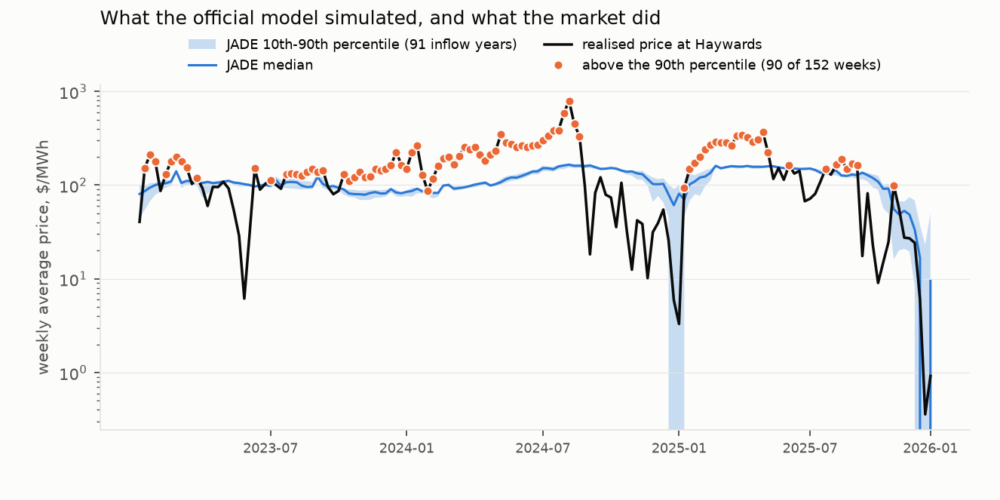
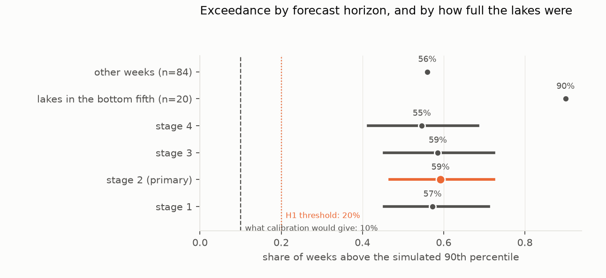
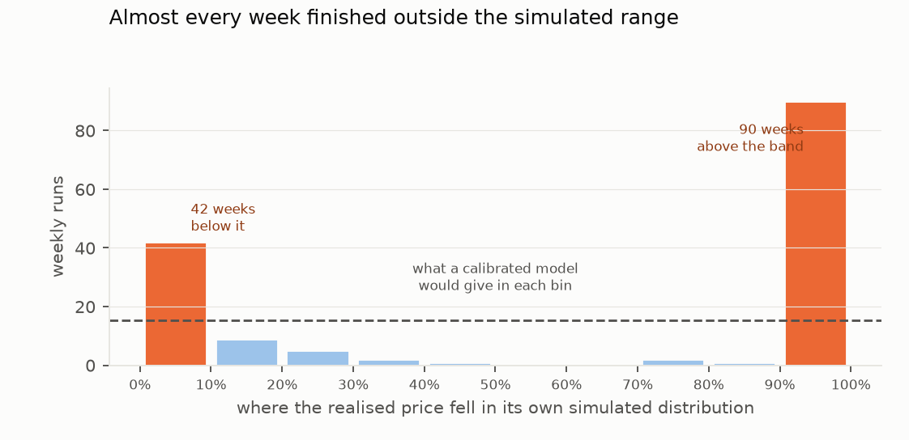

# Not a price forecast: the Electricity Authority's published water-value runs against the prices that followed

*Every one of the 152 weekly JADE runs the Electricity Authority published from 2023 to 2025, scored against the
price the market then settled at Haywards in the run's first fully out-of-sample week.*

**Verdict: H1 Supported; H2 Refuted, though by a test that could not be passed. The runs' price distributions are far
too narrow to read as forecasts of price — and the reason is how the runs price future weeks, not how little
hydrology matters.**

- **H1 (the upper tail is far too thin): Supported.** The realised price finished above the run's simulated 90th
  percentile in **59.2% of weeks**, against a nominal 10% and a preregistered threshold of 20%. The preregistered
  interval is 46.1% to 73.0%. Consecutive weekly runs are strongly dependent (lag-one autocorrelation 0.66, an
  effective sample of about 19 weeks), so with longer resampling blocks the interval widens to about 41% to 79% — its
  lower bound still twice the threshold, only just.
- **H2 (three times worse when the lakes are low): Refuted by its rule, but the rule was unreachable.** Low-storage
  weeks did fail more often, 90% against 56%, a ratio of 1.61. But with the comparison group already failing 56% of
  the time, the largest ratio any data could give is 1/0.56 = 1.79, so the threefold test could not be passed once H1
  held. Storage is strongly associated with exceedance: 85–90% of weeks in each of the bottom three storage fifths,
  falling to 43% and then 6% in the top two. The 20 low-storage weeks are two consecutive spells (December 2023 to
  January 2024, and the gas shortage of May to August 2024), so even the 1.61 rests on two episodes.

**What the runs are, and why the band is narrow.** JADE is a stochastic dual dynamic programming model. The
Authority's runs are risk-neutral (no risk parameters are set, and JADE's default is risk neutrality) and vary only
which of 80 to 91 historical inflow sequences the year follows. The Authority itself describes them as "assumption
laden: risk neutrality, single scenario re: demand forecast, fuel prices", built to produce "a steady state water
release policy in presence of uncertain inflows" and published to support trading-conduct monitoring.

The scored week is priced at a **flat long-run fuel assumption**, not the fuel prices of the moment. In the run
frozen in week 32 of 2024, during the gas shortage, the gas price input follows a weekly series up to that week
($28.31/GJ) and then drops to **$13.20/GJ** from week 33 — the week scored — for every week thereafter; the carbon
price input rises from $51.65 to $64.13. At $13.20 gas the model's thermal stack spans roughly $128 to $184/MWh,
and the next price level is load shedding at $530. So that run's 91 sequences gave $139 to $173 for the week, while
the market settled at $449 — a price the model could not reach without shedding load.

So the narrowness of the band is a property of risk-neutral, cost-based price formation at a fixed fuel assumption.
It is not a measure of how much hydrology contributes to price risk, and an earlier draft that read it that way was
wrong.

**The size of the gap.** The realised price fell **outside the entire envelope of every inflow sequence** — above
the highest simulated price or below the lowest — in **71.1%** of weeks (above it in 55.3%). Outside the 10th-to-90th
band it fell in 86.8%: 59.2% above and 27.6% below. The nominal 50%, 80% and 90% intervals contained the outcome
5.3%, 13.2% and 17.1% of the time. The median simulated band is $15.03/MWh wide, its 90th percentile 14% above its
10th; the spread of the run's own forecast errors (10th to 90th percentile) is $231, about 15 times wider.

## In plain terms

New Zealand's electricity market runs on water. Every week the Electricity Authority publishes a run of a computer
model, built at the University of Auckland, that works out what the water stored in the hydro lakes is worth. Each
run plays the year ahead about 90 times, once for each year of rainfall on record, and reports the electricity prices
that come out.

We took all 152 of those runs from 2023 to 2025 and asked: when the week they were looking at actually arrived, where
did the real price land among their prices?

Mostly outside them altogether. In seven weeks out of ten the real price was above the highest of the roughly 90
prices the run produced, or below the lowest.

That is not because rainfall hardly matters. It is because of what the run assumes. It takes the cost of gas and coal
from a single long-run figure, not today's price, and it sets prices as if no one were worried about running short.
In August 2024, during a gas shortage, the run assumed gas at less than half its own figure for the week before. Its prices for
that week ran from $139 to $173. The market paid $449.

The Authority says plainly that these runs rest on simplifying assumptions and exist to work out how to use water.
Our check shows they should not be read as a forecast of what a week will cost.

Low lakes made things worse: when the lakes were at their lowest, the real price beat the run's range in nearly every
week.

## What was asked

Since 2023 the Electricity Authority has published weekly runs of JADE as its benchmark for the value of water held
in New Zealand's hydro lakes. JADE is a stochastic dual dynamic programming model of the hydro-thermal system,
developed by the Electric Power Optimization Centre at the University of Auckland and released as open source. Each
weekly run looks a year ahead over 52 weekly stages and produces a distribution of wholesale prices as well as the
water values the Authority publishes.

The preregistration (`plan.md`) sets two hypotheses:

- **H1:** does the realised price exceed the simulated 90th percentile in at least 20% of weeks, twice the
  nominal 10%?
- **H2:** is that at least three times more common in weeks that begin with the lakes unusually low?

This is a calibration audit of a published official model's price output. It is not a test of whether JADE is the
right model for the job the Authority uses it for.

## What was already known

The Authority publishes the runs and describes them in an EPOC workshop presentation (Bishop and Nguyen, 2022),
which states their purpose and their simplifying assumptions and notes that JADE superseded the earlier DOASA model.
An arXiv paper on capacity planning uses the JADE New Zealand dataset. No published check of whether the runs' price
distributions match the prices that followed was found (searches 2026-10-20).

## How it was done

**Data.** Everything is published by the Electricity Authority on EMI and downloaded from its blob store:

- the **Expected water values** dataset: 152 weekly runs out of 17,991 files and 44.8 GB. Each run's
  `tidy_results.csv` is about 88 MB and prices appear in no smaller file, so each was streamed and filtered in
  flight to the rows the study needs — 13.4 GB read, 104 MB kept;
- each run's **input-freeze timestamp**, from the `Inputs/data_files/<YYYYMMDDHHMM>/` folder name, and its own
  `hours_per_block.csv`;
- **final energy prices**, half-hourly by node, for HAY2201;
- the **Hydrological Modelling Dataset**: per-lake active storage from 1980, and the derived capacity series
  giving each scheme its GWh per million cubic metres.

**The out-of-sample boundary.** Stage 1 of a run is the week its inputs were frozen, and is partly elapsed when
the run is made; stage 2 is the first week wholly after the freeze, and is the week scored. This was verified
rather than assumed: every run's input timestamp falls one to three days after its own stage-1 week begins, which
also confirms that JADE week *w* of year *Y* begins on 1 January plus 7(*w*−1) days.

**Measures.** For each run and each inflow sequence, the stage-2 block prices at HAY are combined into a weekly
average weighted by that run's own hours per block. The realised figure is the time-weighted average of settled
half-hourly prices at HAY2201 over the same seven days. The study records where the realised price fell within its
own simulated distribution (the probability integral transform) and whether it exceeded the simulated 90th
percentile.

**National storage.** Lake volumes cannot be added across lakes, so each lake's active storage is converted to
energy with its own GWh-per-Mm³ ratio before summing. A run is low-storage if that figure, averaged over its first
week, is below the 20th percentile for the same week of the year in other years.

**Intervals** come from a moving-block bootstrap over runs in calendar order (blocks of four consecutive runs,
2,000 resamples, seed 20261020), as preregistered.

## Results

### What was simulated, and what happened (`results/figures/F1_band_vs_actual.png`)

| | |
|---|---|
| weekly runs scored | **152** (52 in 2023, 52 in 2024, 48 in 2025); none excluded |
| inflow sequences per run | 80 to 91 (91 in 101 runs) |
| median simulated 10th-90th band | **$15.03/MWh** (90th percentile 1.14 times the 10th) |
| realised outside the envelope of all sequences | **71.1%** of weeks (55.3% above, 15.8% below) |
| realised outside the 10th-90th band | **86.8%** of weeks (59.2% above, 27.6% below) |
| realised above the simulated median | 61.2% of weeks; median realised/median simulated 1.32 |

How wide the band is, against three yardsticks (post-review analysis, `review/reviewer_checks/percentile_fairness.out`):

| the band's median width as a share of… | |
|---|---|
| the spread of the run's own forecast errors (10th to 90th percentile, $231) | 6.5% |
| the spread of the realised week-to-week change ($110) | 13.7% |
| the spread of realised weekly prices across weeks, by year | 13.5% (2023), 4.6% (2024), 5.4% (2025) |

Realised weekly prices over the three years ran from $0.36 to $796.87; the earlier draft's "$265" was the spread
between their 10th and 90th percentiles across weeks, which pools three different years and is the least fair of
these comparisons.

### H1: the upper tail (`results/figures/F3_exceedance.png`)

- **Exceedance rate 59.2%** (preregistered 95% interval 46.1% to 73.0%), against a nominal 10% and a 20% threshold.
  **H1 is Supported.**
- The weekly outcomes are strongly autocorrelated: lag-one 0.66, falling to 0.16 by lag eight, for an effective sample
  of about 19. Under longer moving blocks (13 to 26 weeks) or a stationary bootstrap the interval is about 41% to 79%
  (`review/reviewer_checks/bootstrap_sensitivity.out`). The verdict is unchanged; the preregistered four-run block
  understates the uncertainty, and the minimum detectable effect it implies (18.7 points) is too small by a factor of
  about 1.4.
- When the price exceeded the 90th percentile, it did so by a median factor of **1.69**, and at most **4.68**.
- **By horizon:** 57.2% (stage 1), 59.2% (stage 2), 58.6% (stage 3), 54.6% (stage 4). Only stages 1 to 4 were
  retained, so this shows no growth over four weeks; it says nothing about longer horizons.
- **By year:** 61.5% (2023), 63.5% (2024), 52.1% (2025).
- **Robust to how the weekly price is formed.** A block-matched average gives the same 59.2%; exceedance by demand
  block is 57–62%; using the weekly median or a trimmed mean of realised prices gives 57.9% and 56.6%. Mapping JADE's
  NI, HAY and SI nodes onto Otahuhu, Haywards and Benmore in other combinations gives 57–63%.

### The other tail, and bias (`results/figures/F2_pit.png`)

The realised price fell **below** the simulated 10th percentile in **27.6%** of weeks. The probability integral
transform is U-shaped and almost empty in the middle — 90 weeks in the top tenth of their own distribution, 42 in the
bottom tenth, 20 in the eight bins between — but it is not symmetric. The realised price exceeded the simulated median
in 61.2% of weeks, with a median ratio of 1.32: the runs are biased low as well as too narrow.

A naive persistence forecast — last completed week's price — is closer to the realised price than the runs' median:
a median absolute error of $32 against $65, with JADE's median the closer of the two in only 34% of weeks. This is a
statement about the runs as price forecasts, which they are not built to be.

| nominal interval | weeks it actually contained |
|---|---|
| 50% | 5.3% |
| 80% | 13.2% |
| 90% | 17.1% |

### H2: storage state

| group | runs | exceedance rate |
|---|---|---|
| national energy storage in the bottom fifth for that week of the year | 20 | **90.0%** |
| all other weeks | 84 | **56.0%** |

- **Ratio 1.61** (preregistered interval 1.12 to 2.36; 1.01 to 2.72 under longer blocks). **H2 is Refuted** by its
  rule, but the rule could not be met: with the comparison group at 56%, no data could give a ratio above 1.79.
- The 20 low-storage runs fall in two spells: December 2023 to January 2024 (6 of 6 exceeding) and late May to
  August 2024 (12 of 14). The second is the gas shortage, so low storage and high fuel prices coincide there.
- Exceedance by storage quintile shows the relationship the bottom-fifth split hides
  (`review/reviewer_checks/storage_split.out`):

  | storage percentile for the week of the year | exceeded |
  |---|---|
  | 0–20% | 18 of 20 |
  | 20–40% | 17 of 20 |
  | 40–60% | 16 of 18 |
  | 60–80% | 12 of 28 |
  | 80–100% | 1 of 16 |

- The split covers the 104 runs in 2023 and 2024, because the hydrological dataset ends 2024-12-31.

### One week in detail

The run published for week 32 of 2024 forecast the week beginning 12 August 2024. Across all 91 inflow sequences its
weekly average price at Haywards ranged from **$139.33 to $173.04**, with a 90th percentile of **$167.07**. The market
settled that week at **$449.36**, with daily averages from $350 to $599 — **2.69 times** the 90th percentile and well
beyond the highest sequence. That run priced the week with gas at $13.20/GJ, against $28.31 in its own input for the
week before. This week was recomputed by hand from the raw files, independently of the analysis code, and again by
the reviewer; both match.

## What this does and does not show

- **It shows** that the price distributions in the Authority's published weekly runs are far too narrow, and biased
  low, as forecasts of the price the market then set — consistently across three years, at every stage examined, and
  more so when storage is low.
- **It shows why, in part:** the scored week is priced risk-neutrally at a flat long-run fuel assumption, so the
  runs' prices sit on the thermal cost stack. In a fuel shortage that assumption is far below the price of fuel, and
  the band cannot reach the market price.
- **It does not show that JADE's water values are wrong, or that JADE is a poor scheduling model.** The runs are built
  to produce a water-release policy and are explicitly assumption-laden. This audit is of their price output read as
  a forecast, which is not their purpose.
- **It does not measure hydrology's contribution to price risk.** The band reflects the model's pricing assumptions;
  a run with market fuel prices or a risk-averse setting would give a different band.
- **The storage result is confounded in 2024** with the gas shortage, and rests on two spells.
- **One node is scored.** HAY2201 is the reference node for the model's HAY output; Otahuhu and Benmore were planned
  to be reported alongside and are summarised above from the review rather than scored in the study's own code.
- **Prices can be revised.** The latest published monthly files were used, and December 2025 was assembled from daily
  files because the Authority publishes that month's consolidation only as incomplete (D1).
- **No personal or community data**: market prices, model outputs and reservoir levels only.

## Process and deviations

- **Preregistration.** `plan.md` was committed before any simulated price met a realised one, after only the blob
  listing and one file's schema had been examined.
- **Code before outputs.** `fetch.py` and `analysis.py` were committed before the outputs they produced;
  `figures.py` was written after the results.
- **D1** records the 152-run count, the varying number of inflow sequences, the complete-week rule, the December
  2025 assembly, the storage measure and its coverage, and the spread statistics added after the results.
- **D2 (after independent review)** records the reinterpretation, the post-review analyses, the deviations the draft
  did not declare, and a correction to the description of the storage sensitivity.
- **Review.** An independent adversarial review (`review/review.md`) re-derived three runs to the cent, confirmed the
  week alignment to the day and the cached data against fresh downloads, and found H1 robust. It found the draft's
  interpretation wrong — attributing the narrow band to hydrology rather than to the runs' fuel and risk assumptions —
  and its "range" and H2 statements overstated; all are corrected here.

## Reproducing it

`code/fetch.py`, then `code/analysis.py`, then `code/figures.py`. The post-review analyses are in
`review/reviewer_checks/` (`bootstrap_sensitivity.py`, `percentile_fairness.py`, `realised_average.py`,
`storage_split.py`, `node_mapping.py`), with the Authority's run configuration and fuel-cost excerpts in
`review/reviewer_checks/evidence/`.

- **Inputs** are cached under `data/`: `runs/<year>_<week>.csv`, `runs/<year>_<week>_hours.csv`, `run_index.csv`,
  `prices/<yyyymm>.csv` and `hmd/`.
- **Results** are in `results/tables/`: `primary.json`, `runs.csv` and `by_stage.csv`.
