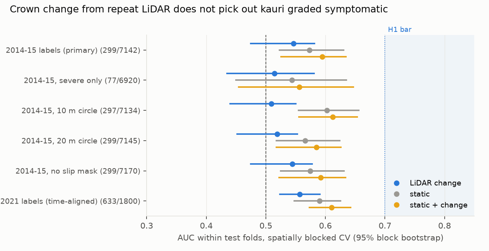
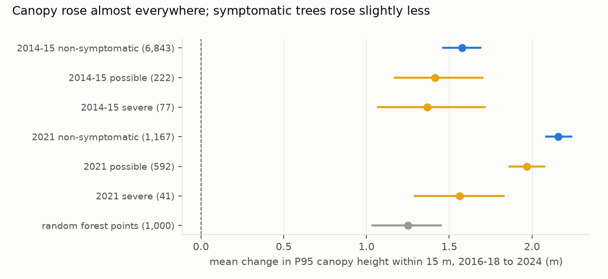

# Can open repeat LiDAR see kauri dieback? Not at trees graded from the track in 2014–15, where sick and healthy trees stand metres apart

*Ground survey: Auckland Council's ObsKauri public layer. Trees graded along Waitākere tracks in 2014–15 (6,871
non-symptomatic, 299 with possible or severe dieback symptoms, after merging duplicate records within 2 m) were
compared with the change in LiDAR canopy height within 15 m of each tree. The change runs between the LINZ Auckland
North 2016–18 survey and the Auckland 2024 survey. The test is prognostic: the labels predate the first LiDAR epoch.
This version incorporates an independent review (`review/review.md`; D1).*

**Verdict: H1 Refuted; H2 Refuted.**

- **H1 (LiDAR crown change separates trees graded symptomatic, AUC at least 0.70): Refuted.**
  - The change model's AUC, computed within spatially blocked test folds, is **0.55** (95% block bootstrap 0.47–0.58).
  - A within-block label shuffle gives 0.48 on average (95th percentile 0.52). So the change model sits slightly
    above that "place" chance level, but far below the 0.70 bar.
- **H2 (change adds at least 0.05 AUC to elevation, slope, canopy height and distance to track): Refuted.** The gain
  is +0.021 (−0.034 to +0.045).
- **This tests the label geometry as much as the LiDAR.**
  - In the 2014–15 survey, a symptomatic tree's nearest healthy record is a median 1.4 m away.
  - 92% of symptomatic trees have a healthy record within 15 m.
  - A symptomatic tree's 15 m circle is a median 25% symptomatic.

  At the feature scale, sick and healthy labels share most of their canopy (review).
- **With time-aligned labels (2021 survey, secondary)** the change model reaches 0.557, against a place null of 0.539
  (95th percentile 0.560), so no signal beyond place can be claimed.
- **The surveys differ.** Canopy height rose by 1.25 m on average even at random forest points. The rise grows with
  canopy height (about 0 under 5 m, about +3 m above 30 m), consistent with a difference in point density between the
  surveys rather than growth.

## In plain terms

Kauri dieback kills Aotearoa's giant kauri, and finding sick trees on foot is slow and can spread the disease. We
asked whether free laser scans of Auckland, flown in 2016–18 and again in 2024, can show which kauri are dying, by
measuring how much each tree's crown thinned or dropped between the two scans.

We used the council's ground survey of 2014–15, when people walked the Waitākere tracks grading every kauri they
could see. The trees graded as sick then did not lose clearly more crown than the trees graded healthy, nowhere near
enough to map sick trees. But the survey's sick and healthy trees often stand a metre or two apart along the same
track. At the 15-metre scale the scans can measure, they share the same patch of canopy, so this test could hardly
have told them apart.

Trees graded in 2021 showed no clearer difference once the patch of forest they stand in is allowed for. The two scans
also differ: the tall canopy measured up to 3 metres taller in 2024, more than any group difference, and probably
because the 2024 scan has more laser points.

Open LiDAR at this resolution does not give an early-warning map from these survey labels. Whether crown-level data or
labels for isolated trees would do better is left open.

## What was asked

The lead (`auckland-nz-kauri-dieback-multitemporal-lidar`, Auckland signature area) asked whether open repeat LiDAR
can see kauri dieback, using ObsKauri field surveys as the answer key. The critic's note reframed it as a prognostic
test, because the 2014–15 labels predate the first LiDAR epoch, and added the 2021 survey as a time-aligned check. No
dieback study using repeat LiDAR or ObsKauri was found.

The plan (`plan.md`) was committed before any LiDAR was read.

## How it was done

- **Labels.** ObsKauri, downloaded in full on 2026-10-23 (52,867 records).
  - Primary set: the Waitakere Track Survey 2014-2015. Positive is status 3 (possible) or 4 (severe); negative is
    status 1.
  - Records within 2 m with the same status were merged by single linkage (D1; the first run used a 2 m grid, which
    under-merged). That leaves 6,871 status-1 and 299 symptomatic trees.
  - 28 trees were dropped by the slip mask (more than half their circle had ground change over 1 m).
- **Canopy height.** DSM minus DEM at 1 m for each epoch (Auckland North 2016–2018; Auckland 2024 Parts 1 and 2).
- **Features within 15 m of each tree:**
  - change in P95 and P50 canopy height, and in the share of cover above 15 m;
  - static features: elevation, slope, 2016–18 P95, and distance to the nearest OSM path or track.
- **Models.** Logistic regression on standardised features, with spatially blocked 5-fold CV over 500 m blocks and 5
  repeats.
  - **AUC** is computed within each test fold and averaged (D1). Pooling out-of-fold predictions across blocked folds
    is biased downward: a within-block label shuffle gave 0.36.
  - **Intervals** come from a block bootstrap of the per-fold AUC. The H2 gain is paired.
  - **A within-block shuffle null** (200 shuffles) gives the relevant chance level.

## Results

### H1 and H2 (`results/figures/F1_auc.png`)

| labels | symptomatic / trees | change AUC | static | static + change | gain | place null (mean / 95th pct) |
|---|---|---|---|---|---|---|
| 2014–15 (primary) | 299 / 7,142 | 0.55 (0.47–0.58) | 0.57 (0.52–0.63) | 0.59 (0.53–0.63) | +0.021 (−0.034 to +0.045) | 0.48 / 0.52 |
| 2014–15, severe only | 77 / 6,920 | 0.51 (0.43–0.58) | 0.54 | 0.56 | +0.012 (−0.032 to +0.054) | |
| 2014–15, 10 m circle | 297 / 7,134 | 0.51 (0.44–0.55) | 0.60 | 0.61 | +0.010 (−0.032 to +0.030) | |
| 2014–15, 20 m circle | 299 / 7,145 | 0.52 (0.45–0.55) | 0.57 | 0.59 | +0.019 (−0.031 to +0.042) | |
| 2014–15, no slip mask | 299 / 7,170 | 0.54 (0.47–0.58) | 0.57 | 0.59 | +0.018 (−0.036 to +0.040) | |
| 2021 (time-aligned) | 633 / 1,800 | 0.56 (0.52–0.59) | 0.59 | 0.61 | +0.020 (+0.003 to +0.039) | 0.54 / 0.56 |

- **Per-repeat spread.** AUCs vary across the five repeated splits about as much as the reported intervals. The
  bootstrap holds each repeat's fold predictions fixed.

### Canopy change by status (`results/figures/F2_change_by_status.png`)

- **2014–15.** Mean P95 change was:
  - +1.58 m (1.46–1.69) around non-symptomatic trees;
  - +1.42 m (1.17–1.70) around possible;
  - +1.37 m (1.07–1.72) around severe.
- **Within the same blocks (review),** the 2014–15 difference is −0.13 m (−0.27 to −0.02) and the 2021 difference is
  −0.10 m (−0.21 to +0.02).
- **2021.** Mean P95 change was +2.16 m around non-symptomatic trees, +1.97 m around possible and +1.56 m around
  severe. These trees stand deeper in the forest, under taller canopy, where the between-survey rise is larger.
- **Random forest points:** +1.25 m (1.04–1.45).
  - The rise depends on canopy height and on how it is defined (1.06–1.88 m).
  - Ground change is +0.05 m and bare-ground canopy height +0.01 m, so it is not a datum shift.

## What this does and does not show

- **No usable prognostic signal from track-side ground grades.** Trees graded symptomatic in 2014–15 lost slightly
  more crown than healthy ones within the same blocks, but by about 0.1 m, far from a usable classifier.
- **The test could hardly have succeeded with these labels.** Sick and healthy trees stand a median 1.4 m apart, and
  a 15 m circle mixes them. "Refuted" is a verdict on this design, open LiDAR at this resolution with track-side
  labels, not on repeat LiDAR in general.
- **No signal beyond place with 2021 labels.**
- **Not shown:**
  - that LiDAR cannot see dieback with crown segmentation, full point clouds or isolated trees;
  - anything about Hunua.
- **Care.** Kauri are taonga, and the Waitākere Ranges are under a rāhui placed by Te Kawerau ā Maki. This study entered
  no forest and used only open data. It publishes features by record identifier only, with no coordinates. Methods
  like this belong with the kaitiaki and the council's kauri programme.

## Process and deviations

- **Preregistration:** `plan.md`.
- **Deviations** (`deviations.md`):
  - the Overpass retry, an edit to `features.py` after its pre-computation commit;
  - D1, after the review: the true 2 m merge, the per-fold AUC with a within-block shuffle null, and wording.
  - The first run's results are in `primary_pre_d1.json`.
- **Independent review:** Fable, 2026-10-23, "fix first" (`review/review.md`). The features reproduced exactly; the
  review found the estimator and label-geometry problems. A confirmation pass follows.

## Reproducing it

1. `code/fetch_obskauri.py`.
2. `code/features.py mosaics`, then `code/features.py trees`.
3. `code/model.py`.
4. `code/figures.py`.
