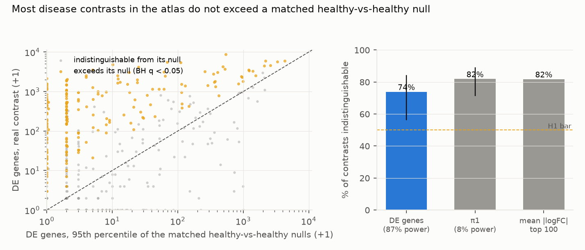
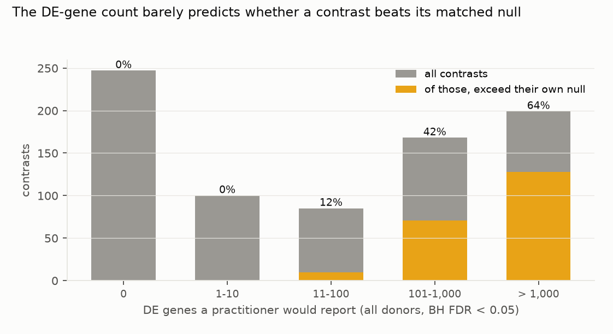
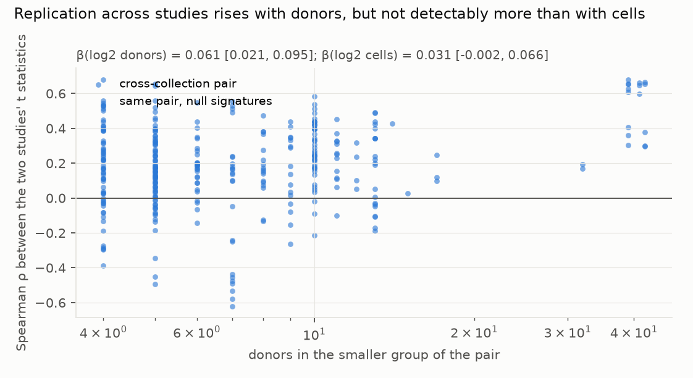

# At matched group sizes, three quarters of single-cell disease signatures in a cell atlas cannot be told apart from comparing healthy donors with each other

*799 disease × tissue × cell-type contrasts from 25 datasets in the CZ CELLxGENE Census (42 diseases, 161 cell
types). Each was compared with 500 matched healthy-donor-only contrasts drawn from the same dataset, tissue and cell
type, through an identical limma-voom pipeline on donor pseudobulk. The plan was committed before any expression
value was read.*

**Verdict: H1 Supported; H2 Inconclusive.**

- **H1 (more than half of contrasts are indistinguishable from their matched healthy-vs-healthy null): Supported.**
  - On the number of differentially expressed genes, the statistic the power check selects (below), **74%** of the
    799 contrasts do not exceed their own null at BH q < 0.05 (95% CI 57–84%, cluster bootstrap over the 25
    datasets). Real and null are compared at the same group sizes, a median of 13 donors against 13.
  - On π1, the preregistered primary statistic, 82% (71–89%). **But π1 detects a real twofold change in 5% of genes
    only 8% of the time**, so that figure is nearly uninformative; the DE-gene count detects it 87% of the time
    (D2, `results/tables/power_check.json`).
  - Weighting every disease equally gives the same answer: 74%.
- **The DE-gene count a practitioner reports barely predicts whether the contrast beats its null.**
  - At full size, using every donor (median 100 per contrast), a practitioner would report at least one DE gene in
    69% of these contrasts, with a median of 52.
  - Among contrasts reporting 11–100 DE genes, only **12%** exceed their own matched null. Among those reporting
    101–1,000, only 42%; above 1,000, 64%.
  - **The two are not the same comparison.** The null test is run at matched group sizes, a median of 13 donors
    against 13, because a null needs two disjoint healthy groups and no dataset has enough healthy donors to mirror
    a full-size comparison. So part of this gap is donor count, not signal.
  - Comparing healthy donors with healthy donors is not quiet: in 8.9% of contrasts the null's 95th percentile is
    above 100 DE genes.
- **A positive control confirms the power problem on real data.** Comparing male with female healthy donors in the
  largest dataset (115 per group, brain oligodendrocytes) gives 219 DE genes and is detected against permuted nulls
  at p = 0.005. π1 misses it (p = 0.25).
- **It varies by disease.** Of the eight most common diseases, 0% of schizophrenia (37 contrasts) and 0% of
  tauopathy (35) contrasts exceed their null, against 62% of interstitial lung disease (32) and 63% of pulmonary
  fibrosis (27). COVID-19 (86) is 45%.
- **Disease-gene enrichment is weak.** Comparing the Open Targets scores of each contrast's 100 strongest genes
  with the same statistic on its nulls, 9.9% of 575 contrasts beat their null at raw p < 0.05, against 5% expected
  by chance. None survives BH correction.
- **H2 (cross-study replication follows donor count rather than cell count): Inconclusive.**
  - Across 335 cross-collection pairs (94 disease × tissue × cell-type groups, 9 diseases), the median Spearman
    correlation between two studies' t statistics is 0.19.
  - More donors does predict better replication: β = 0.061 per doubling (95% CI 0.021–0.095).
  - But it is not detectably better than cell count: the paired difference is 0.030 (−0.032 to 0.084), so the
    hypothesis as preregistered is Inconclusive.
  - Those pairs span only 9 diseases. Bootstrapping over diseases instead widens every interval to include zero.
- **The nulls share the real contrasts' confounding.** Where both sides of a pair have null draws, the null
  signatures correlate across studies at 0.03 against 0.30 for the real ones, so the matched null is not simply
  reproducing a batch effect common to all data.

## In plain terms

Single-cell studies compare sick and healthy people one cell type at a time, and report the genes that differ. The
trouble is that people differ from each other anyway. With a dozen donors per group, some genes will always look
different.

We took a large public atlas of such data and, for each disease comparison, built 500 fake comparisons from healthy
donors only: same study, same tissue, same cell type, same numbers, matched for sex and age. Then we ran the
identical analysis on all of them and asked whether the real comparison stood out from its own fakes.

Three quarters did not. In most of these comparisons, the disease result is no more striking than what you get by
splitting healthy people into two arbitrary groups of the same size and comparing them.

A caveat we cannot remove: the fake comparisons can only be as large as the healthy donors allow, so the test runs at
about a dozen donors a side, while a researcher using every donor in the study has about a hundred. Part of what we
call "indistinguishable" is therefore the smaller comparison, not only the weaker signal.

That is not a claim that the diseases have no effect on these cells. It means these particular datasets, at this
size, cannot show it. Lung fibrosis comparisons mostly do stand out; schizophrenia and tauopathy comparisons, in
these data, never did.

## What was asked

The lead asked how much reported single-cell disease signal survives explicit, matched negative controls at atlas
scale.

Prior work:
- Squair et al. (2021) showed that treating cells as replicates inflates false discoveries and that donor pseudobulk
  controls them. This study uses pseudobulk throughout, so it asks a different question: whether a correct pipeline
  still reports signatures a matched null would also produce.
- Nakatsuka et al. (2025) found that disease DE genes from single neurodegeneration and COVID-19 datasets replicate
  poorly across datasets, and improved matters with a rank-based meta-analysis. They measure cross-study
  replication; they do not build within-study negative controls.
- Dann et al. (2023) showed matched controls reduce false discoveries when identifying disease cell states.

No study was found that builds matched healthy-vs-healthy nulls across an atlas and reports how many published-style
contrasts exceed them.

## How it was done

- **Data.** CZ CELLxGENE Census LTS 2025-11-08, human, primary cells only, raw counts summed per
  (dataset, tissue, cell type, donor) with at least 10 cells. Donors carrying more than one disease label in a
  dataset were excluded.
- **Contrasts.** 799 primary contrasts: within one dataset, a disease group of at least 8 donors against at least 16
  normal donors of the same tissue and cell type. Median 13 donors per group after matching, median 106 cells per
  donor.
- **The null.** For each contrast, 500 draws of two disjoint healthy-donor groups from the same dataset, tissue and
  cell type, reproducing the real draw's counts by sex and age bin.
  - Where a stratum was short, the draw fell back to the nearest age bin, then to any donor of the same sex, then to
    any donor. These fallbacks cover 11.8% of null donor slots, and 5.5% did not match sex.
- **The pipeline,** identical for real, null and full-size runs: `filterByExpr`, TMM, voom, lmFit, eBayes, with sex
  as a covariate where it varies. edgeR 4.8.2 and limma 3.66.0 in Docker, without network access.
- **Exceedance.** An empirical p from 500 null draws, then BH across contrasts; a contrast is indistinguishable at
  q ≥ 0.05.
- **Positive control (G3).** Male against female normal donors in the same framework, 25 real draws against 200
  label-permuted nulls (`results/plausibility.md`).
- **Coverage (G2).** `results/tables/coverage.json`: 43 of 43 datasets pseudobulked with integer counts and no cell
  shortfall against the Census metadata; contrast donors kept and dropped with reasons; fits failed.

## Results

### Exceedance (`results/figures/F1_exceedance.png`)

### What a practitioner would report (`results/figures/F2_practitioner.png`)

### Replication across studies (`results/figures/F3_replication.png`)

### What predicts exceeding the null (exploratory)

Regressing each contrast's standardised excess over its null on standardised predictors (cluster bootstrap over
datasets): sex imbalance between the disease and normal groups has the clearest association (β = 0.75, 95% CI
0.26–1.96), and nucleus-based assays exceed less often (β = −0.97, −1.87 to −0.06). Donor count (β = 0.16,
−0.28 to 1.18) and cells per donor (β = 0.13, −0.22 to 0.41) do not separate from zero. The sex-imbalance
association, together with the 5.5% of null slots that could not match sex, suggests part of the exceedance that
does occur is residual donor confounding rather than disease biology.

## What this does and does not show

- **A matched null is a low bar that most atlas contrasts do not clear.** This is a statement about these datasets
  at these donor counts, not about the diseases.
- **The usual evidence does not separate them.** A DE-gene count in the dozens, which is what most of these
  contrasts produce, is almost never distinguishable from healthy-donor variation in the same data.
- **Exceeding the null is necessary, not sufficient.** A disease cohort processed in its own batch would exceed a
  null drawn from that dataset's healthy donors. The exploratory sex-imbalance association is consistent with some
  of the exceedance being confounding.
- **Not shown:**
  - **That these diseases have no cell-type-specific effects.** Low power is the more likely explanation for most
    contrasts, and the study does not estimate per-contrast power against a biological effect size.
  - **That a full-size analysis would also fail.** The matched null is bounded by the healthy donors available, so
    it tests a smaller comparison than a practitioner runs. The exceedance result is a statement at matched sizes.
  - **Matching beyond sex and age bin.** Ancestry, BMI, post-mortem interval and sampling site are not matched, and
    11.8% of null donor slots used a fallback.
  - **Cell-type label quality.** Census annotations are used as given, at mixed granularity.
  - **H2 beyond 9 diseases.** The replication analysis is observational and thin.

## Process and deviations

- **Preregistration:** `plan.md`, committed before any expression value was read.
- **Deviations** (`deviations.md`):
  - D1 (before any expression value): contrast counts under the plan's own donor rule (799, not 869); the H5AD data
    route; the DE image.
  - **D2 (before any H1 result): the preregistered primary statistic π1 has 8% power against a synthetic twofold
    change in 5% of genes, against 87% for the preregistered secondary DE-gene count.** Both are reported; the
    interpretation leads with the DE-gene count. The choice used only null draws and synthetic injections.
- **Gates:** G1 (plan §6), G2 (`coverage.json`), G3 (`results/plausibility.md`, including the power check),
  G4 (`results/tables/age_map.csv`), G5 and G6 at write-up. G7 does not apply.
- **Independent review:** queued (Fable), per the lab's pacing rule.

## Reproducing it

1. `code/meta.py`, then `code/stream.py list`.
2. `code/fetch_h5ad.py` and `code/pb_h5ad.py watch` (they run together).
3. `code/draws.py agemap`, `build`, `control`; `code/power_check.py build`.
4. `code/draws.py run 22` and `code/power_check.py run 10` (limma-voom in Docker).
5. `code/fetch_ot.py`, then `code/analyse.py` and `code/figures.py`.
