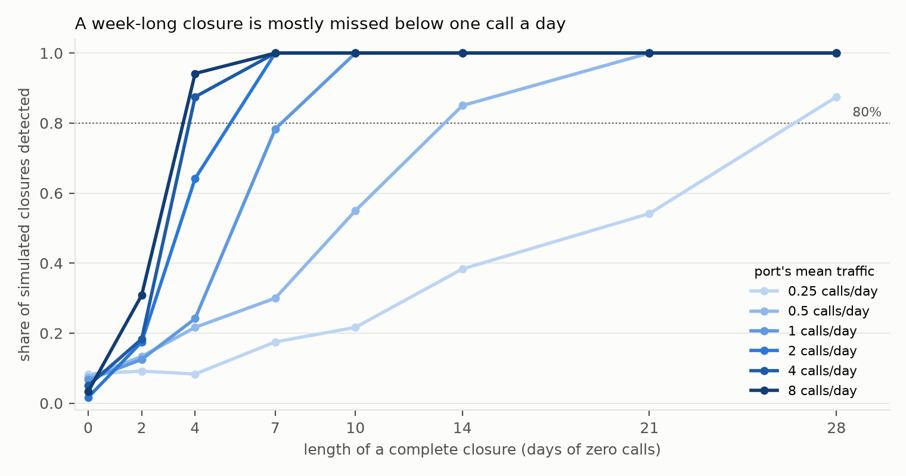
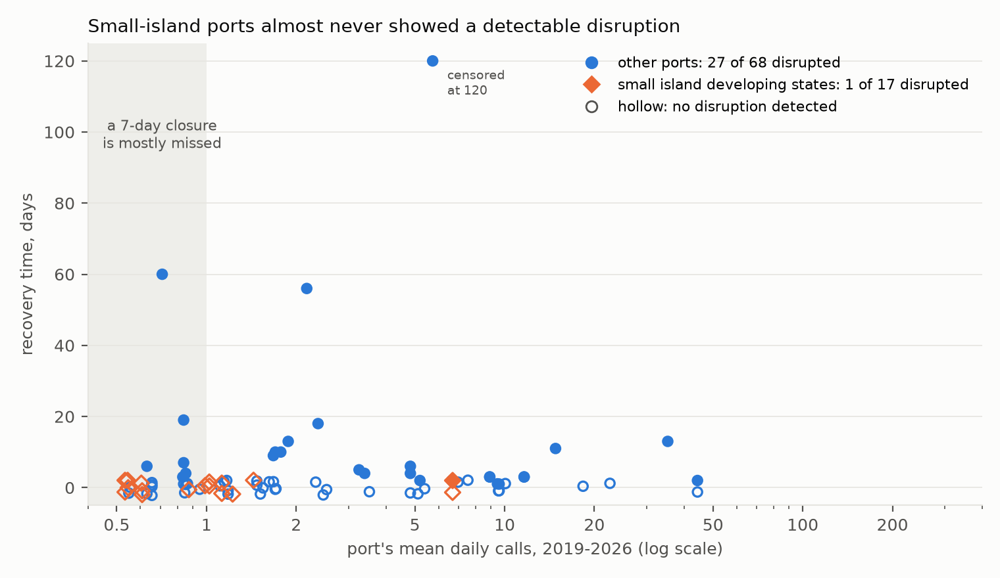
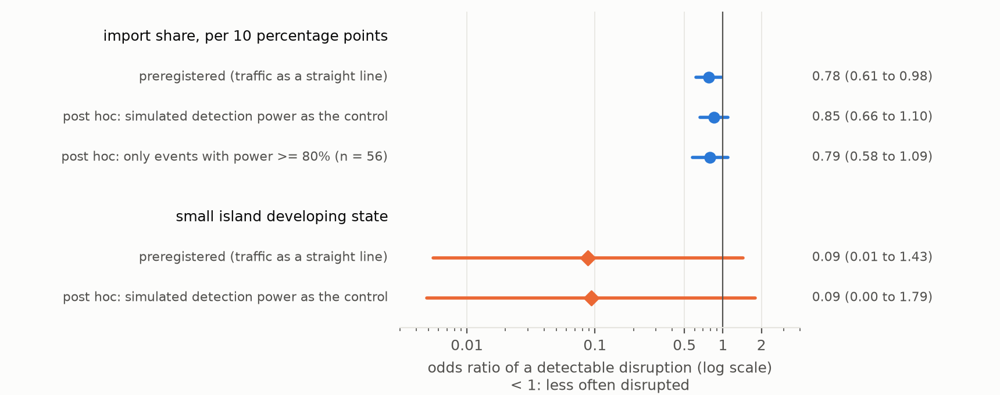

# How long do island supply lines stay broken after a cyclone?

*Ship calls after Category 3+ cyclones at 2,065 ports over eight years of open AIS-derived data: an
import-concentration test, a small-island comparison, and a forecast for the 2026–27 South Pacific season frozen
before it begins.*

**Verdict: Inconclusive. Neither preregistered hypothesis could be decided, and the lead's direction is not borne
out.** The primary hypothesis was that a port's share of national imports predicts recovery beyond size and storm.
It came out at ΔAIC 2.3 against a bar of 10. A permutation test puts that gain within chance (p = 0.14). The
association in it turns out to track how many ports a country has, not import concentration as such.

The small-island hypothesis (a time ratio ≥ 2) could not be estimated as planned. Only 1 of 17 measurable
small-island events showed any detectable disruption. That is the rate the same method gives at small-island ports
on dates with no storm (3 of 49), so there was nothing to time. Measured instead as average days disrupted,
small-island ports showed far less *detectable* disruption than other ports, not more. Part of that gap is
detectability. The part that is not is among ports inside hurricane-force winds: small-island ports 0 of 6
disrupted, other ports 14 of 23.

The deeper finding is about what this kind of data can see. Most Pacific island ports are too quiet for ship-call
records to reveal a closure shorter than a month. Of the six measurable small-island harbours that took
hurricane-force winds, four would almost certainly have shown a complete two-week closure, and none did. At the
other two (Montego Bay and Santiago de Cuba under Hurricane Melissa, 2025) the method could not have reliably seen
one.

## In plain terms

When a severe cyclone passes near a port, how long until ships come back? Are small island ports, which often
handle most of a country's imports, slower to recover? We used a public daily record of ship visits to 2,065 ports
from 2019 to 2026, and matched it with every cyclone track.

Most Pacific island ports turned out to be too quiet to answer the question. Fifty of 62 get fewer than one ship
every two days. At that rate, a port can be shut for two weeks and the record looks much like an ordinary lull.
Before looking at any result, we simulated how long a closure would have to be to show up at each level of traffic.

At the small-island ports busy enough to measure (17 cases, mostly in the Caribbean, five in the Pacific), we
almost never saw a disruption. The one we saw (Kingston, Jamaica, two days) is the rate our method gives on dates
with no storm at all. Only six of those cases actually took hurricane-force winds. At four of them, a full
two-week shutdown would almost certainly have shown up, and none did. At the two ports hit hardest by Hurricane
Melissa, it might not have. That is not evidence that the islands escaped harm. Ship visits are not cargo, the
hardest-hit ports were usually the quiet ones, and a service running at half capacity would often look normal in
this record.

At busier ports elsewhere, a detected disruption typically lasted about six days, matching earlier work. Even
there, some detections are probably false alarms.

Before the season opens on 1 November 2026, we have locked in a forecast for 12 Pacific ports. We will score it
once the season's data are complete, in about September 2027.

## What was asked

The lead (scouted 2026-10-16 from the University of Auckland's Blue Pacific Horizons signature research area)
claimed three things. Pacific island ports take a median of at least 14 days to recover after a Category 3+
cyclone. That is at least twice as long as matched non-island ports. And a port's share of national imports
predicts recovery better than its size (ΔAIC ≥ 10).

Counting events before computing any outcome showed the first claim had no usable sample, so plan.md restated the
hypotheses before any recovery time existed:

- **H1 (primary):** adding import share to both parts of a two-part model improves AIC by ≥ 10. Supported if
  ΔAIC ≥ 10; Refuted if < 2; Inconclusive between.
- **H2 (secondary):** small island developing states (UN list) recover at least 2× more slowly, adjusted
  (Weibull time ratio). Supported if the interval is above 1 and the point estimate is ≥ 2; Refuted if the upper
  end is < 2.
- **Pacific:** a descriptive case series, with what the method could have detected at each port.
- **Forecast:** frozen before 1 November 2026, scored after the season.

## What was already known

| Work | What it establishes | What it leaves open |
| --- | --- | --- |
| Verschuur, Koks & Hall (2020), *Transp. Res. D* 85:102393 | AIS-observed port disruption after natural disasters: 141 disruptions, 74 ports, 27 disasters; median 6 days, p95 22.2 days | small islands; import concentration |
| Verschuur, Koks & Hall (2023), *Nature Climate Change* 13:804–806 | modelled downtime at 1,320 ports and its trade knock-ons; some small island states among the most exposed | observed recovery |
| CyPort (arXiv:2509.22656) | 1,927 port–cyclone interactions at 145 US ports, 2015–2023 | outside the US |
| US DOT / MarTREC (2023), *Prediction of port recovery time after a severe storm* | AIS vessel counts; Gulf and Florida storms of 2022 | outside the US |
| IMF WP 26/99 (2026) | PortWatch nowcasts of country trade, incl. some SIDS | port-level recovery after cyclones |

No earlier PortWatch- or AIS-based estimate of recovery at Pacific island ports, test of import concentration, or
frozen seasonal forecast was found (searches 2026-10-16 and, by the reviewer, 2026-10-17).

## How it was done

**Data.** IMF PortWatch daily port calls, 2019-01-01 to 2026-07-24 (2,065 ports). The PortWatch ports database
(size; share of national maritime imports, a model-based estimate). IBTrACS v04r01 tracks to 2026-10-15. All
retrieved 2026-10-16; hashes are in `data/raw/VINTAGE.txt`.

**Events.** A port–storm pair where the hourly-interpolated track passes within 150 km at Category 3+ (the primary
arm). "Category" is the Saffir–Simpson scale from 1-minute winds (JTWC/NHC), not the Australian or Fiji regional
scale. The arm holds 213 events. 85 of them (34 storms) are at ports averaging ≥ 0.5 calls a day, with ≥ 270 days
of history before and the follow-up the method needs after. The rest are 114 at quieter ports, 8 with too little
follow-up and 6 with too little history.

**What counts as a disruption.** For each event, a negative-binomial model of the port's daily calls over the two
years before, with weekday, seasonal and trend terms. It models the port's *share* of traffic at reference ports
1,000–4,000 km away, so that a shock to all shipping (COVID's collapse in early 2020) cancels. 2,000 simulated paths
give the range of normal. An event is *disrupted* if the deepest dip in the first 14 days falls below the 5th
percentile of the same statistic in the simulated paths. At the quietest ports that window stretches to the
smoothing-window length, up to 27 days. *Recovery time* is the first day from the deepest dip from which calls stay
within the normal range for a full window. The smoothing window scales with traffic, about ten expected calls: 7
days at busy ports, 21 at half a call a day.

**What the method can see, worked out first.** Synthetic ports with known closures, run through the identical
algorithm (F1; the rows quoted use dispersion 0.25). At ≥ 2 calls a day, a complete week-long closure is caught
every time. At one call a day, 78% of the time. At half a call, 30%, and a two-week closure 85%. The simulation
uses independent noise. Real series have serially correlated swings, so the real false-alarm rate, measured after
the review at storm-free dates, is higher: about 10% (below).

**Model.** Part A: a logistic model for disrupted or not. Part B: a Weibull accelerated-failure-time model for
recovery days among disrupted events, censored at 120. Both use log port size, log mean daily calls (a
detectability control), category and distance. Part A intervals are clustered by storm; part B intervals use a
storm-cluster bootstrap.

**Changed from the lead before any outcome (deviations D1).** 50 of 62 Pacific island ports average under 0.5
calls a day. Of 32 Pacific events in the primary arm, 5 were measurable, from 3 storms. So the Pacific became a
case series. The island comparison widened to all small island developing states, and import concentration became
the primary. "Non-island" became "not a small island developing state".

**Caught by the method's own tests before any real event (D2, D3).** A pointwise rule gave 23% false alarms; it
became one familywise test. An estimated COVID adjustment absorbed nothing; it became an offset. A fixed 7-day
window could not see even a 28-day closure at half a call a day; it now scales with traffic.

## Results

### H1: Inconclusive, and indistinguishable from chance

| specification | events (storms) | ΔAIC | part A: odds of disruption per +10 pp import share | verdict |
| --- | --- | --- | --- | --- |
| **primary: Cat 3+ ≤ 150 km** | 85 (34) | **2.33** | **0.78 (0.61–0.98)** | **Inconclusive** |
| Cat 1+ ≤ 150 km | 435 (100) | 9.52 | 0.84 (0.73–0.97) | Inconclusive |
| Cat 3+ ≤ 100 km | 53 (24) | 3.40 | 0.67 (0.40–1.12) | Inconclusive |
| Cat 3+ ≤ 250 km | 189 (50) | 9.08 | 0.78 (0.65–0.92) | Inconclusive |
| recovery = back within 10% (T10) | 85 (34) | 2.18 | as primary | Inconclusive |
| own-history counterfactual | 85 (34) | 1.54 | 0.79 (0.63–0.99) | (below the Refuted line) |
| excluding Mar–Jun 2020 | 81 (32) | 1.46 | 0.79 (0.63–0.99) | (below the Refuted line) |

All the gain is in part A, whether a disruption is detected at all (ΔAIC +4.2). Adding import share to part B makes
the fit worse (−1.8), and its time ratio has a bootstrap interval of 0.17 to 670. These data say nothing about
import share and recovery *length*.

Two post-hoc checks (D8) say the part-A association should not be read as an import-concentration effect:

- **It is within chance.** Shuffling import share across ports 400 times gives a null distribution of ΔAIC whose
  95th percentile is 5.0. The observed 2.33 is exceeded 14% of the time. (For the Cat 1+ arm the reviewer's
  permutation gives p = 0.003, so an association exists there, but see the next point.)
- **It tracks how many ports a country has.** PortWatch's share is within-country, so a port in a one-port country
  has share 1 by construction. Across the 85 events, share correlates −0.79 with log(number of PortWatch ports in
  the country). Adding that variable turns the share coefficient positive (+2.6, p = 0.24); the port-count
  variable carries the association (+1.26, p = 0.008). In the Cat 1+ arm, share goes to −0.37 (p = 0.72). Ports in
  China, the US, Japan, Taiwan and the Philippines were more often detectably disrupted than ports elsewhere.

Candidate reasons include pre-emptive typhoon closures at Chinese and Japanese ports (short, clean, detectable
dips), AIS density, storm geometry (landfalls versus offshore passes), relief shipping raising calls at island
ports after a disaster, and the busy-port false alarms below. None of them is import concentration.

### H2: Inconclusive, because there was almost nothing to time

| | events | storms | detectably disrupted | at storm-free placebo dates |
| --- | --- | --- | --- | --- |
| small island developing states | 17 | 8 | **1** (Kingston, Melissa 2025: 2 days) | 3 of 49 runs (6%) |
| other ports | 68 | 27 | 27 (40%); median recovery 6 days, p90 34 | 23 of 209 runs (11%) |
| Pacific island ports (subset of the first row) | 5 | 3 | 0 | — |

With one disrupted small-island event, part B cannot estimate a small-island time ratio. H2 is reported as
Inconclusive by a guard (fewer than 3 disrupted small-island events → not estimable). The guard was **added in D4
after the descriptive table was seen; it was not preregistered.** The alternatives give different answers:

- the D4 code without the guard (storm bootstrap): time ratio 0.40, interval 0.14–1.34, which would be **Refuted**;
- lifelines' own interval: 0.40 (0.06–2.61), which would be Inconclusive;
- a pooled measure, mean recovery days counting undisrupted events as 0: 0.12 days at small-island ports against
  5.84 elsewhere, ratio 0.02 (0.00–0.09).

The lead's directional claim, that small island ports are slower, is therefore contradicted in the pooled sense.
In the conditional sense, recovery time among disrupted events, it is untestable here. In the Cat 1+ arm, where 5 of
53 small-island events were disrupted, the adjusted time ratio is 0.80 (0.15–3.89).

**External check, with a caveat.** The median recovery among detected disruptions at other ports, 6 days, equals
Verschuur et al.'s (2020) AIS median. But at the placebo false-alarm rate, about 7 of the 27 non-small-island
detections are expected to be false alarms. Those carry spurious "recovery times" of median 34 days (10 of 26
censored at 120), so the 6-day median and 34-day p90 describe a mixture.

**Two influential events.** Lake Charles (56 days) and Calcasieu Pass (60 days) after Hurricane Laura were hit
by Hurricane Delta on days 43–44. Censoring them at day 43 barely changes part B. Cebu after Typhoon Rai (December
2021) is the only disrupted event censored at 120 days. Its calls stayed at about half their earlier level for all
of 2022, a level shift whose cause (storm damage, Omicron, or a counting change) the series cannot tell. Without
Cebu, part B's category effect falls from ×3.1 to ×0.9 per category step. That matters for the forecast below.

### Post hoc: what the small-island result can and cannot carry (D7, D8)

**Exposure.** "Category 3+ within 150 km" describes the storm, not what the port felt. Using IBTrACS's 64-kt wind
radii in the quadrant facing the port, only 6 of the 17 small-island events were inside hurricane-force winds:
Nouméa/Niran, Apra Harbor/Mawar, Kingston/Beryl, Mariel/Rafael, Santiago de Cuba/Melissa and Montego Bay/Melissa.
Inside those radii: small-island ports 0 of 6 disrupted, other ports 14 of 23 (Fisher p = 0.017). Outside: 1 of 11
against 8 of 34 (p = 0.42). Radii were missing for 11 other-port events.

**Event-specific power.** Closures were simulated under each event's own fitted counterfactual, reference index and
threshold (100 replicates each). For a complete 14-day closure the mean power across the 17 events is 0.93, but it
is 0.33 at Santiago de Cuba/Melissa (whose calls rose after the storm, consistent with relief shipping) and 0.79 at
Montego Bay/Melissa. For a week-long closure the mean is 0.61, and 10 of 17 events are below 0.8. Partial
disruption is mostly invisible: calls halved for 14 days are caught 45% of the time on average, halved for 28 days
57%. Fifteen of 17 events are below 0.8 for both.

**So the surviving claim is narrow.** Four measurable small-island harbours took hurricane-force winds with near-1
power for a two-week complete closure: Nouméa, Apra Harbor, Kingston under Beryl, and Mariel under Rafael. None
showed one. At the two Melissa direct hits it could not have been seen reliably. A half-capacity month could have
been missed almost anywhere.

**Detectability as a control.** Small-island events have less power to show a week-long closure (0.66 against 0.86
by the simulation grid). Replacing part A's straight-line traffic control with each event's simulated power shrinks
the import-share log-odds by about a third (to an odds ratio of 0.85, 0.66–1.10, p = 0.21). The small-island odds
ratio stays at 0.09 (0.00–1.79).

### The Pacific case series

| port | storm | traffic (calls/day) | hurricane-force winds at port | power, complete 14-day closure | power, halved 28 days | dip (observed ÷ expected) | threshold | disrupted |
| --- | --- | --- | --- | --- | --- | --- | --- | --- |
| Lautoka, Fiji | Harold, Apr 2020 (Cat 4, 111 km) | 0.99 | no | 1.00 | 0.41 | 0.93 | 0.24 | no |
| Suva, Fiji | Harold, Apr 2020 (Cat 4, 103 km) | 1.02 | no | 1.00 | 0.52 | 0.88 | 0.24 | no |
| Nuku'alofa, Tonga | Harold, Apr 2020 (Cat 4, 115 km) | 0.54 | no | 0.96 | 0.51 | 0.64 | 0.36 | no |
| Nouméa, New Caledonia | Niran, Mar 2021 (Cat 3, 50 km) | 1.44 | yes | 1.00 | 0.63 | 0.38 | 0.30 | no (close) |
| Apra Harbor, Guam | Mawar, May 2023 (Cat 4, 37 km) | 0.87 | yes | 1.00 | 0.51 | 0.78 | 0.36 | no |

The other 27 Pacific events in the primary arm could not be analysed. 26 are at ports below 0.5 calls a day,
including Luganville under Harold's eye, Savusavu under Yasa, and every Saipan, Tinian and Rota event. The
remaining one is Apra Harbor under Bavi (July 2026), with too little follow-up yet. The strongest hits on Pacific
main harbours in recent memory (Pam at Port Vila 2015, Winston at Suva and Lautoka 2016, Gita at Nuku'alofa 2018)
predate PortWatch.

### The frozen forecast for 2026–27

The forecast model has base covariates, import share and the small-island indicator in part A. Part B drops the
indicator, because one disrupted event cannot estimate it (D5). It was fitted once and frozen on 2026-10-17:

    forecast_model.json  0cbaa6e125ad071f05641a2c3ad58f096c4ad993bbef50220ed77ff6e43b8d25
    forecast_table.csv   26e6c7aa3693f2734372e5ca153d38c0daa8ee85b5d3fd19d0c7e73e635f45c3

For a Category 4 cyclone passing 75 km away (alphabetical; this is not a ranking):

| port | chance of a detectable disruption | median recovery if disrupted (days) |
| --- | --- | --- |
| Apia, Samoa | 0.02 | 23 |
| Apra Harbor, Guam | 0.03 | 23 |
| Honiara, Solomon Islands | 0.03 | 22 |
| Kimbe, Papua New Guinea | 0.09 | 14 |
| Lae, Papua New Guinea | 0.15 | 16 |
| Lautoka, Fiji | 0.08 | 18 |
| Nouméa, New Caledonia | 0.08 | 19 |
| Nuku'alofa, Tonga | 0.02 | 23 |
| Papeete, French Polynesia | 0.04 | 23 |
| Port Moresby, Papua New Guinea | 0.15 | 17 |
| Rabaul, Papua New Guinea | 0.10 | 14 |
| Suva, Fiji | 0.08 | 18 |

How to read it:

- **The chances mostly track traffic.** Part A's coefficient on log mean daily calls is 1.11, so the busier PNG
  ports score higher because a disruption there is easier to see, not because they are more vulnerable.
- **The medians rest on two choices.** Had part B kept the small-island indicator, as the plan specified, they
  would be about four times shorter: Port Moresby 4 days instead of 17, Suva 5 instead of 18, Apia 12 instead of
  23. D5 was made after H1 and H2 were seen.
- **The category effect behind the medians rests on Cebu.** It depends on one censored event (Cebu/Rai); without
  it the effect vanishes. Medians above the 120-day horizon (nine rows, all Category 5 at 25 km) extrapolate beyond
  the fitting data, which contain no Category 5 event.

The forecast file stays frozen. The scorer, `code/score_forecast.py`, was revised after the review so that it runs
without judgement calls (D8):

- It checks the model's hash.
- It uses the frozen 2026 port covariates (`forecast_port_covariates.csv`, verified to reproduce all 108 forecast
  rows).
- It rebuilds the season's events from a new vintage without touching the sealed data.
- It scores recovery with censoring, and reports Brier scores against both the all-port benchmark (0.33) and the
  small-island rate (0.06).

A dry run on the 2019–20 season reproduces the three Harold events. Scoring is due once PortWatch covers 30 April
2027 plus 135 days, about September 2027.

**The decision rule, fixed now (D8):**

- **Fewer than 3 scorable events:** the score is reported and not interpreted.
- **3 or more events but none disrupted:** the result is reported as uninformative about skill, because low
  probabilities win automatically when nothing happens.
- **3 or more events, at least one disrupted:** the forecast *shows skill* only if its Brier score beats both the
  all-port (0.33) and small-island (0.06) benchmarks, *and* its censoring-aware recovery error beats the 5.5-day
  benchmark's. Otherwise it *does not show skill*.

## What this does and does not show

**It shows** three things. First, at the four measurable small-island harbours that took hurricane-force winds and
where the method had near-full power, there was no complete two-week closure (2019–2026). Second, import share as
PortWatch defines it is not a usable predictor of port recovery in these data. In the primary arm its signal is
within chance (permutation p = 0.14). In the Cat 1+ arm it is not within chance, but it is carried by country port
counts. Third, most Pacific ports are too quiet for ship-call records to answer the lead's question,
and F1 shows where that limit lies.

**It does not show** that small island ports are resilient. Eleven reasons:

1. **Port calls are not cargo.** A port can receive ships while cranes, warehouses or roads are down.
2. **The hardest-hit ports are mostly the quiet ones.** 49 of 68 small-island events in the primary arm were at
   ports too quiet to analyse. The measurable ones are main national harbours.
3. **Partial disruption is mostly invisible** (calls halved for a month: 57% power on average).
4. **Exposure is thin.** Only 6 measurable small-island events were inside hurricane-force winds, and two of
   those were beyond the method's power.
5. **Small vessels are outside the data.** PortWatch counts AIS-equipped cargo and tanker vessels, not the small
   inter-island boats that carry much of the Pacific's domestic supply.
6. **Relief and naval shipping** can raise call counts after a disaster (Santiago de Cuba after Melissa).
7. **Second storms** inside the 120-day window (Laura then Delta).
8. **The worst cases predate the record.** PortWatch starts in 2019, after Pam, Winston and Gita, and Dorian's
   devastation of Freeport (September 2019) has too little prior history to analyse.
9. **Metering gaps:** AIS coverage loss at a port, PortWatch revisions, and anchorage calls outside the port
   polygon.
10. **Disruptions starting more than about two weeks after the storm** fall outside the test window.
11. **The detection threshold carries Monte Carlo noise.** The reviewer's eight-seed rerun gives 28 ± 1
    detections; no small-island verdict is near its threshold.

"Small island developing state" is the UN label. It includes territories of the US, France and the UK (Guam, the
Northern Marianas, New Caledonia, the Turks and Caicos), so it does not describe a port's resources. The code's list
also includes Bahrain, which is no longer on the UN list; Bahrain has no events, so this is immaterial.

## Process and deviations

Eight logged deviations (`deviations.md`):

- D1: hypotheses restated before any outcome.
- D2, D3: method flaws caught by tests.
- D4: `analysis.py` crashed on first run. The fix and new tests were committed before the rerun. The H2 guard
  added there is post hoc.
- D5: the forecast's part B drops the small-island indicator.
- D6: forecast hashes.
- D7: post-hoc detectability checks.
- D8: acting on the adversarial review (fix first, 21 issues). It added the placebo, exposure, event-power,
  country-port, permutation and H2 checks (`code/review_response.py`). It also revised the scorer and corrected
  `recovery.py`'s docstring, whose code is unchanged since the plan.

Code was committed before the outcomes it produced. The plan is at d12c3f0, the analysis fix at 3c194e6, the
results and frozen forecast at 0c928af, and the review response at e230de9.

## Reproducing it

    bash code/download.sh                    # PortWatch + IBTrACS; compare data/raw/VINTAGE.txt
    venv/bin/python code/events.py           # cyclone-port events from tracks and coordinates only
    venv/bin/python code/test_recovery.py    # 9 synthetic checks of the recovery algorithm
    venv/bin/python code/detectability.py    # F1 grid (28 cores, ~10 min)
    venv/bin/python code/recovery.py         # every event's counterfactual, disruption and recovery (~30 min)
    venv/bin/python code/test_analysis.py    # 6 synthetic checks of the models
    venv/bin/python code/analysis.py         # H1, H2, arms, sensitivities -> results/tables/primary.json
    venv/bin/python code/supplementary.py    # post-hoc checks, Pacific case series
    venv/bin/python code/review_response.py  # placebo, exposure, event power, confounds (~20 min)
    venv/bin/python code/figures.py

Released: `results/tables/recovery_events.csv` (every event, its status, disruption and recovery time),
`events_all.csv`, `detectability.json`, `primary.json`, `supplementary.json`, `review_response.json`,
`placebo_false_alarms.csv`, `exposure_primary.csv`, `event_power_sids.csv`, `pacific_case_series.csv`, and the frozen
forecast with its covariates. PortWatch and IBTrACS are public and not redistributed.
