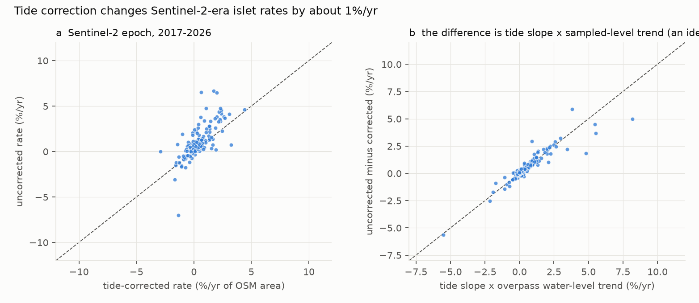
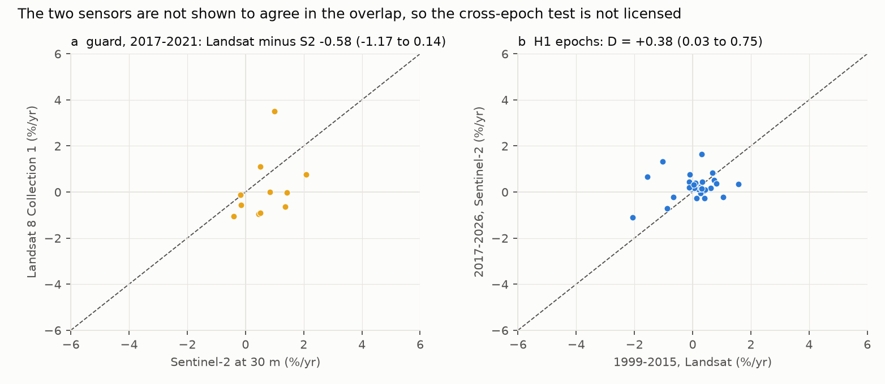
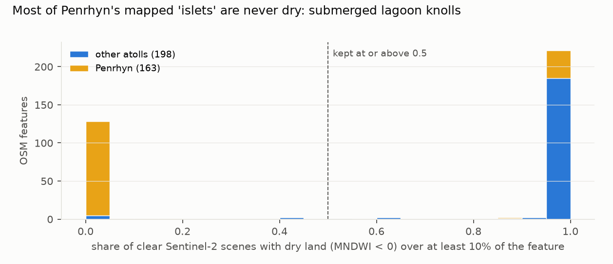

# Pacific reef islets: skipping tide correction shifts each islet's recent area trend by about 1% a year, islets grew slightly on average, and acceleration cannot be tested with these sensors

*Islet land area was measured in every usable Sentinel-2 image (2017–2026; from late 2019 at Funafuti and Tarawa) and
every usable Landsat 7/8 image (1999–2015), at the eight Pacific atolls with their own tide gauge. Each area was
corrected to mean sea level with the gauge reading at image time. Rates are Theil–Sen slopes, as a percentage of the
islet's OpenStreetMap (OSM) area per year. This version incorporates an independent review and a bug fix found while
applying it (`review/review.md`; D7).*

**Verdict: H1 not testable; H2 Supported.**

- **H2 (a missing tide correction biases decadal rates by at least 0.3%/yr): Supported.**
  - Over 150 islets in 6 atolls, the mean absolute difference between uncorrected and corrected Sentinel-2-era rates
    is **0.88%/yr** (95% interval 0.72 to 1.04).
  - With water levels shuffled within each islet the difference is 0.13%/yr. Using only clearly negative tide slopes
    it is 0.82 (0.66 to 0.97).
  - The direction varies from islet to islet. On average, uncorrected images overstate growth by 0.6%/yr.
- **H1 (no acceleration of loss): not testable by the preregistered rule.**
  - **The guard is not passed.** Landsat 8 and Sentinel-2 at 30 m, on the same islets and years, give rates that
    differ by −0.58%/yr (−1.17 to +0.14). The interval is not inside the ±0.2%/yr tolerance. It also includes zero,
    so the sensors are not shown to disagree; the guard simply cannot confirm that they agree.
  - There are 11 islets at three atolls (Kwajalein +0.01, Majuro −0.93, Penrhyn −0.84, a single islet).
  - Every guard span tried gives −0.51 to −0.64%/yr, each interval including zero and none inside ±0.2
    (`review/reviewer_checks/confirm_recompute.out`), so the result does not depend on D6's span.
  - **The early epoch is itself two sensors.** Per islet it holds a median of 5 Landsat 7 images (1999–2012) and 20
    Landsat 8 images (2013–2015), and its rate tracks the Landsat 8 minus Landsat 7 step (r = 0.66).
  - The epoch comparison (D = +0.38%/yr, +0.03 to +0.75) is therefore not interpretable as a change in the islets.
- **What the islets did, 2017–2026.**
  - The mean tide-corrected rate is **+0.42%/yr (+0.26 to +0.58; median +0.23)** over 150 non-engineered islets, a
    slight average gain. Uncorrected, it would read +1.01.
  - Atoll means run from −0.09%/yr (Kwajalein) to +1.24 (Funafuti).
- **Two atolls fail the tide check.** At Tarawa and Kiritimati the primary index (MNDWI with an Otsu threshold) does
  not respond to the tide (pooled r +0.20 and −0.05; elsewhere −0.34 to −0.70). Their rates are given with that caveat
  and from the NDWI series.
- **Correction after review.** The draft reported a 2.08%/yr bias and a "mechanism". Both came from a Theil–Sen bug
  that used about half of the time pairs, and from reading an identity as evidence. D7 explains.

## In plain terms

Low coral islands in the Pacific are often said to be shrinking as the sea rises. Satellite studies have mostly found
the opposite. But how big an island looks from space depends on the tide when the picture was taken: at low tide a wide
beach and reef flat are dry.

We measured islands at eight atolls in every usable satellite picture, and corrected each picture to the same water
level using the atoll's own tide gauge. Skipping that correction shifts an island's measured trend over 2017–2026 by
about 1% a year, in a direction that differs from island to island. The reason is simple: an island is seen in a few
dozen cloud-free pictures, and by chance those happen to be taken at slightly higher or lower tides as the years go by.
Corrected, the average island grew slightly, by about 0.4% a year.

We also wanted to know whether islands are shrinking faster now than before 2016. We could not answer that fairly. The
older Landsat satellites and the newer Sentinel-2 give different trends for the same islands in the same years, and
the older period itself mixes two Landsat satellites. Any difference between the periods could come from the
satellites.

## What was asked

The lead (`blue-pacific-reef-island-area-tide-corrected`, Blue Pacific Horizons) asked two things:
- whether reef-island loss has accelerated since 2016, once each image is corrected for the tide;
- how much a missing correction biases rates.

Per-scene tide correction exists in CoastSat.islands, Cuttler et al. 2020, and Sengupta, Ford, Kench and Perry 2025.
What is new here is one pipeline applied to two epochs at atolls with an on-atoll gauge, plus a direct measure of the
bias on the same islets. The plan (`plan.md`) was committed before any scene was processed.

## How it was done

- **Atolls:** the eight with an on-atoll UHSLC gauge, namely Tarawa, Majuro, Funafuti, Kwajalein, Kanton, Kiritimati,
  Penrhyn (Tongareva) and Kapingamarangi.
- **Islets:** OSM coastline rings of at least 1 ha (364 features). Engineered islets are reported apart.
- **The land screen (D5).** A feature counts as an islet only if dry land (MNDWI below 0, which no depth of water
  gives) covers at least 10% of it in at least half its clear Sentinel-2 scenes. 228 of the 361 measured features pass
  (`results/figures/F3_land_screen.png`).
  - The main islands of Kanton, Kiritimati and Tarawa are too large for one Sentinel-2 window and were never
    measured.
- **Areas:** MNDWI with an Otsu threshold inside each islet's buffered ring, keeping connected land that touches the
  ring. Clouds are screened with a split rule (D2).
  - **Sentinel-2 L2A:** 161,845 islet-image records after the land screen, including those rejected for cloud.
  - **Landsat Collection 1 Level-1, 1999–2015:** 27,401 records. When an acquisition exists in several processings,
    the final tier is kept (D7). The archive lists no Landsat 5 scene for these path/rows.
  - **Gross failures** (more than 5 robust standard deviations from the islet's median) were set aside.
- **Image windows, from the archive:**
  - Sentinel-2 starts in January 2017 at Kwajalein, Majuro and Penrhyn, June 2018 at Kiritimati, October 2019 at
    Funafuti and Tarawa, and 2022 at Kanton and Kapingamarangi.
  - The last two are too short for a rate.
- **Tide correction:** each islet's area is regressed on the gauge's level at image time, and the fitted response is
  removed, giving the area at mean sea level.
- **Rates:** Theil–Sen slopes over every pair of images (D7 fixed a bug that used about half the pairs). They need at
  least 20 images over at least 6 years, and are expressed as a percentage of the OSM area (D3).
- **Tests:**
  - **The guard:** Landsat 8 against Sentinel-2 at 30 m. The Landsat side is restricted to each islet's Sentinel-2
    window (D7), with a minimum span of 4.5 years (D6).
  - **H1:** the epoch difference D on non-engineered islets of at least 5 ha.
  - **H2:** the mean absolute uncorrected-minus-corrected rate on Sentinel-2 islets of at least 1 ha.
  - **Intervals:** islets resampled within atolls (B = 2,000).

## Results

### H2: the tide bias (`results/figures/F1_tide_bias.png`)

| atoll | islets | corrected rate (%/yr) | uncorrected minus corrected | mean absolute bias | tide response of the Otsu area (r) | level trend at image times, all acquisitions (mm/yr) |
|---|---|---|---|---|---|---|
| Funafuti | 16 | +1.24 | +1.64 | 1.80 | −0.66 | −7 (−33 to +17) |
| Kwajalein | 52 | −0.09 | +0.45 | 0.87 | −0.70 | −3 (−10 to +4) |
| Majuro | 29 | +0.83 | +0.99 | 1.04 | −0.65 | +2 (−7 to +10) |
| Penrhyn | 31 | +0.40 | +0.50 | 0.54 | −0.34 | −1 (−3 to +2) |
| Tarawa | 20 | +0.51 (NDWI +0.30) | −0.22 | 0.52 | **+0.20** | +2 (−22 to +24) |
| Kiritimati | 2 | (fails tide check; NDWI −0.20) | −0.06 | 0.34 | **−0.05** | +4 (−1 to +9) |

- **The statistic:** 0.88%/yr (0.72 to 1.04), Supported.
- **The noise floor:** 0.13%/yr with levels shuffled within islets. 91% of islets exceed their own floor.
- **Why it happens.**
  - No atoll shows a trend in water level at image times: every interval in the last column includes zero. So this
    is not an orbital or tidal drift. Satellites pass at a fixed local time, which aliases the tide into periods of
    weeks or a year, never into a decade-long drift.
  - What differs is each islet's own sample. Which images survive the cloud screen differs islet by islet, so each
    islet's few dozen tide levels carry a chance trend.
  - At an islet whose visible area changes by 35–70% per metre of water, that chance trend becomes a trend of up to
    a few percent a year in uncorrected area. The correction removes it.
  - The bias equals tide slope × sampled-level trend. That relation is an identity of the correction, so it is
    shown, not offered as evidence (panel b).
- **Islet size:** the bias is largest for islets of 1–5 ha (mean 1.26%/yr, 76 islets in the half-open bin (1, 5]),
  against about 0.42%/yr for larger ones.
- **Tarawa and Kiritimati.** Their Otsu areas do not follow the tide. At high water the Otsu threshold also takes in
  bright shallow water over the reef flat; imagery of one Tarawa islet shows 14 ha at low water and 28 ha at high
  water. The fixed-threshold and NDWI areas at the same islets do respond. Their Otsu-based rates are not
  tide-corrected in any meaningful sense, so NDWI rates are given beside them. The Kiritimati row covers only two
  islets.

### H1: why acceleration cannot be tested here (`results/figures/F2_guard_and_epochs.png`)

- **The guard.** It is not passed: −0.58%/yr (−1.17 to +0.14) over 11 islets. By atoll:
  - Kwajalein +0.01 (4 islets);
  - Majuro −0.93 (6 islets);
  - Penrhyn −0.84, from a single islet.

  Without D7's restriction of the Landsat side to each islet's Sentinel-2 window, the guard has 13 islets and gives
  −0.29 (−0.85 to +0.30), which also does not pass.
  - The interval treats islets as independent, but islets at one atoll share scenes and tides, so the effective
    sample is three atolls.
  - The D6 span change was checked by the review: the result does not depend on it.
- **The early epoch mixes sensors.** Per H1 islet it has a median of 5 Landsat 7 images (1999–2012) and 20 Landsat 8
  images (2013–2015), with no Landsat 5. Its rate correlates 0.66 with each islet's Landsat 8 minus Landsat 7 area
  step, so the "17-year" slope is mostly a sensor step. No guard tests Landsat 7 against Landsat 8.
- **For the record only:**
  - **Bootstrap:** D = +0.38%/yr (+0.03 to +0.75) on 33 islets in 4 atolls. Read without the guard, the H1 rule
    would return Supported (no acceleration of loss), so the verdict depends on the guard. No guard span passes,
    though, so it does not depend on the span (D8).
  - **Mixed model:** +1.22 (−0.88 to +3.33).
  - **Sensitivity analyses:** NDWI +0.08 (−0.57 to +0.69); robust tide slopes +0.32 (+0.09 to +0.58); fixed threshold
    −0.23 (−0.60 to +0.18).
  - None of this measures a change in the islets.

### The 2017–2026 rates

- **Pooled:** +0.42%/yr (+0.26 to +0.58; median +0.23) over 150 non-engineered islets. Uncorrected: +1.01 (+0.78 to
  +1.26).
- **Engineered islets** (23): +0.10%/yr.
- **Islets of 1–5 ha** (79, half-open bin [1, 5)): +0.57%/yr.

### The inventory (`results/figures/F3_land_screen.png`)

- **Penrhyn.** 126 of its 163 OSM features of at least 1 ha are submerged coral knolls in the lagoon.
- **Elsewhere,** the screen removes:
  - one 181 ha Tarawa polygon that is mostly reef flat;
  - one 4.7 ha Kwajalein reef-flat feature;
  - three small Kiritimati features;
  - two Kwajalein sand cays of about 1 ha.
- **A flagged cay.** One 1.3 ha intertidal sand cay at Kwajalein is flagged by the "possible loss" rule. Its detection
  depends on tide phase, and only four images exist before 2019, so no change can be inferred.
- **One-sided rule.** The rule has no "possible gain" counterpart, and borderline cays depend on each one's tide
  sampling.

### Digital Earth Pacific Coastlines (secondary)

- **Islet level.** DEP's 2016–2023 shoreline rates near each islet, converted to areal rates, do not correlate with
  this study's corrected rates (r = −0.11 over 146 islets) or uncorrected rates (r = −0.09). Mean absolute differences
  are about 8%/yr.
- **Atoll level.** DEP is negative at Funafuti, Kwajalein and Majuro, where this study's corrected rates are positive
  or near zero. It is positive at Penrhyn and Tarawa.
- **Reading.** Shoreline-transect rates and area time series do not agree at this scale, and neither validates the
  other.

## What this does and does not show

- **Tide correction is needed for islet-level trends from optical satellites.**
  - Without it, a single islet's rate over 2017–2026 is off by about 1%/yr, in a direction set by chance in its own
    image sample.
  - Pooled regional means are biased less, but not zero: +0.6%/yr toward growth here.
  - This supports per-image correction, as CoastSat.islands does.
- **Islets did not shrink on average over 2017–2026.** The corrected mean is +0.4%/yr. That is consistent with the
  literature's finding that most atoll islands are stable or growing on decadal scales.
- **Acceleration is not testable with these sensors.**
  - Landsat 8 and Sentinel-2 are not shown to agree in the overlap.
  - The guard's interval includes zero but extends well beyond the ±0.2%/yr tolerance.
  - The early epoch mixes Landsat 7 and Landsat 8.
  - A credible test needs a sensor-consistent series: Landsat alone with intercalibrated sensors, or Sentinel-2
    alone once it is long enough.
- **Limits:**
  - **Measurement:**
    - The rates measure satellite-visible land at mean sea level, not vegetated or habitable area.
    - OSM rings define both the islets and the reference area.
    - The Otsu index fails the tide check at Tarawa and Kiritimati.
  - **Coverage:**
    - Sentinel-2 covers only 6.8 years at Funafuti and Tarawa.
    - Six atolls give rates.
- **Care.** Results are reported by atoll and pooled, with no islet-level habitability framing and no ranking of
  islands. The communities of these atolls have not been consulted, and this is a measurement study, not an
  assessment of their land.

## Process and deviations

- **Preregistration:** `plan.md`.
- **Deviations** (`deviations.md`):
  - D1: Landsat Collection 1 Level-1; the guard window.
  - D2: the cloud rule.
  - D3: OSM reference area.
  - D4: two measurement bugs.
  - D5: the land screen.
  - D6: the guard's span, after the first run.
  - D7: after the review:
    - Landsat tier preference;
    - the guard window;
    - the not-measured list;
    - post-hoc checks (tide response per atoll, level trends on all acquisitions, E1 composition, spans, the guard by
      atoll, significant slopes only);
    - a **Theil–Sen bug** (only pairs with a positive index-ordered time difference were used; every rate re-run);
    - wording.
  - Earlier outputs are kept: `h1_h2_run1_before_D6.json`, `h1_h2_before_D7.json` and
    `h1_h2_D7_pre_theilsen_fix.json`.
- **Post hoc:** `code/h2_diag.py`, `code/review_fixes.py`, the DEP comparison.
- **Independent review:** Fable, 2026-10-23, "fix first" (`review/review.md`). The review's own checks used the
  study's Theil–Sen function, so the bug was found while applying its fixes. A confirmation pass follows.

## Reproducing it

1. **Inventory, gauges and catalogues:** `code/inventory.py`, `code/tides.py`, `code/scenes.py`,
   `code/gcp_scenes.py`.
2. **Areas:** `code/run_measure.sh`, which drives `code/measure.py`.
3. **Rates and tests:** `code/rates.py`.
4. **Checks and figures:** `code/h2_diag.py`, `code/review_fixes.py`, `code/dep_audit.py`, `code/dep_compare.py`,
   `code/figures.py`.
