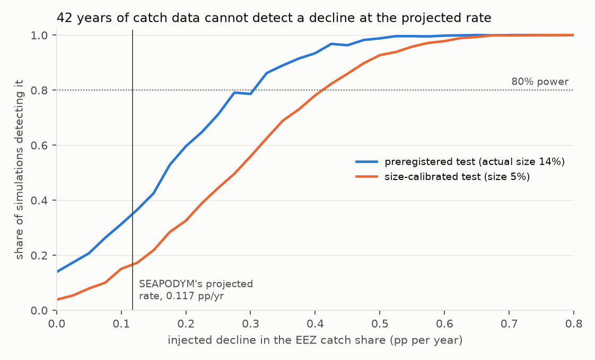
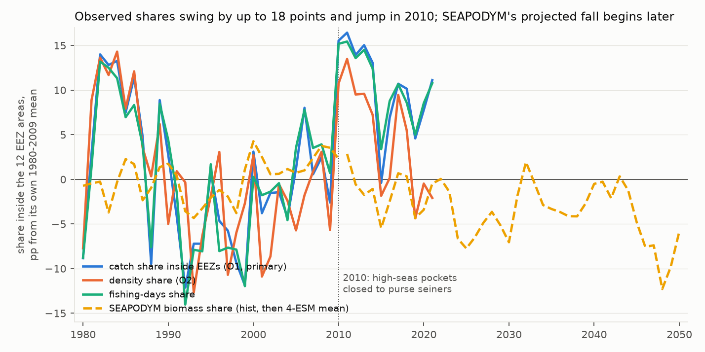
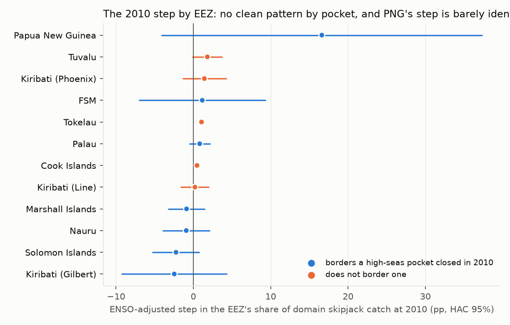
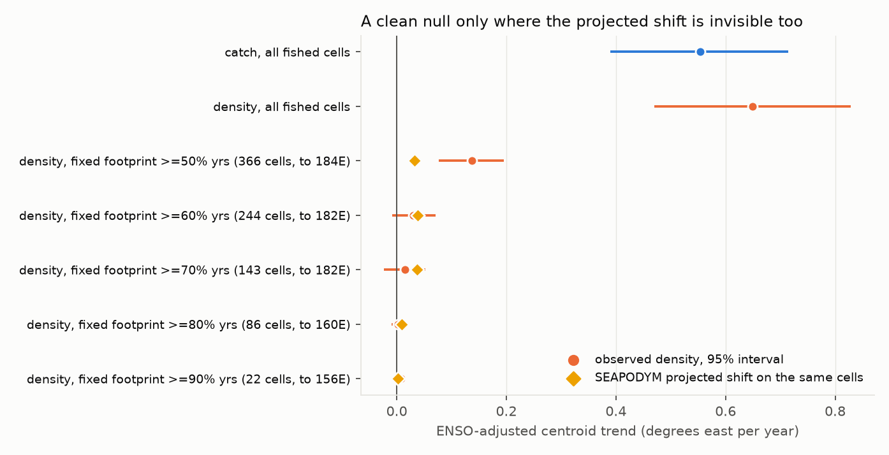

# Is the projected eastward shift of Pacific skipjack detectable yet?

*A detection-and-power test of the SEAPODYM projections behind the "13% loss from Pacific SIDS waters"
claim, against 42 years of open purse-seine data.*

**Verdict: Supported, borderline.** By the preregistered rule, the share of tropical skipjack catch taken
inside the ten Pacific SIDS' EEZs has not declined at SEAPODYM's projected rate: it rose, +0.255 percentage
points a year (95% interval −0.026 to +0.537), against a projected −0.117. But the preregistered intervals
turn out to be too narrow for a series this autocorrelated, and an interval that accounts for it (GLS-AR(1),
−0.225 to +0.620) includes the projected rate. Either way the verdict does **not** contradict SEAPODYM: the
model's own historical run rises too, and its decline begins later. What the study establishes is that catch
records cannot yet test the projection — they have essentially no power to see the projected decline so far,
and would not reliably detect it before about 2050 at the earliest, and quite possibly not this century.

## In plain terms

A widely cited projection says that by 2050, climate change will push about 13% of the region's tuna out of
the waters of ten Pacific Island countries and into the high seas, costing them access fees. We asked
whether that shift can already be seen in the fishing record.

We used 42 years of public catch data for skipjack, the main purse-seine target. The share caught inside the
islands' waters has not fallen; if anything it has risen. That is not evidence against the projection: the
computer model behind it says the same thing for the past, and only starts the decline in the future.

The useful finding is about what the catch record can tell anyone. The share swings by up to 18 points year to
year. Against that noise, the decline the model projects — starting around 2011 — would have
had almost no chance of showing up by 2021. Depending on how noisy the future turns out to be, it would not
be reliably visible until somewhere between about 2050 and the 2110s. Evidence that does not depend on where
boats fish could get there by the mid-2030s.

The share does move, but mostly for reasons that have nothing to do with the fish. It jumped in 2010, when the
high seas between several island countries were closed to these vessels, and the fleet's centre of activity
has moved steadily east as it opened new fishing grounds. Whether the fish themselves have moved east, these
data cannot say: the checks that give a clean answer are blind to the size of shift the model predicts, and
the ones that could see it disagree with each other.

So watching where tuna are caught will not confirm or refute the projection in time to matter for decisions.

## What was asked

Bell et al. (2021, *Nature Sustainability* 4:900–910) project that under RCP 8.5 the combined biomass of
skipjack, yellowfin and bigeye in the EEZs of ten Pacific SIDS falls by an average of 13% (range −5% to −20%)
by 2050, as tuna move east. The figure is now load-bearing in WCPFC, Forum Fisheries Agency and
climate-finance arguments. SEAPODYM's developers validate its *fit* to catch, length and tagging data; nobody
had tested whether the projected *redistribution* is visible in the record, or how much power the record has
to see it.

## What was already known

| Work | What it establishes | What it leaves open |
| --- | --- | --- |
| Bell et al. (2021) | The projection under test | Whether the redistribution is detectable in observations |
| SEAPODYM validation (WCPFC-SC21-2025/SA-IP-20 §6.2; SC22-2026) | Out-of-sample fit to catch, length and tagging | Fit to the redistribution *trend* |
| Lehodey et al. (1997, *Nature*) | Skipjack track the warm-pool edge with ENSO | Long-term change once ENSO is removed |
| Hanich et al. (2018) / McDermott et al. (2019), *PNAS* | ENSO dominates effort redistribution; ENSO control is the crux | Climate-driven change net of ENSO |
| Dutta, Ivekolia & Das (2025), *Asia & the Pacific Policy Studies* | Management moves catch across EEZ boundaries | — |

The calibration critic for this scouting round and the independent reviewer both found no detection-or-power
test of the SEAPODYM redistribution trend.

## How it was done

**Data, all open.** WCPFC public-domain purse-seine catch and effort, 1°×1° monthly (SPC THREDDS mirror,
1967–2021; 1980–2021 complete). SEAPODYM 2° reference runs from SPC: a historical run forced by ocean
reanalysis (1980–2010) and four RCP 8.5 projections forced by Earth system models (GFDL, IPSL, MIROC, MPI;
2011–2099), with no fishing. Marine Regions EEZ boundaries for the twelve EEZ areas of the ten SIDS (the eight
Parties to the Nauru Agreement, Tokelau and the Cook Islands; Kiribati counts three). Niño 3.4 and ERSST v5.
The FIRMS Global Tuna Atlas (5°) as a check on the 1° file's completeness.

**The comparison.** The same quantity in model and observations: the share of skipjack in a fixed domain
(20°S–20°N, 120°E–228°E, the WCPFC data's extent) that lies inside the twelve EEZ areas. Observed as catch
share (preregistered primary), density share (each fished cell weighted by catch per fishing day), and a
free-school-only density share.

**The test.** An ENSO-adjusted linear trend: share on year, Niño 3.4 (current and lagged) and the warm-pool
edge. Preregistered intervals: moving-block bootstrap (block 4, 2000 draws) and Newey–West (3 lags).

**The threshold** was not chosen by hand. It is SEAPODYM's own projected rate of change in the identical
share, four-ESM mean, 2011–2050: **τ = −0.1174 pp/yr** (GFDL −0.074, IPSL −0.216, MIROC −0.152, MPI −0.027).

Plan, code and model-only results were committed (3cc5aff) before any observed series was computed. The
grid's coordinate convention is not stated in WCPFC's documentation; the south-west-corner reading is primary
and the two alternatives are reported.

## What the model predicts, computed before any observation

**The headline reproduces closely.** The EEZ mask matches Marine Regions' area to 0.4%. Bell et al.'s own
equation (1) — the mean, over the 120 months of 2011–2020, of the biomass 33 years later divided by the biomass
then — gives a three-species change of **−13.8% (−9.3% to −19.9%)** against the published −13% (−5% to −20%).
(The paper is internally inconsistent: its Fig. 3 caption says the baseline is 2009–2018. Annual-mean windows
give −14.2% against 2011–2018 and −15.3% against a spliced 2009–2018; the first draft of this report quoted the
first of these under the second's label.) The mean agrees; the remaining gap is the MPI run, −9.3% here against
the paper's least-negative −5%.

**The model's past and future point opposite ways.** SEAPODYM's historical run has the skipjack EEZ share
*rising* over 1980–2010: **+0.105 pp/yr ENSO-adjusted (+0.033 to +0.180)**. The decline begins only in the
ESM-forced projections. So the model does not predict the shift should already be visible, and an observed
rise agrees with it. This was written into the plan (§1.3) before any observation was examined.

## Results

All 1980–2021; ENSO-adjusted; 95% intervals.

### The preregistered verdict: Supported, but borderline

| interval | trend (pp/yr) | 95% interval | vs τ = −0.117 |
| --- | --- | --- | --- |
| block bootstrap (preregistered) | +0.255 | −0.026 to +0.537 | Supported |
| Newey–West, 3 lags (preregistered) | +0.255 | +0.017 to +0.494 | Supported |
| GLS-AR(1), ρ = 0.58 (added after review) | +0.198 | −0.225 to +0.620 | Inconclusive |

Mean share 83.8%. Both preregistered intervals clear τ, and the result holds across coordinate conventions,
the 10°S–10°N core band, yellowfin and bigeye, and covariate sets. But the residuals are strongly
autocorrelated (lag-1 0.56), and the plan's disclosed coverage of 0.89 was measured under white noise. Under
the observed autocorrelation, both preregistered intervals cover the true trend only about three-quarters of
the time (0.74 in 150 synthetic replicates here; 0.79 for the bootstrap and 0.76 for Newey–West in the
reviewer's 600). An interval that models the autocorrelation includes τ. The verdict follows the rule as
committed, and it is a narrow one.

### The record cannot see the projected decline yet, and will not for decades



Three numbers describe what the catch record can detect:

| | value |
| --- | --- |
| **power to see the decline the projection makes** — beginning in 2011, record to 2021, size-calibrated test | **8%** — about the 5% false-alarm rate |
| minimum linear decline across 1980–2021 detectable at 80% power: preregistered / size-calibrated test | 0.325 / 0.425 pp/yr |
| power to detect a 42-year linear decline at τ: preregistered / size-calibrated test | 0.37 / 0.17 |

The preregistered one-sided test raises a false alarm in 14% of simulations with no decline, because three
Newey–West lags undercorrect the autocorrelation; the size-calibrated test takes its critical value from those
null simulations. And the 42-year linear decline is not the hypothetical the projection makes: it projects a
decline beginning around 2011, and for that the record to 2021 has no usable power at all.

When would it become detectable? That depends on how noisy the future is, so it is a range:

| noise model for the future | first year detectable at 80% power |
| --- | --- |
| full 1980–2021 variability (the preregistered noise) | 2097 |
| with the 2010 step removed | 2071 |
| 1990–2021 variability, 2010 step removed | 2050 |
| preregistered spread, no autocorrelation | 2064 |
| preregistered spread, autocorrelation 0.75 | 2117 |
| SEAPODYM's steeper 2011–2030 rate (−0.336) | 2051 |
| the IPSL rate (−0.216) | 2064 |
| a fishery-independent index with model-like noise (SD 1.26, autocorrelation 0.63) | 2035 |

(Size-calibrated; each figure ±2–3 years of Monte Carlo error.) The full-period noise includes the fleet's
development decade and an unmodelled 17-point management step, which a future monitoring programme might not
face, so the 2090s are a pessimistic case. But **no catch-share noise model gets there before about 2050** —
the date the projection is about.

### What moves the share: fishing rules and the fleet



The share does not trend smoothly. It was high in the early 1980s, fell through the 1990s, and jumped in 2010
(F1). Adding a single step at 2010 — the year the two high-seas pockets between several EEZs were closed to
purse seiners (WCPFC CMM 2008-01 and the PNA's Third Implementing Arrangement) — gives a step of **+17.0
points** (Newey–West +8.5 to +25.6) and turns the trend to −0.242 pp/yr (−0.538 to +0.054). At the same moment
the EEZ share of fishing *days* jumped from 81.8% to 92.4% and catch share from 80.9% to 91.3%, while the
density share moved less, 78.8% to 83.5%.

Catch outside the twelve EEZ areas, by longitude, says where the displaced fishing went:

| longitude band | 2000–2009 (kt/yr) | 2010–2019 (kt/yr) |
| --- | --- | --- |
| 140–160°E | 34.1 | 8.6 |
| 160–180°E | 73.3 | 16.9 |
| 180–200°E | 16.7 | 60.9 |
| 200–228°E | 0.9 | 4.6 |

Catch in the western high seas, where the closed pockets lie, fell by about 80 kt a year. The decade averages
make it look as if some of it reappeared east of the dateline, but the timing says otherwise: at 180–200°E,
outside-EEZ catch was 13.6 kt a year in 2010–2013, no higher than before. The rise came in 2014–2019 (92.5 kt a
year, 173.5 in the 2015 El Niño), tracks ENSO (correlation 0.76 with Niño 3.4 over 2000–2019), and began after the pocket
closure measure lapsed in February 2013. At the time of the closure, the displaced catch went into the EEZs.

That fits the management record. On 1 January 2011 the PNA also closed the high seas between 10°N and 20°S,
170°E and 150°W — 4.56 million km² — to the purse seiners it licenses (announced 23 April 2010,
pnatuna.com/node/102). With both the western pockets and the eastern high seas closed to those vessels, effort
had nowhere to go but inside the EEZs. A PNA amendment dated June 2014 is titled as removing that closure; I
could not open it, so its timing fit with the 2014 rise is noted, not relied on. These bands include other
states' EEZs inside the domain, not only high seas.

What the per-EEZ pattern does *not* show: I predicted, before computing it, that the 2010 jump would sit in the
seven EEZs bordering the closed pockets. It does not, cleanly. Grouped, the bordering EEZs carry more of the
ENSO-adjusted step (+12.1 against +5.0 points), but all of it is Papua New Guinea, whose interval spans about
−4 to +37 points; four of the seven bordering EEZs have negative steps. With twelve post-2010 years, step and
trend trade off per EEZ and the decomposition is poorly identified (F3).



### SEAPODYM's historical run and the observations point the same way from 1990

| ENSO-adjusted trend, pp/yr | observed | SEAPODYM hist | difference (95%) |
| --- | --- | --- | --- |
| **H2**, catch share, 1980–2010 | −0.103 | +0.105 | −0.208 (−0.793 to +0.240) |
| catch share, 1990–2010 | +0.556 | +0.221 | +0.335 (−0.151 to +0.839) |
| density share, 1980–2010 | −0.293 | +0.105 | −0.398 (−0.889 to −0.045) |
| density share, 1990–2010 | +0.180 | +0.221 | −0.041 (−0.496 to +0.322) |
| free-school density share, 1980–2010 | −0.002 | +0.105 | −0.107 (−0.807 to +0.463) |
| free-school density share, 1990–2010 | +0.355 | +0.221 | +0.133 (−0.434 to +0.594) |

H2, as preregistered, is consistent. The one disagreement — the 1980–2010 density share — comes from the
fleet's development decade: a share over fished cells is close to 1 by construction when the fleet works 25
cells inside Papua New Guinea and FSM waters (1980) and falls as it spreads to 410 cells (1992). From 1990 all
three observed series move the same way as the model, though with intervals of ±0.4–0.5 points. The first draft read the 1980–2010 density result as
evidence against SEAPODYM's redistribution; it is not, and that reading is withdrawn. None of the observed
series is free of the fleet's footprint.

Out of sample (**H3**, train 1980–1999, test 2000–2010, eleven test years), both predictors are worse than
simply predicting the test-period mean: R² −0.46 for calibrated SEAPODYM, −1.72 for the ENSO regression. The
comparison is uninformative.

### The eastward move: mostly the fleet; the fish, unresolved



The catch centroid has moved east at **+0.554° a year** (+0.390 to +0.715) and the density centroid at +0.650.
Catch shifted from western EEZs (Papua New Guinea −8.9 points, FSM −10.9) to central and eastern ones
(Kiribati Gilbert +11.4, Nauru +4.9, Tuvalu +4.2, Kiribati Phoenix +3.1) — largely inside the ten SIDS' waters,
so the pooled share could not register it.

Most of that is the fleet. A centroid computed over the cells fished each year moves east whenever new eastern
grounds open, and on any fixed set of grounds the trend is far smaller. But whether skipjack density itself
has shifted east, the fixed-footprint check cannot say, because the footprints that give a clean answer are
blind to the shift the model predicts:

| fixed footprint (cells fished in ≥ x% of years) | cells | reaches | years covered ≥80% | observed trend (°/yr) | SEAPODYM projected, same cells |
| --- | --- | --- | --- | --- | --- |
| ≥50% | 366 | 184.5°E | 1997–2021 | +0.137 (+0.077 to +0.195) | +0.032 |
| ≥60% | 244 | 182.5°E | 1990–2021 | +0.030 (−0.009 to +0.071) | +0.039 |
| ≥70% | 143 | 181.5°E | 1989–2021 | +0.015 (−0.023 to +0.052) | +0.037 |
| ≥80% | 86 | 159.5°E | 1988–2021 | +0.002 (−0.009 to +0.013) | +0.010 |
| ≥90% | 22 | 155.5°E | 1982–2021 | +0.008 (−0.001 to +0.017) | +0.002 |

The narrow western footprints give a clean null, but SEAPODYM's own projected shift registers there as only
+0.002 to +0.010° a year against +0.070 domain-wide, so they could not tell no shift from the projected one.
The wider footprints, where the projected shift is visible (+0.03 to +0.04), give trends from no detectable
change to +0.14 — at or above the projected rate — depending on the threshold and the coverage rule. Across the eight threshold-by-coverage combinations on
those wider footprints, four exceed the projected rate and the one negative estimate (−0.010) is
indistinguishable from zero (full grid, with 60% and 90% coverage rules, in results/tables/footprint_grid.json). The first draft reported only
the ≥80% row, read its null as proof the fish had not moved, and left out the ≥50% result that its own plan
had named as the sensitivity. That headline is withdrawn.

## What this does and does not show

**It does not show the projection is wrong**, and it does not show the projection is right. The catch record
cannot test it on a timescale that matters for decisions about 2050.

**Catch is not biomass.** SEAPODYM's runs are no-fishing biomass; the observations are catch from a managed,
expanding fishery. Everything is framed on shares and trends, never levels.

**The 1° file holds about three-quarters of the raised catch, unevenly.** Against the FIRMS Global Tuna Atlas
5° public data for the same domain — which are raised to total catch — the 1° file holds 58% of skipjack
purse-seine catch in the 1980s, 71% in the 1990s, 73% in the 2000s and 79% in the 2010s (median year 73%). The
gap is raising plus suppression; suppressed cells lose every variable at once, so they are indistinguishable
from unfished ones (D4). Part of it is a whole region: the 1° file has no catch at all at 120–130°E, where the 5°
data record 144–578 kt a decade from domestic fleets; excluding that band it holds 63%, 76%, 78% and 82% by
decade. More consequential for this study, in the 1980s it holds 68% of the 5° catch at 130–160°E but only 11%
at 160–200°E. The high EEZ share of the early 1980s therefore rests on a file that barely sees the east that
decade, and the share's early level — and so part of its long-run shape — is not trustworthy.

**The domain stops at 228°E.** Biomass that leaves eastward leaves the denominator too, so this share is not
the 13% figure and must not be read as one.

**The open data end in 2021**, and SEAPODYM's historical run in 2010. More years would help, but at 80% power
the detection year is decades away under any catch-share noise model.

**Several analyses are post hoc** (D5–D8): the per-EEZ test, the size-calibrated power, the centroid and its
footprint checks, the detection-year range, the closure bands and the FIRMS comparison. The per-EEZ prediction
and the footprint check were logged with decision rules before they ran; the coverage refinement in D7 was not,
and the footprint check's rule was mis-specified because it did not ask what the model would show on the same
cells. The per-EEZ prediction failed, and the footprint headline was withdrawn after review.

**The residual standard deviation** is 7.9 points with the regression's degrees-of-freedom correction and 7.5
with the simple one the simulations use; the conclusions do not depend on which.

## Data-integrity findings worth reporting to SPC

In the SEAPODYM 2° reference runs on SPC THREDDS: the four bigeye projection files `bet_Btot_<ESM>_F0.nc`
hold total biomass (identical to adult + young) under the variable name `bet_B_young`, a leftover of `cdo add`
without a `chname` step, as their history attribute shows. The bigeye historical `bet_Btot_hist_F0.nc` is
identical to `bet_Badult_hist_F0.nc` — adult biomass only — so splicing it to the projections puts a
definitional step at 2010/2011 inside Bell et al.'s baseline period. Skipjack and yellowfin are consistent. (The
first draft described the historical file as "0.848 × (adult + young)"; that number was just the adult
fraction, and the review identified the file correctly.)

## Reproducing it

```
code/model_targets.py   EEZ mask, Bell reproduction, SEAPODYM share trajectories   (model only)
code/bell_eq1.py        Bell et al.'s equation (1)                                (post review)
code/indices.py         Nino 3.4 anomaly and warm-pool edge
code/observed.py        observed annual shares, three coordinate conventions
code/analysis.py        estimators and decision rules
code/test_analysis.py   15 checks on synthetic data, including coverage under AR(1) noise
code/primary.py         H1-H4 and preregistered sensitivities -> primary.json
code/exploratory.py     per-EEZ, size-calibrated power, centroid                (post hoc, D5)
code/footprint.py       fixed-footprint check                                   (post hoc, D6-D7)
code/footprint_grid.py  every footprint x coverage rule, beside the model       (post review, D8)
code/review_response.py GLS interval, H2 from 1990, hinge power, detection-year range, closure bands
code/firms_check.py     1-degree file against the 5-degree Tuna Atlas            (post review, D8)
code/figures.py         F1-F4
```

Raw data are public at the URLs in plan.md §3 and are not redistributed. Seeds are fixed (20261016). The
review, the reviewer's own scripts and its recomputed numbers are in review/.
