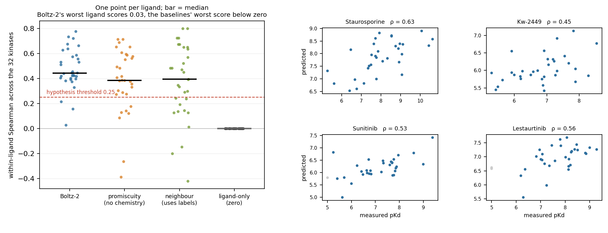
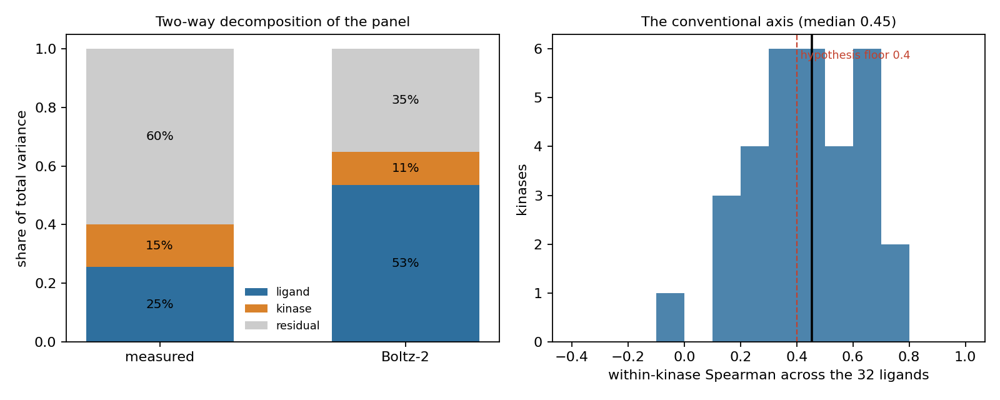
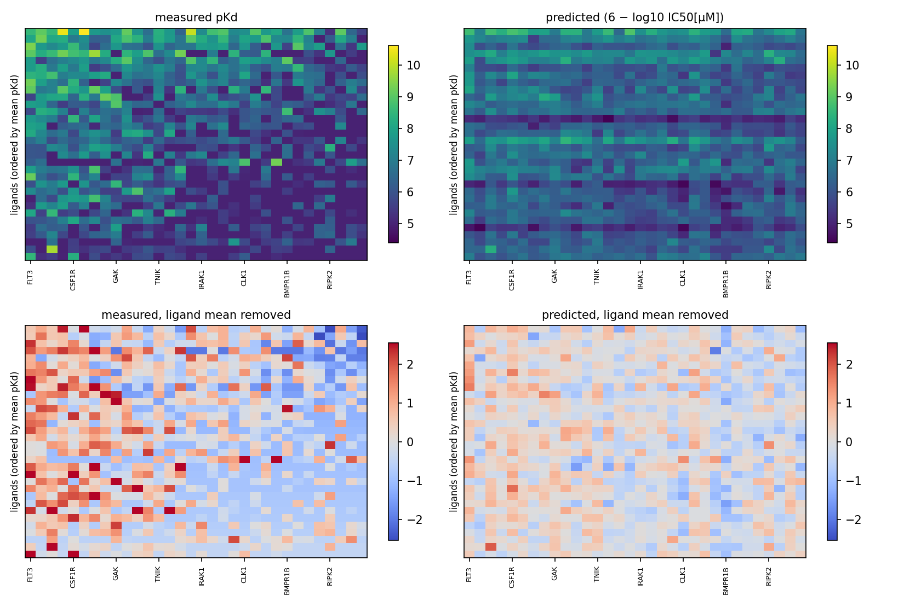
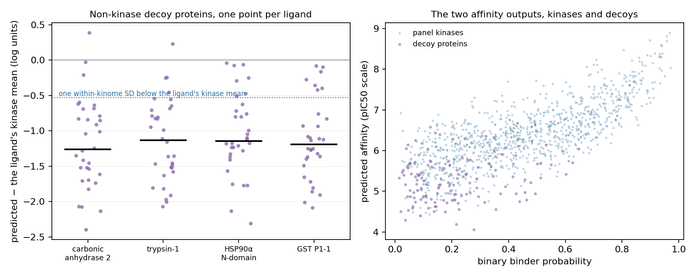
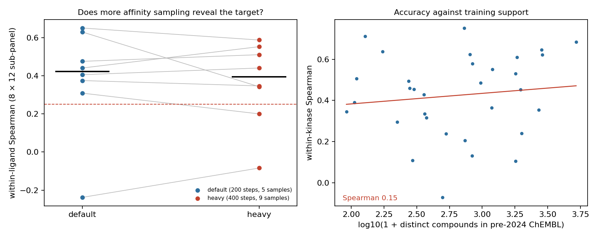

# Does co-folding affinity know its target?

*A kinase-panel selectivity test of Boltz-2: hold each ligand fixed, vary the protein, and compare with
measured binding constants.*

**Verdict: Refuted.** The preregistered hypothesis — that Boltz-2's affinity head cannot rank proteins for
a fixed ligand — does not hold. It ranks them with a median correlation of 0.44 and puts a true top-3
kinase first for 56 % of compounds against 9 % for chance. Against a baseline that never looks at the
compound, it wins on every statistic tried except two: the preregistered primary P1, and the ability to
tell the assay-ceiling block from real binders. Those two exceptions are the same fact, and they are why
the primary statistic understates the model. What it does badly is the thing selectivity consists of: it
captures about a third of the compound-by-kinase interaction, and reports the difference between a typical
pair of kinases at about half its true size.

## In plain terms

Drug companies need to know not just whether a compound hits its target, but what else it hits. A drug that
blocks the intended enzyme and thirty others causes side effects. So the practical question for any new
affinity predictor is: given a compound, can it tell you which proteins that compound will bind?

Boltz-2 is an open model that predicts binding affinity roughly a thousand times faster than the physics
calculations it aims to replace. We tested it the way a drug project would: take 32 known kinase
inhibitors, ask the model to rank 32 human kinases for each one, and compare with laboratory measurements
of all 1,024 combinations.

We expected it to fail, and preregistered that prediction. It didn't. The model's rankings correlate about
0.44 with the measurements, well above the threshold we had set for failure.

But a correlation on its own means little without something to compare it against, so we also wrote down,
before running the model, what some deliberately stupid methods achieve. One of them ignores the compound
entirely and simply ranks kinases by how many drugs bind them in general. On the headline measure that
scores 0.39 — statistically indistinguishable from the model.

That near-tie turns out to be an artefact of the measure rather than a fact about the model. Seven in ten
of the laboratory numbers are not real affinities at all: they are "no measurable binding at the highest
concentration tested". The headline measure spends a quarter of its weight on sorting those non-binders,
and the stupid baseline is exactly as good at spotting them as the model is. Once you ask any question
that depends on real affinities — order the compounds that do bind, or name the best target — the model
wins by a margin that comfortably excludes chance. Asked to name a compound's single best target it
succeeds 56 % of the time, against 19 % for the baseline.

Where it falls short is the thing selectivity actually consists of. Most of what varies in real
measurements is the specific pairing of compound and kinase; the model captures only about a third of that,
leaning instead on how potent a compound is overall. It also flattens the kinome: for a typical pair of
kinases, the difference it reports is about half the real one. So it will point you at roughly the right
targets while understating how much they differ.

Useful for triage, then, and better than nothing by a clear margin at the top of the list. Not yet a
substitute for the experiment when two close relatives have to be told apart.

## What was asked

Boltz-2 predicts a binding affinity for a protein–ligand pair at a thousandth of the cost of a
free-energy calculation, and its affinity head is the headline open claim of 2025–2026. People are
beginning to use it for *selectivity*: given a compound, which of many proteins will it hit? That use
needs the model to respond to the protein, not only to the chemistry of the ligand.

The published audits test the axis the authors emphasised — rank a series of ligands against one target —
and agreement with physics-based free energies on a handful of systems. This study tests the other axis.
On a complete kinase profiling panel (Davis et al. 2011, as packaged by DeepDTA: 68 inhibitors against 442
kinase assays, every cell measured), it holds each ligand fixed and asks the model to rank kinases, then
compares that ranking with the measured dissociation constants.

The preregistered hypothesis, in plan.md, was that the model fails this test: median within-ligand
across-kinase Spearman ≤ 0.25, while still clearing 0.4 on the conventional axis.

## What was already known

The preregistration catalogued the nearest prior work before any prediction was made; the full table is in
plan.md §2. Six results bound this study on either side:

| Work | What it establishes | Why it leaves this question open |
| --- | --- | --- |
| Boltz-2 preprint (bioRxiv 2025.06.14.659707) | FEP benchmarks, hit discovery, synthetic cross-target decoys in training | No panel-complete within-ligand test against measured values |
| **Koch, ChemRxiv 10.26434/chemrxiv-2025-sf3cs** | **Closest prior work.** Boltz-2 cannot pick the true target for an active among LIT-PCBA decoy targets, by either read-out | Binary target identification among unrelated pockets, not quantitative ranking inside one family against measured Kd |
| MIRAGE (arXiv 2609.14491) | Accuracy versus historical public support for a protein family, with ligand-only controls | Generalisation to *unsupported* families; this panel is deliberately all high-support |
| Nesso-1 (10.64898/2026.08.01.742196) | Matches or surpasses Boltz-2, arguing its benchmarks "reflect in-distribution scenarios" | Model comparison, not a selectivity audit — but it sharpens why an in-distribution panel is the right place to look |
| BoltzOmics (PMC13401010) | Within-drug ranking across *variants of one protein*, sensitive to affinity sampling settings | Mutants of a single target; motivated this study's sampling arm |
| Reliability audits (arXiv 2603.05532; JCIM pmid 41592323) | Boltz-2 affinity is largely independent of pose quality | A few targets, within-target axis |

Koch's result is the one that most constrains how this study's decoy arm should be read, and it is
discussed where that arm is reported. Their finding also changed this study's design before it ran: H4 was
restated as a descriptive spread comparison rather than a target-identification claim, because they had
already answered the target-identification question (D1, plan §1.2).

No prior work tests the axis this study tests — within-ligand, across-target, against a complete measured
panel, with chemistry-free and label-using baselines and a variance decomposition.

## How it was done

**The panel.** A 32 × 32 rectangle of the Davis panel, every cell predicted. Kinases had to be wild-type,
non-phosphorylated Davis entries whose sequence matches a reviewed human UniProt entry exactly, with
exactly one annotated protein-kinase domain of 220–350 residues; 303 of 442 qualified, and 32 were taken by
largest-remainder allocation across the eight Manning groups, choosing inside a group by the number of
uncensored Davis cells. The model input is that kinase domain plus a 20-residue flank — full-length
multi-domain kinases are neither affordable at panel scale nor what the competition binding assay reports.
Ligands had to be RDKit-parseable, single-fragment, MW ≤ 700 and have at least 8 uncensored cells among the
chosen kinases; the 32 taken are recognisable kinase drugs (pazopanib, crizotinib, gefitinib, erlotinib,
sorafenib, sunitinib, bosutinib, axitinib, neratinib, vandetanib, fedratinib, staurosporine and the rest).

Selecting on uncensored counts matters: 69.6 % of the whole Davis matrix sits at the 10 µM assay ceiling,
but only 27.1 % of this rectangle does, and the median ligand has 22 uncensored cells out of 32. The
selectivity question is therefore asked where there is a real dynamic range to rank. The cost is a sample
of relatively promiscuous kinases and ligands, which a separate arm probes.

**The model.** Boltz-2 2.2.1 with its released weights, in affinity mode, one protein chain plus one ligand
chain, one MSA per protein from the public ColabFold server, reused across every complex that protein
appears in. Settings are the defaults, passed explicitly: 3 recycling steps, 200 sampling steps, 1
diffusion sample, 5 affinity diffusion samples, 200 affinity sampling steps, no molecular-weight
correction, seed 20261013 throughout (every retained run was a single process at that one seed). The
read-out is `affinity_pred_value`, which is
log10(IC50 in µM), converted to a pIC50-like scale (6 − value) so that higher means stronger, matching pKd;
`affinity_probability_binary` is reported alongside. Note that the molecular-weight correction cannot
change any within-ligand statistic, because for a fixed ligand it is a constant.

One point about the read-out matters for reading the results. Boltz's own documentation scopes
`affinity_pred_value` to "comparing different active molecules, **not inactives**", and directs
`affinity_probability_binary` at telling binders from decoys. P1 ranks all 32 kinases together, 27 % of
them at the assay ceiling, so the preregistered primary estimand uses the value head outside its documented
domain. That is the documented reason to expect what we find — the probability head ranking better, and P2
being the more appropriate statistic for the value head — and it was not noticed until after the analysis
was done.

**What the measurements say before the model is consulted.** Three numbers fix the scale, and all three
come from Davis alone:

| Reference, from measured data only | Selectivity axis (within-ligand, 32 kinases) | Conventional axis (within-kinase, 32 ligands) | Top-1 hit |
| --- | --- | --- | --- |
| Ligand-only (one value per ligand) | 0.000 by construction | **0.489** | undefined |
| Target promiscuity, no chemistry (uses the measured panel) | **0.386** (0.310–0.522) | 0.000 by construction | 0.188 |
| Nearest chemical neighbour (uses the measured panel) | 0.394 (0.268–0.503) | 0.264 | 0.312 |
| Molecular weight only | 0.000 | 0.061 | undefined |
| Chance | — | — | 0.096 |

Two consequences for reading the hypothesis. The threshold it set on the selectivity axis, 0.25, is *below*
what a baseline with no chemistry in it achieves (0.386): knowing only which kinases bind most compounds
gets you a correlation of 0.39 with a given compound's real selectivity profile. And the floor it set on
the conventional axis, 0.4, is below what a baseline with no protein in it achieves (0.489): ranking
ligands within a target is mostly ranking ligands by overall potency. The verdict below follows the
preregistered rules, but the baselines are the more informative comparison, which is why they were
preregistered too.

The measured panel's variance splits 25.5 % to the ligand, 14.6 % to the kinase and 59.9 % to the
ligand-by-kinase interaction — so most of what a selectivity predictor has to get right is the interaction,
not either main effect.

## Results

All 1,024 panel complexes predicted, no failures, no missing cells. The secondary arms add 573 more, for
1,597 in total, against the ≈1,624 the plan projected: the post-cutoff arm yielded 11 compounds and 93
pairs where plan §5.3 had estimated 14 and ~120 (D11).

### The preregistered verdict: Refuted

The hypothesis was that the model fails this test, with a median within-ligand Spearman of 0.25 or below.
It does not fail it.

| | point | 95 % interval | |
| --- | --- | --- | --- |
| **P1** median within-ligand Spearman, 32 kinases | **0.444** | 0.418 – 0.532 | ligand cluster bootstrap |
| P2 the same, uncensored cells only | 0.464 | 0.429 – 0.487 | |
| P1, resampling kinases instead of ligands | — | 0.368 – 0.578 | sensitivity |
| P1, dyadic bootstrap | — | 0.329 – 0.624 | sensitivity |
| P1 on the high-confidence half | 0.537 | 0.391 – 0.637 | |
| P1 using the binary binder probability | 0.596 | 0.519 – 0.665 | |
| P3 median within-kinase Spearman, 32 ligands | 0.453 | — | H2's floor was 0.4 |
| P4 top-1 in the true top-3 | 0.562 | — | chance 0.096 |
| P4 precision@3 | 0.375 | — | chance 0.096 |

The lower end of every interval sits above 0.25, so by the rule in plan.md §6 the hypothesis is **refuted**:
the affinity head is not protein-blind, and its rankings are not noise. Dropping the ceiling cells moves the
model's own score up slightly, from 0.444 to 0.464, so censoring is not propping the model up. It is
emphatically doing work in the *comparison* against the baselines, which the next section is about.

The high-confidence row needs a caveat the plan did not anticipate. Filtering to the better half of Boltz's
own confidence scores is not the fold-quality control §9.3 intended: at the median cut, 6 of the 32 kinases
retain no cells at all, the kept half is *more* censored than the whole (31.6 % against 22.7 %), and mean
confidence correlates −0.278 with within-kinase accuracy. It is close to a non-random kinase subset with a
different effective panel per ligand, so 0.537 should be read as "the result is not an artefact of the
worst-folded complexes" and no further.

### But the threshold was in the wrong place, which the baselines show

This was foreseeable and was written down before any prediction: 0.25 is *below* what a baseline with no
chemistry in it achieves. Ranking kinases purely by how many compounds they bind — a single column vector
reused for every ligand — scores 0.386.

| | P1 all cells | P2 uncensored | top-1 | precision@3 |
| --- | --- | --- | --- | --- |
| **Boltz-2 affinity** | **0.444** (0.418 – 0.532) | **0.464** (0.429 – 0.487) | **0.562** | **0.375** |
| B1 target promiscuity (uses the measured panel) | 0.386 (0.310 – 0.522) | 0.293 | 0.188 | 0.229 |
| B2 nearest chemical neighbour (uses the measured panel) | 0.394 (0.268 – 0.503) | 0.294 | 0.312 | 0.240 |
| B0 ligand-only | 0.000 | 0.000 | undefined | undefined |
| B3 molecular weight | 0.000 | 0.000 | undefined | undefined |

B0 and B3 are constant within a ligand, so they have no ranking and no hit rate; an earlier draft printed
0.062 for them, which was an artefact of the kinase column order rather than an estimate.

One detail of B1 needs stating, because it is a choice that affects the headline margin. B1 is each
kinase's mean measured pKd over the *other* 67 compounds — leaving the ranked compound out, so that it
cannot contribute to the baseline it is scored against. Without that adjustment B1 scores 0.4256 on P1
rather than 0.3856, which would shrink the model's margin from +0.058 to +0.018; the leave-one-out version
is the honest comparator but it is also the one that flatters the model, and both numbers belong in the
record. On the within-kinase axis the adjustment has to be dropped, because leaving a compound out of its
own kinase's mean makes that baseline correlate exactly −1 with the measurement there; the within-kinase
cell therefore uses the unadjusted variant, which is 0 by construction. Both variants were committed at
`bdd795d`, half an hour before the panel run began.

Both B1 and B2 are built from the measured Davis panel — B1 from 67 other compounds' Kd against the same
kinases, B2 from the nearest compound's. As plan.md §7 put it, they are references for *how much signal is
extractable*, not fair competitors to a zero-shot model: neither can be computed for a kinase set nobody
has profiled yet, which is the situation the model is meant to serve. They are the right bar for "is this
worth running", and the wrong bar for "is this impressive".

### P1 is the one statistic that does not separate them, and the reason is the assay ceiling



Paired ligand bootstraps of the difference, model minus baseline, over every rank statistic a selectivity
user might reasonably ask for:

Bold marks the margins wide enough to survive a multiplicity correction over the sixteen comparisons in
this table; the unbolded ones exclude zero individually but would not.

| statistic | model | B1 | model − B1 | model − B2 |
| --- | --- | --- | --- | --- |
| P1 median within-ligand ρ, all cells | 0.444 | 0.386 | +0.058 (−0.071, +0.166) | +0.050 (−0.065, +0.195) |
| AUC, ceiling block vs real binders | 0.724 | 0.711 | +0.013 (−0.061, +0.090) | +0.038 (−0.030, +0.115) |
| P2 median within-ligand ρ, uncensored | 0.464 | 0.293 | **+0.171 (+0.065, +0.292)** | +0.170 (+0.017, +0.346) |
| concordance among uncensored cells | 0.653 | 0.604 | +0.050 (+0.014, +0.084) | +0.037 (−0.010, +0.082) |
| NDCG (gain = pKd − 5) | 0.864 | 0.802 | +0.062 (+0.021, +0.106) | +0.057 (+0.012, +0.108) |
| NDCG@3 | 0.693 | 0.497 | **+0.196 (+0.096, +0.296)** | +0.123 (+0.018, +0.235) |
| NDCG@5 | 0.709 | 0.566 | **+0.142 (+0.053, +0.236)** | **+0.125 (+0.036, +0.224)** |
| top-1 in the true top-3 | 0.562 | 0.188 | **+0.375 (+0.188, +0.562)** | **+0.250 (+0.031, +0.469)** |
| precision@3 | 0.375 | 0.229 | **+0.146 (+0.021, +0.250)** | **+0.135 (+0.010, +0.260)** |

Exactly two rows fail to exclude zero, and they are the same fact twice. 27.1 % of the rectangle is tied at
the 10 µM ceiling, and the model and the chemistry-free baseline are *equally good at spotting that block*
— AUC 0.724 against 0.711, a dead heat. P1 ranks all 32 kinases together, so it spends roughly a quarter of
its weight on a task where the two are tied. Every statistic that asks about ordering real affinities (P2,
concordance), or about the top of the profile (NDCG@3, top-1), separates them with an interval excluding
zero.

So the honest summary is not "the two statistics disagree". P1 is a legitimate composite of two questions —
can you spot the non-binders, and can you order the binders — and the model's advantage over the baselines
is concentrated entirely in the second of them. For a panel that is 27 % ceiling cells, that is enough to
hide the advantage in the composite.

Two cautions on the table above. Only P1 and P2 were preregistered as estimands; the rank-weighted
statistics were added after seeing P1 (D11), and the hit-rate intervals after seeing the point estimates
(D8). And the table contains sixteen post-hoc comparisons with no multiplicity correction: five of the
intervals have a lower bound under +0.025 (NDCG vs B2, concordance vs B1, P2 vs B2, NDCG@3 vs B2, NDCG vs
B1) and would not survive a Bonferroni step over sixteen tests. The conclusion does not rest on those: the
three large margins against B1 — P2 +0.171, NDCG@3 +0.196, top-1 +0.375 — survive any correction one might
apply. The verdict itself stands on P1 alone, as committed.

The per-ligand floors sharpen the same point, and are exploratory (D9):

| | P1 worst | P1 below 0 | P2 worst | P2 below 0 |
| --- | --- | --- | --- | --- |
| Boltz-2 | +0.029 | 0 of 32 | −0.094 | 2 of 32 |
| B1 promiscuity | −0.387 | 2 of 32 | −0.101 | 2 of 32 |
| B2 neighbour | −0.419 | 3 of 32 | −0.123 | 6 of 32 |

On all cells the model never goes negative and the baselines do, which looks like a decisive reliability
advantage. It is not: on uncensored cells the model's floor (−0.094, two ligands) is indistinguishable from
B1's (−0.101, two ligands). The floor gap is another consequence of the ceiling block, not a separate
property, and an earlier draft of this report built a recommendation on it that it would not support.

### What the model gets wrong: it hears the ligand, and it flattens the kinome

The two-way decomposition says where the error lives (F3). In the measurements, 60 % of the variance is
the ligand-by-kinase interaction — which is exactly what selectivity *is*. In the predictions it is 35 %,
while the ligand main effect swells from 25 % to 53 %.

| share of variance | measured | predicted |
| --- | --- | --- |
| ligand (which compound is potent in general) | 25.5 % | 53.4 % |
| kinase (which kinase binds most things) | 14.6 % | 11.4 % |
| ligand × kinase interaction (selectivity itself) | 59.9 % | 35.2 % |





The predictions are also compressed: the spread of a ligand's profile is half the measured spread (SD 0.52
against 1.00), and across the whole panel 0.76 against 1.19. So differences are in the right direction more
often than not, but systematically too small.

The geometry arm (exploratory, D3) says what the model is listening to. Taking each kinase's 32-ligand
prediction vector and comparing the resulting kinase-by-kinase distance matrices (ligand means are
subtracted first, though that is cosmetic: a per-ligand constant cancels in the difference between two
kinases' vectors, so it controls for nothing):

| Mantel-style comparison | ρ | permutation p |
| --- | --- | --- |
| predicted distances vs measured distances | 0.434 | 0.0001 |
| predicted distances vs kinase-domain sequence distance | 0.338 | 0.0003 |
| measured distances vs sequence distance | 0.248 | 0.0029 |
| binary-probability distances vs measured distances | 0.520 | — |

The model has a real picture of which kinases resemble each other, and it is not a sequence lookup: it
agrees with the measured geometry (0.434) more than with sequence distance (0.338), on a panel whose median
pairwise crop identity is only 23 %.

An earlier draft of this report claimed the model tracks sequence *more tightly than the measurements
themselves do* (0.338 against 0.248). A kinase bootstrap of that difference does not support it: +0.081
(−0.099, +0.284), positive in 80 % of draws. The claim has been withdrawn.

What the geometry does show is flattening. Taking each kinase pair's mean absolute difference across the 32
ligands, the median per-pair ratio of predicted to measured is 0.52: the typical pair of kinases is
reported about half as far apart as it really is.

| pair | crop identity | measured | predicted | ratio |
| --- | --- | --- | --- | --- |
| CSNK1D / CSNK1E | 0.973 | 0.350 | 0.115 | 0.33 |
| AURKB / AURKC | 0.795 | 0.371 | 0.148 | 0.40 |
| LOK / SLK | 0.746 | 0.328 | 0.258 | 0.79 |
| CLK1 / CLK2 | 0.639 | 0.325 | 0.239 | 0.73 |
| CSF1R / FLT3 | 0.532 | 0.923 | 0.528 | 0.57 |
| *the five above, median* | | | | *0.57* |
| *all 496 pairs, median of per-pair ratios* | *0.233 median identity* | | | *0.52* |

The natural suspicion is that close paralogues are flattened worst, since that is the case drug projects
care about. There is no sign of it, but nor is it ruled out: the correlation between crop identity and the
compression ratio is −0.068 (dyadic permutation p = 0.41), and the near-identical pairs sit +0.051
(−0.223, +0.309) from the rest. With five near-identical pairs the interval admits a substantial effect in
either direction, so the right statement is that no dependence on similarity is detectable, not that
compression is uniform. (An earlier draft asserted uniformity, which would have repeated the error D10 was
written about; the table also mixed a ratio of medians with medians of ratios, and is now one estimator
throughout.)

Compression is also not a constant factor: per-pair ratios run from 0.25 to 1.32, with six of the 496 pairs
predicted *further* apart than they measure. "Halves the distance" describes the typical pair, not every
pair. Either way it is the thing to know before using the model to separate two relatives — the gap it
reports is likely to be around half the real one.

### The secondary arms

**Decoys (128 complexes).** For every one of the four non-kinase proteins, the median prediction sits 1.1
to 1.3 log units below the same ligand's mean across the 32 kinases — 2.0 to 2.4 within-kinome standard
deviations. No decoy ever outscored a ligand's best kinase (0 of 128), and only 2 of 128 outscored a
ligand's kinase *mean*. The binary probability separates them further still (median 0.07 – 0.29 against
0.44 for kinases). Kinase inhibitors are recognised as kinase binders; this is the easy discrimination, and
the model passes it cleanly.



The plan put a specific question to this arm: HSP90α was included as a *nucleotide-binding* non-kinase, so
if the head were responding to generic ATP-pocket character rather than to kinase identity, HSP90 should
score like a kinase. It does not — but it is the most kinase-like of the four, on both read-outs: binder
probability 0.290 against 0.070, 0.183 and 0.190 for the others, and the smallest gap at −2.04 kinome SDs
against −2.22, −2.33 and −2.37. So a little of the discrimination is ATP-pocket character, and most of it
is not.

This is also the arm where the closest prior work disagrees with us, and the disagreement is worth stating
rather than smoothing over. Koch et al. (10.26434/chemrxiv-2025-sf3cs) report that Boltz-2 "is still not
able to identify the correct protein target by correctly predicting a higher binding affinity in comparison
to the decoy targets". Our decoy arm passes. The two are compatible because the tests are different ones:
Koch rank plausible decoy targets drawn from LIT-PCBA, where the decoys are proteins a compound might
genuinely be confused about, while this arm uses four unrelated non-kinases against potent kinase drugs — a
much easier discrimination. Their result is the more demanding test of the two, and ours should not be read
as contradicting it. H4 was restated before any prediction because of their work (D1, plan §1.2): the
original clause would have claimed novelty for a question they had already answered.

**Promiscuity probe (256 complexes).** Adding the eight least-promiscuous eligible kinases to the panel
leaves the result where it was: P1 = 0.475 (0.359 – 0.573) over the 40-kinase union. The eight on their own
give 0.284 (0.192 – 0.577), but with an average of 1.4 uncensored cells per ligand only 16 of the 32
ligands have a defined correlation there at all, so that sub-rectangle carries no weight and is reported
rather than relied on. One number in this arm does cross a preregistered line: the 40-kinase union's
within-kinase P3 is 0.379, just below H2's 0.4 floor, where the 32-kinase panel gave 0.453.

**Affinity sampling (96 complexes re-predicted).** Doubling the affinity sampling steps and running nine
diffusion samples instead of five changes nothing: predictions correlate 0.979 between settings, move 0.13
log units on average, and P1 shifts by −0.029 (−0.206, +0.091).

On its own that correlation has no scale — 0.979 could mean "the setting does not matter" or "0.979 is
simply the noise floor". The reproducibility check (plan §4, `results/tables/repro.csv`) supplies the
reference, and it turned up something the plan did not anticipate.

Re-running one complex twice in the same configuration reproduces the affinity value to the last decimal
digit. But re-running that same complex, at the same seed, *alone* rather than inside the 1,024-complex
panel job moves it by **0.063 log units**. Boltz is deterministic given an identical run configuration and
not deterministic across configurations: batching changes the result, presumably through RNG stream
position or non-deterministic kernels. (Changing the seed as well moves it 0.156.)

That is the reference this arm needed, and it is a stricter one than a seed change: 0.063 is the movement
with *no* seed change at all, purely from running the complex in different company. The sampling arm's
0.128 log units is only about twice that floor, so a good deal of what looked like a sampling-setting
effect is simply run context. The conclusion is unchanged and better grounded — the affinity sampling
settings do not matter much — but the honest version is 0.128 against a floor of 0.063, not against a
seed-change figure measured in a different kind of run.

**Post-cutoff compounds (93 complexes).** The eleven compounds whose earliest ChEMBL document is 2025 or
later, profiled against 6 to 12 kinases each (61 kinases in all, 8.6 % of records censored — 3 pairs
inactive at the top concentration and 5 more potent than the assay could resolve), give P1 = 0.543
(0.371 – 0.657) — if anything above the Davis panel's 0.444, with intervals that overlap heavily. Whatever
the model is doing, it is not reciting Davis.

Three caveats keep this a check rather than a replication. The measurements are ChEMBL pActivity pooled
over mixed assay types rather than one laboratory's Kd, so some of the within-compound variation is
between-assay noise. Six to twelve kinases make a per-compound correlation noisy. And this arm admits no
baseline: the promiscuity analogue needs kinases measured across several compounds, but only 8 of the 61
appear in three or more, leaving the baseline defined for 4 compounds over 3 to 6 kinases each — two of
which share all six, so their "mean over other compounds" is essentially each other and both score exactly
1.0. That is an artefact of the overlap, and it is reported as not computable rather than as a comparison.
Ninety-three pairs is the ceiling of what public post-cutoff kinase profiling currently offers.

**Training support (no GPU).** Across the panel's kinases, pre-2024 ChEMBL compound counts span 91 to
5,205, and accuracy barely tracks them: Spearman 0.147 against the within-kinase correlation, 0.251 against
pairwise concordance, −0.041 against absolute error. On this panel the model is not simply reciting the
best-measured targets.



### The other head is better

One practical finding worth stating separately. Boltz-2 emits a binary binder probability alongside the
affinity value, and on this axis the probability is consistently the better ranker: P1 = 0.596 against
0.444, within-kinase 0.614 against 0.453, and a Mantel correlation of 0.520 against 0.434. Anyone using
Boltz-2 for selectivity triage should be ranking by `affinity_probability_binary`, not by
`affinity_pred_value`. That comparison was preregistered as a secondary read-out, so it is not a fishing
expedition, but the size of the gap was not anticipated.

## What this does and does not show

The headline is easy to misread in either direction, so stated plainly: on this panel Boltz-2's affinity
head carries real protein-side signal — it is not ranking kinases at random, and it clears the
preregistered threshold comfortably. Against a baseline that never looks at the compound it wins on every
statistic tried except the preregistered primary P1 and the ceiling-versus-binder AUC, which are the same
fact: P1 is a composite of two things, telling binders from non-binders and ordering the binders, and the
model's advantage lives entirely in the second. That is a real limitation of the primary statistic for this
kind of panel, not a licence to quote whichever number flatters the model — the verdict stands on P1, and
the statistics that separate the two were chosen after seeing it.

The hypothesis this study set out to test was refuted, and the threshold it set was, as the preregistration
itself anticipated, too low to be the interesting comparison. The interesting comparison is the baseline
table, and it was fixed before any prediction was made.

A reader should not take "Refuted" to mean the model is good at selectivity. It means the specific claim
that it is *useless* at selectivity is wrong. The limitations below were written from the design, before
the predictions were analysed.

**It tests one axis, not the model.** The question is whether a fixed ligand's predicted ranking of
proteins tracks the measured one. That is the axis selectivity work needs, and it is not the axis Boltz-2
was tuned or benchmarked on. A model can be genuinely useful for ranking a congeneric series against one
target — the published audits say it is — and carry no usable protein-side signal. Nothing here speaks to
pose accuracy, to the structure module, or to the conventional axis beyond the one within-kinase number
reported for scale.

**One model version, one read-out.** Boltz-2 2.2.1 released weights, the `affinity_pred_value` head, the
default settings passed explicitly. The binary binder probability is reported alongside because it is a
differently-trained head on the same features; the sampling arm varies the diffusion budget. A later
release could behave differently, which is why the decoy protocol and panel definition are released with
the report rather than only the numbers.

**The crop is a real assumption, and it is measurably costing accuracy.** The model sees the annotated
kinase domain plus 20 residues, not the full-length protein — a median of 55 % of the full sequence, as
little as 15 % for the largest multi-domain kinases. That matches what the competition binding assay
reports and makes a panel affordable, but it is not free:

| | |
| --- | --- |
| Spearman (fraction of the protein retained, within-kinase ρ) | +0.389 (p = 0.028) |
| P1 on the 16 least-cropped kinases | 0.524 |
| P1 on the 16 most-cropped kinases | 0.389 |

The kinases that lose the most sequence are the ones the model ranks worst. This cuts in opposite
directions for the two headline claims, and both directions should be stated. It makes "Refuted"
**conservative**: an uncropped model would presumably score higher still, so the hypothesis of failure
would be refuted more decisively, not less. But it **weakens** the comparison against the baselines, which
read measured labels and are entirely crop-immune — some part of the model's narrow margin on P1 is a
handicap this study imposed rather than a limitation of the model. How much, this design cannot say.

**Training exposure cuts one way.** Davis is from 2011 and is almost certainly inside the training
distribution. That makes a null result harder to explain away — the model is not being asked to
extrapolate — and it makes a positive result uninterpretable as generalisation. The post-cutoff arm (11
compounds first published in 2025, 93 pairs) and the training-support gradient bound this, but 93 pairs is
the ceiling of what public post-cutoff profiling offers, so that arm is a check, not a replication.

**Censoring is handled two ways and both are reported.** 27.1 % of the rectangle sits at the 10 µM assay
ceiling. P1 keeps those cells as ties at pKd 5, because telling binders from non-binders is part of
selectivity; P2 drops them and asks only about ordering among real numbers. The verdict follows P1, as
preregistered.

**The panel is deliberately the easy case.** Kinases and ligands were chosen for having many uncensored
measurements, which buys dynamic range to rank but samples the more promiscuous end of both. The
promiscuity probe adds the eight least-promiscuous eligible kinases to test whether the picture changes
where binding is rare. A panel chosen for difficulty would be a harder test, not an easier one.

**Rank, not calibration.** Davis reports Kd from a competition binding assay; the model's head mixes
Kd/Ki/IC50. Every primary statistic is a rank correlation within a fixed ligand, which is invariant to any
monotone recalibration — including the molecular-weight correction, which for a fixed ligand is a
constant and cannot change a within-ligand statistic at all. Absolute agreement in log units is reported
descriptively and should not be read as a calibration claim.

**No docking comparison.** A Vina or Glide baseline would answer "is this better than the cheap physical
alternative?", which is a different and larger study; it was declared out of scope in the plan (§5.8)
rather than dropped quietly. The baselines here are deliberately trivial — target promiscuity, nearest
chemical neighbour, ligand-only, molecular weight — because the point of the comparison is what a model
must beat to be worth running at all.

## Reproducing it

Everything needed is in the run directory, and nothing in it requires a credential: the Davis panel comes
from the DeepDTA release, the kinase sequences from UniProt, the alignments from the public ColabFold
server, and the model weights from the Boltz release.

```
code/panel.py                  select the 32 x 32 rectangle   -> data/panel.json
code/validate_data.py          check the matrix against the paper and PubChem
code/build_inputs.py <arm>     write one YAML per complex     -> data/inputs_<arm>/
code/boltzrun.py msa <seqs>    fetch one MSA per protein      -> data/msa/
code/boltzrun.py run <in> <out>  boltz predict, resumable
code/boltzrun.py collect <out> <arm> results/predictions.jsonl
code/assemble.py tidy          per-pair tables                -> results/tables/pairs_<arm>.csv
code/assemble.py primary       P1-P5, baselines, verdict      -> results/tables/primary.json
code/secondary.py              decoy, promiscuity, sampling, support
code/geometry.py               sequence-vs-prediction geometry
code/figures.py                F1-F5
code/repro_check.py            plan §4's same-seed and changed-seed check -> repro.csv
code/test_analysis.py          18 checks on the estimators
```

The estimator checks are worth running first: they assert that a perfect predictor scores 1, that a
ligand-only predictor scores exactly 0 on the selectivity axis, that the sign convention is right, that a
pure-noise predictor's interval covers 0, and that each of the four verdict branches fires on data built to
trigger it. They take a second and they caught two real bugs in this analysis.

One caution for anyone checking a released number: re-predicting a single complex will *not* reproduce the
released value exactly. Boltz is deterministic for an identical run configuration but not across
configurations — the same complex at the same seed moves 0.063 log units when run alone instead of inside
the 1,024-complex job (`results/tables/repro.csv`). Re-run the whole arm to reproduce an arm's numbers, and
treat 0.06 log units as the floor on any single-complex comparison.

Seeds and settings are fixed in `code/boltzrun.py` (`SEED = 20261013`, the explicit flag dictionary) and
`code/analysis.py` (`SEED`, `NBOOT = 2000`). `results/tables/env.json` carries the package versions and the
sha256 of both released checkpoints, so a rerun can confirm it used the same weights. The per-complex
read-outs, with Boltz's own confidence scores, are released as `results/predictions.jsonl`; the alignments
themselves are not redistributed, only the manifest of which sequence was aligned.

One operational note for anyone repeating this at panel scale. A thousand complexes is about fifteen
GPU-hours, which is long enough that the machine will probably interrupt you: this run was stopped by a
host crash with the panel 582/1024 through its affinity pass. Boltz writes each complex's outputs as it
finishes and skips on restart any complex that already has them, so the interruption cost one complex. It
is worth confirming that it fails loudly rather than quietly: an out-of-memory batch produces a *missing*
complex and an error, never a wrong number, so a complete output count is sufficient evidence that nothing
was silently corrupted.

Fetch the alignments once per protein and cache them, rather than letting the predictor fetch per complex —
the same 32 proteins appear in every column of the rectangle, and the public server is the slowest step in
the whole pipeline by an order of magnitude.
