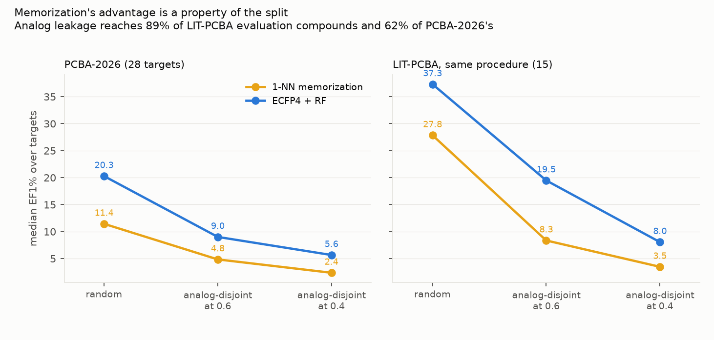
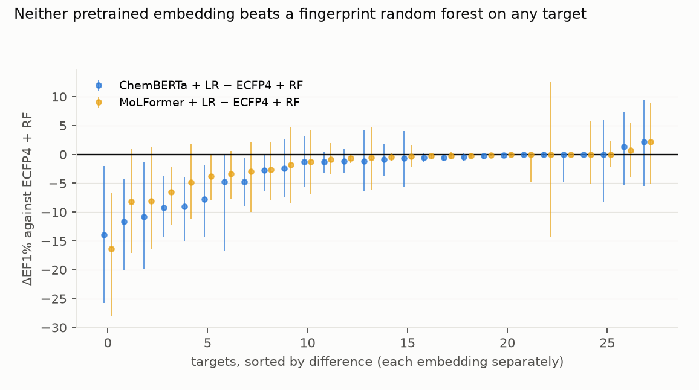
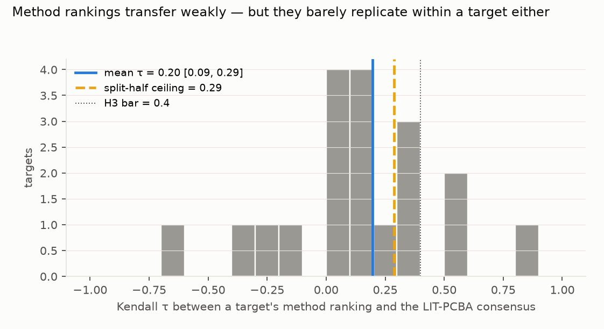

# A leakage-audited virtual-screening benchmark from recent PubChem screens: memorization's advantage is a property of the split, pretrained embeddings never beat a fingerprint random forest, and method rankings barely replicate at all

*PCBA-2026: 28 single-target confirmatory PubChem assays deposited from 2021 (12 from 2023 or later), 578,057
compounds, with analog-disjoint folds that remove any evaluation compound within Tanimoto 0.4 of its training set.
Compared with LIT-PCBA as published and under the same procedure. Five methods: a parameter-free memorization
baseline, ECFP4 + random forest, RDKit descriptors + LightGBM, and ChemBERTa and MoLFormer-XL embeddings with a
linear head. The plan was committed before any activity outcome was downloaded.*

**Verdict: H1 Inconclusive; H2 Supported; H3 Supported.**

- **The leakage LIT-PCBA was criticised for is real, and larger than in the new benchmark.** Before the audit, a
  training neighbour above Tanimoto 0.4 exists for **89%** of LIT-PCBA evaluation compounds and **62%** of
  PCBA-2026's. Removing them leaves 12% of LIT's compounds scorable, against 40% of PCBA-2026's.
- **H1 (memorization's advantage at least halves on the leakage-controlled benchmark): Inconclusive.**
  - Q = A_new / A_lit = 0.43, which meets the preregistered bar as a point estimate, but the interval is useless
    (−1.47 to 3.38): it is a ratio of two medians, one over only 15 LIT targets.
  - **The within-benchmark contrast is the clean evidence, and it is unambiguous.** Holding the data fixed and
    changing only the split, the memorization baseline's median EF1% falls from 11.4 (random) to 4.8 (analog-
    disjoint at 0.6) to **2.4** (at 0.4) on PCBA-2026, and from 27.8 to 8.3 to **3.5** on LIT-PCBA.
  - So the memorization result is a property of how the benchmark is split, not of the chemistry, and LIT-PCBA's
    larger collapse matches its larger analog redundancy.
- **H2 (pretrained molecular embeddings do not beat ECFP4 + random forest): Supported.**
  - On **0 of 56** target-embedding pairs does an embedding's paired bootstrap interval exclude zero in its favour.
    The random forest's does on 9.
  - Median ΔEF1% is −1.00 for ChemBERTa and −0.56 for MoLFormer-XL.
  - On the primary split the medians are RF 5.65, LightGBM 5.32, ChemBERTa 4.36, MoLFormer 4.29, memorization 2.36.
- **H3 (method rankings do not transfer from LIT-PCBA): Supported, but for a duller reason than it sounds.**
  - Mean Kendall τ between a PCBA-2026 target's ranking and the LIT consensus is 0.20 (0.085–0.295), under the 0.4
    bar.
  - **But the split-half noise ceiling is 0.29.** Rankings of five closely matched methods barely replicate between
    two halves of the *same* target's data, so most of the disagreement is measurement noise rather than a real
    difference between benchmarks.

## In plain terms

To judge a program that picks promising drug molecules, you hide some known answers and see how many it recovers.
The catch is which molecules you hide. Chemists make families of near-identical molecules, so if a close relative of
a hidden molecule stays in the training set, a program can win by looking up the relative rather than understanding
anything.

A 2025 audit showed the field's standard benchmark, LIT-PCBA, is full of such relatives. We measured it: for about
nine in ten of its test molecules, a near-twin sits in the training data. We then built a fresh benchmark from
recent public screening experiments and removed the near-twins from scoring.

Doing that, the pure look-up method's score collapses — from 28 to 3.5 on the old benchmark, and from 11 to 2.4 on
ours. In other words, much of what the benchmark was measuring was look-up.

Two further results. Large pretrained "foundation" models for chemistry did not beat a plain 1990s-style molecular
fingerprint with a random forest on a single target. And which method looks best varies so much from target to
target that the ranking is barely reproducible even when you split one target's own data in half.

## What was asked

The lead asked for a leakage-audited, post-cutoff replacement for LIT-PCBA, and for the measurement of whether
method rankings move when you switch to it.

Prior work:
- The LIT-PCBA leakage audit (arXiv 2507.21404) documents duplicated and analog ligands across its splits and shows
  a parameter-free memorization baseline matching reported state of the art. It released code but no corrected
  benchmark, and none of its citing works has released one.
- LIT-PCBA itself (Tran-Nguyen, Jacquemard & Rognan, JCIM 2020), including its AVE-debiased split, which is the
  "as published" arm here.
- MF-PCBA (JCIM 2022) is the closest construction recipe. It predates these assay depositions and does not enforce
  analog-disjoint splits.

## How it was done

- **Assays.** PubChem confirmatory assays deposited from 2021-01-01, one protein target, at least 50 active and
  5,050 tested substances: 51 assays, one per gene by most actives, giving 32 candidate targets and 28 after the
  compound funnel. Depositors are NCATS and Tox21.
- **Compounds.** Outcomes as PubChem gives them; deduplicated by InChIKey connectivity block, with conflicting
  groups dropped; RDKit-parsed. 1,769,491 substance records in, 1,574,697 kept
  (`results/tables/coverage.json`).
- **Analog-disjoint folds.** Per target, ECFP4 Butina clusters at distance 0.6 assigned to 5 folds balancing
  actives, then any evaluation compound with a training neighbour above Tanimoto 0.4 removed from scoring. The
  realised nearest-neighbour similarity is audited per target (0.6 and a random split are the sensitivities).
- **Size cap (D3).** At most 50,000 compounds per target, subsampling both classes proportionally so the hit rate,
  and therefore EF1%'s ceiling of min(100, 1/hit-rate), is preserved. Checked against the uncapped set on the three
  largest targets.
- **Methods,** fixed hyperparameters, no tuning: 1-NN maximum Tanimoto to training actives; ECFP4 + random forest
  (500 trees, balanced); RDKit descriptors + LightGBM; ChemBERTa-77M-MLM and MoLFormer-XL-both-10pct mean-pooled
  embeddings with logistic regression. The two pretrained models ran offline in Docker, without credentials.
- **Metrics.** EF1% primary; BEDROC (α = 20) and AUPRC secondary; bootstraps over targets, and paired over
  evaluation compounds for H2.

## Results

### Splits, not chemistry (`results/figures/F1_splits.png`)

| benchmark | split | memorization | ECFP4 + RF | LightGBM | ChemBERTa | MoLFormer |
|---|---|---|---|---|---|---|
| PCBA-2026 | random | 11.43 | 20.27 | 15.88 | 7.45 | 8.84 |
| PCBA-2026 | analog-disjoint 0.6 | 4.83 | 9.00 | 8.17 | 5.07 | 5.49 |
| **PCBA-2026** | **analog-disjoint 0.4** | **2.36** | **5.65** | **5.32** | **4.36** | **4.29** |
| LIT-PCBA | random | 27.83 | 37.29 | 11.33 | 11.59 | 15.58 |
| LIT-PCBA | analog-disjoint 0.4 | 3.46 | 8.04 | 6.35 | 4.57 | 3.02 |
| LIT-PCBA | as published (AVE) | 4.15 | 6.50 | 5.15 | 6.34 | 5.20 |

Median EF1% across targets. The published LIT-PCBA split already suppresses memorization (4.15) relative to a random
split of the same data (27.83), which is what its AVE debiasing was for; the analog-disjoint procedure suppresses it
further (3.46).

### Embeddings against a fingerprint random forest (`results/figures/F2_embeddings.png`)

### Ranking agreement and its ceiling (`results/figures/F3_ranking.png`)

## What this does and does not show

- **A benchmark's memorization result is mostly a statement about its split.** The same compounds and labels give a
  memorization EF1% of 11.4 or 2.4 depending only on whether near-twins are allowed into scoring.
- **PCBA-2026 is less analog-redundant than LIT-PCBA** (62% against 89% of evaluation compounds with a close
  training neighbour), but it is not clean: the audit still removes 60% of its compounds from scoring.
- **Pretrained chemical embeddings bought nothing here** over a fingerprint random forest, on a benchmark whose
  labels postdate 2021 and, for 12 targets, 2023.
- **Reported method rankings should be treated as noise** unless they come with a replication estimate: the
  split-half ceiling of 0.29 is barely above the cross-benchmark 0.20.
- **Not shown:**
  - **That PCBA-2026 is contamination-free.** The assay labels are recent, but the structures are mostly from the
    NCATS and Tox21 libraries and may appear in pretraining corpora.
  - **A representative sample of drug discovery.** Two depositors and their compound libraries dominate; 7 of 28
    targets are counterscreens with hit rates above 20%, where EF1% is capped near 2 to 5 (D2).
  - **Tuned models or docking.** Hyperparameters were fixed in advance and no structure-based method was run.
  - **That analog-disjoint splitting is the right difficulty.** It can over-debias; the 0.6 and random splits show
    how much the answer moves.

## Process and deviations

- **Preregistration:** `plan.md`, committed before any activity outcome was downloaded.
- **Deviations** (`deviations.md`):
  - D1 (before any outcome): the published LIT split lives in the AVE archive, not the full-data one; PUG REST has
    no inconclusive outcome type; the MoLFormer snapshot needs transformers 5.
  - D2 (before any fit): hit rates range from 0.18% to 49%, so EF1% ceilings range from 100 to 2; the preregistered
    all-28 analysis is reported beside a post hoc 19-target subset at or below a 5% hit rate. The EF1% ceiling
    formula was corrected to min(100, 1/hit-rate), and a wrong BEDROC implementation was fixed, both before any
    score.
  - D3 (before any fit): the 50,000-compound cap and its check.
- **Gates:** G1 (plan §5), G2 (`results/tables/coverage.json`), G3 (`results/plausibility.md`), G4 (the leakage
  audit), G5 and G6 at write-up. G7 does not apply.
- **Independent review:** queued (Fable), per the lab's pacing rule.

## Reproducing it

1. `code/fetch.py assays`, `outcomes`, `smiles`, `lit`.
2. `code/build.py new`, then `code/build.py lit`.
3. `code/subsample.py build`, then `check`.
4. `code/embed.py` for both checkpoints, in the `pcba-embed:3` image (see its docstring).
5. `code/folds.py new`, then `code/folds.py lit`.
6. `code/run.py new`, `lit_cv`, `lit_pub`.
7. `code/analyse.py` and `code/figures.py`.
