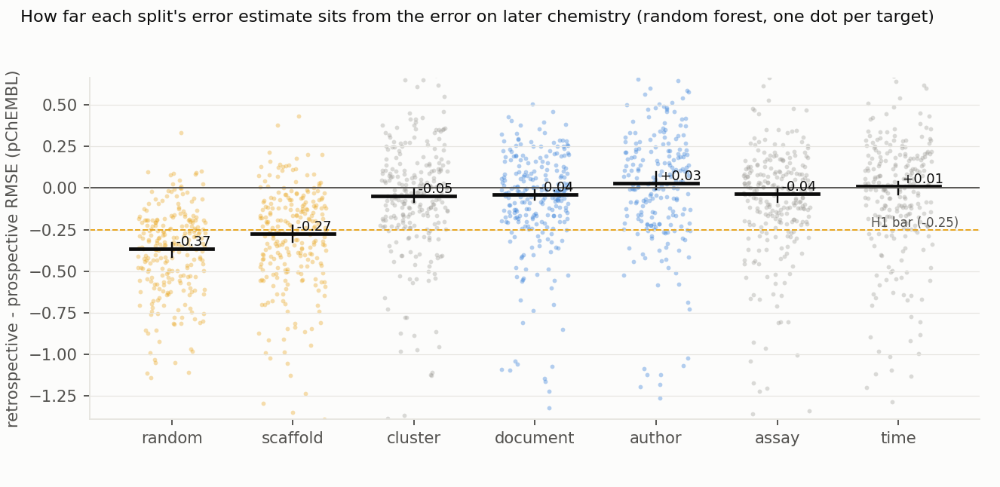
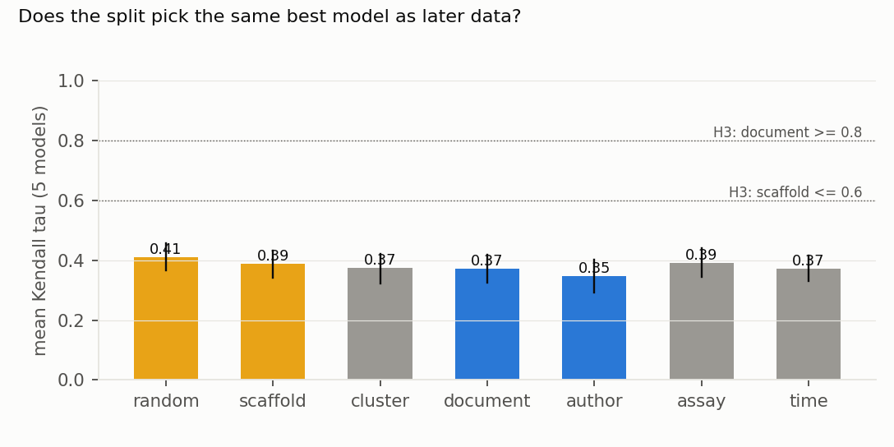
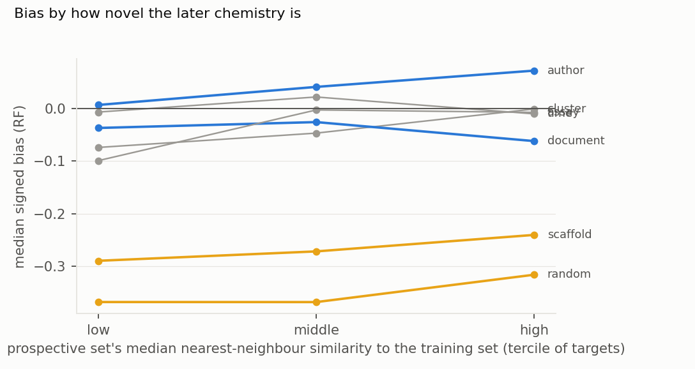

# Which retrospective split predicts error on future bioactivity data? Random and scaffold splits understate it by about a third of a log unit; provenance and time splits are unbiased on average but miss by 0.15–0.22 per target, and no split recovers the model ranking

*250 ChEMBL protein targets. Models were trained on ChEMBL 33 (2023) and tested on compounds first measured in
documents from 2023 onward that appear only in ChEMBL 37 (2026). Seven retrospective splitters and five model
families. The plan and all analysis code were committed before any ChEMBL table was read. The target list was written before
training began and committed before any fit had finished.*

**Verdict: H1 Supported; H2 Refuted; H3 Refuted.**

- **H1 (random and scaffold splits understate prospective error by at least 0.25 log units): Supported.**
  - The primary model is a random forest on ECFP4. Its median signed bias (retrospective RMSE − prospective RMSE)
    over 250 targets is −0.37 (95% CI −0.42 to −0.33) for random splits and −0.27 (−0.32 to −0.22) for scaffold
    splits.
  - The median prospective RMSE is 1.07 pChEMBL units. A random split reports 0.68, and a scaffold split 0.78.
- **H2 (document- and author-disjoint splits are nearly unbiased: median absolute bias ≤ 0.12): Refuted.**
  - On average they are close to unbiased: median signed bias −0.04 (document) and +0.03 (author).
  - Per target they miss by more than the bar: the median absolute bias is 0.17 (0.14–0.19) for document splits and
    0.22 (0.18–0.23) for author splits.
  - Cluster, assay and within-release time splits behave the same: signed bias −0.05 to +0.01, absolute bias
    0.16–0.19.
  - **Not just noise (exploratory).** Sampling noise in each target's prospective RMSE would alone give a median
    absolute bias of about 0.05, so most of the per-target miss is real.
- **H3 (the split changes which model you pick: Kendall τ ≤ 0.6 for scaffold and ≥ 0.8 for document splits):
  Refuted.**
  - No splitter ranks the five model families the way later data do.
  - The mean τ is 0.35–0.41 under every splitter (scaffold 0.39, document 0.37). The paired difference is −0.02
    (−0.06 to +0.02).
- **The pattern holds for every model family and prospective definition.**
  - It holds for random forest, LightGBM, Tanimoto SVR, kNN and MLP, and for all new activities from any year.
  - The MLP is the most overconfident under random splits (−0.56).
  - On the lenient set (compounds already in ChEMBL 33 but new to the target), every splitter understates the error.

## In plain terms

Chemists train machine-learning models on past experiments to predict how strongly new molecules will bind a drug
target. Before trusting a model, they test it by hiding part of the past data and checking predictions against it.
How that part is chosen matters. Hide molecules at random, and the test molecules usually have close relatives in
the training data. That makes the test too easy.

We checked seven ways of hiding data against what actually happened next. We trained on the 2023 edition of the
public ChEMBL database and tested on molecules first published from 2023 on, which appear only in the 2026
edition.

Random and "scaffold" tests made models look much better than they turned out to be. Their typical error on the
future molecules was about 1.1 units on a log scale, against 0.7–0.8 in those tests. Hiding whole papers, author
groups, assays or the latest compounds gave about the right error on average, but could still be well off for any
one target. And no test reliably picked the model that did best on the future data.

## What was asked

The lead (`cheminformatics-drug-discovery-split-calibration`) asked which retrospective splitting strategy best
predicts prospective performance, measured against a real future, not a simulated one.

Prior work:
- **Sheridan (2013).** Time splits give prospective-like estimates; random splits are too optimistic and
  leave-class-out splits too pessimistic, on in-house data.
- **Almendra and Falcão (2026).** On 14 ChEMBL classification sets, chronological validation shows a gap that random
  and structure-filtered validation do not reproduce.
- **Clever Hans in Chemistry (arXiv 2512.20924).** Models can learn chemist style, which motivates author-disjoint
  splits, but those splits were not validated against future data.

H1 is therefore partly confirmatory. What is new is a real prospective truth from later database releases,
regression error, provenance splitters (document, author, assay), model ranking, and 250 targets.

## How it was done

- **Data** (ChEMBL 33 and 37 SQLite; ledger L4).
  - Activities pass the following filters: pChEMBL present; relation "="; binding assays; confidence 9; single
    protein; no validity flag; not a potential duplicate.
  - Compounds are keyed by standard InChIKey. The median pChEMBL per target and compound is used.
  - This leaves 973,255 activities in release 33 and 1,357,779 in release 37 (`results/tables/coverage.json`).
- **Prospective truth (primary).**
  - Activities new in release 37 (387,035), from documents dated 2023 or later (108,593), on compounds whose
    InChIKey is absent from release 33.
  - **Delta audit (G4).** Of 60 sampled new activities, 16 come from 2023+ publications, 43 are older publications
    newly curated, and 1 is a re-deposited record. That is why the 2023+ restriction is needed.
- **Targets.**
  - Eligible targets have ≥ 100 compounds in release 33 and ≥ 50 primary prospective compounds: 295 of them, of
    which a random 250 are used.
  - Training sizes run from 101 to 8,290 compounds (median 744). The median prospective set is 127 compounds.
- **Splitters** (inside release 33, about 20% test, 5 repeats each):
  - random;
  - Bemis–Murcko scaffold (L5);
  - Butina clusters at Tanimoto distance 0.65 (L6);
  - document-disjoint;
  - author-disjoint (documents linked by shared author);
  - assay-disjoint;
  - the latest 20% by document year (1 repeat).
- **Models** (fixed hyperparameters):
  - RF (500 trees) on ECFP4 (L7);
  - LightGBM on RDKit descriptors;
  - SVR with a Tanimoto kernel;
  - Tanimoto-weighted kNN;
  - MLP.
- **Inference.** 2,000 bootstrap resamples over targets.
- **Coverage (G2).**
  - 37,600 of 38,170 fit units ran.
  - The 570 others are planned drops. In 425, no group draw gave a 15–25% test set. In 145, the author graph was
    infeasible (one component holds more than 80% of compounds).
  - So author splits cover 212 targets, document and cluster 247, and assay 248.

## Results

### Bias by splitter (`results/figures/F1_bias_by_splitter.png`)

| splitter | targets | median signed bias (95% CI) | median absolute bias (95% CI) | median retrospective RMSE |
|---|---|---|---|---|
| random | 250 | −0.37 (−0.42 to −0.33) | 0.37 (0.33–0.42) | 0.68 |
| scaffold | 250 | −0.27 (−0.32 to −0.22) | 0.28 (0.23–0.33) | 0.78 |
| cluster | 247 | −0.05 (−0.08 to −0.00) | 0.18 (0.15–0.22) | 1.01 |
| document | 247 | −0.04 (−0.07 to −0.01) | 0.17 (0.14–0.19) | 1.03 |
| author | 212 | +0.03 (−0.01 to +0.10) | 0.22 (0.18–0.23) | 1.09 |
| assay | 248 | −0.04 (−0.09 to +0.00) | 0.16 (0.13–0.18) | 1.01 |
| time (within release 33) | 250 | +0.01 (−0.04 to +0.04) | 0.19 (0.17–0.22) | 1.05 |

The median prospective RMSE is 1.07.
- **Why.** The median nearest-neighbour Tanimoto similarity of test compounds to their training set is 0.80 for
  random splits, 0.70 for scaffold, 0.50 for document and 0.46 for time splits. For the real prospective compounds it
  is 0.43 (from `data/fits/`).
- **Ranking quality is overstated too.** The retrospective minus prospective Spearman ρ is +0.45 (random) and +0.34 (scaffold), against +0.06 to +0.11 for
  the other splitters.

### Model ranking (`results/figures/F2_ranking_tau.png`)

### By how novel the later chemistry is (`results/figures/F3_bias_by_similarity.png`)

Random and scaffold splits stay optimistic in every tercile of prospective-to-training similarity, from −0.37
(lowest) to −0.32 (highest) for random splits. The other splitters stay within ±0.1.

### Bias corrector (secondary)

A gradient-boosting corrector was trained to predict each target's prospective RMSE. Its inputs were the
retrospective RMSEs of all seven splitters plus dataset descriptors: similarity, activity-cliff density, document and
assay entropy, label variance and size. Its median absolute error under 5-fold cross-validation over targets is 0.17
(`results/tables/corrector.json`).
- That misses the 0.10 bar, and is no better than taking the assay split's estimate as is (0.16) or the document
  split's (0.17).
- The most important input was the assay-split RMSE.

### Is the per-target miss just noise? (exploratory, `results/tables/noise_check.json`)

- The prospective RMSE of a target with n compounds has a normal-theory standard error of about RMSE/√(2n). The
  median is 0.066 here.
- Noise of that size alone would give a median absolute bias near 0.045, against the observed 0.16–0.22 for the
  provenance, cluster and time splitters.
- Between 30% (author) and 43% (assay) of targets fall within two standard errors.
- This ignores the retrospective repeats' own noise and heavy-tailed errors, so it is a rough lower bound on noise.

## What this does and does not show

- **Random and scaffold splits overstate performance on future data,** by about a third of a log unit of RMSE and
  about 0.3–0.45 in Spearman ρ. A scaffold split is only modestly better than random.
- **Splits that hold out whole papers, author groups, assays, clusters or the latest compounds are right on average
  but noisy per target.** The typical miss of 0.15–0.22 log units is larger than the H2 bar. This agrees with Sheridan
  (2013) on time splits. Unlike his leave-class-out case, cluster splits here are not pessimistic.
- **Correcting the estimate does not help.** A corrector that sees every splitter's estimate and dataset descriptors
  does no better than the best single provenance split.
- **Model selection is unreliable whichever split is used.** τ ≈ 0.4 means the retrospective ranking of five model
  families only loosely predicts the prospective one.
- **Not shown:**
  - **Random future chemistry.** The prospective sets are the series chemists chose to pursue; results are
    stratified by similarity.
  - **Tuned models.** Hyperparameters were fixed in advance.
  - **Assays other than binding,** and author disambiguation finer than surname plus first initial.
  - **Within-release time splits as a true future.** The time splitter uses document years inside release 33. Its
    near-zero bias is a retrospective result.

## Process and deviations

- **Preregistration:** `plan.md`, committed before any ChEMBL table was read.
- **Deviations:** none. The ChEMBL download needed a resumable fetcher because EBI throttles this host; this changed
  no analysis choice.
- **Gates:**
  - G1 leakage audit: plan §7;
  - G2: `results/tables/coverage.json`;
  - G3: `results/plausibility.md`;
  - G4: the delta audit;
  - G5: `review/overclaim_check.md`;
  - G6: `results/attribution_ledger.csv`;
  - G7 does not apply (no human labels).
- **Independent review:** queued (Fable), per the lab's pacing rule.

## Reproducing it

1. `code/fetch.py 33`, then `code/fetch.py 37` (resumable).
2. `code/build.py` (unpack, extract, filter and coverage), then `code/select.py`.
3. `code/run.py 16`.
4. `code/analyse.py`, then `code/corrector.py`.
5. `code/figures.py` and `code/plausibility_check.py`.
