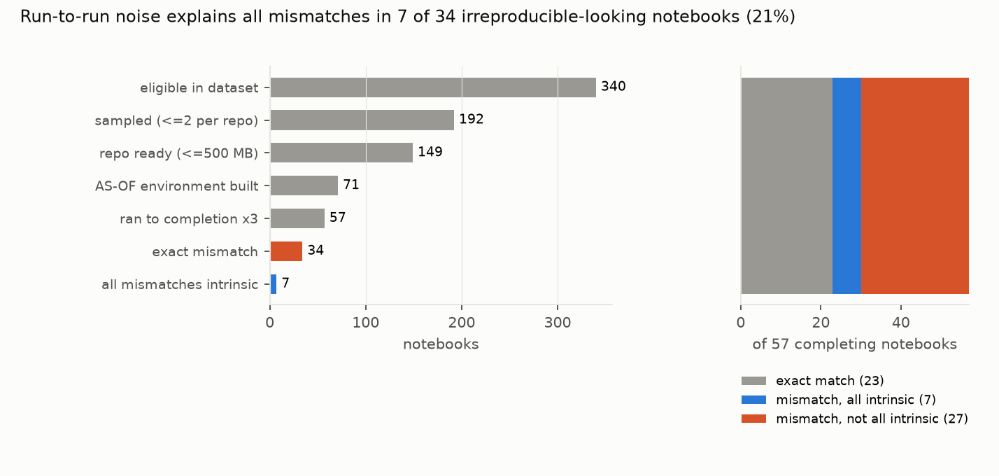

# How much "irreproducibility" in biomedical Jupyter notebooks is run-to-run noise? About a fifth of mismatching notebooks, and exact matching overstates irreproducibility about 1.3-fold; neither clears nor clearly misses the preregistered bars

*Python notebooks from PubMed Central-linked GitHub repositories, drawn from those that Samuel and Mietchen's
large-scale re-execution found to run but not reproduce their stored outputs. Environments were rebuilt with uv,
pinned to the dependency landscape before publication, inside isolated Docker containers. Each notebook was executed
three times without network access, plus once with current packages. The plan was committed before any notebook was
executed; an execution bug found during validation forced a full re-run (D3).*

**Verdict: H1 Inconclusive; H2 Inconclusive.**

- **H1 (in at least 30% of completing-but-mismatching notebooks, every mismatch is run-to-run variability):
  Inconclusive.**
  - **7 of 34** (20.6%; Wilson 95% 10.4% to 36.8%; repository bootstrap 7.9% to 36.7%).
  - The point estimate is below the bar, but the interval includes it.
- **H2 (exact-match verdicts overstate irreproducibility by at least 1.4×): Inconclusive.**
  - Among the 57 notebooks that ran to completion three times, 59.6% fail exact matching and 47.4% fail noise-aware
    matching.
  - The factor is **1.26** (repository bootstrap 1.09 to 1.58).
- **Notebooks the dataset called irreproducible now match.** 23 of the 57 match their stored outputs exactly under
  this comparator, which masks volatile tokens and compares numbers at displayed precision.
- **What drives the real mismatches.**
  - Missing command-line tools: shell cells calling `qiime`, `wget` or `unzip` fail silently inside Jupyter, so the
    notebook still "completes".
  - Version-dependent output formats, such as pandas `value_counts` naming and Python 2 reprs.
  - Genuinely stochastic analyses (MCMC, cross-validation).
  - With current packages, 11% of cells that are stable and matching in the AS-OF environment change.
- **The comparator agrees with hand labels on 94 of 100 cell pairs.** All six disagreements are figures flagged as
  different that differ only cosmetically (fonts and title weights across matplotlib versions). A looser image
  tolerance moves H1 only to 21.9% (post hoc).

## In plain terms

Scientists increasingly publish the code behind their papers as Jupyter notebooks. Studies that re-run them often
find the results don't match, and count that as a failure to reproduce. But some analyses involve randomness, and
would give slightly different numbers even on the original computer. Is much of the measured "irreproducibility"
just that?

We took about 150 notebooks from biomedical papers that an earlier study had found didn't reproduce. We rebuilt each
one's software environment as it was around publication, in a sealed container, and ran it three times. About 40%
of the notebooks that ran turned out to match their published outputs after all, once trivial differences such as
memory addresses and timestamps were ignored. Of those that still differed, only about one in five differed solely
because of run-to-run randomness. Most differences had other causes, such as missing command-line tools and changed software or output formats.

So exact-match counts somewhat overstate the problem, by a factor of about 1.3 here, but most mismatches are not just
noise.

## What was asked

The lead (`computational-reproducibility-notebook-noise-aware-verdicts`) asked whether exact-match verdicts overstate
notebook irreproducibility. Its predictions were that at least 30% of mismatching notebooks are explained by
run-to-run variability, and that the overstatement is at least 1.4×.

Prior work counts identical outputs (Pimentel et al. 2019; Samuel and Mietchen 2024), or scores similarity without
replicates (arXiv 2509.23645). A 2026 containerisation study (Samuel, Mietchen et al., arXiv 2604.01072) did not separate stochasticity with replicates.

## How it was done

- **Sample.**
  - Eligible: notebooks from Samuel and Mietchen's dataset (Zenodo 8226725) whose execution completed with at least
    one differing cell. That is 340 notebooks in 133 repositories (D1).
  - Sampled: at most two per repository, 192 notebooks.
  - Kept: 149 with repositories of at most 500 MB, checked out at their last commit before publication.
- **Environments** (Docker; no host credentials or home directory mounted).
  - uv installs the repository's requirements, or the notebook's imports through a fixed import-to-package table.
  - AS-OF resolution uses `--exclude-newer` at the checkout's commit date; LATEST has no limit.
  - 61 AS-OF builds succeeded in `-slim` images. 10 more succeeded in full images with build tools (D2).
- **Execution.** Network off, 2 CPUs and 6 GB per container, nbclient with a 20-minute limit and a fresh kernel. Three
  AS-OF runs, one LATEST run. 57 notebooks completed all three runs.
- **Comparison** (`code/compare.py`).
  - **Outputs compared:** stdout streams and display outputs. Warnings and errors are excluded (D1).
  - **Text:** volatile tokens are masked (addresses, dates, times, durations, paths).
  - **Numbers:** compared at the stored output's displayed precision.
  - **Images:** compared by perceptual hash (at most 6 bits).
  - **Intrinsic:** a mismatching cell is intrinsic if its output varies across the three runs, or if the stored
    numbers lie within the runs' envelope.
- **Intervals:** Wilson, and a bootstrap over repositories (2,000 resamples).

## Results (`results/figures/F1_flow.png`)

| | value |
|---|---|
| completed with three AS-OF runs | 57 notebooks (453 compared cells) |
| exact match | 23 |
| exact mismatch | 34 (180 mismatching cells) |
| all mismatches intrinsic (H1) | 7 / 34 = 20.6% (10.4–36.8%) |
| exact-fail rate / noise-aware-fail rate (H2) | 59.6% / 47.4% = 1.26 (1.09–1.58) |
| stable AS-OF cells that change with current packages | 11.1% |

**Post hoc sensitivities** (both labelled; neither changes a verdict):

| sensitivity | H1 share (95% CI) | overstatement factor (95% CI) |
|---|---|---|
| looser image tolerance (12 bits), addressing the validation's six cosmetic disagreements | 21.9% (11.0–38.8%) | 1.28 |
| excluding 6 notebooks whose shell commands were not found in the container | 25.0% (12.7–43.4%) | 1.33 (1.11–1.79) |

**The flawed first run** (D3) set a non-inline plotting backend, which suppressed every figure. It gave 12.2% for H1
and a factor of 1.14, so that bug biased both towards Refuted. It is kept for the record only.

## What this does and does not show

- **Run-to-run noise is a minority explanation.** Among notebooks that run but don't match, about a fifth differ
  only through randomness. The rest have environmental or substantive causes. Exact-match tallies overstate
  irreproducibility, but modestly (about 1.3× here).
- **Normalisation matters as much as replicates.** Masking volatile tokens and respecting displayed precision turns
  40% of "irreproducible" notebooks into matches before any replicate is used.
- **Not shown:**
  - **Notebooks that need network or data downloads.** They fail here by design (no network), so the completing set
    leans toward self-contained analyses.
  - **Rare variability.** Three replicates can miss it, biasing H1 down.
  - **The authors' own environments.** AS-OF resolution approximates them. 78 of 149 AS-OF builds failed even with
    build tools, mostly old pins incompatible with Python 3.8+.
  - **The full dataset.** The sample is 149 notebooks; the intervals are wide.

## Process and deviations

- **Preregistration:** `plan.md`.
- **Deviations** (`deviations.md`):
  - D1: selection fields, comparator scope and H2's base, all before execution;
  - D2: failed AS-OF builds retried in full images, before any comparison;
  - D3: the plotting-backend bug found during validation, and the full re-run (post-result; the first result kept).
- **Validation:** `results/tables/validation.json`, 94/100 agreement.
- **Safety:** third-party code ran only in containers without credentials, with network disabled during execution.
- **Independent review:** queued (Fable), per the lab's pacing rule.

## Reproducing it

1. Download Zenodo 8226725 into `data/raw/` and unzip it.
2. `code/clone_all.sh`, then `code/select_nb.py`.
3. `code/runner.py runners`.
4. `SAMPLE=sample_slim.csv code/runner.py run`, then `NB_IMAGE_FLAVOR= SAMPLE=sample_redo.csv code/runner.py run`.
5. `code/compare.py run`.
6. `code/figures.py`.
