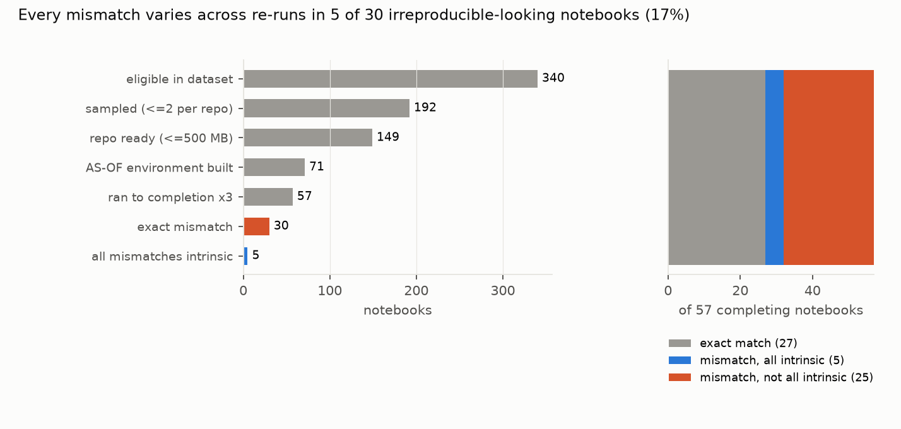

# How much "irreproducibility" in biomedical Jupyter notebooks is run-to-run noise? About a sixth of mismatching notebooks by the preregistered rule, none if the stored value must fall within the replicates' range; masked exact matching overstates irreproducibility about 1.2-fold, byte-exact matching 1.9-fold

*Python notebooks from PubMed Central-linked GitHub repositories, drawn from those that Samuel and Mietchen's
large-scale re-execution found to run but not reproduce their stored outputs. Environments were rebuilt with uv,
pinned to the dependency landscape before publication, inside isolated Docker containers. Each notebook was executed
three times without network access, plus once with current packages. The plan was committed before any notebook was
executed; an execution bug found during validation forced a full re-run (D3).*

**Verdict: H1 Inconclusive; H2 Inconclusive.** Both were re-computed after review with a corrected comparator (D4);
neither verdict changed.

- **H1 (in at least 30% of completing-but-mismatching notebooks, every mismatch is run-to-run variability):
  Inconclusive.**
  - **5 of 30** (16.7%; Wilson 95% 7.3% to 33.6%; repository bootstrap 3.7% to 32.0%).
  - The point estimate is below the bar, but the interval includes it.
  - **The preregistered rule is a disjunction, and only one branch is ever met.** A mismatch counts as noise if
    the three replicates differ among themselves, or if the stored value lies inside their range. In all 5
    notebooks every mismatching cell meets only the first branch: the replicates vary, but the stored value lies
    outside their range or is an image. Read strictly, requiring the stored value inside the replicates' range, H1 is
    0 of 30 (0% to 11.4%). Some cases are convincing, such as Monte-Carlo output, random data, random error bars and
    tie order in `value_counts`.
- **H2 (exact-match verdicts overstate irreproducibility by at least 1.4×): Inconclusive.**
  - Among the 57 notebooks that ran to completion three times, 52.6% fail **masked** exact matching and 43.9% fail
    noise-aware matching. Masked matching hides volatile tokens and compares numbers at displayed precision.
  - The factor is **1.20** (repository bootstrap 1.04 to 1.47).
  - **Against byte-exact matching** on the same re-runs, 84.2% fail and the factor is **1.92**, which would clear the
    bar. The preregistered comparison is the masked one.
  - **All 57 were irreproducible in the dataset**, so these rates describe that set, not notebooks in general (D1).
- **Three rungs, on the study's own re-runs:** 48 of 57 notebooks differ byte for byte, 30 under masked matching, and
  25 under noise-aware matching. So normalisation recovers 18 notebooks and replicates 5 more.
  - 9 notebooks match byte for byte here, although the dataset called them irreproducible. For those, its verdict
    came from its environment or its comparator, not from the notebook.
  - 31 of the 57 were checked out at a commit other than the dataset's, but the notebook file is identical at both
    commits in all 31. The stored outputs compared are the dataset's own.
- **The comparator, validated blind** (post hoc; `results/tables/validation_blind.json`).
  - A separate labelling session judged 95 stratified cell pairs without seeing the comparator's verdicts, plus all
    17 remaining figure mismatches.
  - Text: the comparator agrees on 29 of 30 flagged mismatches and 20 of 20 matches.
  - Figures: it agrees on 14 of 15 matches, but only 20 of the 47 flagged figure mismatches are judged genuinely
    different. The rest differ in fonts, legend placement, tick labels or figure size.
  - With the human judgement in place of the comparator for every flagged figure, H1 is 5 of 26 (19.2%, 8.5% to
    37.9%) and the H2 factor 1.24. Neither verdict changes.
  - The first draft's 94/100 agreement came from a check whose labeller saw the comparator's verdicts. It is
    withdrawn.
- **What drives the real mismatches.**
  - Missing command-line tools: shell cells calling `qiime`, `wget` or `unzip` fail silently inside Jupyter, so the
    notebook still "completes".
  - Version-dependent output formats, such as pandas `value_counts` naming.
  - Genuinely stochastic analyses (MCMC, cross-validation).
  - With current packages, 12% of cells that are stable and matching in the AS-OF environment change.

## In plain terms

Scientists increasingly publish the code behind their papers as Jupyter notebooks. Studies that re-run them often
find the results don't match, and count that as a failure to reproduce. But some analyses involve randomness, and
would give slightly different numbers even on the original computer. Is much of the measured "irreproducibility"
just that?

We took about 150 notebooks from biomedical papers that an earlier study had found didn't reproduce. We rebuilt each
one's software environment as it was around publication, in a sealed container, and ran it three times. Of the 57
that ran, 9 matched their published outputs byte for byte, and 27 in all matched once trivial differences were ignored,
such as memory addresses, timestamps and digits beyond those printed. Of the 30 that still differed, 5 showed
run-to-run variation in every mismatching cell. But in none of them did the published output fall within the spread
of our three runs, so randomness is a possible explanation, not a demonstrated one. Most differences had other
causes, such as missing command-line tools and changed software or output formats.

So how much exact-match counts overstate the problem depends on what "exact" means: by a factor of about 1.2 once
trivial differences are masked, and about 1.9 for byte-for-byte comparison. Most mismatches are not just noise.

## What was asked

The lead (`computational-reproducibility-notebook-noise-aware-verdicts`) asked whether exact-match verdicts overstate
notebook irreproducibility. Its predictions were that at least 30% of mismatching notebooks are explained by
run-to-run variability, and that the overstatement is at least 1.4×.

Prior work counts identical outputs (Pimentel et al. 2019; Samuel and Mietchen 2024), or scores similarity without
replicates (arXiv 2509.23645). A 2026 containerisation study (Samuel, Mietchen et al., arXiv 2604.01072) did not separate stochasticity with replicates.

## How it was done

- **Sample.**
  - Eligible: notebooks from Samuel and Mietchen's dataset (Zenodo 8226725) whose execution completed with at least
    one differing cell. That is 340 notebooks in 133 repositories (D1).
  - Sampled: at most two per repository, 192 notebooks.
  - Kept: 149, checked out at their last commit before publication. Dropped: 36 with repositories over 500 MB (25 on
    GitHub's reported size, before cloning), 6 whose notebook was missing at that commit, and 1 whose clone failed.
- **Environments** (Docker; no host credentials or home directory mounted).
  - uv installs the repository's requirements, or the notebook's imports through a fixed import-to-package table.
    None of the 11 notebooks with a requirements file completed. All 57 completed notebooks ran in environments
    resolved from their imports: 49 through the table and 8 with ipykernel only.
  - AS-OF resolution uses `--exclude-newer` at the checkout's commit date; LATEST has no limit.
  - 61 AS-OF builds succeeded in `-slim` images. 10 more succeeded in full images with build tools (D2); the LATEST
    arm stayed in slim images.
- **Execution.** Network off, 2 CPUs and 6 GB per container, nbclient with a 20-minute limit and a fresh kernel. Three
  AS-OF runs, one LATEST run. 57 notebooks completed all three runs.
- **Comparison** (`code/compare.py`).
  - **Outputs compared:** stdout streams and display outputs. Warnings and errors are excluded (D1). Consecutive
    stdout chunks are joined before comparison, since Jupyter splits one stream at arbitrary points (D4). Shell
    "not found" messages are compared where the shell writes them to stdout (6 notebooks) and ignored where it
    writes them to stderr (2).
  - **Text:** volatile tokens are masked (addresses, dates, times, durations including "0.05[sec]", paths, and
    `ls -l` dates; the last two added in D4).
  - **Numbers:** compared at the stored output's displayed precision. Numbers printed to 10 or more significant
    digits are compared with a relative tolerance of 1e-9 (D4).
  - **Images:** compared by perceptual hash (at most 6 bits).
  - **Intrinsic:** a mismatching cell is intrinsic if its output varies across the three runs, or if the stored
    numbers lie within the runs' envelope.
- **Intervals:** Wilson, and a bootstrap over repositories (2,000 resamples).

## Results (`results/figures/F1_flow.png`)

| | value |
|---|---|
| completed with three AS-OF runs | 57 notebooks (453 compared cells) |
| byte-exact mismatch | 48 |
| masked exact match / mismatch | 27 / 30 (173 mismatching cells) |
| all mismatches intrinsic (H1) | 5 / 30 = 16.7% (7.3–33.6%) |
| the same, stored value inside the replicates' range | 0 / 30 (0–11.4%) |
| masked fail rate / noise-aware fail rate (H2) | 52.6% / 43.9% = 1.20 (1.04–1.47) |
| byte-exact fail rate / noise-aware fail rate | 84.2% / 43.9% = 1.92 |
| stable AS-OF cells that change with current packages | 11.8% |

The first draft gave 7/34 and 1.26. Four notebooks changed under the corrected comparator. nb16791 was a stream
chunking artefact, and nb19758 an unmasked timing token; both were all-intrinsic in the draft. nb17727 and nb19008
differed only in the 17th significant digit. The draft's tables are kept as `primary_v1.json` and `notebooks_v1.csv`.

**Post hoc sensitivities** (both labelled; neither changes a verdict):

| sensitivity | H1 share (95% CI) | overstatement factor (95% CI) |
|---|---|---|
| human judgement for every flagged figure mismatch (blind) | 5/26 = 19.2% (8.5–37.9%) | 1.24 |
| looser image tolerance (12 bits) | 5/28 = 17.9% (7.9–35.6%) | 1.22 (1.04–1.52) |
| excluding 6 notebooks whose shell commands were not found in the container | 5/24 = 20.8% (9.2–40.5%) | 1.26 (1.05–1.64) |

**The flawed first run** (D3) set a non-inline plotting backend, which suppressed every figure. It gave 12.2% for H1
and a factor of 1.14, so that bug biased both towards Refuted. It is kept for the record only.

## What this does and does not show

- **Run-to-run noise is a minority explanation, and only a possible one.** Among notebooks that run but don't
  match, about a sixth show variation in every mismatching cell. In none is the stored value inside the range of
  three replicates, and three replicates cannot say whether the stored value was a plausible draw.
- **Normalisation does more than replicates.** On the study's own re-runs, masking volatile tokens and respecting
  displayed precision recovers 18 of the 48 byte-different notebooks. Replicates recover 5 more. A further 9
  notebooks match byte for byte, so for them the dataset's verdict reflects its environment or comparator.
- **Not shown:**
  - **Notebooks that need network or data downloads.** They fail here by design (no network), so the completing set
    leans toward self-contained analyses.
  - **Rare variability.** Three replicates can miss it, biasing H1 down. They also cannot place the stored value
    within the distribution, which is why the strict reading gives zero.
  - **The authors' own environments.** AS-OF resolution approximates them. 78 of 149 AS-OF builds failed even with
    build tools, mostly old pins incompatible with Python 3.8+.
  - **The full dataset.** The sample is 149 notebooks; the intervals are wide.

## Process and deviations

- **Preregistration:** `plan.md`.
- **Deviations** (`deviations.md`):
  - D1: selection fields, comparator scope and H2's base, all before execution;
  - D2: failed AS-OF builds retried in full images, before any comparison;
  - D3: the plotting-backend bug found during validation, and the full re-run (post-result; the first result kept);
  - D4: the fixes after the independent review (post hoc): stream coalescing, full-precision tolerance and masks, the
    byte-exact and envelope-only readings, the blind validation and the commit check.
- **Validation:** blind, post hoc (`results/tables/validation_blind.json`; keys and labels in
  `results/tables/validation_blind/`). The first draft's `validation.json` (94/100) was not blind and is withdrawn.
- **Safety:** third-party code ran only in containers without credentials, with network disabled during execution.
- **Independent review:** fix first (two major and three moderate findings); the fixes are in D4.
- **Timing:** one execution (nb19053, which errored) finished after the first draft's tables were written. The D4
  tables were computed after every run had finished.

## Reproducing it

1. Download Zenodo 8226725 into `data/raw/` and unzip it.
2. `code/clone_all.sh`, then `code/select_nb.py`.
3. `code/runner.py runners`.
4. `SAMPLE=sample_slim.csv code/runner.py run`, then `NB_IMAGE_FLAVOR= SAMPLE=sample_redo.csv code/runner.py run`.
5. `code/compare.py run`; `code/posthoc_commit.py`; `code/validate_blind.py` (sample, labelling in a separate
   session, score); `code/posthoc_figures.py`.
6. `code/figures.py`.
