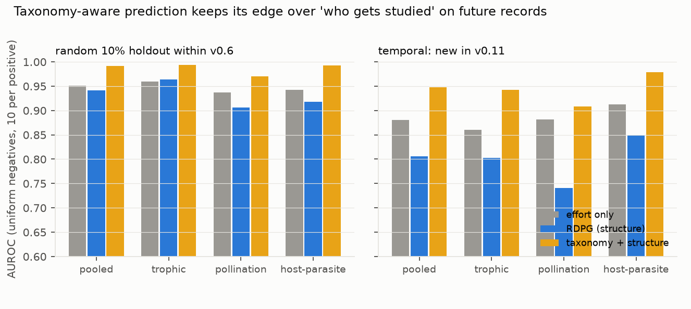
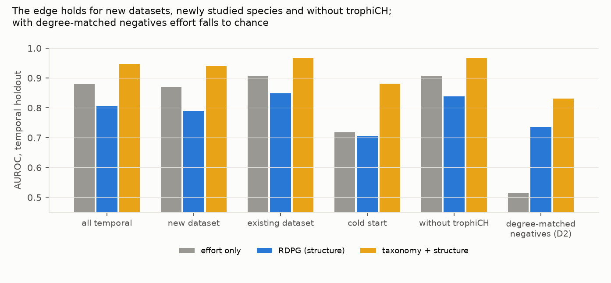

# A taxonomy-aware species-interaction predictor keeps its edge over "who gets studied" on GloBI's future records, though nearly half of those records come from one dataset of mostly inferred links

*GloBI's interpreted interaction snapshots: v0.6 (2023-08-25) as the past and v0.11 (2026-09-10) as the future.
Species-level trophic, pollination and host–parasite pairs. Three predictors: effort only (degree and citation
counts), a structural embedding (RDPG), and gradient boosting on taxonomic-neighbourhood features. Each is evaluated
on a random holdout within v0.6 and on 411,702 pairs first recorded in v0.11 between species already in v0.6. The plan
was committed before any graph was built. This version includes fixes made after independent review (D2): the
dominant dataset is disclosed and tested, the degree-matched negatives are corrected, and coverage accounting is
added.*

**Verdict: H1 Refuted.** The advantage of taxonomy-aware prediction does not halve out of time: it holds.

- **H1 (the structural advantage over effort at least halves on future records): Refuted.**
  - The best structural predictor, taxonomy + structure, beats effort by **+0.040 AUROC** on the random holdout
    (0.991 against 0.951; 95% cluster bootstrap +0.029 to +0.054).
  - On the temporal holdout it beats effort by **+0.067** (0.947 against 0.880; +0.052 to +0.075).
  - The ratio is **1.68** (1.10 to 2.31), against the hypothesis of at most 0.5.
- **Nearly half the future records come from one dataset of mostly inferred links (D2).**
  - 183,892 of the 411,702 temporal positives (45%) are from trophiCH, a Swiss national metaweb. Only 30% of its
    species-level links are documented; the rest are inferred from coarser taxonomic records.
  - Without trophiCH, the advantage is +0.059 (+0.050 to +0.068) and the ratio is **1.46 (1.05 to 2.08)**. H1 is still Refuted. That the advantage grows out of time is only narrowly supported once the inferred dataset is
    set aside.
- **What shrinks under uniform negatives is effort.**
  - Prior degree and citation counts lose 0.07 AUROC going from a random to a temporal holdout; the taxonomic model
    loses 0.04.
  - The structural embedding by itself (RDPG) is worse than effort on both holdouts.
- **With degree-matched negatives (corrected in D2), effort falls to chance:**
  - effort scores 0.50 random and 0.51 temporal;
  - the taxonomic model scores 0.93 random and 0.83 temporal;
  - the advantage still shrinks out of time, from 0.43 to 0.32 (a point estimate of 0.74 with no interval, not a second test of H1).
- **The edge holds where it matters most:**
  - for pairs introduced by datasets indexed after v0.6 (72% of the future pairs): 0.940 against 0.870;
  - for species with a single prior link: 0.881 against 0.718;
  - in 24 of the 26 datasets with at least 1,000 future pairs.
- **Name changes do not drive the result.** The independent review found that 1.1% of positives have an old record
  behind them under another name; dropping them changes nothing. The 26–42% of v0.6 pairs missing from v0.11 are
  mainly pairs removed, refuted or re-typed.

## In plain terms

Scientists use machine learning to guess which species interact, such as who eats whom, which insect pollinates which
plant, or which parasite lives on which host, so that field work can be pointed at likely pairs. A worry is that
these models mostly learn which species scientists already study a lot, and would be no better than simply betting
on well-studied species.

We used two archived snapshots of GloBI, a global database of species interactions, three years apart. We trained
models on the older snapshot and asked how well they picked out interactions that appeared in the newer one. A simple
"popularity" guess, based on how many interactions and studies a species already had, did well. A model that also
uses what related species do did clearly better, on the new records as much as on a random test drawn from the old
one. That held for interactions contributed by newly added studies and for species that had been recorded only once
before.

There is a catch. Almost half of the new records come from one Swiss database, most of whose links were inferred from records
made at the genus level rather than observed for each species. Without it the taxonomy-aware model still
wins, by a similar margin. So in this database, taxonomy-aware prediction is not just repeating "who gets studied",
but a large part of the "future" it is tested on was itself produced by taxonomic reasoning.

## What was asked

The lead (`ecology-biodiversity-globi-temporal-link-holdout`) asked whether species-interaction link predictors keep
their skill on genuinely later records, or mostly learn sampling effort. Prior work validates link prediction by
random edge holdout or single prospective cases, such as Becker et al. 2022 for bat betacoronavirus hosts. GloBI's versioned snapshots allow a broad pseudo-prospective test. None was found in the lead's search, which could not include a final 2026 check.

## How it was done

- **Data.** GloBI interpreted `interactions.tsv.gz` and `refuted-interactions.tsv.gz` for v0.6 and v0.11 (Zenodo),
  each MD5-verified. The v0.6 file needed a three-way chunk repair after corrupted downloads (deviations).
- **The graph.**
  - Records with species names at both ends are kept, with interaction types mapped to trophic, pollination and
    host–parasite, and direction normalised.
  - Refuted pairs are removed.
  - v0.6 has 427,844 trophic, 78,918 pollination and 356,050 host–parasite species pairs.
- **Positives.**
  - Temporal: pairs in v0.11 not in v0.6, with both species on the right sides of the v0.6 class graph.
  - Random: 10% of v0.6 pairs hidden.
  - Negatives are 10 per positive, uniform over non-edges in either snapshot.
  - Degree-matched variant (D2): every decile of the positives' log degree product filled with 10 negatives per
    positive, without replacement.
- **Predictors.**
  - **Effort:** logistic regression on log degree and log citation counts of both species.
  - **RDPG:** a rank-32 SVD of the bipartite adjacency.
  - **Taxonomy + structure:** gradient boosting on the effort features, the RDPG score and five
    taxonomic-neighbourhood counts (links between the species and the other's genus or family, and genus–genus and
    family–family links).
  - The supervised models are trained on an inner split of the training graph.
- **The statistic.** ρ = A_temporal / A_random. A is the pooled AUROC, from within-class percentile ranks, of the best
  structural predictor (chosen on the random holdout) minus effort's. Intervals come from a cluster bootstrap over
  the positives' source datasets.

## Results

### AUROC by predictor and holdout (`results/figures/F1_auroc.png`)

| | effort | RDPG | taxonomy + structure |
|---|---|---|---|
| random holdout, pooled (72,666 positives) | 0.951 | 0.942 | **0.991** |
| temporal holdout, pooled (411,702 positives) | 0.880 | 0.805 | **0.947** |
| temporal: trophic | 0.860 | 0.802 | 0.942 |
| temporal: pollination | 0.882 | 0.740 | 0.907 |
| temporal: host–parasite | 0.913 | 0.848 | 0.979 |

### Subsets of the future (`results/figures/F2_subsets.png`)

| temporal positives | n | effort | RDPG | taxonomy + structure |
|---|---|---|---|---|
| from datasets new since v0.6 | 298,259 | 0.870 | 0.789 | 0.940 |
| from datasets already in v0.6 | 113,443 | 0.906 | 0.848 | 0.966 |
| cold start (an endpoint with one prior link) | 100,647 | 0.718 | 0.704 | 0.881 |
| without trophiCH (D2) | 227,810 | 0.907 | 0.838 | 0.966 |
| all, degree-matched negatives (corrected, D2) | 411,702 | 0.514 | 0.736 | 0.831 |
| random holdout, degree-matched negatives (D2) | 72,666 | 0.501 | 0.866 | 0.930 |

- **Clusters.** The temporal positives come from 266 source datasets. trophiCH holds 44.7%, and the top three
  (trophiCH, usda-fungus-host and iNaturalist) hold 73.8%, so the cluster bootstrap behaves close to a three-point
  distribution.
- **Per dataset** (`results/tables/per_dataset.csv`, datasets with at least 1,000 positives): the advantage ranges
  from −0.035 (YSU) to +0.207 (BOLD). It is +0.078 for trophiCH, +0.062 for usda-fungus-host and +0.054 for
  iNaturalist, and positive in 24 of 26.
- **Growth.** v0.11 has 827,885 new trophic, 199,350 new pollination and 386,201 new host–parasite pairs.
- **Eligible positives.** 26–36% of them join two species already in the v0.6 class graph and are the positives here.
- **Turnover.** 26–42% of v0.6 pairs are absent from v0.11:
  - trophic: 112,825 of 427,844;
  - pollination: 32,842 of 78,918;
  - host–parasite: 127,999 of 356,050.

  The review traced most of this to pairs removed (mycoportal alone loses 48,077 host pairs), refuted (13,115) or
  re-typed (`hasHost` records remapped to types outside the three classes). Very little is renaming.
- **Coverage (G2).** The build keeps 13.7 million of v0.6's 20.0 million records and 8.1 million of v0.11's 24.5
  million. The rest have other interaction types, lack species-level names, are self-loops or are refuted
  (`results/tables/coverage.json`).

## What this does and does not show

- **No collapse out of time.** On GloBI, a model that knows what related species do keeps its lead over a
  sampling-effort baseline when predicting interactions recorded in the following three years.
  - That holds for new data sources, for barely studied species, without the dominant dataset, and in 24 of 26
    large datasets.
  - Under uniform negatives the lead is larger out of time than in a random holdout. Under degree-matched negatives
    it is smaller (0.32 against 0.43; point estimates), though still far above effort.
- **The future records are partly inferred.**
  - 45% of the temporal positives come from trophiCH, most of whose species-level links were inferred from coarser
    taxonomic records with habitat filters. For those records the test partly asks whether one taxonomic model agrees
    with another's inferences.
  - The review also counted 51,465 positives (12.5%) whose trophiCH records cite GloBI's own data products.
  - The result without trophiCH (ratio 1.46, 1.05 to 2.08) is the one to rely on.
- **Effort alone is strong under uniform negatives** (AUROC 0.88 on the future), because most random species pairs
  are implausible. Degree-matched negatives remove that, and effort falls to chance.
- **Not shown:**
  - **True discovery.** New GloBI records include re-indexed literature, inferred metaweb links and re-resolved
    names, not only newly observed interactions.
  - **Absences.** The negatives are unobserved pairs, not known absences. They also exclude pairs recorded in v0.11,
    a mild use of future information a real user would not have.
  - **The random-holdout effort baseline** is marginally optimistic: species citation counts include the hidden
    edges' citations, which the review measured as negligible (D2).
  - **Embeddings.** node2vec-style embeddings were not tested; RDPG was the only pure-structure model.
  - **The v0.8 rolling origin**, not run (D1).

## Process and deviations

- **Preregistration:** `plan.md`.
- **Deviations** (`deviations.md`):
  - data acquisition (chunk-verified downloads);
  - D1: secondary 4 not run;
  - pre-review gate (G5, G6);
  - **D2, after independent review:** trophiCH disclosed and tested; the degree-matched sampler corrected; the
    citation leak disclosed; per-dataset results; coverage accounting, the G1 audit and the G3 plausibility file.
- **Independent review:** Fable, "fix first" (`review/review.md`). A confirmation pass by the same reviewer found every
  finding resolved and asked for three wording edits, made in this version ("publish with edits").

## Reproducing it

1. Download and verify the four Zenodo files (MD5 in `deviations.md`).
2. `code/build.py 0.6`, then `code/build.py 0.11`.
3. `code/model.py`, with OMP_NUM_THREADS=4.
4. `code/coverage_build.py` (G2) and `code/turnover.py`.
5. `code/figures.py`.
