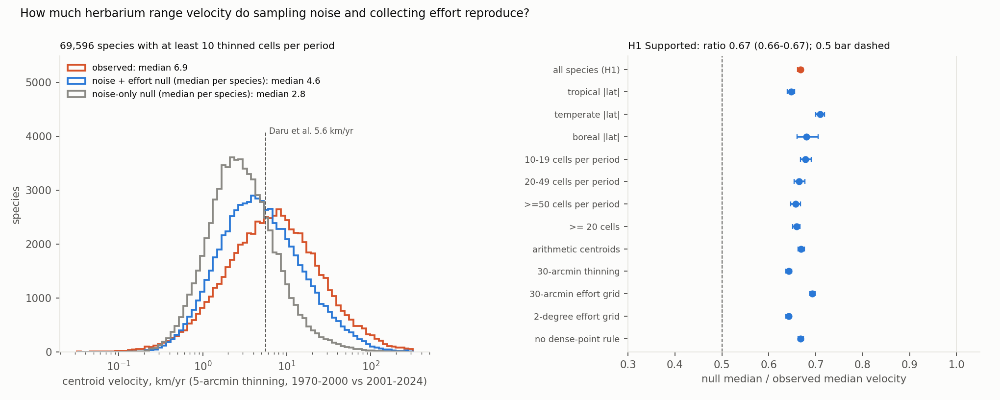

# At least two-fifths of the median herbarium plant range velocity is sampling noise; a collecting-effort null reproduces two-thirds, but that null cannot tell collectors moving from plants moving together

*GBIF preserved-specimen records of vascular plants (2026-07-01 snapshot; 30.6 million records after cleaning) were
thinned to 5-arcmin cells, and each species' centroid displacement between 1970–2000 and 2001–2024 was compared with
999 null replicates. The replicates keep the species' own records and move only which of them fall in which period: at random, or
according to where all other species' records fell in each period. The plan, the cleaning, null and analysis code, and two
pre-result fixes (D1, D2) were committed before any velocity was computed.*

**Verdict: H1 Supported under the preregistered rule (ratio 0.67 against a bar of 0.5), but the design does not
identify what the rule was meant to test.** The effort null's effort surface is built from all other species'
records, so it moves when ranges move together, as well as when collectors move.

- **What the data identify.**
  - **Sampling noise:** records reassigned between periods at random give **2.8 km/yr** against an observed
    **6.9 km/yr**, for 69,596 species with at least 10 thinned cells in each period. That is a ratio of **0.41**
    (95% species bootstrap 0.40 to 0.41), so at least two-fifths of the median velocity is noise. In synthetic
    worlds this null stays at the noise level whether or not ranges move.
  - **A poleward excess:** the median species moves 9.4 km poleward over 28 years (0.34 km/yr), against 0.3 km under
    the effort null and −0.6 km under the noise null; 53.6% of species move poleward, against 50.8% under the effort
    null. The effort surface itself drifted only mildly poleward: its mean absolute latitude went from 30.6° to
    31.8°, the tropical share fell from 34.5% to 32.3% and the boreal share rose from 10.9% to 13.2%.
- **What the effort null reproduces, and why it is not "fixed ranges".**
  - The noise-plus-effort null gives 4.6 km/yr: a ratio of **0.67** (0.66 to 0.67). The preregistration and the first
    draft read this as "fixed ranges plus noise and effort reproduce two-thirds of the velocity".
  - **That reading is not identified** (synthetic test, post hoc; `results/tables/absorption_test.json`). Run through
    this study's own code with uniform, unchanging collecting effort, a world where every species really moves 1°
    north is scored by the effort null as fully reproduced (ratio 1.03; 5% exceed its 95th percentile). When half the
    species move, the movers' ratio is 0.70; when a fifth move, 0.60. The observed 0.67 is also what a world with
    shared real shifts and no effort change can produce.
  - So the 26% between the noise floor and the effort null mixes changing collecting effort with range shifts that
    many species share. The design cannot apportion it.
  - The 0.5 bar was not demanding: with a noise floor of 0.41, almost any effort surface pushes the ratio past it.
- **Movement beyond the nulls.**
  - 52.8% of species move farther than their noise null's 95th percentile, and 36% farther than their effort null's.
    Under shared real shifts the effort null's exceedance falls towards 5%, so 36% is a lower bound on species with
    real movement, not an estimate.
  - Per species: the median of the species' own ratios is 0.68 and the mean 0.97; 25.8% of species move less than
    their effort null's median.
- **Robust as computed.** The effort-null ratio stays between 0.64 and 0.71 across latitude bands, cell-count classes,
  thresholds of 20 and 50 cells, 30-arcmin thinning, 30-arcmin and 2° effort grids, arithmetic centroids, and
  cleaning without the dense-point rule. The same identification caveat applies to every row.
- **SDM-centroid variant** (1,000 species): modelled-range centroids move at a median of 8.4 km/yr, and one effort-null
  replicate per species gives 6.2 km/yr (ratio 0.74, 0.68 to 0.82).
- **Reproduction.** Our observed median is 6.5–6.9 km/yr depending on the threshold, against Daru et al.'s 5.6 km/yr.
  At five cells per period we have 101,328 species, against their 109,242.

## In plain terms

A recent study used millions of museum plant specimens to estimate that over 100,000 plant species have shifted
their ranges at a median of 5.6 km a year since the 1970s–1990s, faster than models predict for the coming decades.
But the centre of a range estimated from a few dozen specimens moves around by chance. Botanists also collect in
different places from decade to decade. Both of these make ranges look as if they are moving even when they are not.

We rebuilt the measurement from the open GBIF data and found a somewhat higher figure: 6.9 km a year. Then, for each of
nearly 70,000 species, we reshuffled which of its specimens counted as "early" and which as "late", 999 times. Done
at random, the reshuffles alone produced 2.8 km a year, about two-fifths of the observed figure: that much is pure
chance. Done so as to follow where all other plant specimens were collected in each period, they produced 4.6 km a
year, two-thirds of it. But that second baseline also moves when many species really shift together, so it cannot
say how much of the gap is collectors and how much is plants.

So a large share of the headline speed is noise, and an unknown part of the rest may be collecting effort. There is
a small tilt towards the poles that neither baseline produces. A velocity like 5.6 km a year cannot be read as
how fast plants are moving until it is compared with a baseline, and a better baseline needs a measure of collecting
effort that does not move with the plants.

## What was asked

The lead (`ecology-biodiversity-herbarium-velocity-effort-null`) asked whether global herbarium-based range velocities
survive a sampling-noise and collecting-effort null.
- **Daru, Birkeland & Chala** (bioRxiv, December 2025) report that 109,242 vascular plant species shifted their
  centroids at a median of 5.6 km/yr between 1970–2000 and 2001–2024, using 16.2 million herbarium records. They
  compare this with projected future velocities of 3.27 km/yr. Their methods give 5-arcmin thinning and
  native-range filtering, but no noise floor, no effort null and no code.
- **Centroid displacement is always positive,** so finite samples inflate it. Herbarium collecting is strongly biased
  in space and time (Daru et al. 2018), and apparent range shifts can be artefacts of detectability and effort
  (Bates et al. 2015). Methodological attributes explain much of the variation in published range-shift velocities
  (Lenoir et al. 2020).

## How it was done

- **Records.** GBIF's monthly Parquet snapshot of 2026-07-01 on AWS (doi:10.15468/dl.teccpa). It was filtered to
  Tracheophyta, PRESERVED_SPECIMEN, 1970–2024 and records with coordinates: 35,526,014 records.
- **Cleaning.** Rules applied in order, each counted (`results/tables/clean_summary.json`):
  - GBIF coordinate issues (495,139);
  - uncertainty over 10 km (531,658);
  - equal or near-zero coordinates (216);
  - introduced, managed or absent (139,943);
  - coordinates shared by more than 1,000 species, a proxy for centroids and institutions (528,628 records at 86
    points);
  - sea cells (206,740);
  - no species key (3,001,290).

  30,622,400 records were kept.
  - D2: the first cleaning run lost about 1% of records silently through in-place database updates. G2's coverage
    count caught it before any velocity was computed.
- **Velocity.** Unique 5-arcmin cells per species per period (1970–2000, 2001–2024). The centroid is the spherical
  mean of the cell centres, and velocity is the great-circle distance between the two centroids divided by 28 years,
  as in Daru et al. The primary population is species with at least 10 cells in each period: 69,596.
- **Nulls.** For each species, its pooled records are reassigned to the two periods at their observed counts, then
  thinned and measured exactly as observed (999 replicates each).
  - **Noise only:** a uniformly random reassignment.
  - **Noise plus effort (primary):** Pareto order sampling (D1). The odds that a record belongs to the early period
    follow the early period's share of all-tracheophyte collecting effort in its 1° cell, relative to the late
    period's.
  - **Leave-one-species-out:** the focal species' own records are removed from the effort surface, so its own shift
    cannot enter its weights (G1).
  - A synthetic check (`code/test_effort.py`) shows this null reproduces 97% of a pure effort shift. The sampler the
    plan named reproduced 66%, hence D1, made before any real data were touched. The same check cannot distinguish a
    pure effort shift from every range moving north (see "What this does and does not show").
  - **The weights are approximate per record.** Pareto order sampling ranks records correctly (correlation of
    empirical and target inclusion probabilities 0.995–0.999), but for the smallest species (20–22 records) the
    empirical inclusion probabilities deviate from the stated target by up to 0.04–0.17, and the targets do not sum
    to the period's count (8.6–13.2 against 10–12). 28% of primary species have fewer than 100 records (post hoc).
- **Statistic.** Ratio of the median (over species) of each species' null median velocity to the median observed
  velocity, with a species bootstrap (2,000).
- **SDM variant.** For 1,000 random species: MaxEnt-type models (elapid, WorldClim 2.1 bioclim at 10 arcmin) per
  period, with background drawn by that period's effort within 1,000 km of the species' records. Each binary range's
  centroid is computed, on the observed assignment and on one effort-null replicate.
- **Coverage (G2):** every species in every variant received both nulls (`results/tables/coverage.json`).
- **Plausibility (G3):** `results/plausibility.md`, including three species recomputed from the raw extract that
  match exactly.

## Results (`results/figures/F1_velocity_null.png`)

| analysis | species | observed median (km/yr) | effort-null median (km/yr) | ratio (95% CI) |
|---|---|---|---|---|
| **primary** | 69,596 | **6.91** | **4.61** | **0.667 (0.661–0.673)** |
| noise-only null | 69,596 | 6.91 | 2.80 | 0.405 (0.401–0.409) |
| tropical (pooled centroid within 23.5°) | 32,134 | 9.42 | 6.10 | 0.647 (0.639–0.655) |
| temperate (23.5–50°) | 32,442 | 4.41 | 3.13 | 0.710 (0.700–0.719) |
| boreal (above 50°) | 5,020 | 15.78 | 10.74 | 0.680 (0.661–0.706) |
| 10–19 cells in the smaller period | 25,120 | 6.02 | | 0.678 (0.668–0.691) |
| 20–49 cells | 22,323 | 6.46 | | 0.664 (0.654–0.677) |
| at least 50 cells | 22,153 | 8.57 | 5.63 | 0.657 (0.647–0.667) |
| at least 20 cells | 44,476 | 7.43 | 4.90 | 0.659 (0.651–0.667) |
| 30-arcmin thinning | 58,329 | 7.60 | 4.88 | 0.643 (0.636–0.649) |
| 30-arcmin effort grid | 69,596 | 6.91 | 4.78 | 0.693 (0.687–0.699) |
| 2° effort grid | 69,596 | 6.91 | 4.44 | 0.642 (0.637–0.648) |
| arithmetic-mean centroids | 69,596 | | | 0.669 (0.663–0.676) |
| cleaning without the dense-point rule | 69,996 | 6.94 | 4.63 | 0.668 (0.662–0.674) |

- **Exceedance.** 36.0% of species (35.7–36.4%) exceed their effort null's 95th percentile, and 52.8% exceed the
  noise null's.
  - By band: tropical 40.3%, temperate 30.9%, boreal 42.3%.
  - By cells: 30.5% (10–19), 33.4% (20–49) and 45.0% (at least 50). That is as expected if real shifts are easier
    to detect with more cells.
- **Direction.** 53.6% of species move poleward, against 50.8% under the effort null and 49.0% under the noise null.
- **Reproduction** (`results/tables/reproduction.csv`): the median observed velocity by minimum cells per period.
  - 1 cell: 6.51 km/yr (188,600 species);
  - 3 cells: 6.51 (127,637);
  - 5 cells: 6.64 (101,328);
  - 10 cells: 6.91 (69,596);
  - 20 cells: 7.43 (44,476);
  - 50 cells: 8.57 (22,153).

  The median rises with the threshold, probably because well-collected species tend to have larger ranges, where
  the same relative wander is more kilometres (not tested here).
- **SDM variant** (`results/tables/sdm_variant.json`): 1,000 random species from the primary population, all fitted.
  - Observed median 8.44 km/yr from modelled ranges. A single noise-plus-effort null replicate per species gives
    6.23: ratio 0.74 (0.68–0.82).
  - For the same species, point centroids give 6.55 observed and 4.40 for the null median.
  - In 39% of species the null replicate's modelled range moves farther than the observed one. Modelled and point
    velocities correlate only moderately across species (Spearman 0.48).

## What this does and does not show

- **A large part of a herbarium centroid velocity is not range movement.** Chance alone produces two-fifths of the
  observed median, with each species' own records and no movement at all.
  - A figure such as 5.6 km/yr therefore partly measures sampling; how much more than two-fifths cannot be said
    from this design.
  - Comparing it with SDM-projected velocities compares quantities with different noise properties, unless both are
    measured against the same baseline.
- **The effort null cannot separate collectors from plants; this is the main limitation.** Its effort surface is
  the thinned records of all other species, so it moves with any range shift that many species share. In synthetic
  worlds with unchanging, uniform effort (`code/absorption_test.py`, run through `velocity.py`):

  | world | species scored | observed (km/yr) | noise null | effort null | ratio (effort) | exceed effort p95 |
  |---|---|---|---|---|---|---|
  | none move | all 300 | 1.79 | 1.89 | 1.89 | 1.05 | 7% |
  | all move 1° N | all 300 | 4.15 | 1.90 | 4.26 | 1.03 | 5% |
  | half move 1° N | 129 movers | 4.16 | 1.91 | 2.91 | 0.70 | 18% |
  | a fifth move 1° N | 56 movers | 4.35 | 1.92 | 2.60 | 0.60 | 23% |

  The fix is an effort proxy that does not move with plants, such as collecting events from other kingdoms or
  institution-level digitisation counts. That is out of scope here.
- **Real shifts are probably present.** 53% of species move beyond their noise null's 95th percentile and 36% beyond
  their effort null's, more among well-sampled species. The excess over the effort null is about 1.9 km/yr for the
  typical species, and the poleward excess (0.34 km/yr) is the one directional shift the design identifies. Some of that excess may also come from what the null does not model: taxonomic changes between periods,
  changing georeferencing practice, or collecting that targets particular groups. This study does not estimate how
  far any particular species has moved.
- **Not shown:**
  - **Daru et al.'s exact pipeline.** No code is available. Names here are GBIF species keys, not WCVP, and there
    is no native-range filter beyond GBIF's establishment field. The snapshot includes recently digitised specimens.
    The observed-versus-null comparison uses one set of records, so it does not depend on matching their median,
    which ours exceeds by about 20%.
  - **The effort null assumes** collecting within a 1° cell is independent of species identity. Targeted collecting
    of particular groups breaks that.
  - **Elevation and other range-shift measures** (leading and trailing edges, occupancy) were not tested.

## Process and deviations

- **Preregistration:** `plan.md`, committed with the extractor before any centroid or count.
- **Deviations** (`deviations.md`):
  - **D1, before any real data:** the effort null samples by Pareto order sampling, because the planned sampler
    reproduced only 66% of a synthetic effort shift.
  - **D2, before any velocity:** cleaning was rewritten as a single query after G2 found that in-place database
    updates had dropped 1% of records.
- **Quality gates:**
  - G1: the leakage audit in plan.md, with leave-one-species-out effort;
  - G2: coverage.json;
  - G3: plausibility.md;
  - G5: review/overclaim_check.md;
  - G6: results/attribution_ledger.csv.

  The ledger check caught a wrong DOI for Bates et al., now fixed. G4 and G7 do not apply.
- **D3, after the independent review (post hoc):** the synthetic absorption test, the effort surface's latitude by
    period, and the Pareto inclusion check; the title, verdict and plain terms rewritten around what the design
    identifies.
- **Independent review:** fix first (one major finding: the effort null absorbs shared range shifts); the fixes are in
  D3.

## Reproducing it

1. `code/s3_extract.py`: about 2 hours; reads 3.9 billion snapshot rows.
2. `code/clean.py`: needs Natural Earth land and minor islands in `data/ref/`.
3. `code/velocity.py primary`, then `thin30`, `eff30`, `eff2deg` and `no_r5`: about 13 minutes each on 16 cores.
4. `code/analyse.py`.
5. `code/sdm_variant.py`: needs WorldClim 2.1 10-arcmin bioclim in `data/ref/wc/`.
6. `code/figures.py`, `code/handtrace.py`, `code/test_velocity.py` and `code/test_effort.py`.
