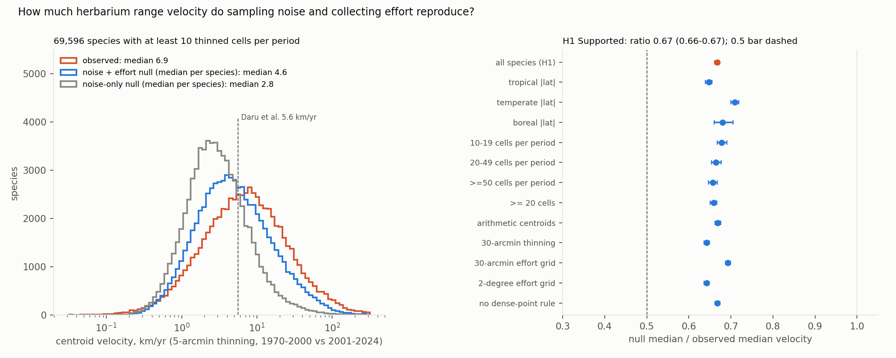

# Two-thirds of the median herbarium plant range velocity is reproduced by sampling noise and shifting collecting effort alone: a fixed-range null gives 4.6 km/yr against an observed 6.9

*GBIF preserved-specimen records of vascular plants (2026-07-01 snapshot; 30.6 million records after cleaning) were
thinned to 5-arcmin cells, and each species' centroid displacement between 1970–2000 and 2001–2024 was compared with
999 null replicates. The replicates keep its range fixed and move only which records fall in which period, at random
or according to where collectors worked in each period. The plan, the cleaning, null and analysis code, and two
pre-result fixes (D1, D2) were committed before any velocity was computed.*

**Verdict: H1 Supported.** A null with fixed ranges reproduces 67% of the observed median velocity.

- **H1 (a noise-plus-effort null with fixed ranges reproduces at least half of the observed median velocity):
  Supported.**
  - Observed median velocity: **6.9 km/yr** for 69,596 species with at least 10 thinned cells in each period.
  - Median of the species' null medians: **4.6 km/yr**.
  - Ratio **0.67** (95% species bootstrap 0.66 to 0.67), against the preregistered bar of 0.5.
- **Sampling noise alone** (records reassigned between periods at random) gives 2.8 km/yr: a ratio of 0.41 (0.40 to
  0.41). The rest of the null's velocity comes from the shift in where specimens were collected.
- **Movement beyond the null, in a minority.**
  - 36% of species move farther than their own null's 95th percentile (5% would be expected if every range were
    fixed).
  - The typical species exceeds its null median by 1.9 km/yr (1.8 to 1.9).
  - 53.6% of species move poleward, against 50.8% under the null (median poleward shift 9.4 km against 0.3 km).
- **Robust.** The ratio stays between 0.64 and 0.71 across latitude bands, cell-count classes, thresholds of 20 and 50
  cells, 30-arcmin thinning, 30-arcmin and 2° effort grids, arithmetic centroids, and cleaning without the
  dense-point rule. Every interval lies above 0.5.
- **SDM-centroid variant** (1,000 species): modelling each period's range does not remove the effect.
  - Modelled-range centroids move at a median of 8.4 km/yr.
  - One fixed-range null replicate per species gives 6.2 km/yr: a ratio of 0.74 (0.68 to 0.82).
- **Reproduction.** Our observed median is 6.5–6.9 km/yr depending on the threshold, against Daru et al.'s 5.6 km/yr.
  At five cells per period we have 101,328 species, against their 109,242.

## In plain terms

A recent study used millions of museum plant specimens to estimate that over 100,000 plant species have shifted
their ranges at a median of 5.6 km a year since the 1970s–1990s, faster than models predict for the coming decades.
But the centre of a range estimated from a few dozen specimens moves around by chance. Botanists also collect in
different places from decade to decade. Both of these make ranges look as if they are moving even when they are not.

We rebuilt the measurement from the open GBIF data and found a somewhat higher figure: 6.9 km a year. Then, for each of
nearly 70,000 species, we kept its range exactly where it was and reshuffled which specimens counted as "early" and
which as "late", 999 times. The reshuffles followed where collectors were actually working in each period. With no
real movement at all, this produced 4.6 km a year: two-thirds of the observed figure.

So most of the headline speed is noise and changing collecting effort. Real shifts are probably there: about a third of
species moved more than chance and our model of effort can explain, with a slight tilt towards the poles. But a velocity like
5.6 km a year cannot be read as how fast plants are moving until it is compared with this baseline.

## What was asked

The lead (`ecology-biodiversity-herbarium-velocity-effort-null`) asked whether global herbarium-based range velocities
survive a sampling-noise and collecting-effort null.
- **Daru, Birkeland & Chala** (bioRxiv, December 2025) report that 109,242 vascular plant species shifted their
  centroids at a median of 5.6 km/yr between 1970–2000 and 2001–2024, using 16.2 million herbarium records. They
  compare this with projected future velocities of 3.27 km/yr. Their methods give 5-arcmin thinning and
  native-range filtering, but no noise floor, no effort null and no code.
- **Centroid displacement is always positive,** so finite samples inflate it. Herbarium collecting is strongly biased
  in space and time (Daru et al. 2018), and apparent range shifts can be artefacts of detectability and effort
  (Bates et al. 2015). Methodological attributes explain much of the variation in published range-shift velocities
  (Lenoir et al. 2020).

## How it was done

- **Records.** GBIF's monthly Parquet snapshot of 2026-07-01 on AWS (doi:10.15468/dl.teccpa). It was filtered to
  Tracheophyta, PRESERVED_SPECIMEN, 1970–2024 and records with coordinates: 35,526,014 records.
- **Cleaning.** Rules applied in order, each counted (`results/tables/clean_summary.json`):
  - GBIF coordinate issues (495,139);
  - uncertainty over 10 km (531,658);
  - equal or near-zero coordinates (216);
  - introduced, managed or absent (139,943);
  - coordinates shared by more than 1,000 species, a proxy for centroids and institutions (528,628 records at 86
    points);
  - sea cells (206,740);
  - no species key (3,001,290).

  30,622,400 records were kept.
  - D2: the first cleaning run lost about 1% of records silently through in-place database updates. G2's coverage
    count caught it before any velocity was computed.
- **Velocity.** Unique 5-arcmin cells per species per period (1970–2000, 2001–2024). The centroid is the spherical
  mean of the cell centres, and velocity is the great-circle distance between the two centroids divided by 28 years,
  as in Daru et al. The primary population is species with at least 10 cells in each period: 69,596.
- **Nulls.** For each species, its pooled records are reassigned to the two periods at their observed counts, then
  thinned and measured exactly as observed (999 replicates each).
  - **Noise only:** a uniformly random reassignment.
  - **Noise plus effort (primary):** Pareto order sampling (D1). The odds that a record belongs to the early period
    follow the early period's share of all-tracheophyte collecting effort in its 1° cell, relative to the late
    period's.
  - **Leave-one-species-out:** the focal species' own records are removed from the effort surface, so its own shift
    cannot enter its weights (G1).
  - A synthetic check (`code/test_effort.py`) shows this null reproduces 97% of a pure effort shift. The sampler the
    plan named reproduced 66%, hence D1, made before any real data were touched.
- **Statistic.** Ratio of the median (over species) of each species' null median velocity to the median observed
  velocity, with a species bootstrap (2,000).
- **SDM variant.** For 1,000 random species: MaxEnt-type models (elapid, WorldClim 2.1 bioclim at 10 arcmin) per
  period, with background drawn by that period's effort within 1,000 km of the species' records. Each binary range's
  centroid is computed, on the observed assignment and on one effort-null replicate.
- **Coverage (G2):** every species in every variant received both nulls (`results/tables/coverage.json`).
- **Plausibility (G3):** `results/plausibility.md`, including three species recomputed from the raw extract that
  match exactly.

## Results (`results/figures/F1_velocity_null.png`)

| analysis | species | observed median (km/yr) | effort-null median (km/yr) | ratio (95% CI) |
|---|---|---|---|---|
| **primary** | 69,596 | **6.91** | **4.61** | **0.667 (0.661–0.673)** |
| noise-only null | 69,596 | 6.91 | 2.80 | 0.405 (0.401–0.409) |
| tropical (pooled centroid within 23.5°) | 32,134 | 9.42 | 6.10 | 0.647 (0.639–0.655) |
| temperate (23.5–50°) | 32,442 | 4.41 | 3.13 | 0.710 (0.700–0.719) |
| boreal (above 50°) | 5,020 | 15.78 | 10.74 | 0.680 (0.661–0.706) |
| 10–19 cells in the smaller period | 25,120 | 6.02 | | 0.678 (0.668–0.691) |
| 20–49 cells | 22,323 | 6.46 | | 0.664 (0.654–0.677) |
| at least 50 cells | 22,153 | 8.57 | 5.63 | 0.657 (0.647–0.667) |
| at least 20 cells | 44,476 | 7.43 | 4.90 | 0.659 (0.651–0.667) |
| 30-arcmin thinning | 58,329 | 7.60 | 4.88 | 0.643 (0.636–0.649) |
| 30-arcmin effort grid | 69,596 | 6.91 | 4.78 | 0.693 (0.687–0.699) |
| 2° effort grid | 69,596 | 6.91 | 4.44 | 0.642 (0.637–0.648) |
| arithmetic-mean centroids | 69,596 | | | 0.669 (0.663–0.676) |
| cleaning without the dense-point rule | 69,996 | 6.94 | 4.63 | 0.668 (0.662–0.674) |

- **Exceedance.** 36.0% of species (35.7–36.4%) exceed their effort null's 95th percentile, and 52.8% exceed the
  noise null's.
  - By band: tropical 40.3%, temperate 30.9%, boreal 42.3%.
  - By cells: 30.5% (10–19), 33.4% (20–49) and 45.0% (at least 50). That is as expected if real shifts are easier
    to detect with more cells.
- **Direction.** 53.6% of species move poleward, against 50.8% under the effort null and 49.0% under the noise null.
- **Reproduction** (`results/tables/reproduction.csv`): the median observed velocity by minimum cells per period.
  - 1 cell: 6.51 km/yr (188,600 species);
  - 3 cells: 6.51 (127,637);
  - 5 cells: 6.64 (101,328);
  - 10 cells: 6.91 (69,596);
  - 20 cells: 7.43 (44,476);
  - 50 cells: 8.57 (22,153).

  The median rises with the threshold, probably because well-collected species tend to have larger ranges, where
  the same relative wander is more kilometres (not tested here).
- **SDM variant** (`results/tables/sdm_variant.json`): 1,000 random species from the primary population, all fitted.
  - Observed median 8.44 km/yr from modelled ranges. A single noise-plus-effort null replicate per species gives
    6.23: ratio 0.74 (0.68–0.82).
  - For the same species, point centroids give 6.55 observed and 4.40 for the null median.
  - In 39% of species the null replicate's modelled range moves farther than the observed one. Modelled and point
    velocities correlate only moderately across species (Spearman 0.48).

## What this does and does not show

- **Most of a herbarium centroid velocity is not range movement.** Keeping every range fixed, chance and the
  redistribution of collecting effort produce two-thirds of the observed median.
  - A figure such as 5.6 km/yr therefore mostly measures sampling.
  - Comparing it with SDM-projected velocities compares quantities with different noise properties, unless both are
    measured against the same baseline.
- **Real shifts are probably present.** About a third of species move beyond their null's 95th percentile, and more among
  well-sampled species. The excess over the null is about 1.9 km/yr for the typical species, with a small poleward
  bias. Some of that excess may also come from what the null does not model: taxonomic changes between periods,
  changing georeferencing practice, or collecting that targets particular groups. This study does not estimate how
  far any particular species has moved.
- **The effort null may absorb some real movement.** If collectors followed expanding species into new areas, that
  movement becomes "effort" and the null overstates noise. Leave-one-species-out removes only the focal species' own
  records.
- **Not shown:**
  - **Daru et al.'s exact pipeline.** No code is available. Names here are GBIF species keys, not WCVP, and there
    is no native-range filter beyond GBIF's establishment field. The snapshot includes recently digitised specimens.
    The observed-versus-null comparison uses one set of records, so it does not depend on matching their median,
    which ours exceeds by about 20%.
  - **The effort null assumes** collecting within a 1° cell is independent of species identity. Targeted collecting
    of particular groups breaks that.
  - **Elevation and other range-shift measures** (leading and trailing edges, occupancy) were not tested.

## Process and deviations

- **Preregistration:** `plan.md`, committed with the extractor before any centroid or count.
- **Deviations** (`deviations.md`):
  - **D1, before any real data:** the effort null samples by Pareto order sampling, because the planned sampler
    reproduced only 66% of a synthetic effort shift.
  - **D2, before any velocity:** cleaning was rewritten as a single query after G2 found that in-place database
    updates had dropped 1% of records.
- **Quality gates:**
  - G1: the leakage audit in plan.md, with leave-one-species-out effort;
  - G2: coverage.json;
  - G3: plausibility.md;
  - G5: review/overclaim_check.md;
  - G6: results/attribution_ledger.csv.

  The ledger check caught a wrong DOI for Bates et al., now fixed. G4 and G7 do not apply.
- **Independent review:** queued (Fable), per the lab's pacing rule.

## Reproducing it

1. `code/s3_extract.py`: about 2 hours; reads 3.9 billion snapshot rows.
2. `code/clean.py`: needs Natural Earth land and minor islands in `data/ref/`.
3. `code/velocity.py primary`, then `thin30`, `eff30`, `eff2deg` and `no_r5`: about 13 minutes each on 16 cores.
4. `code/analyse.py`.
5. `code/sdm_variant.py`: needs WorldClim 2.1 10-arcmin bioclim in `data/ref/wc/`.
6. `code/figures.py`, `code/handtrace.py`, `code/test_velocity.py` and `code/test_effort.py`.
