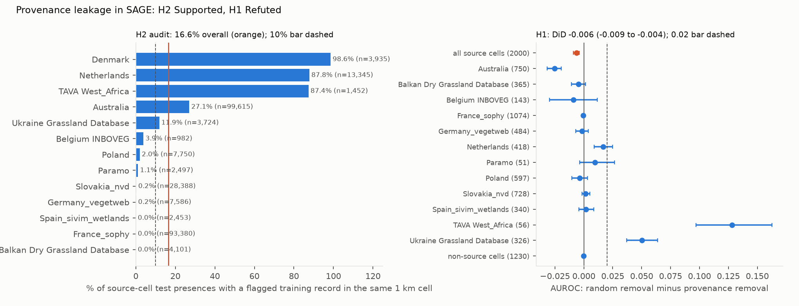

# A sixth of SAGE's test presences share a 1 km cell with a republished survey record once two missed Australian republications are flagged, yet removing those records barely changes Random Forest scores; West African, Ukrainian and Danish test plots are the exceptions

*SAGE trains species distribution models on GBIF presence-only records and tests them on sPlotOpen vegetation plots,
treating the two as independent. Several of the vegetation-plot databases that supply its test plots are also
published in GBIF. The first draft flagged those GBIF datasets from registry metadata and froze the list. The review
showed that list missed the second-largest source. This revision flags republications from the data instead, with a
same-day, same-cell species-list scan of every dataset, and re-runs the audit and the Random Forest retraining for
2,000 species (D4, post hoc). The preregistered frozen-list results are reported beside the corrected ones.*

**Verdict: H1 Refuted; H2 Supported (corrected flag list). As preregistered with the frozen list, both Refuted.**

- **H2 (at least 10% of source-plot test presences have a provenance-shared record in the same 1 km cell):
  Supported with the corrected list.**
  - **16.6%** (95% cell bootstrap 16.0% to 17.2%) of 268,972 test presences in 13,622 source test cells.
  - With the frozen list it was 8.3% (7.7% to 8.9%). The list missed NSW BioNet and SA Flora, which republish the
    Australian source (5,383 single-plot dated test cells; 664 and 96 of them reproduced). It also flagged the Danish
    nature-monitoring portal only as "broad", which the analysis never counted.
  - Counting only records that reached SAGE's training data: 14.8%. 13.1% of all test presences have
    such a record and no other record of the species in the cell (provenance-only). Any-source same-cell overlap, which SAGE accepts by design, is 29.3%.
  - By source: Denmark 98.6%, Netherlands 87.8%, TAVA West Africa 87.4%, Australia 27.1%, Ukraine 11.9%, France's
    SOPHY 0%. The scan finds no dataset that republishes SOPHY relevés. In Slovakia, PLADIAS.SK reproduces 6 of 628
    single-plot test cells, below the flag rule.
  - The "broad" sensitivity now defines source cells from core and broad sources together: 15.6% (15.1% to 16.2%).
    The first draft's version was vacuous by construction.
- **H1 (removing provenance-shared training records lowers AUROC on source plots by at least 0.02 more than matched
  random removal): Refuted.**
  - The difference-in-differences is **−0.006** (−0.009 to −0.004) across 2,000 species. Removing the republished
    records hurts the scores slightly less than random removal does.
  - **The random control falls short.** Random removal could not match 46% of C1's count. Denmark accounts for 58%
    of the shortfall and Australia for 35%. Counted before SAGE's 10,000-presence cap, C1 removes a mean 1,501
    presences per species and random removal 808 (pooled ratio 0.54). Restricted to the 1,381 species where random
    removal reached at least 90% of C1 (603 of which had nothing to remove), the DiD is +0.001 (−0.001 to +0.003).
  - With the frozen list it was +0.006 (+0.005 to +0.008), on 1,745 species.
- **Three databases exceed 0.02 on their own:**
  - **TAVA West Africa: DiD +0.128** (+0.097 to +0.163, 56 species). AUROC falls from 0.807 to 0.693 without the
    shared records but is 0.821 after random removal. The West African test plots are themselves in the training data.
  - **Ukrainian grasslands: DiD +0.050** (+0.037 to +0.064, 326 species).
  - **Denmark: DiD +0.031** (+0.014 to +0.048, 249 species), with 98.6% of test presences co-located. It was missing
    from the first D4 draft because stale cached fits lacked its source cells (D5). It is not an artefact of the
    shortfall: among the 45 Danish species where random removal reached at least 90% of C1, the DiD is +0.064
    (+0.021 to +0.108).
  - **Not because removed records turn into pseudo-absences.** In C1 a removed presence can become a background cell
    for that species. A neutral variant keeps those cells out of the background and gives +0.118 (TAVA) and +0.052
    (Ukraine), post hoc. That was expected: all 382 species sit at the 10,000-cell background cap, and their removed
    cells are a median 0.07% of the pool, so induced pseudo-absences were too few to matter.
  - The Netherlands: 88% co-located, DiD +0.017 (+0.009 to +0.025).
  - **Australia: −0.025**, unexplained. It persists among Australian species where random removal reached at least
    90% of C1 (−0.012, −0.021 to −0.005; 256 species, counts before the cap), so it is not an artefact of the control's shortfall,
    which would bias the DiD upward.

## In plain terms

New benchmarks for species distribution models train on millions of crowd-sourced and museum sightings from GBIF.
They then test the models on expert vegetation surveys, assuming the two sources are independent. But some of those
expert surveys are also published inside GBIF, so a model might be tested on places it has, in effect, already seen.

Our first attempt to find those republished surveys used dataset descriptions and missed the second-largest one:
Australian state flora databases that carry the same survey plots without saying so. Checking the data directly, by
looking for the same species list recorded on the same day in the same square kilometre, found them. With them
counted, about one in six test sightings has a republished survey record next to it.

We then retrained the benchmark's Random Forest model for 2,000 plant species without the republished records, and
again without an equal number of other records. Overall, removing the republished surveys makes almost no
difference. In West Africa, though, the score for the region's species drops sharply, from 0.81 to 0.69, because the
test plots themselves are in the training data. Ukrainian grasslands and Denmark show smaller drops.

So the benchmark's overall Random Forest scores hold up, but its scores for West African species partly reward
recalling the training data, and which surveys are republished cannot be read from metadata alone.

## What was asked

The lead (`ecology-biodiversity-sdm-provenance-leakage`) asked whether provenance leakage inflates SAGE's evaluation.
SAGE (Arens et al., arXiv 2609.31082) trains on GBIF presence-only records and evaluates on sPlotOpen plots for 5,771
plant species. It deliberately keeps training records inside evaluation cells, because it treats the two sources as
independent.

The lead predicted that removing provenance-shared GBIF datasets would lower source-plot AUROC by at least 0.02 more
than a matched random removal.

The lead listed the Czech Vegetation Database among the republications. That GBIF dataset exists but is not in SAGE's
download, so the 1,143 Czech plots have no provenance-shared training data. Dependence between nearby records is
known to inflate SDM scores under random cross-validation (Roberts et al. 2017). Cross-source provenance in the
presence-only-train, presence-absence-test design had not been measured.

## How it was done

- **Data.**
  - SAGE's processed benchmark (Zenodo 21297133): 1 km training targets, predictors, target-group background,
    native-range masks, evaluation targets and plot metadata, with the test split from SAGE's repository.
  - **GBIF record attributes** come from GBIF's public Parquet snapshot of 2026-02-01, 19 days before SAGE's download.
    SAGE's download itself was served at about 60 KB/s.
    - Filters: the download's taxon keys plus SAGE's basis-of-record and coordinate-uncertainty filters.
    - Result: 280.5 million rows. 96.1% of SAGE's 57.1 million training presences (species × 1 km cell) have a
      matching snapshot record.
- **Provenance flags** were frozen before any overlap was computed (`results/tables/provenance_flags_frozen.csv`). The
  corrected list (`provenance_flags.csv`) adds every dataset that reproduces at least 20 of a source's single-plot,
  dated test cells (recall ≥ 0.8, precision ≥ 0.5) in a same-day, same-cell scan (`code/republication_scan.py`, D4).
  - Registry metadata for all 11,621 datasets in SAGE's download were screened.
  - In the corrected list, 30 core datasets republish 13 sPlotOpen source databases: for example the Dutch Vegetation
    Database, the West African Vegetation Database, NSW BioNet, SA Flora and the Danish Naturdatabase. The frozen
    list had 27 core datasets for 11 sources.
  - 2 broad datasets are aggregators, used as an audit sensitivity only.
- **Co-location (H2)** is counted from flagged snapshot records in the test cell, as planned; SAGE's own cleaning was
  not replayed, so this is an upper bound (see the post hoc split under Results).
- **Provenance-only presences.** A training presence is provenance-only if every snapshot record of that species in
  that cell comes from core-flagged datasets.
  - That covers 4,302,471 training presences (7.5%): Denmark 1,682,622, Australia 1,504,558, Netherlands 897,358.
    The frozen list gave 1,115,257 (2.0%).
- **Conditions.**
  - C0: as distributed.
  - C1: provenance-only presences removed.
  - C2–C6: five draws removing the same number of other presences of the same species in the same country. 46% of
    the C1 count could not be matched (13% with the frozen list), and the shortfall is reported.
- **Model.** SAGE's single-species Random Forest baseline, reimplemented from its code:
  - balanced random forest, 1,000 trees, max_features 7, seed 0;
  - SAGE's occurrence subsample and 10,000 caps;
  - target-group background.

  SAGE's per-species tuning and the DeepSDM were not repeated. In the corrected run 14,000 fits were run for 2,000 species: a seeded sample of the 2,833 with at least 10
  presences and 10 absences on range-masked source test cells, as the plan's 2,000 cap requires. The frozen-list run
  had 12,215 fits for 1,745 species. Unchanged inputs reuse cached fits (keyed by an input hash and the evaluation version), and 2,292 more fits
  ran for the neutral variant.
- **Evaluation unit.** The evaluation unit is SAGE's own 1 km evaluation cell. Source cells are test cells with at
  least one plot from a core-flagged source database (D1).
- **Coverage (G2):** every fit completed. On non-source cells, 5,390 fits had an undefined AUROC (one class only) and
  are dropped from that contrast (`results/tables/coverage.json`).
- **Plausibility (G3):** `results/plausibility.md`, including two species refitted from scratch that reproduce the
  stored AUROC exactly.

## Results (`results/figures/F1_provenance.png`)

| analysis | flag list | test presences | H2 share (95%) | species | DiD (95%) |
|---|---|---|---|---|---|
| **corrected (D4)** | **frozen + 3 scan-flagged datasets** | **268,972** | **16.6% (16.0–17.2)** | **2,000** | **−0.006 (−0.009 to −0.004)** |
| corrected, random removal ≥ 90% of C1 (counts before the cap) | same | | | 1,381 | +0.001 (−0.001 to +0.003) |
| preregistered | frozen (registry metadata) | 165,422 | 8.3% (7.7–8.9) | 1,745 | +0.006 (+0.005 to +0.008) |

- **Mean AUROC on source test cells** (corrected): 0.864 as distributed, 0.861 without provenance-shared records,
  0.855 after matched random removal. On non-source cells the contrast is −0.000 (−0.001 to +0.001; 1,230 species).
- **Removal counts.** C1 removes 4.3 million training presences (7.5% of all, against 2.0% with the frozen list).
  The random draws fall 2.0 million short: Denmark accounts for 58% (1.15 million) and Australia for 35% (0.70
  million; confirmation pass).
- **Republication signatures** (`results/tables/republication_scan.csv`, `posthoc_same_releve.json`). In single-plot
  cells, same-day records reproduce the plot's species list:
  - NSW BioNet: median recall 0.78, precision 0.59, 664 cells with recall ≥ 0.8 and precision ≥ 0.5.
  - SA Flora: median recall 1.00, precision 0.87, 96 cells.
  - Denmark: median recall 1.00, precision 0.28, 45 cells.
  - Netherlands: median recall 1.00, precision 0.42.
  - Coordinates differ: for Australian presences, the nearest flagged record lies a median 370 m from the plot, and
    0.02% lie within 10 m. The preregistered exact-coordinate test cannot see this republication.
- **By source database** (corrected; DiD with 95% interval, species):

  | source | H2 share | DiD | species |
  |---|---|---|---|
  | TAVA West Africa | 87.4% | +0.128 (+0.097 to +0.163) | 56 |
  | Ukraine | 11.9% | +0.050 (+0.037 to +0.064) | 326 |
  | Netherlands | 87.8% | +0.017 (+0.009 to +0.025) | 418 |
  | Denmark | 98.6% | +0.031 (+0.014 to +0.048) | 249 |
  | Australia | 27.1% | −0.025 (−0.031 to −0.020) | 766 |
  | France (SOPHY) | 0% | −0.001 (−0.002 to +0.000) | 1,074 |

  The other databases' intervals include zero.

## What this does and does not show

- **SAGE's headline Random Forest comparisons are not driven by provenance leakage,** with either flag list.
- **The overlap is larger than the metadata showed.** A sixth of test presences share a cell with a republished
  survey record. A registry-text screen missed the second-largest source, and a data-level scan found it.
- **Where the test plots themselves are republished, it is real leakage.** In West Africa the scores depend on it.
  The neutral variant changes little, because induced pseudo-absences were too few to matter.
- **Australia's negative DiD is unexplained.** Removing the republished Australian records hurts less than removing
  random ones, even where the random arm matched the removal count. Counted before the cap, the pooled random-to-C1
  removal ratio in Australia is 0.54, but the per-species median is 0.81. Without Australian-source species the overall DiD is
  +0.005 (+0.003 to +0.007; confirmation pass).
- **Not shown:**
  - **Other models.** Only SAGE's Random Forest baseline was retrained.
  - **Republication through datasets the scan cannot see:** relevés filed on another day, in another cell, or with
    changed species names.
  - **Causation for any single species.**

## Process and deviations

- **Preregistration:** `plan.md`, committed before any overlap or model result. Provenance flags were frozen in a
  separate commit before the overlap was computed.
- **Deviations** (`deviations.md`):
  - notes: the lead's false Czech claim, and registry pages that returned no metadata;
  - D1, before any RF result: cells as the evaluation unit, SAGE's occurrence subsample, background construction,
    random-removal matching with its 13% shortfall, and the exact-coordinate definition;
  - D2, before any RF result: the G1 leakage audit and G2 coverage accounting;
  - D3, after the results: four labelled post hoc checks (distance to plots, shortfall restriction, co-location
    split by SAGE training presence, same-relevé species lists), the G3 hand traces, and the job-order change in
    `rf.py`.
- **Quality gates:** G1–G3, G5 (`review/overclaim_check.md`) and G6 (`results/attribution_ledger.csv`). G4 and G7 do
  not apply, as there is no labelling or classifier validation.
- **Independent review:** do not publish in its first form (re-run with corrected provenance flags); the re-run is D4.
- **D4, after the review (post hoc):** the republication scan and amended flags, the full re-run (records, audit,
  removals, 2,000-species retraining), the corrected broad sensitivity, the neutral variant and the refreshed post hoc
  checks. The frozen-list outputs are kept as `results/tables/frozen_flags_*`.
- **Confirmation pass:** fix first (stale cached fits; Denmark missing from the by-source H1).
- **D5, after the confirmation pass (post hoc):** the fit cache keyed on the evaluation version and 2,086 stale results
  refit (only the C0 rows of 553 species changed), Denmark in the by-source H1, Australia described as unexplained,
  and the shortfall split by country.
- **Second confirmation pass:** publish with edits.
- **D6, after the second confirmation pass (post hoc):** removal counted before the 10,000-presence cap in
  `posthoc_shortfall.py` (the matched restriction is now 1,381 species), the shortfall bullet, Australia's ratios,
  Denmark's matched DiD, the title, and bare GBIF dataset keys in ledger rows R13–R15.

## Reproducing it

1. `code/registry.py`, `code/flag_search.py` (the frozen flags are `results/tables/provenance_flags_frozen.csv`),
   `code/republication_scan.py` (the corrected `provenance_flags.csv`) and `code/species_keys.py`.
2. `code/s3_extract.py` (GBIF snapshot columns, about 280 million rows) and `code/cells.py`.
3. `code/audit.py` (H2 and the species population).
4. `code/rf.py removals`, then `code/rf.py fit` (14,000 fits for 2,000 species, about 11 hours on 24 cores without
   cached fits), and `code/rf.py fit_neutral` with `code/posthoc_neutral.py`.
5. `code/analyse.py` (H1).
6. `code/posthoc_distance.py`, `code/posthoc_shortfall.py`, `code/posthoc_h2_training.py` and
   `code/posthoc_same_releve.py` (post hoc).
7. `code/figures.py`, `code/handtrace.py` and `code/handtrace_audit.py` (G3).
