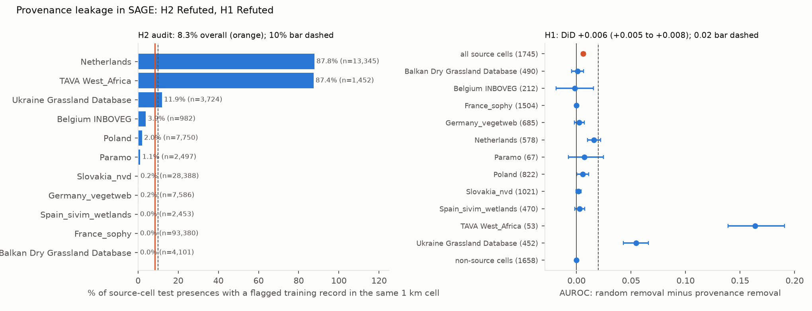

# Republished vegetation surveys barely lift SAGE's Random Forest scores overall (+0.006 AUROC), but its West African test plots also sit in the training data, and their scores depend on it

*SAGE trains species distribution models on GBIF presence-only records and tests them on sPlotOpen vegetation plots,
treating the two as independent. Several of the vegetation-plot databases that supply its test plots are also
published in GBIF. We flagged those GBIF datasets from registry metadata, froze the list, measured how often their
records share a 1 km test cell with a test presence, and retrained SAGE's Random Forest baseline for 1,745 species
without them and, as a control, without matched random records. The plan and all analysis code were committed before
any overlap or model result.*

**Verdict: H1 Refuted; H2 Refuted.** Both leakage measures fall below their preregistered thresholds overall, but the
effect is concentrated in two source databases.

- **H1 (removing provenance-shared training records lowers AUROC on source plots by at least 0.02 more than matched
  random removal): Refuted.**
  - The difference-in-differences is **+0.006** AUROC (95% species bootstrap +0.005 to +0.008), across 1,745 species.
  - Mean AUROC on source test cells: 0.854 as distributed, 0.849 without provenance-shared records, 0.856 after
    matched random removal.
  - On non-source test cells the same contrast is 0.000 (−0.0005 to +0.0005), as expected if the effect is local.
- **H2 (at least 10% of source-plot test presences have a provenance-shared training record in the same 1 km cell):
  Refuted.**
  - The share is **8.3%** (95% cell bootstrap 7.7% to 8.9%) of 165,422 test presences in 7,466 source test cells.
  - That counts flagged GBIF snapshot records. Counting only those that reached SAGE's training data gives 6.1%, and
    3.9% are provenance-only, i.e. have no other record in the cell (post hoc).
  - For comparison, 26.6% of these test presences have a training presence of the same species in the same cell from
    any source, which SAGE accepts by design.
  - France's SOPHY database supplies 56% of those presences and has no co-located flagged record. That is either
    because none exist or because its relevés reach GBIF through aggregators the metadata do not disclose.
- **Two databases exceed 0.02 on their own:**
  - **West Africa (TAVA): 87% of test presences co-located, DiD +0.164** (+0.139 to +0.191, 53 species). AUROC
    falls from 0.836 to 0.685 without the shared records but is 0.849 after random removal.
  - **Ukrainian grasslands: 12% co-located, DiD +0.055** (+0.043 to +0.066, 452 species).
  - **The Netherlands: 88% co-located, but DiD only +0.016** (+0.010 to +0.022, 578 species).
  - The other eight databases' intervals include zero, except Poland's (+0.006, +0.000 to +0.011).
- **The West African test plots themselves are in the training data, and probably the Dutch ones** (post hoc).
  - The preregistered exact-coordinate test misses this. A flagged record lies within 10 m of a source plot for only
    0.05% of test presences, because the two copies carry coordinates hundreds of metres apart (TAVA median 375 m).
  - Species lists show it instead, in cells holding a single plot. In 87% of 107 such TAVA cells, the flagged GBIF
    records list exactly the plot's species (median 8 species on each side).
  - In the median of 464 Dutch cells, every plot species appears among flagged records made the same day (recall
    1.0). They sit alongside other relevés recorded that day (median precision 0.42).
  - Ukrainian matches are partial: 24 cells, median recall 0.73.
- **The random control removed somewhat fewer records**: 24 against 29 per species on average; 13% of C1's total
  could not be matched. Restricted post hoc to the 1,690 species where it removed at least 90% as many, the DiD is
  +0.005 (+0.004 to +0.007).

## In plain terms

New benchmarks for species distribution models train on millions of crowd-sourced and museum sightings from GBIF.
They then test the models on expert vegetation surveys, assuming the two sources are independent. But some of
those expert surveys are also published inside GBIF, so a model might be tested on places it has, in effect,
already seen.

We found every GBIF dataset that republishes one of the survey databases used for testing. We then retrained the
benchmark's Random Forest model for 1,745 plant species twice: once without those datasets, and once without an
equal number of other records from the same countries.

Overall, the overlap matters little. Removing the republished surveys lowers the test score by less than a hundredth
more than removing other records. In West Africa, though, the score for the region's species drops sharply, from
0.84 to 0.69. There, the republished survey contains the very plots used for testing: the same species lists, filed
under coordinates a few hundred metres off. The Dutch test plots appear to be republished too, but the same species are also
recorded there by many other sources, so removing the survey costs the model little. Ukrainian grasslands show a
smaller effect.

So the benchmark's overall Random Forest scores hold up, but its scores for West African species partly reward
recalling the training data rather than predicting somewhere new.

## What was asked

The lead (`ecology-biodiversity-sdm-provenance-leakage`) asked whether provenance leakage inflates SAGE's evaluation.
SAGE (Arens et al., arXiv 2609.31082) trains on GBIF presence-only records and evaluates on sPlotOpen plots for 5,771
plant species. It deliberately keeps training records inside evaluation cells, because it treats the two sources as
independent.

The lead predicted that removing provenance-shared GBIF datasets would lower source-plot AUROC by at least 0.02 more
than a matched random removal.

The lead listed the Czech Vegetation Database among the republications. That GBIF dataset exists but is not in SAGE's
download, so the 1,143 Czech plots have no provenance-shared training data. Dependence between nearby records is
known to inflate SDM scores under random cross-validation (Roberts et al. 2017). Cross-source provenance in the
presence-only-train, presence-absence-test design had not been measured.

## How it was done

- **Data.**
  - SAGE's processed benchmark (Zenodo 21297133): 1 km training targets, predictors, target-group background,
    native-range masks, evaluation targets and plot metadata, with the test split from SAGE's repository.
  - **GBIF record attributes** come from GBIF's public Parquet snapshot of 2026-02-01, 19 days before SAGE's download.
    SAGE's download itself was served at about 60 KB/s.
    - Filters: the download's taxon keys plus SAGE's basis-of-record and coordinate-uncertainty filters.
    - Result: 280.5 million rows. 96.1% of SAGE's 57.1 million training presences (species × 1 km cell) have a
      matching snapshot record.
- **Provenance flags** were frozen before any overlap was computed (`results/tables/provenance_flags.csv`).
  - Registry metadata for all 11,621 datasets in SAGE's download were screened.
  - 27 core datasets republish 11 sPlotOpen source databases: for example the Dutch Vegetation Database, the West
    African Vegetation Database and the Ukrainian Grassland Database.
  - 3 broad datasets are aggregators, used as an audit sensitivity only.
- **Co-location (H2)** is counted from flagged snapshot records in the test cell, as planned; SAGE's own cleaning was
  not replayed, so this is an upper bound (see the post hoc split under Results).
- **Provenance-only presences.** A training presence is provenance-only if every snapshot record of that species in
  that cell comes from core-flagged datasets.
  - That covers 1,115,257 presences (2.0%): Netherlands 897,332, Poland 130,741, Ukraine 78,169.
- **Conditions.**
  - C0: as distributed.
  - C1: provenance-only presences removed.
  - C2–C6: five draws removing the same number of other presences of the same species in the same country. 13% of
    the C1 count could not be matched, and the shortfall is reported.
- **Model.** SAGE's single-species Random Forest baseline, reimplemented from its code:
  - balanced random forest, 1,000 trees, max_features 7, seed 0;
  - SAGE's occurrence subsample and 10,000 caps;
  - target-group background.

  SAGE's per-species tuning and the DeepSDM were not repeated. In total 12,215 fits were run for 1,745 species, all
  with at least 10 presences and 10 absences on range-masked source test cells.
- **Evaluation unit.** The evaluation unit is SAGE's own 1 km evaluation cell. Source cells are test cells with at
  least one plot from a core-flagged source database (D1).
- **Coverage (G2):** every fit completed. On non-source cells, 609 fits had an undefined AUROC (one class only) and
  are dropped from that contrast (`results/tables/coverage.json`).
- **Plausibility (G3):** `results/plausibility.md`, including two species refitted from scratch that reproduce the
  stored AUROC exactly.

## Results (`results/figures/F1_provenance.png`)

### H2: co-location by source database

| source database | test presences | with a flagged record in the same 1 km cell |
|---|---|---|
| **all source cells** | **165,422** | **8.3% (7.7–8.9%)** |
| Netherlands | 13,345 | 87.8% |
| TAVA West Africa | 1,452 | 87.4% |
| Ukraine Grassland Database | 3,724 | 11.9% |
| Belgium INBOVEG | 982 | 3.9% |
| Poland | 7,750 | 2.0% |
| Paramo | 2,497 | 1.1% |
| Slovakia, Germany (VegetWeb) | 28,388; 7,586 | 0.2%; 0.2% |
| France SOPHY, Spain SIVIM wetlands, Balkan dry grasslands | 93,380; 2,453; 4,101 | 0.0% |

The broad aggregator flags add nothing (8.3% either way). A flagged record lies within 10 m of a source plot for 0.05%
of test presences, and within 10 m on the same date for 0.01%.

**Post hoc: which co-located records reached SAGE's training data** (`results/tables/posthoc_h2_training.json`). H2
counts flagged snapshot records, but SAGE's own cleaning dropped some of them. The G3 hand trace found a Dutch cell with
four flagged records and no SAGE training cell at all.

| source database | flagged snapshot record (H2) | ... and a SAGE training presence | ... and provenance-only (removed by C1) | SAGE training presence from any source |
|---|---|---|---|---|
| **all source cells** | **8.3%** | **6.1%** | **3.9%** | **26.6%** |
| Netherlands | 87.8% | 62.3% | 36.0% | 64.9% |
| TAVA West Africa | 87.4% | 84.0% | 79.9% | 84.5% |
| Ukraine Grassland Database | 11.9% | 10.5% | 9.7% | 11.0% |
| France SOPHY | 0.0% | 0.0% | 0.0% | 22.8% |

In West Africa, nearly every test presence has a training presence in the same cell, and nearly all of those come
only from the shared survey.

### H1: retraining contrast

| test cells | species | AUROC C0 / C1 / random | DiD (95% CI) |
|---|---|---|---|
| **source cells (primary)** | 1,745 | 0.854 / 0.849 / 0.856 | **+0.006 (+0.005 to +0.008)** |
| non-source cells | 1,658 | 0.845 / 0.845 / 0.845 | 0.000 (−0.0005 to +0.0005) |
| all test cells | 1,745 | 0.853 / 0.852 / 0.853 | +0.002 (+0.001 to +0.002) |
| TAVA West Africa | 53 | 0.836 / 0.685 / 0.849 | +0.164 (+0.139 to +0.191) |
| Ukraine Grassland Database | 452 | 0.742 / 0.690 / 0.745 | +0.055 (+0.043 to +0.066) |
| Netherlands | 578 | 0.783 / 0.772 / 0.788 | +0.016 (+0.010 to +0.022) |
| Poland | 822 | 0.691 / 0.682 / 0.687 | +0.006 (+0.000 to +0.011) |
| seven other databases (≥ 50 species each) | 67–1,504 | | intervals include 0 |

- C1 changes the training data of 1,533 of the 1,745 species. 53% of species have a positive DiD.
- **Removal counts (post hoc):** C1 removes 29.2 presences per species on average; the random draws remove 24.4.
  - The ratio is lowest for INBOVEG (0.62), Spain (0.74) and the Netherlands (0.79), and 0.85 for TAVA.
  - Among the 1,690 species with a random removal at least 90% of C1's, the DiD is +0.005 (+0.004 to +0.007).
- **Distance to the plots (post hoc;** `results/tables/posthoc_distance.json`**).** For each presence, the distance
  from the species' flagged records to the nearest plot of that database in the cell, against the same number of
  records placed at random in the cell:

  | database | presences | median distance (random) | within 100 m (random) | removed by C1 |
  |---|---|---|---|---|
  | Netherlands | 11,721 | 198 m (133 m) | 23% (38%) | 41% |
  | TAVA West Africa | 1,269 | 375 m (357 m) | 5% (5%) | 91% |
  | Ukraine Grassland Database | 443 | 413 m (317 m) | 4% (7%) | 82% |

  "Removed by C1" is the share of these co-located presences whose training presence has no record from an
  unflagged dataset in the cell, and so is actually removed.

  The flagged records are no closer to the plots than random points would be. That does not rule out copies,
  because the two copies of a relevé can carry different coordinates, as the species lists below show.

- **Same relevé? (post hoc;** `results/tables/posthoc_same_releve.json`**).** These are source test cells holding a
  single dated plot, so the cell's evaluation targets are that plot's species list. The comparison is with the
  database's flagged GBIF records in the same cell:
  - **recall:** the share of the plot's species found among the flagged records;
  - **precision:** the share of the flagged species found on the plot.

  | database | flagged records compared | cells | median recall | median precision | recall and precision ≥ 0.8 | median species: plot / flagged |
  |---|---|---|---|---|---|---|
  | TAVA West Africa | all (GBIF records undated) | 107 | 1.00 | 1.00 | 87% | 8 / 8 |
  | Netherlands | same day as the plot | 464 | 1.00 | 0.42 | 18% | 17 / 37 |
  | Netherlands | other days | 581 | 0.91 | 0.13 | 0% | 17 / 107 |
  | Ukraine Grassland Database | same day as the plot | 24 | 0.73 | 0.39 | 8% | 21 / 30 |

  - **West Africa:** the flagged records reproduce the plot's species list, so the test plot itself is in the
    training data.
  - **Netherlands:** the plot's whole list appears among records made that day, alongside other relevés recorded the
    same day in the same cell. Records from other days also cover most of the list (recall 0.91), so Dutch species
    are densely recorded regardless.

## What this does and does not show

- **SAGE's headline comparisons are not driven by provenance leakage.**
  - Removing every provenance-only presence changes mean source-plot AUROC by less than 0.01 relative to a matched
    control, and changes nothing elsewhere.
  - The independence assumption holds well enough for the benchmark as a whole, at least for the Random Forest.
- **It fails locally, and there it is real leakage.**
  - The West African test plots are republished in GBIF and enter SAGE's training data in the same 1 km cell. The
    species lists match exactly in most single-plot cells.
  - Source-plot AUROC for those species falls from 0.84 to 0.69 without them.
  - Ukrainian grassland species show a smaller effect (DiD +0.055), with partial species-list matches.
  - The preregistered exact-coordinate test could not see this, because the two copies of a relevé carry different
    coordinates. Provenance has to be traced by dataset or by species list, not by coordinates.
  - A datasetKey exclusion for the flagged datasets (`provenance_flags.csv`) removes the dependence at a cost of 2%
    of training presences.
- **The Netherlands is the puzzle.** Dutch test plots appear to be republished too (same-day recall 1.0), and nearly
  nine in ten Dutch test presences have a flagged record in the same cell. Yet removing provenance-only presences
  costs little (+0.016).
  - Only 41% of those co-located presences are provenance-only (post hoc). The rest are also recorded by other
    datasets, so C1 leaves them in place.
  - In West Africa and Ukraine, 91% and 82% are provenance-only, so the shared survey is the only training record
    there.
  - Dutch duplication is therefore redundant: other sources already place the same species in the same cells.
- **Not shown:**
  - **The DeepSDM.** It was not retrained, because the GPU is held by a shared service. Its sensitivity may differ.
  - **SAGE's tuned Random Forest.** Per-species mtry and multi-seed averaging were not repeated.
  - **Hidden republication.** Relevés reaching GBIF through undisclosed aggregators would be missed. That matters
    most for France, where SOPHY supplies most source presences and shows no co-location.
  - **SAGE's exact download.** The snapshot differs by 19 days, and SAGE's CoordinateCleaner and range filtering were
    not replayed. Both bias toward the null.
  - **Other benchmarks** with the same design.
  - **The lead's observational check** on SAGE's released predictions. It was not run, because those predictions are
    a 48 GB optional download.

## Process and deviations

- **Preregistration:** `plan.md`, committed before any overlap or model result. Provenance flags were frozen in a
  separate commit before the overlap was computed.
- **Deviations** (`deviations.md`):
  - notes: the lead's false Czech claim, and registry pages that returned no metadata;
  - D1, before any RF result: cells as the evaluation unit, SAGE's occurrence subsample, background construction,
    random-removal matching with its 13% shortfall, and the exact-coordinate definition;
  - D2, before any RF result: the G1 leakage audit and G2 coverage accounting;
  - D3, after the results: four labelled post hoc checks (distance to plots, shortfall restriction, co-location
    split by SAGE training presence, same-relevé species lists), the G3 hand traces, and the job-order change in
    `rf.py`.
- **Quality gates:** G1–G3, G5 (`review/overclaim_check.md`) and G6 (`results/attribution_ledger.csv`). G4 and G7 do
  not apply, as there is no labelling or classifier validation.
- **Independent review:** queued (Fable), per the lab's pacing rule.

## Reproducing it

1. `code/registry.py`, `code/flag_search.py` (flags are frozen in `results/tables/provenance_flags.csv`) and
   `code/species_keys.py`.
2. `code/s3_extract.py` (GBIF snapshot columns, about 280 million rows) and `code/cells.py`.
3. `code/audit.py` (H2 and the species population).
4. `code/rf.py removals`, then `code/rf.py fit` (12,215 fits, about 11 hours on 24 cores).
5. `code/analyse.py` (H1).
6. `code/posthoc_distance.py`, `code/posthoc_shortfall.py`, `code/posthoc_h2_training.py` and
   `code/posthoc_same_releve.py` (post hoc).
7. `code/figures.py`, `code/handtrace.py` and `code/handtrace_audit.py` (G3).
