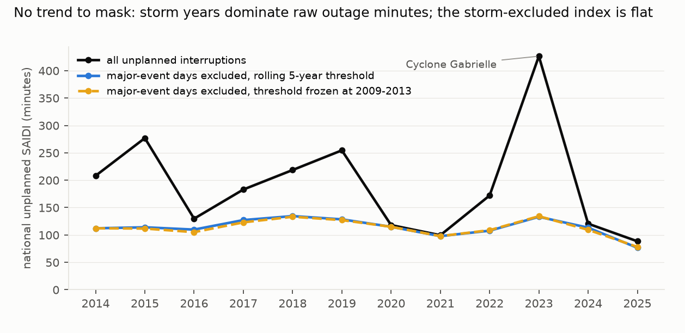
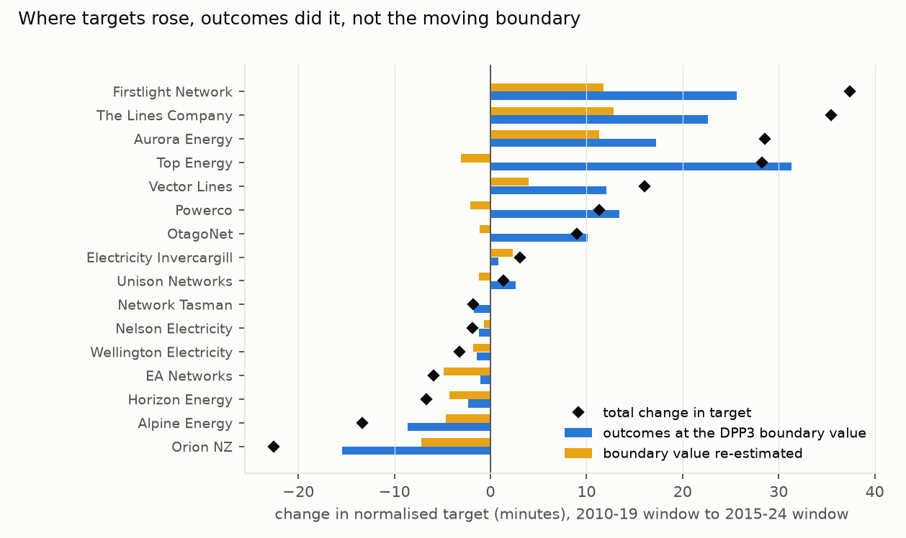
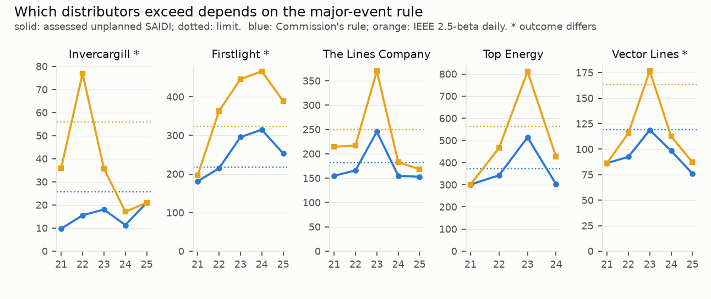

# No sign that New Zealand's outage limits ratchet with storms: the 2025 reset's target rises came from ordinary-day outages, not a moving storm threshold, and a ±5% cap has bound limits since 2020; the major-event rule can change who breaches

*16 non-exempt electricity distributors. The data are the Commerce Commission's interruption-level records, published
with its 2020 (DPP3) and 2025 (DPP4) price-quality path models, for disclosure years 2009–2024, plus the 2025
interruption disclosures. They are combined with the reliability limits and boundary values of the 2015, 2020 and 2025
determinations, transcribed by double entry. The plan was committed before any interruption outcome was aggregated.
This version incorporates an independent review (`review/review.md`; changes logged as D3).*

**Verdict: H1 Inconclusive; H2 Inconclusive; H3 Supported.**

- **H1 (the IEEE 2.5-beta rule masks a rising outage trend): Inconclusive, and there is no rising trend to mask.**
  - National unplanned SAIDI **fell 4.1% a year** over 2014–2025 (95% distributor-cluster bootstrap −7.3 to −0.5;
    the year bootstrap, −9.6 to +4.7, includes zero).
  - Storm years dominate it: 2023, the year of Cyclone Gabrielle, recorded 426 minutes, against 88–277 in other
    years.
  - With major-event days excluded: −1.7% a year (−3.7 to +0.5).
  - The preregistered ratio test (0.40, −0.28 to +0.72) was designed for a rising trend. With a falling one it does
    not measure masking.
- **H2 (a rolling threshold removes more of the trend than a frozen one): Inconclusive.** The difference is +0.24
  percentage points a year (−0.06 to +0.50).
- **H3 (the major-event rule can change compliance): Supported, under every convention tried.**
  - For **3 of 15 distributors**, the Commission's rolling-24-hour rule and the IEEE daily 2.5-beta rule give
    different exceedance years in 2021–2025, each limit computed from the same 2010–2019 window.
  - Against the determinations' own DPP3 limits, 2 differ. With IEEE major-event days excluded rather than capped,
    4 differ.
  - The robust case is Firstlight Network. For Electricity Invercargill the IEEE rule removes nothing in the
    reference window, so its difference is a raw-versus-normalised contrast. Vector's 2023 sits at 0.998 of the
    Commission-rule limit.
  - IEEE boundaries are 1.3 to 25 times the Commission's.
- **The reset: outcomes, not the moving boundary.**
  - Across distributors, targets rose by 115 minutes from the DPP3 to the DPP4 reference window.
  - Changing outcomes first, the boundary's re-estimation accounts for +11 and outcomes for +104. Changing the
    boundary first gives −5 and +120. The Shapley average gives the boundary +3.
  - The Commission's own uncapped DPP4 limits differ from DPP3's by a median of −1% (15 distributors; Aurora,
    whose period was varied, +57%).
  - The ±5% inter-period target cap, in force since the 2020 reset, bound for 13 of 15 distributors in 2025.

## In plain terms

Each local power company in New Zealand is allowed a set number of outage minutes a year before it is in breach.
Days hit by big storms are partly excused. Every five years the regulator resets the allowance from the previous
ten years. The worry was that, as storms get worse, the allowance quietly creeps up with them, so the system loosens
exactly when it should bite.

We rebuilt the regulator's calculations from its own outage records and reproduced its numbers. Over 2014–2025,
outage minutes did not rise. They jump around with storm years, Cyclone Gabrielle above all, and if anything fell.
Where allowances did rise at the 2025 reset, it was mostly because those networks had more ordinary outages, not
because the storm threshold moved. Since 2020 the regulator has also capped any allowance's move at 5% per reset,
and that cap bound for almost every company.

What can matter is how a "storm day" is defined. The regulator uses a rolling 24-hour window with a fixed number of
storm events a year. The international standard (IEEE 1366) uses a statistical threshold on calendar days. Swapping
one for the other changed "in breach" for two to four of fifteen companies in at least one year, depending on
details. So the excusing rule is more than a technicality.

## What was asked

The lead (`energy-nz-edb-quality-standard-ratchet`, Energy signature area) asked whether the five-yearly resets ratchet
reliability limits upward with the storms of the reference period. It is an external check of the lab's US finding
(`runs/energy-outage-major-event-day-ratchet`), using official data instead of outage-map proxies.

Two things changed the plan before it was committed (plan section 0):
- **The published parameters already answer the level question.** The DPP4 boundary values, the Commission's uncapped
  limits and the cap, read during the double-entry check, already show it.
- **The lead's DPP2 → DPP4 limit comparison is not like for like.** DPP2 limits cover 0.5 × planned + unplanned
  SAIDI with a daily boundary. DPP3 and DPP4 cover unplanned SAIDI with a rolling, fixed-count boundary.

## How it was done

- **Data.**
  - The Commission's DPP3 model data supplies disclosure years 2009–2013, and its DPP4 model data (the
    "transitional" series) 2014–2024. They agree exactly in all 96 overlapping distributor-years.
  - The 2025 interruption disclosure passes the plan's identification check (D3). Comparing unplanned totals with
    the disclosed Class C SAIDI ("All" network rows), 26 of the 28 distributors with data are within 5%. Among study
    distributors only Top Energy fails, and Nelson has no Class C rows. Top Energy's 2025 is excluded, because its unplanned total includes
    Transpower-caused interruptions it cannot separate.
  - Eastland is Firstlight. Centralines is dropped, because the DPP4 file's Unison excludes it.
- **The Commission's rule** is re-implemented from its R (DPP4) and Stata (DPP3) code:
  - interruptions are rounded to the half-hour, and rolling 24-hour totals are formed;
  - the boundary is the total ranked 1,104th over ten years (2.3 major events a year), with small-distributor
    adjustments;
  - half-hours inside a major event are capped at boundary ÷ 48;
  - target = mean annual normalised SAIDI, and limit = target + 2 SD.
- **The validation gate passed** after a date-parsing fix (D2):
  - all 16 DPP4 boundary values exactly, and DPP4 targets and uncapped limits within 0.6%;
  - all 17 DPP3 boundary values within 0.15%;
  - all 17 DPP3 uncapped limits within 0.05% of the Stata model's own output.
- **Assessment mode.** The study's rule (a) with the determinations' limits reproduces the Commission's published
  DPP3 non-compliance record exactly: DPP4 reasons paper, Attachment E, Table E3 (review check 2).
- **The IEEE 1366 rule** works on calendar-day SAIDI. The threshold is exp(α + 2.5β) of ln(daily SAIDI) on the
  non-zero days of the previous five years (rolling) or of 2009–2013 (frozen), and major-event days are excluded.
- **National index.** The ICP-weighted mean of distributor SAIDI.
  - ICP counts are a proxy (ICP minutes ÷ SAIDI) with a plausibility guard. Five distributor-years outside 1/3 to
    3 times the distributor's median are interpolated (D3), including a corrupt Alpine 2017 value that had taken
    99.5% of that year's weight.
  - The trend is the slope of the index's log on year, with a distributor-cluster bootstrap (B = 2,000). A year
    bootstrap is a sensitivity.

## Results

### H1 and H2: no rising trend to mask (`results/figures/F1_national.png`)

| series, 2014–2025 | trend, % a year | cluster bootstrap | year bootstrap |
|---|---|---|---|
| raw unplanned SAIDI | −4.11 | −7.27 to −0.48 | −9.57 to +4.69 |
| major-event days excluded, rolling threshold | −1.66 | −3.69 to +0.51 | −4.45 to +1.03 |
| major-event days excluded, frozen threshold | −1.42 | −3.56 to +0.82 | −4.04 to +1.27 |
| frozen minus rolling (H2) | +0.24 pp | −0.06 to +0.50 | −0.11 to +0.62 |
| ratio, excluded (rolling) / raw | 0.40 | −0.28 to +0.72 | −1.06 to +2.07 |

- **Major-event days are rare under IEEE in New Zealand.** The rolling rule flags 0.06–1.6 days per distributor per
  year, against the 2.3 events a year the Commission's rule fixes by construction. Daily outage minutes in New
  Zealand have heavy tails, which inflates β.
- **Sensitivities:**
  - **Without Aurora:** −4.3% a year raw, still Inconclusive.
  - **Without 2023:** −7.0% a year raw (−10.1 to −3.7). The rule returns "Supported" (ratio 0.33), but, as for the
    primary, a falling raw trend is not masked growth, and this is not evidence for H1.
- **SAIFI.** −2.6% a year raw (−4.3 to −1.4), with the excluded series falling as fast (ratio 0.99, 0.85 to 1.07).
  The sign-blind rule returns "Refuted". Read correctly, nothing masks a falling SAIFI trend. H2 for SAIFI is
  Inconclusive (+0.10 pp, −0.13 to +0.28).
- **National SAIDI with major-event days excluded** (ICP-weighted, minutes) varies within 77–134, with no rising
  trend.

### The reset itself: outcomes, not the moving boundary (`results/figures/F2_decomposition.png`)

- **Size of the change.** Moving the reference window from 2010–2019 to 2015–2024 raises the median distributor's
  recomputed, uncapped normalised target by 4.7% and its limit by 3.3%. The Commission's published uncapped limits
  imply a median of −1% (15 distributors, without Aurora).
- **What drives it.** Targets rose by 115 minutes in total. The split depends on the order of the two changes:
  - outcomes first (the boundary evaluated on 2015–2024 outcomes): boundary +11, outcomes +104;
  - boundary first (the boundary evaluated on 2010–2019 outcomes): boundary −5, outcomes +120;
  - Shapley average: boundary +3.

  Either way, outcomes dominate. The largest rises are at Firstlight (+37), The Lines Company (+36), Aurora (+29),
  Top Energy (+28) and Vector (+16). Orion's fall (−23) reflects the 2011 Canterbury earthquakes leaving its window.
- **Share removed by normalisation.** The median share of raw unplanned SAIDI that normalisation removes fell from
  47% to 40%.
- **Gabrielle and Unison.** Unison's raw reference-window mean more than doubled (123 → 283 minutes, Cyclone
  Gabrielle), but its target rose by only 1.4 minutes. The fixed-count rule absorbed the cyclone, as intended.
- **The cap.** The DPP3 target was limited to a ±5% change from a consistently normalised DPP2 target (DPP3 reasons
  paper, Attachment J, Table J1). Stata target × (1 + J1 adjustment) + 2 SD reproduces every DPP3 determination limit
  to 0.02% (review check 3; D3). The same ±5% cap applied in 2025 and bound for 13 of 15.

### H3: the rule can change who exceeds (`results/figures/F3_compliance.png`)

| distributor | Commission's rule: years over limit | IEEE rule: years over limit |
|---|---|---|
| Electricity Invercargill | none | 2022 |
| Firstlight Network | 2023, 2024, 2025 | 2022, 2023, 2024, 2025 |
| The Lines Company | 2023 | 2023 |
| Top Energy (2021–2024) | 2023 | 2023 |
| Vector Lines | none | 2023 |

- **Counts.** 5 exceedances under the Commission's rule and 8 under IEEE, across 15 distributors.
- **Conventions:**
  - with the determinations' own DPP3 limits (including the ±5% cap), Vector also exceeds in 2023 under the
    Commission's rule, so 2 differ (Invercargill and Firstlight);
  - with IEEE major-event days excluded rather than capped, 4 differ (Invercargill, Firstlight, OtagoNet and The
    Lines Company);
  - for SAIFI, 3 differ.

  At least two differ under every convention, so H3 is Supported throughout. The named set changes.
- **Inert cases.** For Electricity Invercargill, Nelson and Network Tasman no reference-window day exceeds the IEEE
  threshold, so the IEEE rule there compares raw SAIDI with a raw limit. Invercargill's difference is of that kind.
- **Margins.** Firstlight 2022 sits at 0.98 of the Commission-rule limit, and Vector 2023 at 0.998.

## What this does and does not show

- **No sign of a storm ratchet over 2014–2025.** Raw outage minutes did not rise, and if anything fell, but the
  interval is wide (the year bootstrap admits +4.7% a year). This is absence of evidence for a rising trend, not
  proof of none.
  - Where reset targets rose, the rise came mainly from more outage minutes on ordinary days, under either ordering
    of the decomposition.
  - The ±5% cap, in force since 2020, held most limits near their previous values.
- **The US result does not transfer.** The rule behaves the same way, but New Zealand's series, unlike the US one,
  shows no rising trend over this window.
- **The rule can be consequential.** IEEE's daily 2.5-beta threshold sits 1.3–25 times above the Commission's
  fixed-count threshold for New Zealand's heavy-tailed outage data. It changes compliance for 2–4 of 15 distributors,
  depending on conventions; the robust case is Firstlight.
- **Not shown:**
  - **Enforcement.** Under DPP3, exceeding the limit in an assessment period is a contravention, subject to
    enforcement discretion and to the regime's extreme-event and major-external-factor provisions, which are not
    modelled.
  - **Trends beyond 2025,** and causes: network condition and recording practice are not separated from weather.
    A 2024–2025 recording-basis check shows comparable interruption counts (median ratio 0.93) and SAIDI per
    interruption (0.86).

## Process and deviations

- **Preregistration:** `plan.md`, committed after the double-entry transcription and before any outcome aggregate.
- **Deviations** (`deviations.md`):
  - D1, now withdrawn by D3: it had excluded 2025 because of a double-counting error.
  - D2: a day-first date-parsing bug, caught by the validation gate before any hypothesis statistic, and the DPP3
    limit mechanism (the ±5% cap; D3).
  - D3, after the review:
    - corrupt ICP weights guarded and interpolated;
    - 2025 included as preregistered;
    - the DPP3 cap explained;
    - H3 conventions and inert cases;
    - both decomposition orderings;
    - wording.
- **History.** This lead was first skipped on 21 October 2026, after a novelty check. The Commission's DPP4 reasons
  paper (Attachment E, Table E16) already tabulates the uncapped and capped DPP3 → DPP4 limit changes. It was
  revisited because the Commission's model bundles hold interruption-level data for 2009–2024.
- **Independent review:** Fable, 2026-10-25, "fix first" (`review/review.md`). Fixes are D3; a confirmation pass
  follows.

## Reproducing it

1. `code/transcribe.py`.
2. `code/panel.py load`, then `check`, then `build`.
3. `code/rules.py validate`.
4. `code/analysis.py`.
5. `code/figures.py`.

The data are the Commission's DPP3 and DPP4 model bundles and the EDB information-disclosure files, all public.
