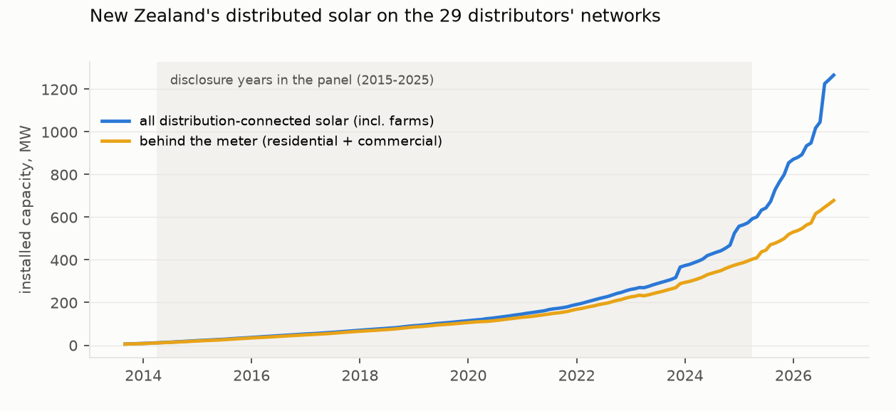
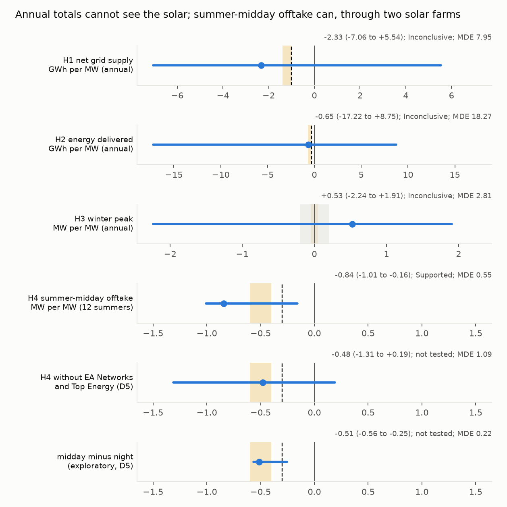
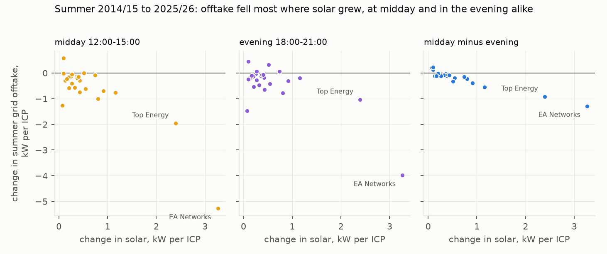

# What distributed solar has done to New Zealand's electricity networks: invisible in the annual books, and at summer midday a signal carried by two networks with solar farms

*Twenty-nine electricity distributors, 2014–2026: their annual information disclosures, the Electricity Authority's
registry of installed solar, and half-hourly metered offtake at every grid exit point, used to measure how much
grid energy distributed solar displaces and whether it touches the winter peak.*

**Verdict: Inconclusive.** The three annual tests are Inconclusive. H4 (summer-midday grid offtake) passes its
preregistered rule but is not robust: the result comes from the two networks that added solar farms, a pre-trend
placebo excludes zero, and rooftop solar's own effect is not detectable. Distributed solar on the 29 networks grew from about 17 MW behind the meter (19 MW in all)
to 363 MW behind the meter (about 490 MW including solar farms) over the panel's years. That is too small a share of
annual energy for the distributors' annual disclosures to detect.

- **H1 (net grid supply falls by at least 1.0 GWh per MW): Inconclusive.** −2.33 GWh per MW (95% interval −7.06 to
  +5.54). The minimum detectable slope at 80% power is about 8 GWh per MW, against an expected 1.0–1.4.
- **H2 (energy delivered to customers falls by at least 0.3 GWh per MW): Inconclusive.** −0.65 (−17.2 to +8.8);
  minimum detectable slope about 18.
- **H3 (the winter peak moves by less than 0.2 MW per MW): Inconclusive.** +0.53 (−2.24 to +1.91); minimum detectable
  slope about 2.8.
- **H4 (summer-midday grid offtake falls by at least 0.3 MW per MW): passes the preregistered rule; not robust.**
  −0.84 MW per MW (−1.01 to −0.16).
  - **Two networks carry it.** EA Networks and Top Energy, which added solar farms (3.3 and 2.4 kW per ICP, against
    0.1–0.6 elsewhere), supply about four-fifths of the variation in exposure. Without them the slope is −0.48
    (−1.31 to +0.19), and in 13% of bootstrap draws neither is present.
  - **Rooftop solar alone is not detectable.** On behind-the-meter capacity alone the slope is −1.49 (−2.67 to
    +0.23); on solar-farm capacity alone, −0.96 (−1.27 to −0.11).
  - **There are confounds.** Top Energy became a net injector into the grid in 2020/21, when its geothermal
    generation expanded, so its offtake fell at every hour before its solar farms arrived. Solar capacity two years
    ahead also predicts lower offtake now (midday −0.22, −0.87 to +0.01; night −0.26, −0.97 to −0.03): a pre-trend.
  - **The cleanest within-network comparison** (exploratory, after review) is midday minus night offtake. It gives
    −0.51 MW per MW (−0.56 to −0.25), and −0.33 (−0.61 to −0.06) without the two farm networks.

## In plain terms

Solar panels are spreading fast in New Zealand, on roofs and, lately, in solar farms connected to local networks.
We asked what this has done to the networks that carry power to homes and businesses. Has it cut how much energy
they deliver, and has it lowered the winter evening peak that drives the cost of building them?

The yearly figures every network publishes cannot tell us. Solar is still only about one or two percent of the
energy they carry, and the yearly totals move around far more than that for other reasons. All three of our tests
on the yearly figures came back "can't tell".

The half-hourly meter readings where each network connects to the national grid show more. On summer afternoons,
networks where solar grew draw less power from the grid. But almost all of that evidence comes from two networks,
in Ashburton and the Far North, which each added large solar farms. In the Far North a geothermal power station also
expanded, which cut the network's draw from the grid at every hour.

Across the other networks, where most solar is on rooftops, we could not tell the effect apart from zero. So these
numbers tell us more about what solar farms do than about what rooftop panels do.

## What was asked

New Zealand's distributed solar has roughly doubled every two years since 2013. Ministry and agency modelling
(MBIE's 2025–2026 reports, EECA's study of residential solar and storage) project its effects, but no empirical,
network-level measurement was found. The preregistration (`plan.md`) set four tests, all per MW of installed solar:

- **H1:** net supply from the grid falls by at least 1.0 GWh a year.
- **H2:** energy delivered to customers falls by at least 0.3 GWh a year.
- **H3:** the network's maximum coincident demand moves by less than 0.2 MW either way.
- **H4:** summer-midday offtake at grid exit points falls by at least 0.3 MW.

**Why H1 and H2 differ.** Solar output that a household uses itself never passes the meter, so it lowers the energy
the distributor delivers. Output the household exports is delivered to a neighbour, so it does not lower delivered
energy, but it does lower what the network takes from the national grid. The lead this study came from put "at least
1.0 GWh per MW" on delivered energy; by this accounting that figure belongs to grid supply (H1), and delivered energy
should fall only by the self-consumed share (H2).

## How it was done

**Outcomes.**
- *Annual (H1–H3):* the Commerce Commission's information disclosures, Schedule 9e, for disclosure years
  (April–March) 2015–2025: energy delivered to ICPs; electricity entering the system minus electricity supplied
  from distributed generation (net grid supply); maximum coincident system demand.
- *Summer (H4):* the Electricity Authority's half-hourly metered flows at every grid exit point (Grid_export minus
  Grid_import), December–February, summers 2014/15 to 2025/26.

**Exposure.** The Authority's registry-based count of installed solar by network, monthly:
- *behind the meter* (residential and commercial segments, H2 and H3);
- *all distribution-connected solar*, including the farms in the industrial segment (H1 and H4).

**Model.** Outcome per customer connection (ICP) on solar kW per ICP, so the slope reads in GWh (or MW) per MW;
weighted by ICPs; distributor and year fixed effects; heating degree-days (H4: mean daily maximum temperature). 95%
intervals from a distributor-cluster bootstrap (4,999 resamples). Networks that share grid exit points are merged for
H4, giving 24 units.

## Results

### Installed solar (`results/figures/F1_installed_solar.png`)

| disclosure year | behind the meter, MW | all solar, MW | energy delivered, GWh |
|---|---|---|---|
| 2015 | 17 | 19 | 31,305 |
| 2020 | 102 | 110 | 32,574 |
| 2025 | 363 | 489 | 33,583 |

At an expected 1.2 GWh per MW, the 2025 stock would displace about 0.6 TWh of grid supply, under 2% of the energy
the networks carry, and less than the year-to-year movement in many networks' totals.

### The four tests (`results/figures/F2_slopes.png`)

| test | estimate | 95% interval | minimum detectable | verdict |
|---|---|---|---|---|
| H1 net grid supply, GWh/MW | −2.33 | −7.06 to +5.54 | 7.95 | Inconclusive |
| H2 energy delivered, GWh/MW | −0.65 | −17.22 to +8.75 | 18.27 | Inconclusive |
| H3 winter peak, MW/MW | +0.53 | −2.24 to +1.91 | 2.81 | Inconclusive |
| H4 summer-midday offtake, MW/MW | **−0.84** | **−1.01 to −0.16** | 0.55 | **Supported** (two units; see below) |

**With the disclosed annual totals, the annual tests could not have succeeded.** Their minimum detectable slopes are five to thirty times the
effects they were designed to find. Every robustness variant agrees (`results/tables/robustness.json`): levels,
unweighted, first differences, without degree-days, without 2021, without network-years whose outcome jumped more
than 15%, and with the disclosures' own ICP counts. All give wide intervals spanning zero.
The implied self-consumption share, about 11%, is equally uninformative.

### Summer midday (`results/figures/F3_change_vs_change.png`)

| variant | MW per MW | 95% interval |
|---|---|---|
| preregistered (per ICP, weighted) | −0.84 | −1.01 to −0.16 |
| levels, ICPs as a control | −0.50 | −1.07 to −0.15 |
| unweighted | −0.89 | −0.99 to −0.24 |
| first differences | −0.58 | −0.86 to +0.43 |
| leave one unit out (range) | −0.90 to −0.72 | — |
| dropping unit-summers whose midday offtake moved more than 15% (46 rows) | −0.62 | −1.53 to +0.33 |
| *after review:* without EA Networks and Top Energy | −0.48 | −1.31 to +0.19 |
| *after review:* without the 11 units with at least 5 MW of industrial-segment solar | −0.95 | −3.40 to +0.15 |
| *after review:* behind-the-meter capacity as the exposure | −1.49 | −2.67 to +0.23 |
| *after review:* solar-farm (industrial) capacity as the exposure | −0.96 | −1.27 to −0.11 |
| *after review:* non-solar distributed generation as a control | −0.80 | −1.02 to −0.31 |
| *placebo:* solar two years ahead, midday | −0.22 | −0.87 to +0.01 |
| *placebo:* night offtake 02:00–05:00 | −0.33 | −0.54 to +0.24 |
| *exploratory:* midday minus night | −0.51 | −0.56 to −0.25 |
| *exploratory:* midday minus night, without the two farm units | −0.33 | −0.61 to −0.06 |

Rows marked *after review* are in `results/tables/sensitivity_post_review.json` (D5); the others in
`robustness.json` (D3, D4).

**The preregistered pass depends on two networks.** EA Networks (a 48 MW solar farm in November 2024) and Top
Energy (farms in November 2023 and September 2025) are the only units whose solar per ICP rose by more than about
1.2 kW. Leaving out either one moves the slope little, which the leave-one-out range shows, but leaving out both
leaves an interval that includes zero. Several other variants also reach zero: first differences, the jump filter,
and dropping every unit with substantial farm capacity. The minimum detectable slope and the lopsided interval
are themselves consequences of that concentration.

**What the farms show is a real solar signature.** Within each of the two units, midday offtake fell relative to
night offtake as the farms came on: by about 0.5 MW per MW at Top Energy and 0.7 at EA Networks. But the networks
also changed in other ways:
- Top Energy has been a net injector into the grid since summer 2020/21, when its geothermal generation expanded;
  its offtake fell by about 17 MW at every hour then, before the farms.
- EA Networks' summer load is dominated by irrigation, and its night offtake ranges from 53 to 110 MW across
  summers.

**Rooftop solar, on its own, does not register.** Behind-the-meter capacity grew everywhere but slowly, and its slope
on its own is not distinguishable from zero.

**An earlier draft overstated this.** It called a midday-minus-evening contrast (−0.35) the best estimate. But in a
New Zealand summer the sun is 26–35° up at 18:00 daylight time, and panels still produce a fifth to almost half of
their midday output in that window. So that contrast subtracted solar output and understated it. It has been
replaced by the night window above.

## What this does and does not show

- **It shows** that the two networks that added solar farms draw markedly less from the national grid at summer
  midday since the farms came on, by roughly half a megawatt or more per megawatt installed. Across the 29 networks
  that is enough to pass the preregistered test, but not robustly.
- **It does not show** an effect of rooftop solar, whether solar has eroded the distributors' delivered-energy base,
  or whether it has left the winter peak untouched. The annual disclosures are too coarse to tell, and the tests
  were Inconclusive, not null results. The peak result would be expected on physical grounds, since winter evening
  peaks fall after dark, but this study cannot confirm it.
- **Confounding is visible.** The two-years-ahead placebo shows a pre-trend: networks about to add solar were already
  drawing less. Top Energy's geothermal expansion and EA Networks' irrigation load move offtake at all hours. The
  midday-minus-night contrast nets out what moves all hours together. It is exploratory, and night loads (hot-water
  ripple control, EV charging, irrigation pumping, batteries) have their own trends.
- **Exposure.**
  - Installed capacity is the Authority's registry count; inverter-versus-panel rating and orientation are unknown.
  - The residential and commercial segments contain some farm-sized steps: Top Energy commercial +20 MW in May 2025;
    Powerco residential +11.5 MW in November 2023; Waipa and Orion residential about +9 MW in July 2025.
  - Residential + commercial + industrial matches the all-segment total within 1.6%.
  - The excluded embedded networks hold 11.5 MW (0.9%).
- **Data corrections**, all made before any estimate:
  - ICP counts are taken from the registry, because four disclosure-derived counts were wrong (D2): Westpower 2024
    implied 91,158 ICPs against about 14,300.
  - Six distributor-years with no distributed-generation figure are left out of H1.
  - The market data's flow directions are named from the grid's side, which the plan had reversed (D1).
- **No personal data.** All inputs are network-level aggregates.

## Process and deviations

- **Preregistration.** `plan.md` was committed before any outcome series was built. The panel, analysis and
  post-review sensitivity code were committed before they were run; `figures.py` was committed with its figures.
- **Deviations** (`deviations.md`):
  - D1 corrected the grid-exit flow direction and set the H4 specification, before any panel was built.
  - D2 replaced the disclosure-derived ICP counts with registry counts, before any estimate.
  - D3 completed the preregistered robustness set for H4 and added the post hoc evening and night placebos.
  - D4 added a midday-minus-evening contrast; its code and outputs were committed together.
  - D5, after independent review, adds the two-unit, exposure-split, confound and night-contrast analyses, and
    withdraws the evening contrast and the rooftop framing.
- **Review.** An independent adversarial review (`review/review.md`) confirmed the accounting, D1, D2, the merged
  units and the trading-period timing, and reproduced the bootstrap exactly. It found the H4 dependence on two units,
  the evening window's sunlight, and the undisclosed confounds, all addressed here.

## Reproducing it

`code/fetch.py` (inputs and a hashed manifest), `code/build_panel.py`, `code/analysis.py`,
`code/sensitivity_post_review.py`, `code/figures.py`.

- **Inputs** are public: the Commerce Commission's disclosure Parquet; the Authority's installed-generation report
  (EMI GUEHMT) and metered grid flows; Open-Meteo historical temperatures.
- **Results** are in `results/tables/`: `panel_annual.csv`, `panel_summer.csv`, `panel_log.json`, `primary.json`
  `robustness.json` and `sensitivity_post_review.json`.
