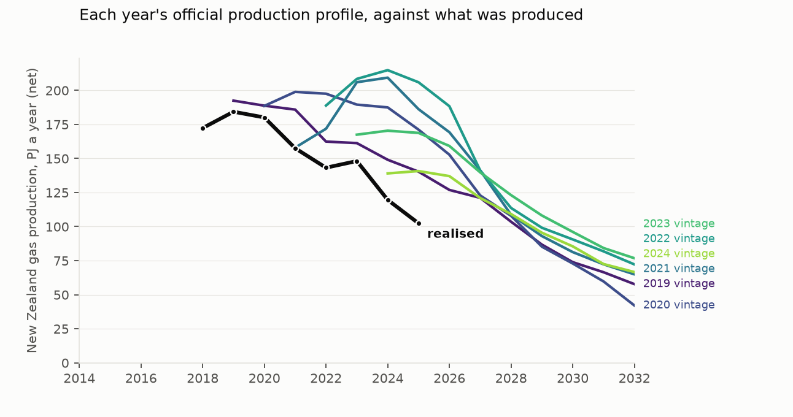
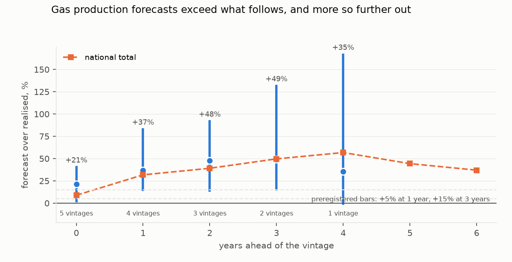
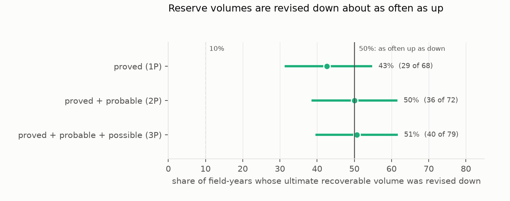

# Are New Zealand's gas production forecasts systematically optimistic?

*Every archived edition of the production profiles that field operators report to MBIE — twelve, from 2015 to 2026 —
compared field by field and year by year with the gas that was actually produced.*

**Verdict: Inconclusive.** The preregistered H1 test reads Supported, but only just, and not robustly: forecasts are
too high one to two years ahead, the optimism does not grow with horizon, and how large it looks depends on which
editions and fields are counted. The proved reserve category is not behaving as a conservative floor (H3
Supported), and 2P reserve volumes have been revised down every year since 2022.

- **H1 (over-forecasting that grows with horizon): Supported by its rule, narrowly, and fragile.**
  - The rule asks for a median field-level over-forecast of at least 5% one year ahead and 15% three years ahead,
    with both intervals excluding zero. One year ahead it is **+27.5%** (95% CI +9.1% to +60.9%); three years ahead
    **+15.1%** (+0.7% to +41.2%). The three-year figure clears its bar by 0.1 percentage point.
  - Of the preregistered sensitivities, clustering by edition instead of field and restricting to fields producing
    above 0.5 PJ both give Inconclusive (the three-year lower bound falls to −2.5% and −0.2%); trimming the largest 5%
    of errors gives Supported. The reviewer's independent implementation put the three-year median at +13%.
  - **The optimism peaks and then fades, rather than growing**: +12.6% in the part-observed year of publication,
    +27.5% one year ahead, +24.4% two, then +15.1%, +6.0% and +6.0% at three, four and five years.
  - **By volume it is smaller**: summed over the same field-years, forecasts exceed outcomes by **15%** one year ahead
    and **12%** three years ahead. The median is pulled up by small fields with large proportional misses.
- **H2 (2P volumes are revised down more than half the time): Inconclusive.** 71 of 142 field-years that moved by
  more than 1% were revised down — exactly half (95% CI 42–58%). But the sign count hides a turn in the volumes:
  2P ultimate recoverable was revised **up** by 227–305 PJ a year between the 2018 and 2021 editions, and **down**
  by 196, 179, 233 and 107 PJ in each year from 2022 to 2026.
- **H3 (the proved category is not conservative): Supported.** The proved (1P) volume was revised down in **43%** of
  field-years (60 of 138; 95% CI 35–52%), against the roughly 10% that a 90%-confident estimate implies.

**Which editions.** The answer depends heavily on when a forecast was made. One year ahead, the 2015, 2016 and 2017
editions were close to right (+0.6%, +4.1%, +14.8%); the 2018 edition and the 2020–2022 editions were far too high
(+35% to +77%). An earlier draft of this study used only the 2019–2024 editions and reported a gap that "widens the
further ahead it looks"; with every archived edition, that pattern disappears.

**Which fields.** By volume, three of the four largest fields were close to unbiased one to three years ahead —
Mangahewa (−1%), Maui (−2%) and Kupe (+3%) — while Pohokura (+24%) and Turangi (+34%) were over-forecast, and small
fields were over-forecast by large proportions (Kowhai +91%, McKee +65%, Ngatoro +172%).

**One number for the scale of it.** The edition published as at 1 January 2022 forecast **206 PJ** of gas for 2025.
New Zealand produced **102 PJ**.

## In plain terms

New Zealand is running short of natural gas. Each year the companies that own the gas fields tell the government
how much they expect to produce over the coming years, and those forecasts feed decisions about electricity, big
industrial users, and whether to import gas.

We found every past copy of those forecasts in a web archive, twelve years of them, and compared each with what the
fields actually produced.

The forecasts were usually too high, by about a quarter one or two years ahead for a typical field, or about a sixth
once big and small fields are weighed by how much gas they produce. But they did not get worse the further ahead they
looked, and the forecasts made around 2015 to 2017 were close to right. The large misses came from the forecasts made
between 2018 and 2022: the 2022 forecast for 2025 was double what was actually produced.

The companies' estimates of how much gas is left were revised up for several years and then cut every year since
2022. The "proved" category, which is supposed to be a safe floor, was cut in more than four cases in ten.

An earlier version of this study, using only six of the twelve years, said the forecasts got steadily worse further
out. With all twelve, that is not true.

## What was asked

Under the Crown Minerals Act, field operators file an annual summary report with MBIE giving their remaining
reserves and a roughly fourteen-year expected production profile. MBIE publishes these as the petroleum reserves
workbook. The profiles feed MBIE's gas outlooks, the system operator's security-of-supply work, and commercial and
policy decisions.

The study asks three preregistered questions (`plan.md`):

- **H1:** do the profiles exceed realised production, and does the gap grow with horizon?
- **H2:** are proved-plus-probable (2P) volumes revised down more often than up?
- **H3:** is the proved (1P) category behaving as a conservative floor?

## What was already known

MBIE reports shortfalls descriptively. *Energy in New Zealand 2026* notes that 2025 net production was 102 PJ, 4.1%
below the 107 PJ profile published in June 2025, and the May 2026 release notes that 2P reserves fell 23% to 731 PJ
with the 2026 profile 15% below the previous year's. A TIMES-NZ methodology page reproduces an MBIE chart comparing
profiles with outcomes for 2020–2025 and observes that actual production "often fell short".

The international literature on overconfidence in petroleum estimates (Capen 1976; Bratvold and Begg) is not about
New Zealand. No horizon-resolved, field-level calibration of these profiles, and no test of whether the
probabilistic reserve categories are calibrated, was found (searches 2026-10-20).

## How it was done

**The forecasts.** Every retrievable edition of MBIE's petroleum reserves workbook, taken from Internet Archive raw
copies because MBIE's own site refuses scripted downloads. Thirteen editions are archived, as at 1 January 2014
through 2026 (D2); the 2014 edition carries reserves but no production profile, so **twelve editions (2015–2026)
enter H1 and thirteen enter H2 and H3**. Where an edition was captured more than once, the latest capture is used.
The edition year is read from the text inside each workbook, never from the capture date. Each gives a gas
production profile by field, in petajoules, running fourteen or more years ahead.

**The outcomes.**
- **By field:** MBIE's gas data tables, net and gross production per field, 1974–2023.
- **National:** MBIE's energy overview, to 2025. It reproduces the sum of published field-level net production to
  within 0.05 PJ in every overlapping year from 2019, and its 2025 value (102.4 PJ) matches MBIE's published 102 PJ.
- **Cross-check:** Gas Industry Co's daily production for the four field groups it publishes.

**Matching.** The workbooks name more fields than MBIE publishes, so finer names are mapped onto MBIE's published
fields by name. MBIE publishes Rimu and Kauri as one series, so the workbooks' Kauri forecast is mapped with Rimu
(D2). Fields without a published counterpart fall into MBIE's "Others" residual. A field-year enters if the field was
forecast **or** produced; a field listed in an edition but left blank for a year, or absent from it, counts as a zero
forecast. That union rule adds 106 zero-forecast field-years on the net basis.

**The measure.** For edition *v*, field *f* and year *t*, the error is ln((F + ε)/(A + ε)) with ε = 0.05 PJ fixed in
advance; positive means over-forecast. The horizon is h = t − Y(v). The headline statistic is the median over
(edition, field) pairs at each horizon, with a field-cluster bootstrap (2,000 resamples).

**Reserve calibration.** The reserve tests use the **ultimate recoverable** volume, which should change between
editions only through re-estimation. Among field-years that moved by more than 1%, the share revised downward is
compared with what each category implies, and the net change is summed in petajoules.

## Results

### Validation first (`primary.json`, `validation`)

The plan required three published MBIE statements to be reproduced, within 2%, before any hypothesis was scored.
All three now reproduce:

| MBIE statement | reproduced |
|---|---|
| 2025 production 4.1% below the June 2025 profile | 102.44 PJ against 106.78 PJ: **−4.1%** |
| 2026 profile for 2026 about 15% below the previous year's | 85.29 PJ against 99.95 PJ: **−14.7%** |
| 2P reserves 731 PJ at 1 January 2026, 23% below a year earlier | 742.6 PJ against 959.3 PJ: **−22.6%** (level within 1.6% of 731) |

Each edition's first-year profile total matches the workbook's own Total row exactly: 192 PJ (2015), 198, 200, 201,
192, 189, 158, 189, 167, 139, 107 and 85 PJ (2026).

### H1: too high one to two years out, not growing (`results/tables/by_horizon.csv`)

| years ahead | median field-level error | 95% CI | editions | national total |
|---|---|---|---|---|
| 0 (part-observed) | +12.6% | +3.2% to +34.0% | 9 | +4.4% |
| **1** | **+27.5%** | **+9.1% to +60.9%** | 8 | +17.8% |
| 2 | +24.4% | +6.3% to +64.0% | 7 | +18.0% |
| **3** | **+15.1%** | **+0.7% to +41.2%** | 6 | +15.4% |
| 4 | +6.0% | −11.2% to +28.9% | 5 | +8.9% |
| 5 | +6.0% | −17.5% to +39.7% | 4 | +12.3% |

The national total uses MBIE's net series to 2025, so it reaches more editions at each horizon than the field-level
series, which ends in 2023. On the gross basis the national error is smaller: +7.8% one year ahead, +5.4% at three,
−1.1% at four.

**H1 by its rule is Supported**, but every way of probing it moves the three-year figure across or near its bar:

| variant | 1 year | 3 years | verdict |
|---|---|---|---|
| **preregistered** | **+27.5% (+9.1, +60.9)** | **+15.1% (+0.7, +41.2)** | **Supported** |
| clustering by edition (preregistered) | +27.5% (+11.8, +42.3) | +15.1% (−2.5, +40.0) | Inconclusive |
| fields producing above 0.5 PJ (preregistered) | +25.5% (+3.6, +63.9) | +16.5% (−0.2, +39.1) | Inconclusive |
| trimming the largest 5% of errors (preregistered) | +29.8% (+9.1, +61.8) | +17.3% (+1.5, +46.4) | Supported |
| excluding the "Others" residual | +26.5% (+6.5, +58.6) | +11.8% (−1.2, +35.4) | Inconclusive |
| without the union rule's zero forecasts (post-review) | +37.0% (+15.0, +66.1) | +32.7% (+11.4, +68.0) | Supported |
| **by volume** (sum of forecasts over sum of outcomes) | **+14.9%** | **+12.0%** | — |

The one-year over-forecast is robust: its lower bound is positive in every variant. The three-year one is not.

- **By edition**, one year ahead: +0.6% (2015), +4.1% (2016), +14.8% (2017), +34.7% (2018), +11.5% (2019),
  +76.6% (2020), +48.9% (2021), +41.5% (2022).
- **By field**, one to three years ahead, median and by volume: Pohokura +19% / +24%, Mangahewa −5% / −1%, Maui
  −1% / −2%, Kupe −2% / +3%, Turangi +29% / +34%, Kapuni +12% / +19%, Kowhai +108% / +91%, McKee +69% / +65%, Maari
  −48% / −25%, Ngatoro +172% / +172%. Eleven of eighteen fields were over-forecast on the median.
- **Zero forecasts and zero outcomes**: 5.6% of field-years one or more years ahead had a positive forecast and no
  production; 16.6% had production but no forecast.
- **Power**: the minimum detectable effect is about 36% one year ahead and 34% three years ahead.

### H2 and H3: reserve revisions (`results/tables/revisions.csv`)

| category | revised down | share | 95% CI | what calibration implies |
|---|---|---|---|---|
| proved (1P) | 60 of 138 | 43% | 35–52% | rarely down (about 10%) |
| proved + probable (2P) | 71 of 142 | 50% | 42–58% | about half |
| proved + probable + possible (3P) | 85 of 155 | 55% | 47–63% | often down |

- **H2 is Inconclusive**: the 2P share is exactly half.
- **H3 is Supported**: a proved volume that is exceeded nine times in ten should rarely be cut; this one is cut in
  more than four field-years in ten. A revision is not a full test of a 90% interval — 1P can also fall when a
  development plan changes — but the frequency is far from what the category implies. In the draft's six-edition
  window the review found it stable across tolerances and field sizes; that check was not repeated on all editions.

**The volumes behind the counts** (net change in ultimate recoverable, PJ, between consecutive editions):

| editions | 1P | 2P | 3P |
|---|---|---|---|
| 2014→2015 | +133 | −90 | −313 |
| 2015→2016 | +90 | −70 | −199 |
| 2016→2017 | −4 | +32 | −10 |
| 2017→2018 | −80 | +75 | +226 |
| 2018→2019 | +237 | +305 | +499 |
| 2019→2020 | +258 | +227 | +309 |
| 2020→2021 | +109 | +243 | +27 |
| 2021→2022 | +180 | +60 | +162 |
| 2022→2023 | +37 | **−196** | **−282** |
| 2023→2024 | −64 | **−179** | **−504** |
| 2024→2025 | −86 | **−233** | **−371** |
| 2025→2026 | −37 | **−107** | **−223** |

Upward revisions dominated from 2018 to 2022 and downward ones every year since — a turn the even sign count cannot
show. The earlier draft's reading, that "the schedule is optimistic, not the volumes", is withdrawn: with H2
Inconclusive it was never supported, and the volumes have been falling for four years.

## What this does and does not show

- **It shows** that MBIE's published gas production profiles have usually been too high one to two years ahead, by
  about a quarter on the median field and about a sixth by volume, that the editions from 2018 to 2022 were much more
  optimistic than those before, and that the proved reserve category is cut far more often than a conservative floor
  should be.
- **It does not show that the optimism grows with horizon.** It peaks at one to two years and fades.
- **H1's verdict is not robust.** It passes its preregistered rule by 0.1 percentage point at three years, and two of
  the preregistered sensitivities do not pass.
- **It cannot separate optimism from changed plans.** A profile is conditional on a development plan that may
  change; the study measures the calibration of the published numbers, not intent.
- **The field-level outcome series ends in 2023**, so the 2023–2026 editions enter H1 only through the national
  series, and editions contribute unequally across horizons.
- **The field map is by name.** MBIE's "Others" residual and the merged Rimu/Kauri series make small-field errors
  noisy; the sensitivity excluding Others is reported.
- **It is not a resource assessment**, and the units are fields and company filings, not people or communities.

## Process and deviations

- **Preregistration.** `plan.md` was committed before any forecast was paired with an outcome. It specified *every
  retrievable* edition; the draft used six.
- **D1** records the original data choices. Its claim that the 2025 and 2026 editions were not archived was false
  (D2).
- **D2 (after independent review)** records the corrected fetch (all thirteen editions), four parser fixes for the
  older layouts, the Rimu/Kauri mapping, the union rule applied to blank cells as preregistered, revisions on
  harmonised field names, the preregistered outputs the draft omitted, provenance for three inputs that had no fetch
  record, and the withdrawn readings.
- **Review.** An independent adversarial review (`review/review.md`) re-extracted every workbook, confirmed the
  draft's numbers as computed, and found that the archive held every edition the fetcher had missed.

## Reproducing it

`code/fetch.py`, then `code/parse.py`, `code/analysis.py`, `code/figures.py`.

- **Raw inputs** are Internet Archive raw copies and two fixed sources, listed with their sha256 in
  `data/raw/MANIFEST.json`.
- **Results** are in `results/tables/`: `primary.json`, `by_horizon.csv`, `pairs.csv`, `national_pairs.csv`,
  `revisions.csv` and `vintages.csv`.
