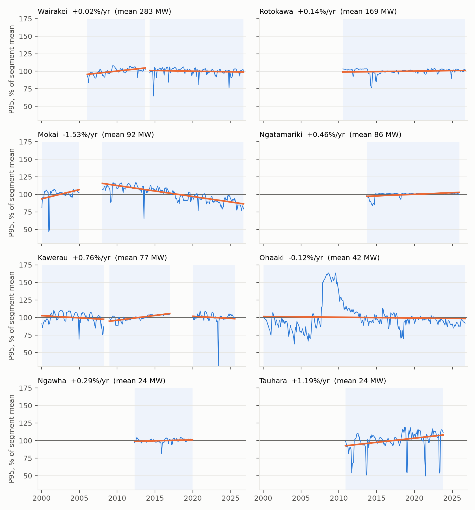
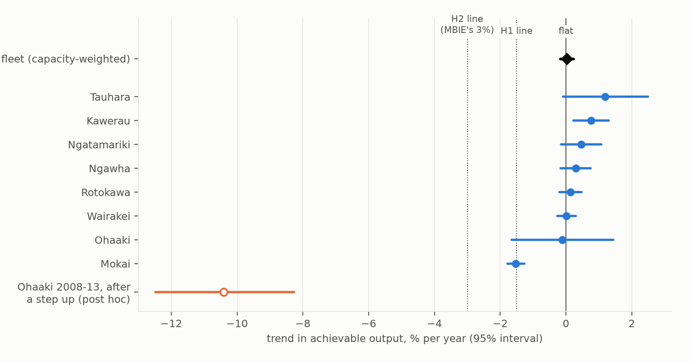

# Does New Zealand's geothermal fleet hold its output?

*Achievable output for all eight developed geothermal fields, from 26 years of half-hourly market metering,
against the planning assumption that existing geothermal plant is flat baseload.*

**Verdict: Supported (H1); the companion claim (H2) is Refuted.** Measured as the monthly 95th percentile of
half-hourly generation, the fleet's achievable output has not declined. The capacity-weighted trend across the
eight fields, between capacity changes, is **+0.02% a year (95% interval −0.18 to +0.22)**. That is flat, as
New Zealand's scenario models assume, and well inside the preregistered bar of a decline slower than 1.5% a year.
No field declines faster than 3% a year: the steepest is **Mokai at −1.5% a year**, steady since 2008. But "flat"
is the net of decline and investment. Ohaaki's output jumped by two-thirds in 2008, consistent with the
well-investment programme the industry association's field history describes. It then ran down at **about 10% a
year** for five years before levelling off. The often-quoted "3% annual run down" in MBIE's geothermal study is
not a forecast of falling output. It is the assumed natural decline that make-up drilling is costed to offset, and
26 years of metering say that, across the fleet, the offset has worked.

## In plain terms

New Zealand's energy plans assume geothermal power stations keep producing the same amount, year after year. But
underground steam reservoirs run down, and companies drill new wells to keep the power flowing. We wanted to know
whether, in practice, the stations have held their output.

We used the electricity market's public half-hourly meter readings for every geothermal station since 2000. For
each field and month, we took the output level the field reached in its best 5% of half-hours: a measure of what
it *can* produce that ignores breakdowns and maintenance. We set the method and the tests before looking at any
results.

Across the eight fields, achievable output has been flat. It is not falling by 3% a year, or even 1%. Only one
field, Mokai, shows a steady decline, of about 1.5% a year since 2008. The most recent decade is slightly softer
(about −0.4% a year fleet-wide, not distinguishable from flat).

Flat does not mean nothing is happening underground. At Ohaaki, output jumped by two-thirds in 2008 and then fell
back by about 10% a year over five years. Upkeep, not the reservoir, is what keeps the fleet level.

The government figure of "3% a year" turns out to describe how fast wells decline before that upkeep. The
planning models assume it is paid for. This study finds that across the fleet it has been.

## What was asked

The lead (scouted 2026-10-16, University of Auckland Energy and Movement signature research area) claimed:

1. The fleet's achievable output declines by less than 1.5%/yr, under half "MBIE's 3%/yr run down".
2. At least two of the eight fields decline faster than 3%/yr.
3. So a single fleet-wide parameter misstates field-level output by more than a factor of three.

Reading MBIE's source before any data changed the interpretation (deviations D1). Lawless, van Campen & Randle
(*Future Geothermal Generation Stack*, Revision D, March 2020, §3.3) use "an estimate of 3% annual run down" to
size the cost of **make-up drilling**: "for a 55MW project … around one well every 5.5 years". That drilling is
carried as fixed O&M so output is maintained, and the same passage says the 3% "would be too low for Ohaaki … and
too high for Kawerau". The 3% is therefore gross run-down before drilling, and metering measures output after it.
The lead's thresholds were kept as decision lines, but the substantive test became the flat-capacity assumption:

- **H1 (primary):** the fleet's capacity-weighted trend in achievable output is a decline of less than 1.5%/yr.
  Supported if the 95% interval's lower end is above −1.5; Refuted if its upper end is below −1.5.
- **H2 (secondary):** at least two fields decline faster than 3%/yr. Supported if two have a point estimate below
  −3 with the interval below 0; Refuted if fewer than two have an interval reaching below −3.

## What was already known

| Work | What it establishes | What it leaves open |
| --- | --- | --- |
| MBIE FGGS (Lawless et al. 2020) | 3%/yr gross run-down for costing make-up drilling; Ohaaki 108 MW originally, ~40 MW produced (2019) | measured trends |
| NZGA annual reviews; MBIE Energy in NZ | aggregate generation and capacity by year | separating decline from outages, upgrades and new plant |
| O'Sullivan et al. (2015, WGC), modelling retrospective on Wairakei and Ohaaki | earlier reservoir models were too pessimistic; fewer make-up wells were needed than forecast | other fields; after 2015 |
| NZ Geothermal Workshop papers | single-field reservoir and emissions studies | a common, metering-based measure across the fleet |

No fleet-wide, metering-based estimate of realised achievable-output trends was found (searches 2026-10-16 and
2026-10-17).

## How it was done

**Data.** EMI *Generation_MD*, half-hourly metered generation by plant with fuel codes, 2000-01 to 2026-09 (321
monthly files, retrieved 2026-10-16). The lead's unit-level dataset holds geothermal units only at Wairakei and
Ohaaki, and only for 2000–2003, so it could not carry the study (D1).

**The field is the unit.** Plants on one field share a consented fluid take. At Wairakei, fluid "is prioritised
to Te Mihi and Poihipi … Wairakei utilises the balance and ramps up during outages on other plants" (Contact, quoted
by MBIE). A single plant there reflects allocation, not the reservoir. Each field's half-hourly output is the sum of
its plants.

**Achievable output** is the month's 95th percentile (P95) of half-hourly field output: the level reached in about
36 hours of the month. In synthetic tests it recovered a true −2.00%/yr trend as −2.00 (sd 0.003) through
maintenance, forced outages, summer derating and flexing. With outages growing more frequent and no true decline,
P95 read −0.01%/yr while the monthly mean (a capacity factor) read −1.86%/yr.

**Segments.** Each field's record is cut where its set of reporting plants changes, or at a documented capacity
change. Those are the Wairakei binary plant (2004–05), Mokai's stages (2005, 2007), the Kawerau KGL rerate
(2017), Te Ahi O Maui (2018), Ngāwhā OEC4 (2020–21) and Ngā Tamariki OEC5 (2026). New plants' first six months are
excluded. Retirements and deratings are not cut: losing capacity because the steam ran out is what is being
measured. Twelve segments of at least five years result. They are exactly those the plan predicted from the
coverage inventory. Five of 1,704 segment-months are dropped as whole-month outages.

**Trend.** Within each segment: log P95 on month-of-year effects (air-cooled binary plants lose output in summer)
plus a linear trend, by GLS with AR(1) errors. Newey–West intervals were tried first and under-covered in
simulation (0.67–0.88), so they are a sensitivity. Field trends combine segments by inverse variance. The fleet
trend weights fields by mean P95: Wairakei 36%, Rotokawa 21%, Mokai 12%, Ngā Tamariki 11%, Kawerau 10%, Ohaaki 5%,
Ngāwhā 3%, Tauhara 3%. Its interval uses the fields' residual correlations.

## Results

### H1: Supported. The fleet's achievable output is flat

| field | segments | mean P95 | trend, %/yr (95% interval) |
| --- | --- | --- | --- |
| Wairakei (Wairakei, Poihipi, Te Mihi) | 2006-01–2013-09; 2014-04–2026-09 | 283 MW | +0.02 (−0.27 to +0.30) |
| Rotokawa (Rotokawa, Nga Awa Purua) | 2010-07–2026-09 | 169 MW | +0.14 (−0.20 to +0.47) |
| Mokai | 2000-01–2004-12; 2008-01–2026-09 | 92 MW | **−1.53 (−1.78 to −1.27)** |
| Ngā Tamariki | 2013-09–2025-12 | 86 MW | +0.46 (−0.15 to +1.07) |
| Kawerau | 2000-01–2008-03; 2008-12–2016-12; 2020-01–2025-07 | 77 MW | +0.76 (+0.22 to +1.30) |
| Ohaaki | 2000-01–2026-09 | 42 MW | −0.12 (−1.65 to +1.44) |
| Ngāwhā | 2012-04–2019-12 | 24 MW | +0.29 (−0.16 to +0.75) |
| Tauhara (Te Huka) | 2010-11–2023-10 | 24 MW | +1.19 (−0.09 to +2.49) |
| **fleet, capacity-weighted** | | | **+0.02 (−0.18 to +0.22)** |

Under perfect correlation between fields the interval widens to −0.43 to +0.47, still far from −1.5.

| sensitivity | fleet, %/yr (95% interval) | H1 | H2 |
| --- | --- | --- | --- |
| P50 instead of P95 | +0.08 (−0.15 to +0.31) | Supported | Refuted |
| P99 | +0.03 (−0.17 to +0.22) | Supported | Refuted |
| monthly mean (capacity factor) | +0.02 (−0.22 to +0.26) | Supported | Refuted |
| equal field weights | +0.15 (−0.14 to +0.44) | Supported | Refuted |
| excluding Wairakei | +0.02 (−0.23 to +0.27) | Supported | Refuted |
| Newey–West intervals | +0.18 (+0.00 to +0.36) | Supported | Refuted |
| **last ten years only (2016-10–2026-09)** | **−0.44 (−0.99 to +0.12)** | Supported | Inconclusive |

The last decade is softer. Wairakei field is −0.52%/yr (−0.78 to −0.27) and Mokai −1.47 (−2.15 to −0.78). H2
turns Inconclusive there only because Kawerau's and Tauhara's short recent records have wide intervals. Neither
point estimate is below −1.

### H2: Refuted. No field declines faster than 3% a year

No field's interval reaches −3%/yr. Mokai is the only field with a clear, sustained decline: −1.54%/yr
(−1.80 to −1.29) from 2008 to 2026. Its achievable output fell from about 115% to about 85% of its segment mean
(F1). That is half MBIE's gross 3%, and it is net of whatever drilling Mokai's operator has done. MBIE's own
report noted that a 2016 consent application at Mokai was "to maintain production from the existing plant".

### Post hoc: flat is the net of decline and investment (D3)

Written after the results were seen, and descriptive:

- **Ohaaki.** Annual median P95 was 35–40 MW in 2000–07, then **66 MW in 2008**. That is consistent with the
  investment programme the NZGA field page describes ("output dropped to as low as 30 MWe but an investment
  programme, including several new wells, has restored production"). Over 2008–2013 it ran down at
  **−10.4%/yr (−12.5 to −8.3)**, back to ~40 MW, and has drifted at −1.3%/yr (−1.9 to −0.7) since 2019. Over
  the whole record the linear trend is −0.12%/yr with a wide interval. The preregistered measure is right that
  the field's capability ended where it began; it is silent on the cycle in between.
- **Year-to-year steps of ≥ 15%** inside segments appear only at Ohaaki (2008 up, 2010 down, 2018 down, 2019 up),
  Tauhara (2012 up) and the small pre-2008 Kawerau plant.
- **Rolling five-year trends** stay between −3.9% and +4.2%/yr everywhere except Ohaaki (−11% to +22%).

So the gross run-down MBIE assumes is real and, at Ohaaki, three times faster than 3%. What the metering shows is
that, fleet-wide, operators have offset it.

## What this does and does not show

**It shows** that the existing geothermal fleet's achievable output was flat from 2000 to 2026, measured between
capacity changes. That is the assumption New Zealand's scenario models make. It also shows that only one field
(Mokai) has a sustained decline, and that no field's realised decline approaches the 3% gross run-down MBIE uses
for costing.

**It does not show** that the reservoirs are not declining. Five limits:

1. **Achievable is after investment.** Trends include make-up drilling, consent limits and fluid allocation;
   they are what the fleet delivered, not what the reservoirs would do untouched.
2. **New capacity is excluded by design.** Total geothermal generation rose with new plant (Te Mihi, Nga Awa Purua,
   Ngā Tamariki, Tauhara). This study measures existing plant between such changes.
3. **Undocumented changes inside a segment** would bias its trend. Turbine upgrades, gas-reinjection retrofits
   (flagged by REN21 for some NZ sites) and drilling campaigns are examples. The step and rolling-trend checks
   find such jumps only at Ohaaki and Tauhara.
4. **Short recent records** at Ngāwhā (after OEC4), Tauhara (after Tauhara and Te Huka 3) and Kawerau (after
   TOPP2) are not yet long enough to measure.
5. **Eight fields.** The fleet estimate is a weighted mean of few units, dominated by Wairakei and Rotokawa (57% of
   the weight).

**For planning**, the result supports treating existing geothermal as flat, *provided the make-up drilling is
costed*, as MBIE's study does. It also suggests watching two things. One is the last decade's slight softening
(−0.4%/yr fleet-wide, mostly Wairakei and Mokai). The other is fields like Ohaaki, where output can fall fast
between campaigns.

## Scope and care

Several fields are owned, co-owned or hosted by iwi and Māori land trusts. Examples are the Tuaropaki Trust at
Mokai, Ngāti Tūwharetoa and Tauhara North No. 2 Trust interests, and the Kawerau A8D Ahu Whenua Trust. The trends
here describe plant capability under current consents, from public metering. They are not judgements about
resource stewardship. Mokai's decline, for instance, could reflect consent limits or deliberate reservoir
management as much as resource change.

## Process and deviations

Three logged deviations:

- D1: the 3% reinterpreted, the dataset changed, the field made the unit, and GLS-AR(1) chosen from synthetic
  tests, all before any output was computed.
- D2: a date-parsing bug that silently dropped 11–12 days of every month, caught by a data-quality count and
  fixed before any trend was computed.
- D3: post-hoc drilling-cycle checks.

Commits: plan c72cc2c → D2 fix d0be78c → results and D3 code 0ab005b.

## Reproducing it

    bash code/prefetch_gmd.sh               # EMI Generation_MD 2000-01..2026-09; compare data/raw/VINTAGE_emi_gmd.txt
    venv/bin/python code/test_analysis.py   # 9 synthetic checks
    venv/bin/python code/build_series.py    # monthly P95/P50/P99/mean per plant and field
    venv/bin/python code/analysis.py        # H1, H2, sensitivities -> results/tables/primary.json
    venv/bin/python code/supplementary.py   # post-hoc steps, run-downs, rolling trends
    venv/bin/python code/figures.py

Released: `results/tables/field_monthly.csv`, `plant_monthly.csv`, `field_membership.csv`, `primary.json`,
`supplementary.json`, `rolling_60m_trend.csv`. EMI data are public and not redistributed.
