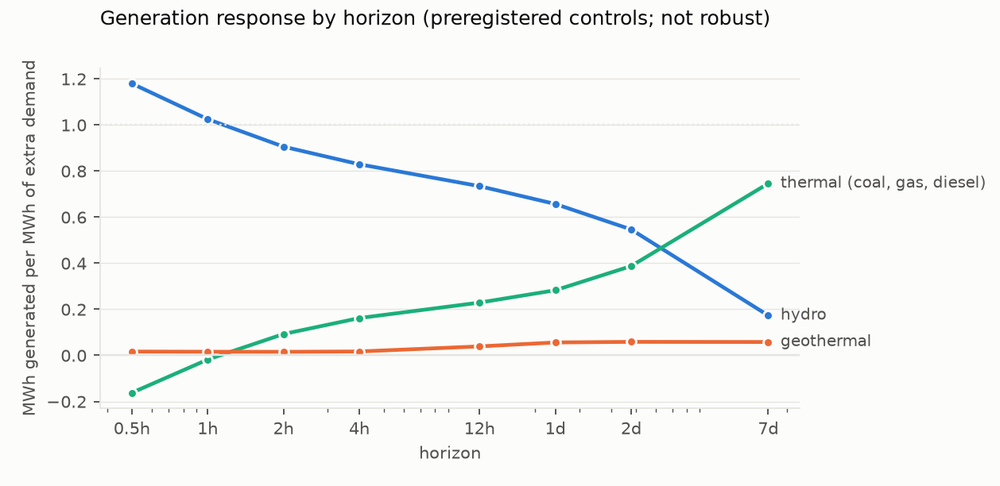

# How much carbon does an extra megawatt-hour cost New Zealand, and when?

*Horizon-resolved marginal emissions for a hydro-dominated grid. The data are ten years of half-hourly metered
generation, an emissions ledger calibrated to the Ministry for the Environment's grid factors, and cold-weather demand
as the instrument. The question is whether carbon-aware load shifting cuts emissions.*

**Verdict: Inconclusive.** All three preregistered hypotheses are Inconclusive.

- **H1 and H2: the instrument is too weak where those tests look.**
  - H1 compares 30 days with 1 hour, and the weather instrument has no strength at 30 days.
  - H2's daily scheduler moves most of its load into the night, where the instrument is weak.
- **H3: storage state makes no detectable difference.**

**What the data do show clearly:**

- **An extra MWh costs more carbon the longer emissions are counted.** These horizons are strongly identified
  (first-stage F of at least 40).
  - Counted over the next hour, an extra MWh of weather-driven demand adds **0.15 t CO2** (95% CI 0.13–0.17).
  - Over a day it adds **0.31 t** (0.27–0.37), and over a week **0.69 t** (0.54–0.94).
  - The rise from 1 hour to 7 days is 0.55 t/MWh (0.38–0.79). This is descriptive, not the preregistered test.
- **The mechanism is visible in the generation data.**
  - Within the hour, hydro meets all of the extra demand: 1.03 MWh of hydro per MWh of demand.
  - Within a week, hydro's share falls to 0.17 and thermal plant supplies 0.75, mostly coal at Huntly.
  - Water used now is made up with fossil generation later.
- **The average signal a carbon-aware scheduler reads barely moves.** The average emissions factor (AEF) is
  0.095–0.100 t/MWh in every 6-hour block of the day.
  - The marginal factor is 2–4 times higher at the 1-day horizon, and up to 7 times higher at a week.
  - Shifting a 20 MW, 4-hour daily load to the lowest-AEF hours "saves" only 0.012 t per MWh moved, by the AEF's own
    accounting.
- **Where the moved load stays within well-identified hours, a third of the claim survives.** With a ±1-hour window,
  the realised saving is 0.34 of the claimed one (−0.08 to 0.75). The interval is too wide to be decisive.

## In plain terms

Some software, data centres and smart appliances now try to run "when the grid is clean". They read a signal of the
grid's average carbon intensity and move work to the hours when it is lowest.

New Zealand's grid is mostly hydro, with a little coal and gas. We wanted to know whether moving electricity use
around in time actually burns less fossil fuel there.

We built a half-hourly record of how much carbon each power station emitted from 2015 to 2024. We then used cold
snaps, which push demand up for reasons nobody chose, to see what happens to emissions when demand rises unexpectedly.

The answer depends on how long you wait. In the first hour, the hydro lakes absorb nearly all the extra demand, and
the extra emissions are modest. But the water used is then missing later. Over the following week, coal at Huntly
makes up most of it. Counted over a week, each extra unit of electricity costs about seven times the grid's average
carbon intensity.

The average signal that carbon-aware tools use hardly changes through the day, so shifting work between hours can
claim very little saving. We could not measure precisely how much of even that small claim is real. Our method is
weak at night and over a month. What we can say is that, in New Zealand, the carbon cost of using more electricity is
much larger than the average suggests, and it arrives days later.

## What was asked

Carbon-aware schedulers usually consume an average emissions factor. In a hydro-dominated grid, the lakes balance most
short-run changes in demand. So an hour-to-hour shift may simply move water around, and the emissions it causes arrive
when thermal plant later refills the gap.

The study estimates the **marginal** emissions factor as a function of the horizon over which emissions are counted.
It then asks three preregistered questions (`plan.md`):

- **H1:** Is MEF(30 d) larger than MEF(1 h)?
- **H2:** Does an AEF-guided daily scheduler capture less than half of its claimed saving?
- **H3:** Is the 1-day MEF higher when national hydro storage is low?

## What was already known

The novelty search (2026-10-18) found no published horizon-resolved MEF for New Zealand.

- **Electricity Authority.** It reports which fuel is marginal (hydro or thermal about 95% of the time) and publishes
  an allocation factor that is not a marginal one.
- **Merit-order price effects.** A 2026 *Energies* paper studies state-dependent price effects in the same market,
  not emissions.
- **Reservoir hydro elsewhere.** WattTime explains why reservoir hydro moves emissions in time. Hydrothermal marginal
  CO2 modelling exists for Chile (*Applied Energy*, 2017).
- **What is new here.** An estimate from metered data, with a horizon axis, plus a test of the scheduling claim.

## How it was done

**Data**, all open, 2015-01-01 to 2024-12-31 (local), 175,344 half-hours:
- **Generation.** EMI `Generation_MD`, every metered unit by trading period.
- **Smelter and HVDC.** The Tiwai smelter offtake and HVDC transfers.
- **Hydrology.** The Electricity Authority's Hydrological Modelling Dataset gives daily controlled storage for ten
  lakes, converted to GWh with the dataset's specific energy, and natural inflows to nine of them, energy-weighted.
- **Temperature.** Open-Meteo (ERA5) hourly temperature for five cities, population-weighted.

**The emissions ledger** (`code/series.py`):
- Each thermal unit's metered output is multiplied by a stated heat rate and the MfE fuel factor. Geothermal output
  is taken at 0.10 t CO2/MWh.
- Each year, fossil emissions are scaled so that the ledger matches MfE's annual grid-average CO2 factor.
  - This is deviation D1. MBIE's quarterly tables, named in the plan, block scripted download.
  - The scale factors are 0.87–1.10. Against MfE's quarterly factors for 2023–2024, which were not used to fit, the
    ledger is within 0.01 t/MWh in seven of eight quarters.
- **The demand measure** is total metered generation. It tracks 2024 grid offtake almost perfectly (r = 0.997; it is
  9% larger because it includes embedded generation and losses).

**The estimator** (`code/mef.py`):
- **Regression.** For each horizon h (30 minutes to 30 days), emissions summed over the next h are regressed on demand
  summed over the same window, by 2SLS.
- **Instrument.** The population-weighted heating-degree anomaly in the starting half-hour, against a
  half-hour-by-day-of-year climatology.
- **Controls:**
  - the previous day's anomalies;
  - lagged demand and emissions;
  - storage, and the week's inflow;
  - the previous day's HVDC and Tiwai;
  - **wind over the same window**, so the cold-and-windy channel is held fixed;
  - fixed effects for half-hour by day type, month and year.
- **Inference.** Intervals come from a calendar-month block bootstrap: 999 resamples of 120 months.
- **Rule.** The plan fixed that a horizon whose first-stage F is below 10 is weakly identified, and a hypothesis that
  rests on it is Inconclusive.

## Results

### The marginal emissions factor by horizon

| Horizon | MEF (t CO2/MWh) | 95% CI | First-stage F | Hydro | Thermal | Geothermal |
|---|---|---|---|---|---|---|
| 0.5 h | 0.153 | 0.132–0.175 | 189 | 1.18 | −0.16 | 0.02 |
| 1 h | 0.154 | 0.133–0.175 | 202 | 1.03 | −0.02 | 0.02 |
| 2 h | 0.157 | 0.137–0.177 | 228 | 0.91 | 0.09 | 0.02 |
| 4 h | 0.164 | 0.143–0.184 | 273 | 0.83 | 0.16 | 0.02 |
| 12 h | 0.229 | 0.199–0.263 | 215 | 0.73 | 0.23 | 0.04 |
| 1 d | 0.314 | 0.267–0.367 | 85 | 0.66 | 0.28 | 0.06 |
| 2 d | 0.367 | 0.314–0.439 | 60 | 0.55 | 0.39 | 0.06 |
| 7 d | 0.695 | 0.541–0.937 | 40 | 0.17 | 0.75 | 0.06 |
| 14 d | 1.55 | 0.97–4.67 | **7.7** | −0.89 | 1.68 | 0.16 |
| 30 d | 11.9 | −85.9 to 62.4 | **0.18** | — | — | — |

The generation columns are MWh generated per MWh of extra demand. Wind over the window is held fixed. At 14 and 30
days the responses are not interpretable.

**H1 (horizon gradient): Inconclusive (weak instrument).**
- The preregistered contrast, MEF(30 d) − MEF(1 h), is 11.7 t/MWh (−86 to 62).
- The 30-day first stage has F = 0.18. A half-hour of cold weather says almost nothing about the next month's total
  demand once the controls are in.
- **The gradient itself is clear over the identified range.** Descriptively, not as the preregistered test, the
  differences are:
  - MEF(1 d) − MEF(1 h) = 0.16 (0.12–0.21);
  - MEF(7 d) − MEF(1 h) = 0.55 (0.38–0.79).

### Does AEF-guided shifting capture its claimed saving? (H2)

**Time-of-day MEFs at 1 day.**
- 06:00–12:00: **0.22** (0.15–0.28).
- 12:00–18:00: **0.27** (0.22–0.32).
- 18:00–24:00: **0.40** (0.29–0.58).
- 00:00–06:00: **weakly identified** (F = 4.2; point estimate −0.37, interval reaching −3.8). Heating demand at night
  responds little to the temperature anomaly.

**The H2 scheduler and its result.**
- **The scheduler.** A 20 MW load runs 10:00–14:00 by default. The scheduler moves it each day to the 8 consecutive
  half-hours of lowest AEF.
- **Where the load goes.** 41% of the moved load lands in 00:00–06:00.
- **Rule.** The realised saving there rests on the weak block, so by the preregistered rule **H2 is Inconclusive
  (weak instrument)**.
- **The raw ratio is meaningless.** It is 18 (0.8–127), driven by the weak block's negative point estimate.

**Variants (descriptive):**
- **±1-hour window.** It moves load only within the two well-identified daytime blocks.
  - It claims 470 t over ten years and realises 159 t.
  - The capture ratio is 0.34 (−0.08 to 0.75).
- **7-day window.** It also lands in the weak night block. Its 7-day block MEFs are weakly identified for the morning
  and night blocks, so it was scored with the 1-day blocks, and it is equally uninformative.

**What the AEF itself shows.**
- The AEF averages 0.095, 0.098, 0.098 and 0.100 t/MWh in the four blocks.
- The daily scheduler's claimed saving is 3,618 t over ten years for 292,000 MWh moved: 0.012 t per MWh. The AEF
  signal has almost nothing to work with, whichever accounting is used.

### Storage state (H3)

**H3: Inconclusive.** The 1-day MEF is 0.30 (0.21–0.40) in the lowest storage tercile and 0.32 (0.25–0.39) in the
highest. The low-minus-high difference is −0.02 (−0.14 to 0.11). All terciles are well identified (F 26–40).

### Checks

- **Energy balance.** Hydro + thermal + geothermal responses sum to 0.98–1.03 MWh per MWh at every identified horizon.
- **Geothermal placebo.** Geothermal should not respond.
  - Its response is 0.02 MWh/MWh for horizons up to 4 h, and 0.04–0.06 from 12 h to 7 d.
  - Its intervals all reach below 0.05, so the preregistered flag is not raised.
  - From 12 h to 2 d, though, the intervals exclude zero (lower bounds 0.003–0.004). Some small geothermal
    flexibility, or a small exclusion failure, cannot be ruled out.
- **Sensitivity of the level, not the shape.** Each alternative ledger moves the levels and keeps the gradient:

  | Ledger | MEF(1 d) | MEF(7 d) |
  |---|---|---|
  | Geothermal 0.05 t/MWh | 0.35 | 0.78 |
  | Geothermal 0.15 t/MWh | 0.28 | 0.61 |
  | Huntly Rankine 70% coal / 30% gas | 0.29 | 0.65 |

- **The OLS alternative** regresses on demand innovations, not weather. It gives much larger factors from 2 hours on
  (1.0 at 1 day). Demand innovations are partly driven by the system itself, which is why the plan made the
  weather-instrumented estimate primary.
- **Tiwai (descriptive only).** One smelter demand-response episode meets the rule: a cut of at least 100 MW for at
  least 7 days, 9–19 August 2024, a cut of 138 MW.
  - Thermal output was 29.9 GWh a day during it, against 31.5 in the month before. The AEF was 0.161 against 0.172.
  - These episodes are called in dry, tight periods by design, so they cannot be read causally.

## What this does and does not show

- **It shows** that, in this grid, the emissions consequence of extra demand builds up over days.
  - It is about 0.15 t/MWh within the hour and about 0.7 t/MWh within a week.
  - These factors are 1.5–7 times the average emissions factor.
  - The average factor hardly varies through the day, so it is a poor guide either to the carbon cost of extra load
    or to the value of shifting it.
- **It does not settle** whether daily shifting captures less than half of what it claims (H2). The method cannot see
  clearly at night, where an AEF scheduler puts the load. It also cannot see the month-scale factor that H1 asked
  about.
- **Exclusion is the main threat.**
  - Cold spells also coincide with gas-supply tightness in some winters (2021, 2024).
  - **The composition shows it.** At the half-hour horizon, the thermal response is coal up by 0.46 MWh and gas down
    by 0.63 MWh per MWh of demand. That looks more like cold-weather fuel switching than marginal dispatch.
  - The short-horizon level (0.15) may therefore partly reflect what fuel is available in cold weather.
  - By 7 days the response is almost all coal (0.71 coal, 0.02 gas), which matches the water-replacement mechanism.
  - Year and month fixed effects absorb dry years and seasons, not within-month fuel shocks.
- **The ledger.** Heat rates are stated assumptions, and the calibration is annual. A uniform scale error cancels in
  the gradient and in ratios, and the sensitivity ledgers bracket the fuel split and the geothermal factor.
- **Scope.** National totals, 2015–2024. Results for a future grid with a different thermal fleet may differ.

## Process and deviations

- **Preregistration.** The plan was committed before any series was downloaded (df14d01).
- **D1 (`deviations.md`)** was recorded before any emissions series was computed:
  - annual MfE calibration, because MBIE's quarterly tables are behind bot protection;
  - the stated ledger assumptions;
  - energy-weighted natural inflows;
  - approximate population weights.
- **Descoped in the plan:** the Australian NEM placebo, replaced by the geothermal placebo.
- **Descriptive, not preregistered:**
  - the ±1-hour scheduler result;
  - the identified-range gradient, MEF(7 d) − MEF(1 h);
  - the coal/gas composition.
- **Review.** An independent adversarial review follows in `review/`.

## Reproducing it

`code/fetch.py`, then `code/series.py`, then `code/mef.py`, then `code/simulate.py`, then `code/checks.py`, then
`code/figures.py`.

- **Raw inputs.** Downloaded to `data/raw/` (checksums in `data/raw/SHA256SUMS`).
- **Results.** Every number above is in `results/tables/`: `mef.json`, `mef_horizons.csv`, `simulation.json`,
  `checks.json` and `ledger_calibration.csv`.
