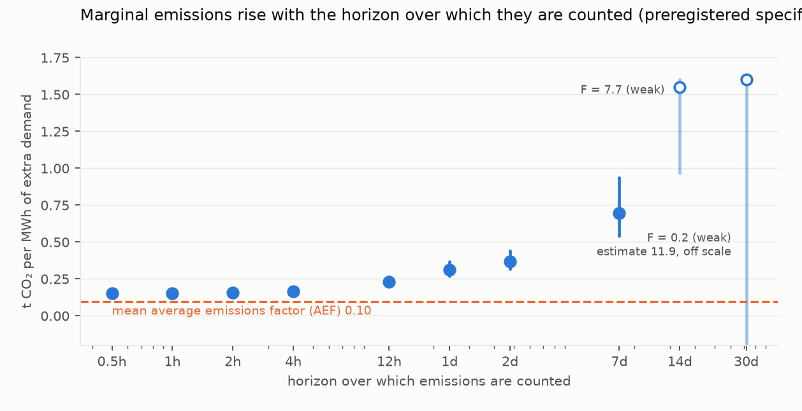
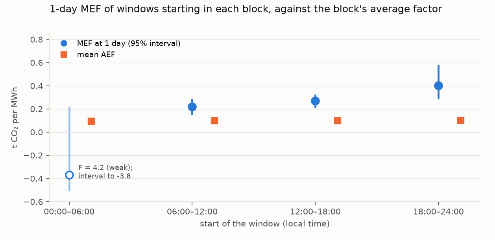

# How much carbon does an extra megawatt-hour cost New Zealand, and when?

*Horizon-resolved marginal emissions for a hydro-dominated grid. The data are ten years of half-hourly metered
generation, an emissions ledger calibrated to the Ministry for the Environment's grid factors, and cold-weather demand
as the instrument. The question is whether carbon-aware load shifting cuts emissions.*

**Verdict: Inconclusive.** All three preregistered hypotheses are Inconclusive.

- **H1:** the weather instrument has no strength at the 30-day horizon it needed.
- **H2:**
  - the daily scheduler puts its load where the instrument is weak;
  - the time-of-day construct the plan chose cannot answer the question even where the instrument is strong.
- **H3:** storage state makes no detectable difference.

**What holds in every specification we tried (17 control sets, instruments and subsamples):**

- **The carbon cost of extra demand grows with the time over which it is counted.**
  - MEF(7 d) exceeds MEF(1 h) in every specification, by 0.12 to 0.64 t CO2/MWh.
  - MEF(1 d) exceeds MEF(1 h) by 0.04 to 0.24.
  - Under the preregistered specification, the factor is 0.15 t/MWh over an hour (95% CI 0.13–0.17), 0.31 over a day
    (0.27–0.37) and 0.69 over a week (0.54–0.94).
  - **The levels are not robust.** Across specifications, the one-hour factor ranges from −0.16 to 0.23 and the
    one-week factor from 0.13 to 0.79. The levels depend chiefly on whether earlier demand and emissions are
    controlled.
- **The average emissions factor that carbon-aware tools read hardly moves through the day.** It is 0.095–0.100 t/MWh
  in every 6-hour block, against a period mean of 0.098.
  - Moving a 20 MW, 4-hour daily load to the day's lowest-AEF hours claims only 0.014 t CO2 per MWh actually moved,
    by the AEF's own accounting.
  - So whichever marginal factor is right, AEF-guided intraday shifting has very little to claim.

**What we cannot say:**

- **Why the factor rises.** Two explanations fit the data equally:
  - water used now is made up with fossil generation later;
  - cold weeks are also dry weeks, so operators conserve water. The instrument predicts lower inflow over the window,
    and controlling for it shrinks the one-week factor to 0.55.
- **Which fuel responds.** The coal/gas split changes sign between reasonable control sets.
- **Whether the AEF scheduler captures less than half of its claim (H2).** No scoring gives a positive,
  well-identified capture. One alternative instrument even gives a negative realised saving.

## In plain terms

Some software, data centres and smart appliances now try to run "when the grid is clean". They read a signal of the
grid's average carbon intensity and move work to the hours when it is lowest.

New Zealand's grid is mostly hydro, with some coal, gas and geothermal. We wanted to know whether moving electricity
use around in time actually reduces emissions there.

We built a half-hourly record of the carbon each power station emitted from 2015 to 2024. We then used cold snaps,
which push demand up for reasons nobody chose, to see what happens to emissions when demand rises.

Two things came out clearly.

**First, the extra emissions build up over days.** The carbon cost of extra demand is smaller counted over the next
hour than over the next day, and smaller over a day than over a week. That held in every version of the analysis we
tried. But the size of the effect depends a lot on modelling choices: counted over a week, anywhere from about 1.3 to
8 times the grid's average intensity. We also cannot tell whether the lakes are being drawn down and refilled with
fossil power later, or whether cold weather simply tends to come with dry weather.

**Second, the "clean hours" signal barely changes through the day.** So shifting work from one hour to another has
almost nothing to gain by its own measure.

We could not test precisely how much of that small claimed saving is real.

## What was asked

Carbon-aware schedulers usually consume an average emissions factor (AEF). In a hydro-dominated grid, the lakes
balance most short-run changes in demand. So an hour-to-hour shift may simply move water around, and any emissions it
causes arrive when thermal plant later fills the gap.

The study estimates the **marginal** emissions factor (MEF) as a function of the horizon over which emissions are
counted. It then asks three preregistered questions (`plan.md`):

- **H1:** Is MEF(30 d) larger than MEF(1 h)?
- **H2:** Does an AEF-guided daily scheduler capture less than half of its claimed saving?
- **H3:** Is the 1-day MEF higher when national hydro storage is low?

## What was already known

The novelty search (2026-10-18) found no published horizon-resolved MEF for New Zealand.

- **Electricity Authority.** It reports which fuel is marginal (hydro or thermal about 95% of the time) and publishes
  an allocation factor that is not a marginal one.
- **Merit-order price effects.** A 2026 *Energies* paper studies state-dependent price effects in this market, not
  emissions.
- **Reservoir hydro elsewhere.** WattTime explains why reservoir hydro moves emissions in time. Hydrothermal marginal
  CO2 modelling exists for Chile (*Applied Energy*, 2017).

## How it was done

**Data**, all open, 2015-01-01 to 2024-12-31 (local); 175,344 half-hours, of which 173,569 have full lags and 30 days
of future data:
- **Generation.** EMI `Generation_MD`, every metered unit by trading period.
- **Smelter and HVDC.** The Tiwai smelter offtake and HVDC transfers.
- **Hydrology.** The Electricity Authority's Hydrological Modelling Dataset:
  - **Storage.** Daily active storage for ten lakes, in GWh via the dataset's specific energy.
    - This is not the Authority's "controlled storage" series. For four southern lakes the HMD range is about twice
      the scheme's active capacity.
    - Each offset is constant, so the day-of-year anomaly and the standardised control are unaffected.
  - **Inflows.** Eight natural inflow series plus Wānaka's natural outflow, energy-weighted.
- **Temperature.** Open-Meteo (ERA5) hourly temperature for five cities, population-weighted.

**The emissions ledger** (`code/series.py`):
- Each thermal unit's metered output is multiplied by a stated heat rate and the MfE fuel factor. Geothermal output
  is taken at 0.10 t CO2/MWh, which is 15–24% of ledger CO2 each year.
- Each year, fossil emissions are scaled to MfE's annual grid-average CO2 factor (the "Electricity Used" rows of the
  MfE emission-factor file).
  - This is deviation D1. MBIE's quarterly tables, named in the plan, block scripted download.
  - The scale factors are 0.87–1.10.
  - Against MfE's quarterly factors for 2023–2024, the within-year shape matches (RMSE 0.006 t/MWh, against a quarterly
    spread of 0.03). The annual calibration forces the yearly mean, so this tests the shape only.
- **The demand measure** is total metered generation. It tracks 2024 grid offtake almost perfectly (r = 0.997; it is
  9% larger because it includes embedded generation and losses).

**The estimator** (`code/mef.py`):
- **Regression.** For each horizon h (30 minutes to 30 days), emissions summed over the next h are regressed on demand
  summed over the same window, by 2SLS.
- **Instrument.** The population-weighted heating-degree anomaly in the starting half-hour.
- **Controls** (as preregistered):
  - the previous day's anomalies;
  - the previous half-hour's and previous day's demand and emissions;
  - storage, and the week's inflow;
  - the previous day's HVDC and Tiwai;
  - wind over the same window;
  - fixed effects for half-hour by day type, month and year.
- **Inference.** Intervals come from a calendar-month block bootstrap: 999 resamples of 120 months.
- **Rule.** A horizon whose first-stage F is below 10 is weakly identified, and a hypothesis resting on it is
  Inconclusive.

**After the independent review (deviation D2),** `code/sensitivity.py` re-estimates the main quantities under 17
alternative specifications. These are exploratory and not preregistered.

## Results

### The marginal emissions factor by horizon (preregistered specification)

| Horizon | MEF (t CO2/MWh) | 95% CI | First-stage F | Hydro | Thermal | Geothermal |
|---|---|---|---|---|---|---|
| 0.5 h | 0.153 | 0.132–0.175 | 189 | 1.18 | −0.16 | 0.02 |
| 1 h | 0.154 | 0.133–0.175 | 202 | 1.03 | −0.02 | 0.02 |
| 2 h | 0.157 | 0.137–0.177 | 228 | 0.91 | 0.09 | 0.02 |
| 4 h | 0.164 | 0.143–0.184 | 273 | 0.83 | 0.16 | 0.02 |
| 12 h | 0.229 | 0.199–0.263 | 215 | 0.73 | 0.23 | 0.04 |
| 1 d | 0.314 | 0.267–0.367 | 85 | 0.66 | 0.28 | 0.06 |
| 2 d | 0.367 | 0.314–0.439 | 60 | 0.55 | 0.39 | 0.06 |
| 7 d | 0.695 | 0.541–0.937 | 40 | 0.17 | 0.75 | 0.06 |
| 14 d | 1.55 | 0.97–4.67 | **7.7** | — | — | — |
| 30 d | 11.9 | −85.9 to 62.4 | **0.18** | — | — | — |

The generation columns are MWh generated per MWh of extra demand, with wind over the window held fixed. They sum to
about 1 by construction, because demand is the sum of the generation series. Their split depends on the control set
(below).

**H1 (horizon gradient): Inconclusive (weak instrument).**
- **The preregistered contrast.** MEF(30 d) − MEF(1 h) is 11.7 t/MWh (−86 to 62), with a 30-day first stage of
  F = 0.18.
- **Why the instrument fails at 30 days.** A single half-hour's cold anomaly is nearly uncorrelated with the weather a
  week or a month later (autocorrelation 0.04 at 7 days), so it cannot move a 30-day demand total. The plan's
  instrument was mismatched to the horizon H1 asked about. That was foreseeable, and it is our error of design.
- **Exploratory, with a matched instrument.** Using the mean anomaly over the next 7 days:
  - MEF(30 d) = 1.52 (0.86–3.65; F 10.8);
  - MEF(30 d) − MEF(1 h) = 1.32 (0.66–3.45).
- **The identified range.** Within the strongly identified horizons, and descriptively:
  - MEF(1 d) − MEF(1 h) = 0.16 (0.11–0.21);
  - MEF(7 d) − MEF(1 h) = 0.54 (0.38–0.79).

  This is the contrast H1 would have used had the plan chosen 7 days. Its size is specification-dependent (0.12–0.64)
  and its sign is not.

### How robust are the levels? (exploratory, `results/tables/sensitivity.json`)

| Specification | MEF 1 h | MEF 1 d | MEF 7 d | F (1 h / 1 d / 7 d) |
|---|---|---|---|---|
| **preregistered** | **0.154** | **0.314** | **0.695** | 202 / 85 / 40 |
| no lagged demand or emissions | 0.021 | 0.095 | 0.289 | 127 / 119 / 74 |
| demand lags only | −0.158 | 0.043 | 0.275 | 198 / 78 / 33 |
| emissions lags only | 0.068 | 0.221 | 0.450 | 205 / 171 / 127 |
| plus lagged coal, gas and hydro | 0.148 | 0.290 | 0.709 | 203 / 82 / 36 |
| 3 days of weather history instead of lagged outcomes | 0.069 | 0.132 | 0.341 | 159 / 120 / 63 |
| preregistered + inflow over the window | 0.153 | 0.295 | 0.548 | 203 / 85 / 32 |
| no lagged outcomes + window inflow | 0.013 | 0.065 | 0.129 | 128 / 122 / 70 |
| weather history + window inflow | 0.058 | 0.098 | 0.176 | 160 / 123 / 57 |
| no wind-window control | 0.161 | 0.399 | 0.784 | 204 / 87 / 40 |
| half-hour × month fixed effects | 0.147 | 0.314 | 0.716 | 388 / 91 / 43 |
| calendar-aligned climatology | 0.155 | 0.324 | 0.794 | 200 / 81 / 29 |
| next-7-day mean anomaly as instrument | 0.197 | 0.272 | 0.379 | 36 / 51 / 221 |
| next-24-h mean anomaly as instrument | 0.228 | 0.301 | 0.603 | 198 / 183 / 107 |
| drop 2021 and 2024 (gas-shortage winters) | 0.161 | 0.278 | 0.661 | 145 / 70 / 31 |
| 2015–2019 only | 0.144 | 0.216 | 0.624 | 69 / 39 / 19 |
| 2020–2024 only | 0.160 | 0.391 | 0.734 | 175 / 48 / 27 |

**Reading the table:**
- **Lagged outcomes.** The preregistered controls include the previous half-hour's and previous day's demand and
  emissions. Those are outcomes of earlier weather that is correlated with today's anomaly (day-to-day
  autocorrelation 0.59). Removing them, or replacing them with three days of weather history, lowers every level
  severalfold. The data cannot say which conditioning is right.
- **Inflow.** The instrument predicts lower natural inflow over the window: −2.7 MWh of inflow energy per MWh of
  induced demand at 1 h, −3.7 at 1 d and −8.0 at 7 d. Cold spells are dry spells. Holding window inflow fixed (the
  same logic the plan applied to wind) lowers the one-week factor, and changes the 7-day split from hydro 0.17 /
  thermal 0.75 to 0.49 / 0.50.
- **Composition.** The coal/gas split is not stable:

  | Controls | Coal 0.5 h | Gas 0.5 h | Coal 7 d | Gas 7 d |
  |---|---|---|---|---|
  | preregistered | 0.46 | −0.63 | 0.71 | 0.02 |
  | plus lagged coal, gas and hydro | 0.06 | 0.18 | 0.43 | 0.64 |

  The "coal" series is the Huntly Rankine units' metered output under the EMI fuel code. Those units also burn gas.
  We draw no fuel conclusion.

### Does AEF-guided shifting capture its claimed saving? (H2)

**The scheduler.**
- A 20 MW load runs 10:00–14:00 by default.
- Each calendar day, the scheduler moves it to the 8 consecutive half-hours of lowest AEF.
- Because the "24-hour window" is the calendar day, 15% of chosen windows start at midnight.
- 29.5% of days overlap the default window, so 250,640 of the 292,240 MWh of load is actually moved.

**The claimed saving.** 3,618 t over ten years: 0.014 t per MWh moved (0.012 per MWh of load).

**The plan's realised saving.** It uses "time-of-day MEFs at 1 day": the 1-day MEF of windows *starting* in each
6-hour block, estimated separately per block.
- 06:00–12:00: 0.22 (0.15–0.28).
- 12:00–18:00: 0.27 (0.22–0.32).
- 18:00–24:00: 0.40 (0.29–0.58).
- 00:00–06:00: F = 4.2, point estimate −0.37, interval reaching −3.8.

41% of the moved load lands in 00:00–06:00.

**H2: Inconclusive.** Four things must be read together:

1. **The construct cannot answer H2.** A block "MEF" is a property of how a 1-day window is aligned. It is not the
   marginal factor of load placed in that block. Applying the four values as if they were block-specific factors is
   what the plan specified, but the resulting "realised saving" does not measure the question even with a strong
   instrument.
2. **The weak-block rule was set after the night block's F was known.** The plan's weak-instrument rule is stated
   for horizons. We extended it to blocks when coding the simulation, after `mef.json` showed the night block's
   F = 4.2 (deviation D2).
   - **Under the plan's literal rule,** the capture ratio of 18 (0.83–127) has a lower bound above 0.5, and H2 would
     read **Refuted**.
   - That ratio is meaningless: it is driven by the weak block's negative point estimate.
3. **With a stronger instrument the answer flips sign.** The night block is weak because of the half-hour
   instrument. With the calendar-day mean anomaly as instrument, all four blocks are strongly identified: 0.30, 0.23,
   0.28 and 0.33 (F 83–387).
   - The preregistered scoring then gives a *negative* realised saving: −8,853 t, a capture of −2.45 (−4.05 to −0.99).
     The scheduler moves load into the night, whose window MEF is higher than midday's.
   - Without the lagged-outcome controls, the same rescoring is uninformative.
4. **No scoring shows a positive, well-identified capture.**

**The plan's other outputs:**
- The share of days on which the realised saving has the opposite sign from the claimed one is 0.36. This uses the
  weak night block.
- The ±1-hour variant moves only 65,220 MWh, 22% of the load: the scheduled window overlaps the default by 6 of 8
  half-hours on average. Its realised saving is simply the 06–12 versus 12–18 difference applied to load crossing
  noon. The capture of 0.34 (−0.08 to 0.75) is uninformative.

### Storage state (H3)

**H3: Inconclusive.** The 1-day MEF is 0.30 (0.21–0.40) in the lowest storage tercile and 0.32 (0.25–0.39) in the
highest. The low-minus-high difference is −0.02 (−0.14 to 0.11). All terciles are well identified (F 26–40).

### Other checks

- **Geothermal placebo.** Geothermal should not respond.
  - It responds by 0.04–0.06 MWh/MWh from 12 hours to 2 days. Intervals are near zero at their lower ends; at 2 days
    it is 0.004–0.12.
  - The plan's flag ("interval excludes ±0.05") is ambiguous. Read as "excludes zero", it fires at 2 days.
  - **A direct supply channel exists.** Air-cooled binary geothermal plants produce more in cold air, so the
    instrument moves some supply directly. Gas turbines behave the same way.
  - The emissions consequence is about 0.006 t/MWh.
- **The wind control** is material: without it, MEF(1 d) is 0.40 rather than 0.31. Wind curtailment, rare before
  2023, does not drive the result: 2020–2024 gives 0.39.
- **Tiwai (descriptive only).** One smelter demand-response episode, 9–19 August 2024, meets the rule: daily offtake
  at least 100 MW below its trailing 30-day median for at least 7 days. The plan said "drops of at least 100 MW
  sustained for at least 7 days".
  - During it, thermal output was 29.9 GWh a day, against 31.5 in the month before.
  - These episodes are called in tight, dry periods by design, so they cannot be read causally.

## What this does and does not show

- **It shows two things.**
  - In this grid, the emissions consequence of extra weather-driven demand is larger counted over days than over
    hours, under every specification tried.
  - The average emissions factor varies by less than ±3% through the day, so it gives an intraday scheduler almost
    nothing to act on.
- **It does not establish the size of the marginal factor.** The one-week value lies anywhere from 0.13 to 0.79 t/MWh
  depending on defensible control choices. "Several times the average" holds only for some specifications.
- **It does not establish the mechanism.** Water replacement and cold-dry co-occurrence cannot be separated with this
  instrument, and the fuel composition is not stable.
- **It does not answer H2.** The preregistered construct measures window alignment rather than time-of-day marginal
  emissions. The instrument is weak at night. With a stronger instrument the scored saving is negative, and that
  depends on the control set.
- **The ledger.** Heat rates are stated assumptions, and calibration is annual. A uniform scale error cancels in the
  gradient's sign.
- **Scope.** National totals, 2015–2024.

## Process and deviations

- **Preregistration.** The plan was committed before any series was downloaded (df14d01).
- **D1** was recorded before any emissions series was computed:
  - annual MfE calibration instead of MBIE quarterly;
  - stated ledger assumptions;
  - energy-weighted inflows;
  - approximate population weights.
- **The independent review** (`review/review.md`) recommended "fix first". It reproduced every number from raw data
  with independent code. It showed that the levels, mechanism and composition in the pre-review draft were not robust,
  and that H2 needed fuller disclosure.
- **D2 records the post-review work:**
  - the 17-specification sensitivity analysis;
  - the post hoc block-level weak-instrument rule;
  - the H2 construct limitation;
  - the H1 instrument mismatch;
  - the storage-level caveat.

  The preregistered pipeline and its numbers are unchanged.
- **Implementation notes:**
  - The time-of-day MEFs are four separate regressions with all controls re-partialled within each block. This is
    equivalent to the plan's fully interacted design.
  - The descoped NEM placebo was replaced by the geothermal placebo.

## Reproducing it

`code/fetch.py`, then `code/series.py`, `code/mef.py`, `code/simulate.py`, `code/checks.py`, `code/sensitivity.py` and
`code/figures.py`.

- **Raw inputs.** Downloaded to `data/raw/` (checksums in `data/raw/SHA256SUMS`).
- **Results.** In `results/tables/`: `mef.json`, `mef_horizons.csv`, `simulation.json`, `checks.json`,
  `sensitivity.json` and `ledger_calibration.csv`.
