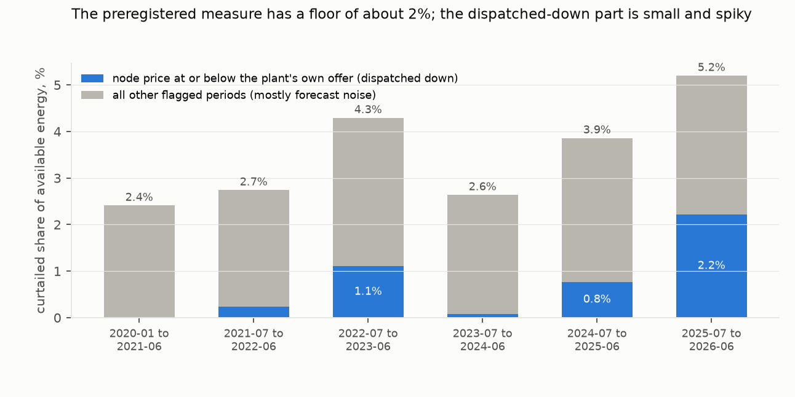
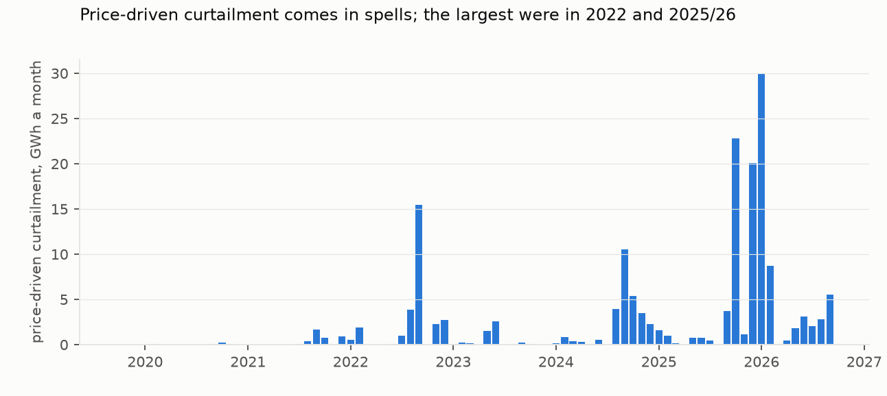
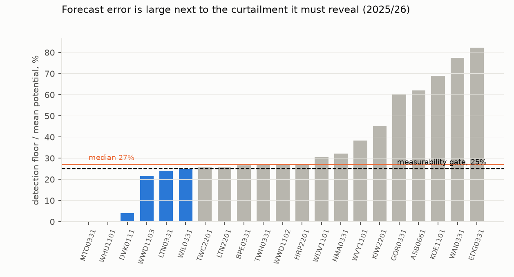

# How much New Zealand wind and solar output is curtailed? Not measurable from the plants' own forecasts, and what does show is mostly two wind farms

*Every offered wind and solar plant in New Zealand, January 2020 to September 2026: each half-hour's latest forecast
of generation potential, from the plant's own offers, set against its metered output and the price at its node, to
build the country's first curtailment ledger.*

**Verdict: Inconclusive. By the study's own preregistered gate, curtailment is not reliably measurable from offers
alone.** In 2025/26 the median plant's detection floor, the size of gap that forecast error alone produces, is 27% of
its mean potential, above the 25% gate. By their rules H1 is Refuted and H2 Supported, but both readings are dominated
by forecast noise that the preregistered measure counts by construction.

The clearest signal is curtailment in half-hours when the node price was at or below the plant's own offer: the plant
was **dispatched down**. It reached 2.2% of available wind and solar energy in 2025/26, but 86% of that is at two wind
farms, Turitea and Kaiwera Downs. Those are the only plants whose median offer is above $0.01/MWh and that still
forecast their potential before the half-hour begins. Without them the fleet shows 0.4% in 2025/26. In 2022/23 the
fleet without that year's two largest contributors (Waipipi and Te Āpiti) showed 0.9%. There is no clear trend, only
spells.

- **H1 (curtailment rose from below 0.5% in 2020 to at least 2.0% in 2025/26): Refuted by its rule.** The measure
  reads 2.27% in 2020 (95% interval 2.13–2.42%) and 5.20% in 2025/26 (4.36–6.32%). The 2020 value is almost entirely
  the noise mass the rule flags by construction (2.22 of the 2.27 points), so the refutation reflects the measure's
  floor.
- **H2 (at least half of 2025/26 curtailment happens when prices exceed $0.01/MWh): Supported by its rule.** 72.7%
  (64.1–82.3%) of measured curtailed energy falls in such half-hours, but half of the measured total is the noise mass,
  which sits in unconstrained half-hours by definition. For the curtailment outside that mass (126 GWh), where the
  line is drawn decides the answer:
  - 53% is above $0.01, the plan's line;
  - 27% is above the plant's own offer;
  - 5% is above $1.

  Nearly all of it happens at near-zero prices, and the $0.01 line splits it evenly only because the two dominant
  plants offer at $0.02 and $1.60.

## In plain terms

When there is more wind or sun than the grid can use or wants to pay for, wind and solar farms are turned down or
switched off. That is "curtailment". Other countries publish how much of it happens; New Zealand does not. We tried
to measure it.

Every wind and solar farm tells the market, every half-hour, how much it could generate. We compared that with what
it actually produced.

The farms' forecasts are off by a lot even when nothing is holding them back, so most of the gap is forecasting
error, not curtailment. By the test we set ourselves in advance, we cannot measure curtailment reliably this way. In
the last year, most wind farms also started sending their forecast after the half-hour had already begun, which can
hide any turning-down.

What does show up clearly is two wind farms, Turitea and Kaiwera Downs, being turned down when power was cheap,
especially in spring and summer 2025/26. They ask a little more than other wind farms for their power, so they are
the first to be turned down.

## What was asked

New Zealand's wind and solar build-out is accelerating, and the Electricity Authority is changing how intermittent
generators share reserve costs, but no curtailment statistic exists. The preregistration (`plan.md`) asked two
questions:
- **H1:** did curtailment grow from under 0.5% of available energy in 2020 to at least 2.0% in the 12 months to
  June 2026?
- **H2:** is at least half of it not price-driven (node price above $0.01/MWh)?

It also set a gate: if forecast error swamps the signal, say so whatever H1 and H2 return.

## How it was done

**Data.** All from the Electricity Authority's EMI service:
- daily offer files, about 170 GB, streamed and filtered to wind and solar energy offers;
- half-hourly metered output by generator (Generation_MD);
- final prices by node.

25 points of connection were matched: 15 wind, 10 solar. Mahinerangi wind farm has no matching metered generator,
and Rotohiko is a battery, so both are excluded.

Half-hours without metered output are dropped (9% of rows; listed below).

**Measure** (plan section 1).
- **Potential** is the plant's latest potential on file for the half-hour, from the highest-numbered latest
  submission.
- **Unconstrained half-hours** are those in which the price exceeded every price the plant offered at by $1 or
  more, and the plant offered at least its potential.
- **Bias correction.** Per plant and quarter, potential is scaled by the median ratio of output to potential in
  unconstrained half-hours, pooled to the year when a quarter is thin. When the year is thin too, the scale is 1 and
  no floor is set, so those half-hours count as available but can never be flagged.
- **Curtailed half-hours** are those whose gap exceeds the plant-quarter's 95th percentile of unconstrained gaps.
- **Intervals** come from a 7-day block bootstrap with calibration re-estimated in each resample. Resampled days
  take the calendar position they are placed in, so their quarters are relabelled. The review's check against
  true quarters (150 resamples) moved the 2025/26 interval slightly (4.45–6.07% against 4.34–5.91%) and left 2020
  unchanged.

## Results

### The measure and its floor (`results/figures/F1_windows.png`)

| | 2020 | 2025/26 |
|---|---|---|
| available energy (bias-corrected potential) | 2,128 GWh | 4,171 GWh |
| preregistered curtailed share | **2.27%** (2.13–2.42) | **5.20%** (4.36–6.32) |
| … in unconstrained half-hours (noise by construction) | 2.22% | 2.17% |
| … dispatched down (price at or below the plant's own offer) | 0.02% | **2.22%** |
| … other flagged half-hours | 0.03% | 0.79% |
| non-price share of curtailed energy (H2) | 99% | 72.7% (64.1–82.3) |

**The noise mass.** The rule flags a half-hour when its gap exceeds the 95th percentile of gaps in unconstrained
half-hours, and it counts unconstrained half-hours too. So it flags about 5% of them by construction: 5.0% in 2020,
4.7% in 2025/26. That mass is about 2.2% of available energy in both periods. A floor matched to the size of the
forecast (by potential decile, a review check) leaves the dispatched-down figure almost unchanged (2.17% against
2.22%).

### Who is dispatched down (`results/figures/F3_monthly_price_driven.png`)

| window | dispatched-down share of available energy | without the two largest plants | the two largest |
|---|---|---|---|
| 2020 (calendar) | 0.02% | — | — |
| Jan 2020–Jun 2021 | 0.01% | 0.00% | White Hill, West Wind |
| Jul 2021–Jun 2022 | 0.23% | 0.06% | Waipipi, White Hill |
| Jul 2022–Jun 2023 | 1.10% | 0.89% | Waipipi, Te Āpiti |
| Jul 2023–Jun 2024 | 0.07% | 0.03% | Waipipi, Turitea |
| Jul 2024–Jun 2025 | 0.77% | 0.45% | Waipipi, Kaiwera Downs |
| Jul 2025–Jun 2026 | **2.22%** | **0.41%** | **Turitea (54 GWh), Kaiwera Downs (25 GWh)** |

Two things make Turitea and Kaiwera Downs the plants that show it:

- **Offer price.** Almost every wind farm offers at $0.01/MWh. Turitea moved to $0.02 in 2025/26, and Kaiwera Downs
  offers at $1.60. A plant offering a little above the floor is the one dispatched down first when prices collapse.
- **Timing of the potential.** For most of the panel, plants submitted their latest potential a few minutes before
  the half-hour began (median lead 2–15 minutes to 2024/25). In 2025/26 most established wind farms switched to
  submitting it after the half-hour had started (median 1.2–11.6 minutes late, 76–89% of half-hours). A potential
  revised after the fact may absorb a turn-down and hide it. Among half-hours at or below the plant's own offer, the
  share flagged as curtailed fell from 2024/25 to 2025/26 at every plant that moved to post-period submission
  (White Hill 0.36 to 0.06, Tararua 3 0.20 to 0.03, Harapaki 0.24 to 0.12, Te Āpiti 0.13 to 0.04, West Wind 0.20
  to 0.09). But it also fell at Waipipi, which did not move (0.50 to 0.28), so this is plausible, not shown (review
  check 9). Turitea, Kaiwera Downs and Waipipi still submit beforehand.

So the 2025/26 rise is partly about which plants are marginal and how they report, not only how often wind is turned
down.

### The gate (`results/figures/F2_gate.png`)

The median plant's floor is 27% of its mean potential in 2025/26, against the 25% gate. The review found it about
0.27 under every variant, and 0.269 for wind alone. Wind plants range from 22% to 60%. Solar plants sit higher because
their potentials are stale: most are submitted days ahead (median leads of about 1.7 to 6.4 days for most solar
plants and years). The review found their floors are 42–45% of mean potential even on daytime half-hours alone.
**The gate fails.**

### Robustness (`results/tables/robustness.json`, `sensitivity_post_review.json`)

| variant | 2020 | 2025/26 |
|---|---|---|
| preregistered | 2.27% | 5.20% |
| only the gap above the floor counted | 0.84% | 2.72% |
| floor at the 99th percentile | 0.76% | 3.01% |
| floor at the 90th percentile | 3.41% | 6.49% |
| no bias correction | 2.28% | 5.58% |
| unconstrained requires a $10 margin | 2.26% | 5.43% |
| plant-quarters with partial metering dropped (k < 0.5) | 2.27% | 5.19% |
| wind only | 2.27% | 5.11% |
| each plant left out (2025/26 range) | — | 3.80% (without Turitea) to 5.67% (without Harapaki) |

- **The offered maximum output**, planned as an alternative to the potential forecast, was not run. It is a nameplate
  value, populated in 2019/20, partly in 2020/21 and 2024/25, and fully from 2025/26, but empty in 2021/22 to
  2023/24; the panel builder did not carry it.
- **Real-time pricing.** Before and after November 2022 the measure reads 2.91% and 3.95%.
- **Weather.** The potential forecasts track ERA5 weather at most plants, with correlations of 0.44–0.85 against
  100 m wind speed or solar radiation. Two new solar farms are lower: Dannevirke 0.14, Tauhei 0.07.
- **Rows without metered output.** Half-hours with no metered output were dropped:
  - Lauriston solar, October 2024 to June 2025 (12,386 half-hours; at that time Generation_MD shows only the
    Highbank hydro station at its point);
  - Kohira/Pukenui, October to December 2023;
  - Kaiwera Downs, August 2023;
  - Mill Creek, October to December 2019;
  - Waipipi, October to November 2020;
  - Clandeboye, June to August 2026;
  - Dannevirke, one day.

**Projection, frozen for scoring after June 2027.** By the preregistered rule (the 2025/26 share scaled by projected
available energy from plants operating by September 2026), the measure would read **5.65%** for the 12 months to June
2027. Four new plants have no usable metering yet (Clandeboye, Kaiwaikawe, Kōwhai Park, Pāmu Rā), so they enter that
rule with no available energy. Projecting them from their potential instead gives 5.93%. Kaiwera Downs stage 2 is
annualised from six commissioning months. Both figures are recorded. Given the floor, and the reporting change above,
neither is a forecast of real curtailment, and the dispatched-down component is not projected.

## What this does and does not show

- **It does not provide** a reliable curtailment statistic. The plants' own potential forecasts err by more than a
  quarter of their mean output at the 95th percentile. Solar potentials are days old. Since 2025/26 most wind
  potentials arrive after the half-hour has begun.
- **It shows** that wind farms offering slightly above the $0.01 floor are dispatched down in low-price spells: about
  80 GWh at Turitea and Kaiwera Downs in 2025/26, concentrated in October 2025 to January 2026. The rest of the fleet
  shows similar spells (largest in 2022/23) but no rising trend.
- **It does not separate** market-driven dispatch-down from network constraints. A constrained node's price falls to
  the marginal offer, so "price at or below the plant's offer" includes plants constrained off. The system operator's
  dispatch records would be needed to tell them apart.
- **Better measures.** A sounder measure would:
  - use potentials fixed before the half-hour (or an independent weather-based potential);
  - count only candidate half-hours against a forecast-matched reference, not every half-hour above a percentile;
  - use dispatch records to classify cause.

## Process and deviations

- **Preregistration.** `plan.md` was committed before any series was built. It fixed a 2020 baseline, since the
  potential field is empty before late 2019. The fetch, build and analysis code were committed before their outputs.
- **Deviations** (`deviations.md`):
  - D1, before any series: an unpublished day; December 2025 prices assembled from daily files; generation
    column-name case; the two fuel codings; partial metering.
  - D2: the failed gate and the post hoc decomposition (`code/diagnostics.py`).
  - D3, after independent review:
    - the dispatched-down relabelling, the per-plant series, offer prices and potential lead times
      (`code/sensitivity_post_review.py`);
    - the corrected maximum-output statement, the dropped rows and the projection variant;
    - the bootstrap and pooling notes.
- **Review.** An independent adversarial review (`review/review.md`) reproduced every number and the fetch filter
  exactly. It found the two-plant concentration, the post-period potentials, the stale solar potentials and the
  projection issue, all addressed here.

## Reproducing it

`code/fetch.py`, `code/build.py`, `code/analysis.py`, `code/diagnostics.py`, `code/sensitivity_post_review.py`,
`code/figures.py`.

- **Inputs** are public EMI files from the Azure blob store, plus Open-Meteo ERA5.
- **Results** are in `results/tables/`: `primary.json`, `robustness.json`, `diagnostics.json`,
  `sensitivity_post_review.json`, `ledger_monthly.csv` (the open ledger by plant and month), `build_log.json` and
  `output_validation_monthly.csv`.
