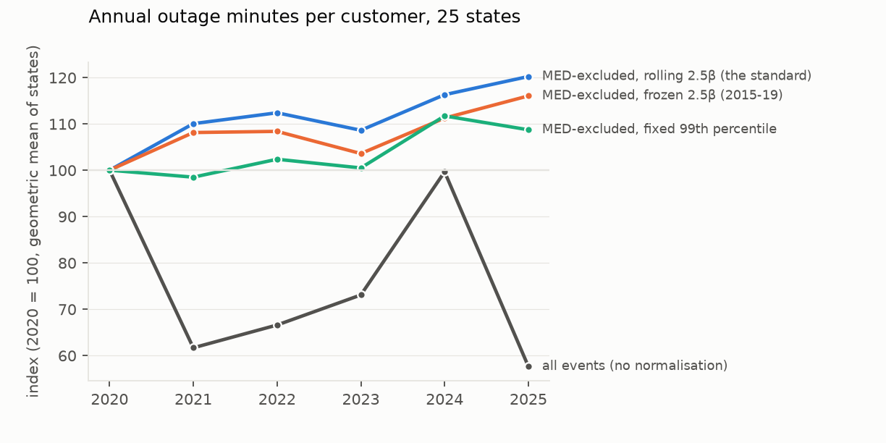
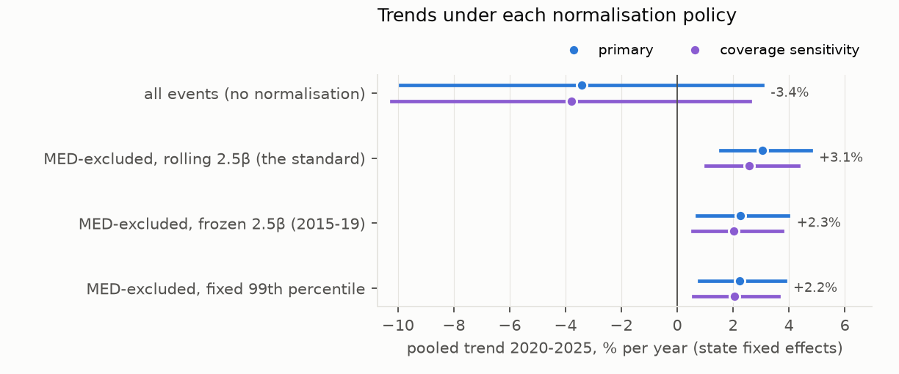
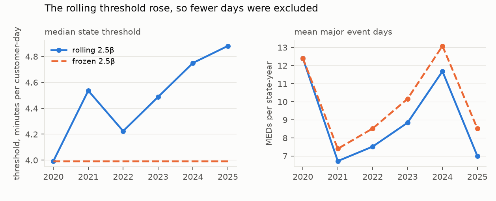
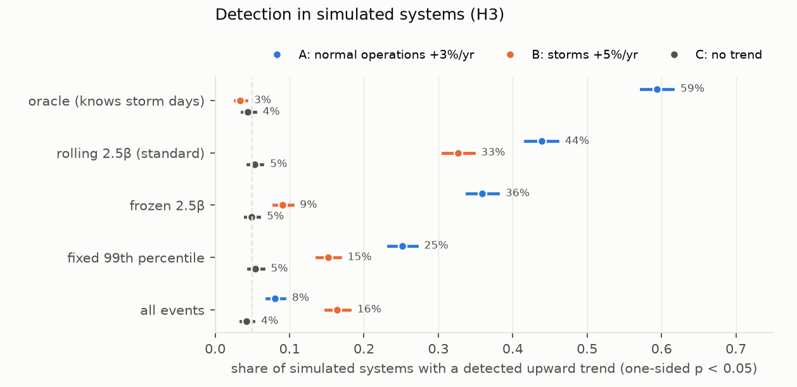

# Does the major-event-day rule hide the US outage trend it is meant to normalise?

*Daily outage minutes per customer for 24 US states and DC, 2015–2025, built from the EAGLE-I county outage snapshots and
classified under the IEEE 1366 "2.5β" major-event-day rule and three alternatives, plus a Monte Carlo of how well
each rule detects a real trend.*

**Verdict: Refuted.** The standard rule does not hide the trend in these data, and in simulation it keeps most of the
power to detect one. Its weakness runs the other way: a rising rolling threshold lets storm growth leak into the
"normal operations" index.

- **H1 (the rule masks an all-events trend): Inconclusive.**
  - All-events SAIDI has no trend over 2020–2025 (−3.4% a year, 95% CI −9.9 to +3.0), so there is nothing to mask.
  - The MED-excluded index under the standard rolling rule rises **+3.1% a year (+1.6 to +4.8)**.
  - So normalisation reveals a trend that storm noise hides, rather than the reverse.
- **H2 (the rolling threshold removes more trend than a frozen one): Refuted.**
  - The rolling MED-excluded index rises 0.79 percentage points a year *faster* than the frozen one (+0.18 to +1.48).
  - The rolling threshold rose from a median 4.0 to 4.9 minutes per customer-day, so fewer days were excluded.
  - Under the preregistered coverage sensitivity the difference is +0.54 (−0.11 to +1.23), which is Inconclusive.
    It is never negative.
- **H3 (the rolling rule has at most half an oracle's detection power): Refuted.**
  - In 2,000 simulated systems where normal-operations severity grows 3% a year, the rolling rule detects the trend
    in 44% and an oracle that knows the storm days in 59%. The ratio is 0.74 (0.70–0.78).
  - The frozen threshold detects 36%, a fixed 99th-percentile rule 25%, and all events 8%.

**What the simulation adds.** When storms, not normal operations, grow 5% a year, the rolling rule's "normal
operations" index shows an upward trend in 33% of systems. The frozen threshold does so in 9% and the oracle in 3%.
- A rising threshold reclassifies growing storm days as ordinary days.
- The observed +3.1% a year could therefore be partly storm leakage rather than worsening routine reliability. The
  frozen and fixed-quantile indices, which are less exposed to it, still rise about 2.3% a year.

**Validation.** Over 175 state-years (2018–2024), the EAGLE-I all-events index ranks states almost exactly as the
utilities' own EIA-861 SAIDI (with major events) does: Spearman 0.94.

## In plain terms

Power companies report how many minutes their customers are without power each year. Before comparing years,
regulators usually remove "major event days", the worst storm days, using a standard statistical rule. Critics worry
the rule's threshold creeps upwards as storms get worse. That could hide a real decline in everyday reliability.

We rebuilt daily outage minutes for 24 US states and DC from a public federal dataset, covering 2015 to 2025. We then applied
the standard rule and three alternatives.

The worry did not hold up here. Including storms, there was no clear trend over 2020–2025, because storms swing too
much from year to year. Once storm days are removed, everyday outage minutes rose about 2–3% a year under every rule,
and fastest under the standard one.

The standard rule's threshold did creep upwards, but that made it exclude *fewer* days, not more.

We also simulated thousands of made-up power systems. When everyday reliability got worse, the standard rule caught
it nearly three-quarters as often as a perfect rule would. That is better than the alternatives we tested.

Its real weak spot ran the other way. When storms got worse, the standard rule's "everyday" figure sometimes rose too,
because the rising threshold let bigger storm days count as ordinary ones. Some of the everyday rise we measured may
be storms in disguise.

These are state totals from outage maps, not individual utilities' official figures.

## What was asked

IEEE Standard 1366 separates "major event days" (MEDs) from normal operations. Each year's threshold is
exp(α + 2.5β), where α and β are the mean and standard deviation of the log of non-zero daily SAIDI over the previous
five years. Regulators judge reliability on the MED-excluded index. If storms are getting worse, the threshold rises
with them, and a critique raised at a 2025 CPUC technical session is that this can hide deteriorating performance.

The study asks three preregistered questions (`plan.md`, 950d8c0):

- **H1 (masking).** Does the MED-excluded index under the rolling rule grow at less than half the rate of the
  all-events index?
- **H2 (ratchet).** Does the rolling threshold remove more of the trend than a threshold frozen at 2015–2019?
- **H3 (detection power).** In simulation, does the rolling rule detect a 3%-a-year deterioration in normal
  operations at most half as often as an oracle that knows which days are storms?

## What was already known

The novelty search (2026-10-18) found known critiques of the 2.5β method:
- zero-SAIDI days (IEEE 2013);
- log-normal tail misfit (IEEE 2011);
- the CPUC session's warning that rising thresholds can hide localised problems.

No study was found that quantifies, across a national panel, how much of the outage trend the rolling threshold
removes, or the detection power of alternative rules.

## How it was done

**Data.**
- **Outages.** The EAGLE-I outage dataset (Oak Ridge National Laboratory; figshare 24237376 v4, CC BY 4.0) gives
  customers out by county in 15-minute snapshots, from utilities' public outage maps.
  - 2015–2025, 11 GB, verified against the repository's MD5 sums.
  - The 2023 file names its customers-out column `sum` (D1).
- **Customers.** The dataset's modelled customer counts per county (MCC 2022).
- **Validation.** EIA-861 reliability data (via PUDL).

**Daily SAIDI** (`code/build.py`). For each state and local day in the state's predominant time zone: the sum over
its counties and snapshots of customers out × 15 minutes, divided by the state's MCC customers. Days with no record are
zero. This gives 204,918 state-days.

**Inclusion.** A state is included if both hold:
- its customer coverage is at least 80% in every year of the dataset's coverage history (2018–2022);
- in every year 2015–2025, the number of its counties reporting any outage is within ±15% of its 2018–2022 median.

24 states and DC qualify: 25 systems, called states below. Excluded:
- AZ, CA, CO, CT, ID and MO, on reporting-county stability;
- AR, IN, KY and MS, on coverage.

**Rules compared** (`code/analysis.py`), for 2020–2025:
- (a) rolling 2.5β, the standard;
- (b) 2.5β frozen at 2015–2019;
- (c) a 10-year window, for 2025 only;
- (d) a fixed 2015–2019 99th percentile;
- (e) no normalisation (all events).

**Trends.** A panel regression of ln(annual index + 1 minute) on year with state fixed effects. Intervals come from a
state-cluster bootstrap (2,000 resamples).

**The Monte Carlo** (`code/simulate.py`):
- **Calibration.** Each simulated system is calibrated to a randomly drawn included state's 2015–2019 days: zero days,
  a log-normal body, and a generalised Pareto tail above the 95th percentile.
- **Scenarios.** 2,000 systems × 11 years each:
  - A: normal operations +3% a year;
  - B: storm frequency and size +5% a year;
  - C: no trend.
- **Detection.** A one-sided p < 0.05 for a positive log-linear trend over the final six years.

## Results

### The trends (`results/tables/primary.json`, `results/figures/F1_indices.png`, `F2_trends.png`)

| index | trend 2020–2025, % per year | coverage sensitivity |
|---|---|---|
| all events | −3.4 (−9.9 to +3.0) | −3.8 (−10.2 to +2.6) |
| **MED-excluded, rolling 2.5β (the standard)** | **+3.1 (+1.6 to +4.8)** | +2.6 (+1.0 to +4.3) |
| MED-excluded, frozen 2.5β | +2.3 (+0.7 to +4.0) | +2.0 (+0.6 to +3.8) |
| MED-excluded, fixed 99th percentile | +2.2 (+0.8 to +3.9) | +2.0 (+0.6 to +3.6) |

- **H1 is Inconclusive** by its preregistered rule: the all-events interval includes zero.
  - The "masking ratio" (rolling trend over all-events trend) is meaningless when its denominator is near zero:
    −0.89 (−9.8 to +9.5).
  - All-events SAIDI is dominated by a few storm years (2020 and 2024), so it carries no detectable trend in six years.
- **H2 is Refuted.** Rolling minus frozen is +0.79 points (+0.18 to +1.48).
  - Under the coverage sensitivity it is +0.54 (−0.11 to +1.23), which is Inconclusive.
  - In neither analysis does the rolling rule remove more trend.
- **The 10-year window** (rule (c), 2025 only) gives a total MED-excluded 2025 index within 1% of the rolling rule's.

### The threshold and the excluded days (`results/figures/F3_thresholds.png`)

- **The threshold rose.** The median state rolling threshold went from 4.0 minutes per customer-day in 2020 to 4.9 in
  2025.
- **Fewer days were excluded.** The rolling rule excluded fewer days than the frozen rule in every year after 2020:
  - 2023: 8.8 vs 10.2 MEDs per state;
  - 2024: 11.7 vs 13.1;
  - 2025: 7.0 vs 8.5.
- **Decomposition.** Per state, the 2020-to-2025 change in all-events SAIDI is split into three parts:
  - normal-operations growth: median +14 minutes, positive in 20 of 25 states;
  - reclassification as the threshold moves: median +5 minutes;
  - storm change: median −161 minutes, since 2020 was a heavy storm year.

  Reclassification adds to the normal-operations index rather than subtracting from it.

### Detection power (H3; `results/tables/simulation.json`, `results/figures/F4_power.png`)

| rule | A: normal ops +3%/yr | B: storms +5%/yr | C: no trend |
|---|---|---|---|
| oracle (knows storm days) | 59% | 3% | 4% |
| **rolling 2.5β** | **44%** | **33%** | 5% |
| frozen 2.5β | 36% | 9% | 5% |
| fixed 99th percentile | 25% | 15% | 5% |
| all events | 8% | 16% | 4% |

- **H3 is Refuted.** The rolling rule's power ratio to the oracle is 0.74 (0.70–0.78), far above 0.5. All rules hold
  their nominal 5% false-positive rate under C.
- **Scenario B shows the rolling rule's real weakness.**
  - As storms grow, its threshold rises and more storm days pass as ordinary days.
  - So the "normal operations" index trends upwards in a third of systems where normal operations did not change at
    all.
  - The frozen threshold leaks far less (9%).
- **The tails are heavy.** For 14 of the 25 states, the fitted Pareto tail shape reached the code's cap of 0.9.
  Infinite-variance tails make all-events trends nearly undetectable, which matches the 8% power of the all-events
  index under A.

### Validation (`primary.json`)

The EIA side is utility SAIDI with major events, customer-weighted within each state, for utilities using the IEEE
method. Over 175 state-years (2018–2024), its Spearman correlation with the EAGLE-I all-events index is 0.94 (0.96
under the coverage sensitivity). That is well above the preregistered 0.6 bar, so the proxy is validated for ranking
states.

## What this does and does not show

- **It shows:**
  - in these 25 states, the standard rolling rule did not hide an outage trend over 2020–2025;
  - every MED-excluded index rose about 2–3% a year while the all-events index showed no trend;
  - in simulation, the rolling rule keeps about three-quarters of an oracle's power to detect deteriorating normal
    operations, more than the alternatives tested.
- **It does not show that routine reliability is worsening by 3% a year.**
  - The simulation shows that the rolling rule also turns growing storms into a rising "normal operations" index.
  - The frozen and fixed-quantile indices, less exposed to that, rise about 2.2% a year. That is a firmer lower
    estimate of the routine trend, if the outage-map coverage is stable.
- **States are not utilities.** Real thresholds are set per utility on its own daily SAIDI. State aggregation smooths
  days, lowers β and changes which days count as MEDs. The conclusions are about the rule's behaviour on state
  aggregates, not any utility's reported figures.
- **The data are outage maps.** EAGLE-I captures what utilities publish. Coverage grew in 2015–2017, which the
  inclusion rule and the coverage sensitivity address. Customers out are snapshots, so outages shorter than 15
  minutes are partly missed.
- **Six annual points** per state; inference is pooled.
- **The NZ external check** named in the lead was descoped in the plan: New Zealand publishes annual, not daily, data.

## Process and deviations

- **Preregistration.** The plan (950d8c0) was committed before any outage series was built. The build, analysis and
  simulation code (e868d1c) was committed before the data finished downloading.
- **D1:** download integrity and the 2023 column name, recorded before any series was computed.
- **The figure code** (`code/figures.py`) was written after the results.

## Reproducing it

`code/fetch.py`, `code/build.py`, `code/analysis.py`, `code/analysis.py coverage`, `code/simulate.py`,
`code/figures.py`.

- **Raw files** are in `data/raw/`, with checksums in `data/raw/SHA256SUMS`.
- **Results** are in `results/tables/`: `primary.json`, `primary_coverage_sensitivity.json`, `state_year.csv`,
  `decomposition.csv` and `simulation.json`.
