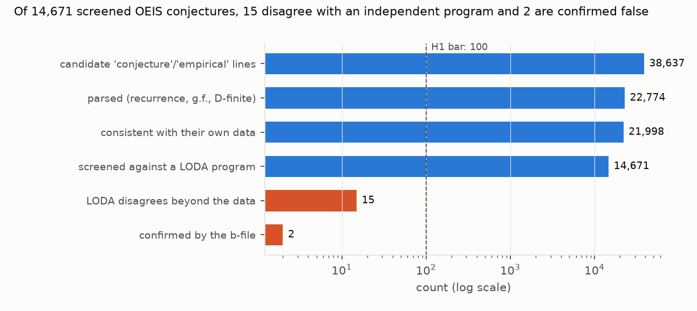

# Machine-guessed OEIS conjectures almost always agree with independent programs beyond the data: of 14,671 screened, 15 disagree and only 2 are confirmed false

*Every OEIS entry (the OEIS data repository, 2026-10-25) was searched for formula lines marked "conjecture" or
"empirical": 38,637 lines in 24,168 entries. Linear recurrences, rational generating functions and P-recursive
relations were parsed into exact predictors, run beyond each entry's data, and compared with the entry's LODA program,
run locally. Disagreements were checked against the entry's b-file. The plan was committed before any entry was
parsed.*

**Verdict: H1 Refuted.**

- **H1 (at least 100 machine-guessed conjectures are false, as shown by two independent term sources): Refuted.**
  - **2 confirmed falsifications** (A076217 and A267515; the latter was already marked "[Wrong]" by OEIS editors).
- **Screening.**
  - Of the 14,671 data-consistent conjectures with a working LODA program, **15 disagree with it** beyond the data:
    a rate of 0.10% (Wilson 95% interval 0.06% to 0.17%).
  - The comparison reaches a median of 26 terms beyond the published data (10th–90th percentile: 18 to 46).
- **Most disagreements cannot be confirmed.** For 13 of the 15, the b-file holds only the published terms, so there
  is no second source.
  - Eight are off by small amounts at large indices (for example 65,287,195,195 against …194). Several are on
    floor-of-ratio or "rounded down" sequences, where a rational g.f. can fit for dozens of terms and then drift.
  - These 13 are listed for OEIS editors, not counted as false.
- **By class:**

  | class | disagreements | screened |
  |---|---|---|
  | constant-coefficient recurrences | 3 | 7,953 |
  | rational g.f.s | 10 | 5,921 |
  | P-recursive | 2 | 797 |

- **Coverage.**
  - 22,774 lines parsed; 21,998 consistent with their own data. Most of the 776 that are not carry a condition the parser
    ignores: 541 (70%) mention an index restriction such as "for n > k" (385) or a parity or residue condition (167).
    Exponential g.f.s and "if and only if" statements are rare (2 and 4) (`results/tables/contradicted_audit.json`).
  - 7,221 data-consistent conjectures have no LODA program and were not screened. A further 104 whose predictor
    failed to run, and 2 whose LODA output was short or mismatched, were also left out of the 14,671.

## In plain terms

The Online Encyclopedia of Integer Sequences (OEIS) is mathematics' great catalogue of number sequences. Thousands of
its entries carry formulas found by computer: a program looks at the known terms and guesses a rule that fits them,
recorded as "Conjecture" or "Empirical". Nobody has proved most of these rules. A guess that fits 40 terms could fail
at the 41st, so how many of them are wrong?

We turned about 22,000 of these guessed formulas into code. For each one that also has an independent program in the
LODA project, we computed further terms both ways and compared them. Disagreements were rare: 15 out of 14,671. Only
2 could be confirmed with a third, independent list of terms. One of those was already flagged as wrong by the
encyclopedia's editors.

So the computer-guessed formulas in the OEIS are, as far as this check reaches, highly reliable. The handful of
disagreements are worth an editor's look.

## What was asked

The lead (`experimental-math-oeis-conjecture-audit`) asked whether at least 100 machine-generated OEIS conjectures
are false. That would be a measurable base rate of error in a class where false positives are known to exist
(Ekhad, Sloane and Zeilberger 2016, on Pisot sequences).

Prior work proves subsets: Ekhad, Yang and Zeilberger (2017) on Mathar's recurrences; Shallit and colleagues on automatic sequences with Walnut (Shallit 2022). No comprehensive falsification audit was found.

## How it was done

- **Entries.** The OEIS data repository (shallow clone, 402 directories of `.seq` files). Data terms come from
  %S/%T/%U, and the offset from %O.
- **Candidates.** %F lines containing "conjecture" or "empirical". Members of "Conjectures from …: (Start) … (End)"
  blocks, the format of most of Colin Barker's conjectures, are included (D1).
- **Parsing** (`code/parse.py`, unit-tested):
  - (C) a(n) = Σ cᵢ a(n−i) (+ constant);
  - (G) G.f.: P(x)/Q(x), expanded exactly;
  - (D) Σ pᵢ(n) a(n−i) = 0 with polynomial coefficients.

  Everything is in exact rational arithmetic. "For n > k" conditions set where the relation starts.
- **Data check.** A conjecture must reproduce all of its entry's data terms that it reaches.
- **Screening.**
  - The LODA program for the entry (loda-programs repository, interpreter v26.8.1) is evaluated for up to twice as
    many terms as the data (at most 1,000, 20-second limit), and must reproduce the data.
  - A disagreement is the first index beyond the data where the conjecture and LODA differ.
- **Confirmation.** The entry's b-file is fetched from oeis.org (15 requests, 1 per second). A disagreement is
  confirmed if the b-file agrees with the data and contradicts the conjecture at or before the disagreement index.

## Results (`results/figures/F1_funnel.png`)

| stage | count |
|---|---|
| candidate lines (entries) | 38,637 (24,168) |
| parsed: C / G / D | 15,306 / 6,466 / 1,002 |
| consistent with own data | 21,998 |
| screened against LODA | 14,671 |
| LODA disagrees beyond the data | 15 |
| confirmed by the b-file | 2 |
| b-file covers only the data (unconfirmable) | 13 |

**Disagreements** (`results/tables/falsifications.csv`):
- **Confirmed:** A076217 (its g.f.; b-file and LODA agree at n = 81) and A267515 (b-file at n = 62; already marked
  "[Wrong]").
- **Unconfirmable:** A005257, A024389, A024390, A026155, A049609 (two P-recursive conjectures that agree with each
  other but not with LODA), A162764, A243989, A261667, A282044, A301424 and A328987 (two lines).

## What this does and does not show

- **The error rate in this class is very low.** About 1 in 1,000 conjectures disagrees with an independent program
  within a median of 26 further terms, and confirmed falsifications are rarer still. The lead's expectation of 100 or
  more false conjectures is far from the evidence.
- **The test is short-range.** Conjectures that fail only far beyond the published data (hundreds of terms) would be
  missed. The comparison depth is bounded by LODA run time and by twice the data length.
- **LODA programs are not ground truth.** They are mined to match known terms, so a LODA error beyond the data could
  create a false disagreement (A049609 may be one). Agreement between a conjecture and LODA is strong but not
  certain evidence of truth.
- **Not shown:**
  - **Unparsed conjectures:** closed forms, sums, inequalities, congruences and asymptotics.
  - **Conjectures without a LODA program,** 7,221 of them.
  - **Proofs.** The lead's certification arm was not attempted.

## Process and deviations

- **Preregistration:** `plan.md`.
- **Deviations** (`deviations.md`): D1, before any screening. A trailing-period parse bug was fixed; formulas written
  before "(conjectured)" are parsed; (Start)/(End) block members are included.
- **Independent review:** queued (Fable), per the lab's pacing rule.

## Reproducing it

1. Clone `oeis/oeisdata` (without LFS) and `loda-lang/loda-programs` into `data/raw/`, with the loda-cpp v26.8.1
   binary.
2. `code/parse.py run`.
3. `code/screen.py screen`, then `code/screen.py confirm`.
4. `code/analyse.py`.
5. `code/figures.py`.
