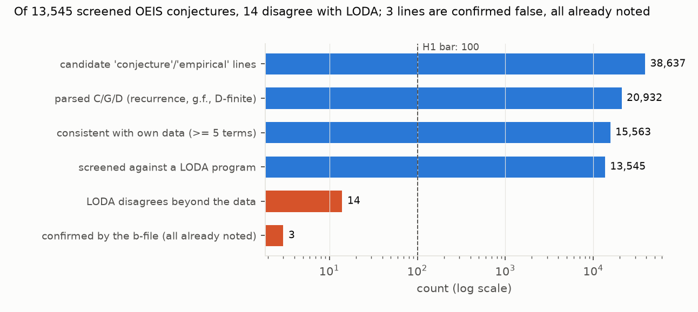

# Machine-guessed OEIS conjectures that fit their entry's terms almost always keep fitting: 3 of 3,114 fail against the b-file up to a median 185 terms further, and every falsification found was already noted in its entry; but hundreds of conjectured formulas are false as written by their entry's own terms

*Every OEIS entry (the OEIS data repository, 2026-10-25) was searched for formula lines marked "conjecture" or
"empirical": 38,637 lines in 24,168 entries. Linear recurrences, rational generating functions and P-recursive
relations were parsed into exact predictors, checked against the entry's own terms, then compared beyond the data
with the entry's LODA program and, for a random sample, directly with the entry's b-file. The plan was committed
before any entry was parsed. Revised after an independent review (fix first; D2).*

**Verdict: H1 Refuted by the preregistered rule (fewer than 100 confirmed falsifications). The accurate reading is
"not supported within this pipeline's coverage", not a refutation of the claim.**

- **H1 (at least 100 conjectured recurrences and g.f.s in OEIS are false, as shown by two independent term
  sources): fewer than 100 confirmed.**
  - **3 confirmed lines** on 2 entries: A076217's g.f. (it fails at n = 81) and two lines of A267515. None is new.
    A267515's block is tagged "[Wrong]" by editors, and A076217's entry carries a later note that the conjectured
    recurrence fails at powers of 3.
  - The rule was followed, but the count is a lower bound on a partial population (below), and the pipeline itself
    finds hundreds of statements false as written. So "Refuted" means "not supported within this coverage".
- **Two strata, not one rate** (corrected after review). LODA programs are checked against up to 1,000 known terms,
  so where an entry has a b-file, LODA is not an independent source.
  - **Entries with a b-file:** 1 of 11,778 screened conjectures disagrees with LODA beyond the data (0.008%; Wilson
    0.002% to 0.048%). This is agreement with the b-file in practice.
  - **Entries without a b-file:** 13 of 1,767 disagree (0.74%; 0.43% to 1.25%). There LODA was mined on the data
    alone, so these disagreements are unresolved extrapolations, not near-zero error. None can be confirmed: the
    b-file holds only the published terms.
  - The first draft pooled these into one rate (0.10%) and called LODA independent throughout.
- **A direct b-file test** (post hoc; finding 5). The plan allowed 2,000 b-file fetches and the confirmation used 13.
  The rest went to a seeded random sample of 1,987 of the 8,586 entries with a b-file and a consistent conjecture.
  - 3,114 conjectures were compared with up to 1,000 b-file terms each, a median of 185 terms beyond the data (10th
    to 90th percentile 105 to 717).
  - 3 fail, on 2 entries: 0.10% (Wilson 0.03% to 0.28%). Both failures lie beyond the LODA screen's depth (a(62) on
    A267514; 532 terms beyond the data on A210247), and both are noted in later lines of their entries.
  - Scaled to the 13,510 consistent conjectures on entries with b-files, that suggests about 13 contradicted by their
    b-file (roughly 4 to 38). This is one source of terms, not the plan's two.
- **False as written by the entry's own terms.** 747 parsed lines contradict their own entry's data. The first draft
  set these aside as "mostly conditions the parser ignores", which was wrong (finding 3):
  - **188 state a range that starts too early** (183 in "Conjectures from …" blocks), and hold from a median 2.5
    indices later. They are false as written, by a boundary slip.
  - 107 hold only from a later index with no range stated, and 8 g.f.s match with a shifted offset.
  - 328 carry a parity or residue condition the parser ignores, in the line or in the next formula line. 13 more
    carry other conditional wording, and 2 are exponential g.f.s (corrected after the confirmation pass).
  - **101 are contradicted with no mechanical explanation** (61 recurrences or g.f.s, 40 polynomial closed forms).
    They are listed by A-number for editors in `results/tables/contradicted_no_simple_fix.csv`.
  - 29 of the first draft's 776 were parser artefacts and are now consistent.

## In plain terms

The Online Encyclopedia of Integer Sequences (OEIS) is mathematics' great catalogue of number sequences. Thousands of
its entries carry formulas found by computer: a program looks at the known terms and guesses a rule that fits them,
recorded as "Conjecture" or "Empirical". A guess that fits 40 terms could fail at the 41st, so how many are wrong?

We turned about 21,000 of these guessed formulas into code. Where an entry has a longer list of terms on file (a
"b-file"), we tested a random sample of about 3,100 guesses against it, a median of 185 terms beyond what the
guesser saw. Only 3 failed, and the encyclopedia had already noted both of the entries involved. Comparing with
programs from the LODA project found 14 disagreements; the one new to us that we could check (A076217) was also already known.

But the check turned up a different kind of error. Hundreds of the guessed formulas don't even fit the terms printed
in their own entry. 188 state a range that starts a few terms too early and 107 more hold only
from a later index, slips in how the range was written, and about 100 more fail for no obvious reason. Those are listed for the editors.

So formulas that fit their entry keep fitting far beyond it, and the editors have caught the failures we could
confirm. The weaker point seems to be how the formulas are written down.

## What was asked

The lead (`experimental-math-oeis-conjecture-audit`) asked whether at least 100 machine-generated OEIS conjectures
are false. That would be a measurable base rate of error in a class where false positives are known to exist
(Ekhad, Sloane and Zeilberger 2016, on Pisot sequences).

Prior work proves subsets: Ekhad, Yang and Zeilberger (2017) on Mathar's recurrences; Shallit and colleagues on automatic sequences with Walnut (Shallit 2022). No comprehensive falsification audit was found.

## How it was done

- **Entries.** The OEIS data repository (shallow clone, 402 directories of `.seq` files). Data terms come from
  %S/%T/%U, and the offset from %O.
- **Candidates.** %F lines containing "conjecture" or "empirical", plus members of "Conjectures from …: (Start) …
  (End)" blocks (D1). Lines or blocks tagged "[Wrong]" or "[Incorrect]" are flagged and kept out of the count (D2).
  Follow-up notes on separate lines are not detected, which is why A076217 counted as new until read.
- **Parsing** (`code/parse.py`, unit-tested) into exact predictors:
  - (C) a(n) = Σ cᵢ a(n−i) (+ constant);
  - (G) G.f.: P(x)/Q(x);
  - (D) Σ pᵢ(n) a(n−i) = 0 with polynomial coefficients.
  - Closed forms with no lag (polynomials in n) are class P. The plan lists them as "not parsed", so they are kept
    out of the C/G/D population and reported separately (1,843 lines; D2).
  - "For n > k" sets where a relation starts, shifted correctly for a(n+k) forms (D2).
- **Data check.** A conjecture is consistent only if at least 5 of its entry's data terms were actually checked and
  all agree (D2). 4,166 conjectures, mostly high-order empirical recurrences on short entries, reach no data term at
  all, and 833 reach only 1–4; neither group is screened. The first draft counted them as consistent.
- **Screening.** The LODA program (loda-programs repository, interpreter v26.8.1) is evaluated for up to twice as
  many terms as the data (at most 1,000) and must reproduce the data. A disagreement is the first index beyond the
  data where the conjecture and LODA differ; "agree" needs at least one term compared. Both values are stored.
  - 153 agreements are tautological: the LODA program's own formula comment is the same recurrence.
  - The depth is a design cap: 99.9% of comparisons stop at twice the data length (median 26 terms beyond the data).
- **Confirmation.** The entry's b-file is fetched from oeis.org (13 entries, 1 request per second). A disagreement is
  confirmed if the b-file agrees with the data and contradicts the conjecture at or before the disagreement.
- **Direct b-file test** (`code/bdeep.py`, post hoc). A seeded random sample (seed 20261107) of 1,987 entries with a
  real b-file (a Git-LFS pointer in the repository). Each consistent, unflagged C/G/D conjecture is run against up to
  1,000 b-file terms. The first ~716 files were fetched at about one request per second until oeis.org returned
  HTTP 429; fetching then ran at about one request every 3 seconds, and from 16:08 every 5 seconds with back-off.
  The 164 rate-limited requests were refetched.
- **Self-contradicted lines** (`code/contradicted_audit.py`). Each is put in one class: stated range too early (holds
  from a start up to 10 indices later), holds from a later index, g.f. offset slip, parity or residue condition, or no
  simple fix.

## Results (`results/figures/F1_funnel.png`)

| stage | count |
|---|---|
| candidate lines (entries) | 38,637 (24,168) |
| parsed: C / G / D (P, outside the population) | 13,463 / 6,467 / 1,002 (1,843) |
| C/G/D consistent with own data (≥ 5 terms checked) | 15,563 |
| … unchecked / 1–4 terms / contradicted | 4,166 / 833 / 370 |
| screened against LODA (unflagged; working program) | 13,545 |
| LODA disagrees beyond the data (with / without a b-file) | 14 (1 / 13) |
| confirmed by the b-file (all already noted; 2 of the 3 lines are A267515's [Wrong]-tagged lines, outside the 13,545) | 3 lines, 2 entries |
| direct b-file test: conjectures (entries) | 3,114 (1,986) |
| … contradicted by the b-file (already noted) | 3 (2) |

| class | screened, with b-file: disagree / n | screened, without b-file: disagree / n | direct b-file test: contradicted / n |
|---|---|---|---|
| constant-coefficient recurrences (C) | 0 / 6,053 | 2 / 751 | 2 / 1,723 |
| rational g.f.s (G) | 1 / 5,222 | 9 / 699 | 1 / 1,268 |
| P-recursive (D) | 0 / 503 | 2 / 317 | 0 / 123 |

**Disagreements and failures** (`results/tables/falsifications.csv`, `bdeep_contradictions.csv`):
- **Confirmed (two sources):** A076217 (its g.f., at n = 81; noted in the entry) and A267515 (two lines, at n = 62;
  tagged "[Wrong]").
- **Unconfirmable** (no b-file beyond the data): A005257, A024389, A024390, A026155, A049609 (two lines), A162764,
  A243989, A261667, A282044, A301424 and A328987 (two lines). Eight are off by small amounts at large indices (for
  example LODA 65,287,195,194 against the conjecture's …195). A301424's "(conjectured)" qualifies the denominator's
  factorisation, not the g.f. (D2).
- **Direct b-file test:** A267514 (two lines, at n = 62; noted in the entry, the sibling of A267515) and A210247
  (a(n) = −a(n−28) fails at n = 606; the entry gives the first counterexample).

**Selection into the screen** (`results/tables/selection.csv`). Among consistent conjectures, the share without a LODA
program is 4.9% for entries with the keyword "easy" against 14.1% otherwise; 6.7% for A000001–A100000 against 16.1%
from A300001; 7.7% for block members against 15.2%; and 17.5% for C, 7.9% for G and 7.3% for D. The screened rates
apply to simpler, older, better-studied entries. The direct b-file test does not depend on LODA coverage.

## What this does and does not show

- **Conjectures that fit their data keep fitting.** Against b-files, failures beyond the data are about 1 in 1,000,
  up to a median of 185 further terms, and both failures found were already noted.
- **OEIS's own editing catches the failures that can be confirmed.** All four failing entries found by either method
  carry an editor's tag or a later note.
- **The common error is how the formula is written.** 188 conjectured recurrences start their stated range too early,
  and 101 lines contradict their own data for no mechanical reason. These are false as written, but the plan set
  such lines aside as possible typing slips, so they do not count toward H1.
- **Without a b-file, nothing beyond the data can be confirmed.** The 0.74% LODA disagreement rate there is a
  disagreement between two fits, not an error rate.
- **Not shown:**
  - **Unparsed conjectures:** closed forms beyond polynomials, sums, inequalities, congruences and asymptotics
    (14,321 lines), 1,541 lines that raised parse errors, and the 5,000 conjectures that reach fewer than 5 data
    terms.
  - **Proofs.** The lead's certification arm was not attempted.
  - **Independence of b-files.** A b-file computed from the conjecture itself would agree by construction. No b-file
    header in the sample mentions a formula, but a b-file can be computed from one without saying so.

## Process and deviations

- **Preregistration:** `plan.md`.
- **Deviations** (`deviations.md`):
  - D1, the parser scope before any screening (the LODA home directory had been created about 45 s before the D1
    commit; the scope was decided at the earlier parse);
  - D2, the fixes after the independent review (post hoc): the data-check minimum, the b-file strata, the
    self-contradiction classes, the direct b-file test, the [Wrong] flag, class P, the a(n+k) start, and reporting
    fixes.
- **Gate G1 (independence) fails for the b-file stratum:** LODA programs are checked against the b-file, so there
  they are not a second source. The strata are reported separately for that reason.
- **Independent review:** fix first (three major findings); fixes in D2; confirmation pass: publish with edits, made
  in D3.

## Reproducing it

1. Clone `oeis/oeisdata` (without LFS) and `loda-lang/loda-programs` into `data/raw/`, with the loda-cpp v26.8.1
   binary.
2. `code/parse.py run`.
3. `code/screen.py screen`, then `code/screen.py confirm`.
4. `code/bdeep.py fetch` (about 3 hours at 5 s per request), then `code/bdeep.py test`;
   `code/contradicted_audit.py`.
5. `code/analyse.py`.
6. `code/figures.py`.
