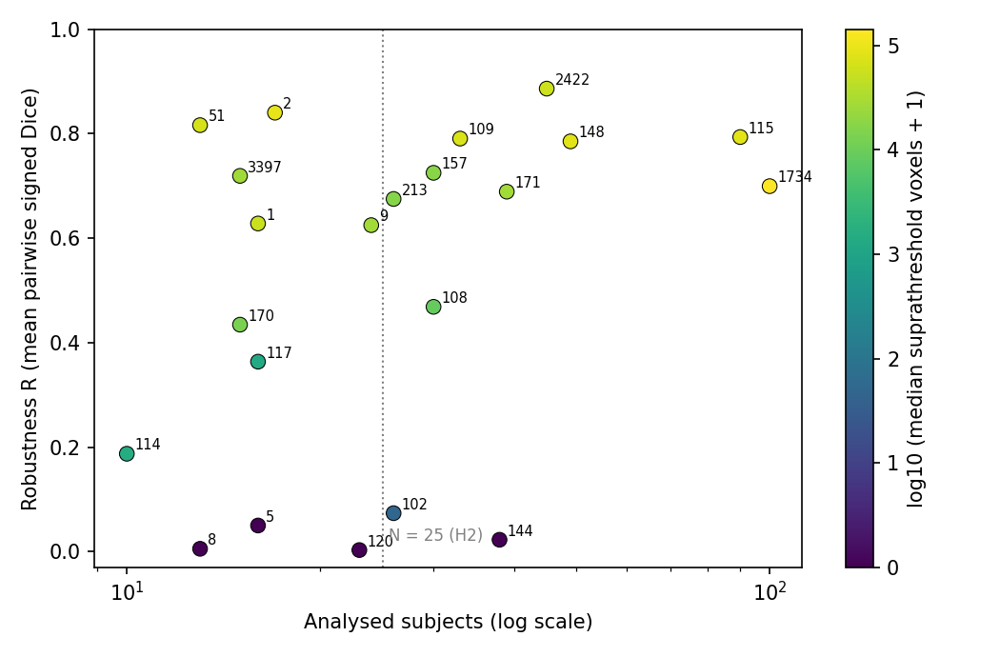

# How robust are OpenNeuro task-fMRI group maps to routine first-level choices? Median robustness is 0.65 over 22 datasets; sample size and tSNR explain only 14% of the variation, too uncertain to rule out more, while (post hoc) robustness tracks how much of the brain an effect reaches

*Each of 24 public OpenNeuro datasets with a published BIDS Stats Model and fMRIPrep derivatives (736 subjects) was
reanalysed 48 ways: smoothing (4, 6, 8 mm) × HRF (canonical, + derivative) × motion confounds (6P, 24P,
24P + aCompCor, 6P + spikes) × noise model (AR(1), OLS), keeping the spec's own contrast. Robustness is the mean
pairwise signed Dice of the 48 FDR-thresholded group maps. A reduced FSL arm compared software on up to 20 subjects
per dataset. The plan was committed before any image was read; ten deviations are listed below, one of which (D10,
two consistency fixes) was made after the first group results.*

**Verdict: H1 Inconclusive; H2 Inconclusive.**

- **H1 (log10 N and tSNR together explain robustness, R² > 0.4): Inconclusive.**
  - Across the 22 datasets where robustness is defined, R² = **0.14** (95% bootstrap interval 0.02 to 0.48). The upper
    bound passes 0.4, so the rule gives Inconclusive, but the estimate is low.
  - With the secondary threshold (|z| > 3.1, clusters ≥ 20 voxels) R² = 0.04 (0.003 to 0.34), and with the
    unthresholded correlation index in place of R, 0.02 (0.003 to 0.26): **both Refuted**.
  - On their own, robustness relates moderately to N (Spearman 0.37, p = 0.09, not significant) and not at all to
    tSNR (−0.01).
- **H2 (datasets with fewer than 25 subjects are majority-fragile, median R < 0.5): Inconclusive.**
  - The 11 small datasets have median R **0.43** (0.05 to 0.72). They split into two groups: six from 0.00 to 0.43 and
    five from 0.62 to 0.84 (ds000051, 13 subjects: 0.82; ds000002, 17: 0.84). The 11 larger datasets have median 0.70.
- **Robustness goes with how much of the brain passes the threshold** (post hoc; not one of the plan's predictors).
  - Robustness follows the median number of suprathreshold voxels across the 48 configurations (Spearman **0.89**).
    Part of that is built into Dice, which is unstable for small maps, but the unthresholded correlation index shows
    it too (0.62).
  - Six datasets have R below 0.2, all with weak effects: in four of them most configurations find no
    suprathreshold voxel at all, and two datasets (ds000052, ds000212) have none in any configuration. Thirteen
    datasets have R of 0.6 or more, and every one of those finds suprathreshold voxels in all 48 configurations.
  - In those 13, the strongest voxel of the most typical configuration (the one that correlates best with the rest)
    is suprathreshold with the same sign in all 48 configurations: what varies is the map's extent and its weaker
    regions.
- **Which choice matters:** pooled over datasets, the mean signed Dice between maps that differ only in that choice
  is 0.57 for smoothing, 0.58 for confounds, 0.71 for the HRF and 0.78 for the noise model. The means are pulled
  down by the weak-effect datasets, where any change can empty or flip a map; the per-dataset medians are 0.67,
  0.77, 0.89 and 0.92. Smoothing is the most influential choice in 11 of 22 datasets, confounds in 6, the HRF in 5,
  the noise model in none.
- **Software:** FSL and nilearn maps that differ only in software agree with signed Dice 0.69 (correlation 0.96) over
  20 datasets, against 0.65 for nilearn maps on the same subjects that differ only in confounds. Switching software
  moves a thresholded map about as much as switching motion confounds. (Bowring et al. 2019 found Dice of 0.00 to
  0.68 between whole AFNI, FSL and SPM pipelines; here only the first-level software differs, from 0.00 to 0.96.)
- **External check (G4):** the configuration closest to each spec (6 mm, canonical, 24P, AR(1)) correlates with the
  group map published by the spec's authors (FitLins, 5 mm by its workflow's default) at r ≥ 0.7 in **23 of 23** datasets (median **0.98**,
  thresholded Dice 0.82; ds003397 has no published map). Where that configuration finds nothing, the published map
  has at most 2 suprathreshold voxels. The matching FSL configuration, on up to 20 subjects, reaches r ≥ 0.7 in 21
  of 23 (median 0.91); the two below are null datasets (ds000144, 0.68; ds000212, 0.56), where half the sample gives
  a noise-dominated map.



## In plain terms

Brain-imaging studies make many small analysis choices before they show a map of "where the brain responded": how
much to blur the images, how to correct for head movement, how to model the slow blood-flow response, and how to
handle noise. Each choice is defensible, and published studies make them differently. We asked how much the final
group map depends on them.

We took 24 public experiments (736 people in total) for which a standard analysis had already been published (by
the openneuro_glmfitlins project, which wrote model specifications for many OpenNeuro datasets), and re-ran each one 48
ways, combining three amounts of blurring, two blood-flow models, four kinds of motion
correction and two noise models. For each experiment we then measured how much the 48 maps overlap, from 0 (no
agreement) to 1 (identical). The typical experiment scored 0.65: its strongest spot is found whichever way you
analyse it, but how far the map extends, and its weaker regions, change.

We expected bigger and cleaner datasets to be more robust, and small ones mostly fragile. The data do not settle
either expectation: in these 22 experiments, size and image quality account for only about 14% of the differences,
though with so few experiments we cannot rule out more. What goes with robustness, in a check we had not planned, is
how strong and widespread the effect is. Experiments with a strong, widespread response give largely the same map
every time, even with only 13 participants. Experiments with a weak response give maps that change a lot, or
vanish, depending on the choices. Overall, blurring and motion correction are the choices that move maps most. Switching to a different analysis
package changes a map about as much as switching motion correction. The version closest to the published standard analysis matched its
maps almost exactly (a typical correlation of 0.98), which suggests the pipeline itself is sound.

## What was asked

The lead (`extra-open-neuroimaging-reanalysis-openneuro-multiverse-robustness-atlas`) asked for a per-dataset
robustness score for OpenNeuro task-fMRI group maps under defensible first-level choices, and predicted that dataset
size and data quality would explain it (H1) and that small datasets would mostly be fragile (H2).
- **Analytic variability** in fMRI is well documented for single datasets: 70 teams analysing one dataset used 70
  different workflows, and their hypothesis tests varied sizeably even where their maps correlated highly
  (Botvinik-Nezer et al. 2020, NARPS); AFNI, FSL and SPM gave thresholded maps with Dice from 0.00 to 0.68 on three
  published datasets (Bowring et al. 2019). Multi-pipeline resources exist for one dataset at a time (Germani et al. 2025).
- **What was missing** (novelty search, 2026-11-10, in `plan.md`): a robustness score per dataset across many
  datasets, which this study provides for the 24 OpenNeuro datasets with published BIDS Stats Models
  (`demidenm/openneuro_glmfitlins`) and fMRIPrep derivatives.

## How it was done

- **Datasets** (`code/eligible.py`): the 57 BIDS Stats Model specs in `openneuro_glmfitlins` (commit `e624fec`); 24
  had MNI 2 mm fMRIPrep BOLD, confounds and brain masks in `s3://openneuro-derivatives` and at least 10 spec
  subjects (30 lacked derivatives, 3 had fewer than 10 subjects). One task per dataset, the spec's first contrast,
  at most 100 subjects (a seeded subset; only ds001734 has more).
- **First level** (`code/firstlevel.py`): pybids (pinned to the spec repository's commit) applies the spec's
  transformations to the events, after the spec authors' own events preparation (vendored, MIT). nilearn's
  `run_glm` fits each run; runs are combined by fixed effects. Confounds replace the spec's motion terms; fMRIPrep's
  cosine regressors stay in every configuration. Maps are stored per subject on the template's 235,840 brain voxels.
- **Software arm** (D3): FSL 6.0.7 (`film_gls`) on the first 20 subjects of each dataset's seeded order, at 6 mm,
  canonical HRF, each of the four confound sets, prewhitening off, matched against nilearn's OLS maps. ds003397 is
  excluded (D9).
- **Group level** (`code/grouplevel.py`): per configuration, a one-sample t-test across subjects within the voxels
  every subject covers; voxelwise FDR q < 0.05 two-sided (primary), |z| > 3.1 with ≥ 20-voxel clusters (secondary).
  R is the mean signed Dice over the 1,128 configuration pairs; pairs where both maps are empty are excluded and
  counted, and a pair with one empty map scores 0.
- **Predictors:** N, and tSNR (median over brain voxels of the temporal mean over standard deviation of the
  unsmoothed BOLD after the cosine regressors, median over runs).
- **Statistics** (`code/analyse.py`): OLS of R on log10 N and tSNR, 2,000 bootstrap resamples of datasets (seed
  20261110); for H2, 2,000 resamples of the datasets with N < 25.
- **Gates:** G2 coverage (`results/tables/coverage.json`): 736 of 739 subjects analysed (3 had no usable run), 2,038 of
  2,097 runs (45 without a design for the spec's contrast, 10 too short for the design, 4 covering less than 90% of
  their events), 409 FSL-arm subjects (13 skipped, D9). G3 (`results/plausibility.md`): three datasets and one
  subject traced and recomputed. G4: the FitLins check above (`code/external_check.py`); a first run compared the 6P
  configuration by mistake (the specs' motion terms are 24P, D2) and gave median r 0.91.

## Results

| Dataset | Task: contrast | N | tSNR | R | Correlation index | Configurations with any voxel | Most influential choice | FSL vs nilearn Dice | FitLins r |
|---|---|---|---|---|---|---|---|---|---|
| ds002422 | arithm: arithmeticvcontrol | 45 | 39 | 0.89 | 0.98 | 48/48 | smoothing | 0.96 | 0.99 |
| ds000002 | deterministicclassification: feedback | 17 | 76 | 0.84 | 0.97 | 48/48 | smoothing | 0.96 | 1.00 |
| ds000051 | abstractconcretejudgment: presentspanish | 13 | 87 | 0.82 | 0.97 | 48/48 | smoothing | 0.91 | 0.99 |
| ds000115 | letter0backtask: zeroback | 90 | 122 | 0.79 | 0.95 | 48/48 | confounds | 0.79 | 0.89 |
| ds000109 | theoryofmindwithmanualresponse: storybelief | 33 | 56 | 0.79 | 0.95 | 48/48 | smoothing | 0.93 | 0.99 |
| ds000148 | figure2backwith1backlures: distractcorr | 49 | 81 | 0.79 | 0.96 | 48/48 | confounds | 0.68 | 0.90 |
| ds000157 | passiveimageviewing: foodvnonfood | 30 | 143 | 0.73 | 0.96 | 48/48 | smoothing | 0.86 | 1.00 |
| ds003397 | checkerboard: checkerboard | 15 | 47 | 0.72 | 0.93 | 48/48 | smoothing | – | – |
| ds001734 | MGT: alltrials | 100 | 32 | 0.70 | 0.77 | 48/48 | hrf | 0.90 | 0.99 |
| ds000171 | music: musicvsounds | 39 | 75 | 0.69 | 0.93 | 48/48 | smoothing | 0.91 | 0.98 |
| ds000213 | socialcomparison: fatvscramble | 26 | 80 | 0.68 | 0.94 | 48/48 | smoothing | 0.73 | 0.99 |
| ds000001 | balloonanalogrisktask: pumpsvcontrol | 16 | 75 | 0.63 | 0.92 | 48/48 | hrf | 0.83 | 0.99 |
| ds000009 | balloonanalogrisktask: explodevcash | 24 | 88 | 0.62 | 0.94 | 48/48 | smoothing | 0.82 | 0.99 |
| ds000108 | Emotionregulation: StimReappNegvLookNeg | 30 | 93 | 0.47 | 0.88 | 48/48 | hrf | 0.77 | 0.96 |
| ds000170 | TrainedHandTrainedSequence: perf1 | 15 | 128 | 0.43 | 0.84 | 48/48 | confounds | 0.69 | 0.93 |
| ds000117 | facerecognition: allfacesvscrambled | 16 | 74 | 0.36 | 0.91 | 48/48 | smoothing | 0.76 | 0.94 |
| ds000114 | covertverbgeneration: task | 10 | 55 | 0.19 | 0.88 | 24/48 | confounds | 0.80 | 0.86 |
| ds000102 | flanker: inVcon | 26 | 62 | 0.07 | 0.65 | 32/48 | hrf | 0.44 | 0.98 |
| ds000005 | mixedgamblestask: paragain | 16 | 74 | 0.05 | 0.88 | 16/48 | confounds | 0.11 | 0.97 |
| ds000144 | emotionalfaces: angryvfearful | 38 | 117 | 0.02 | 0.82 | 5/48 | confounds | – | 0.99 |
| ds000008 | conditionalstopsignal: failstopcritvnoncrit | 13 | 78 | 0.01 | 0.87 | 6/48 | smoothing | 0.00 | 0.96 |
| ds000120 | antisaccadetaskwithfixedorder: allphaserewardvneutral | 23 | 74 | 0.00 | 0.53 | 3/48 | hrf | 0.00 | 0.96 |
| ds000052 | reversalweatherprediction: neg | 13 | 76 | – | 0.95 | 0/48 | – | – | 0.99 |
| ds000212 | dis: harmvpurity | 39 | 84 | – | 0.56 | 0/48 | – | – | 0.82 |

*R: mean pairwise signed Dice of the FDR-thresholded maps; undefined where no configuration has a suprathreshold
voxel. Most influential choice: the axis with the lowest mean Dice between configurations that differ only on it.
FSL: on up to 20 subjects, where both packages found suprathreshold voxels in at least one matched pair; "–" where
not run (ds003397) or both maps were empty. FitLins r: correlation of the spec-closest configuration (6 mm,
canonical, 24P, AR(1)) with the published group map. Full table: `results/tables/atlas.csv`.*

| Hypothesis or analysis | Estimate | 95% interval | Verdict |
|---|---|---|---|
| **H1:** R² of R on log10 N + tSNR (22 datasets) | **0.14** | 0.02–0.48 | **Inconclusive** |
| H1 with the secondary threshold (24 datasets) | 0.04 | 0.003–0.34 | Refuted |
| H1 with the correlation index (24) | 0.02 | 0.003–0.26 | Refuted |
| H1 with the task-positive contrast (14) | 0.12 | 0.01–0.79 | Inconclusive |
| **H2:** median R, N < 25 (11 datasets) | **0.43** | 0.05–0.72 | **Inconclusive** |
| H2 with the secondary threshold (12) | 0.55 | 0.40–0.69 | Inconclusive |


- **The task-positive contrast** (every condition of the primary contrast against baseline, equal weights) was
  expected to be more robust than the primary contrast in most datasets (G3). It is in 7 of 14. The four sharpest
  drops are designs with little separable baseline: modelled events cover 97% of the run in ds000213 (fixation is
  modelled), 99% in ds000171 and 88% in ds002422, and in ds000117 stimuli come every 3.2 s, so the summed regressor is
  nearly flat after convolution. The contrast code was checked; the expectation did not allow for such designs.
- **Effect of the deviations found after the first results (D10):** H1 moved from R² 0.145 (0.02 to 0.49) to 0.141
  (0.02 to 0.48), H2 not at all; ds000001's R rose from 0.56 to 0.63 with its restored runs, ds000108's from 0.43 to
  0.47 (`results/tables/primary_before_D10.json`).

## What this does and does not show

- **First-level choices only.** Preprocessing (fMRIPrep 21.0.1 to 23.0.2 as published by the OpenNeuro
  Preprocessing Team; the plan said 20.2, wrongly) and the group model (one-sample t-test, parametric FDR) are fixed; both are known to matter, so R is an upper bound on robustness to everything a lab
  might change.
- **One contrast per dataset**, the spec authors' first, which is not always the dataset's headline effect; a weak
  contrast in a dataset with strong effects elsewhere scores low here.
- **Dice depends on map size.** A small suprathreshold set gives an unstable Dice even when the unthresholded maps
  agree (ds000052: correlation index 0.95 and no suprathreshold voxel in any configuration). Part of the link between
  effect size and R is therefore built into the measure; the correlation index shows a weaker form of it (0.62).
- **Few datasets.** With 22 to 24 datasets, the H1 interval is wide (0.02 to 0.48), and H2 rests on 11 datasets; the
  data cannot rule out a moderate role for N.
- **Not a random sample of OpenNeuro:** datasets with published specs and fMRIPrep derivatives, mostly older and
  smaller studies.
- **The software comparison is partial:** FSL on up to 20 subjects, one smoothing level and HRF, prewhitening off,
  and not for ds003397.

## Process and deviations

All deviations are in `deviations.md`; D1–D9 were made before any group result.
- **D1:** the FSL software axis restored (FSL in a container), and compute moved from a borrowed machine to the lab's
  VM, before any data.
- **D2:** implementation details settled on one timing subject, among them that the specs' motion terms are 24P, so
  the spec-closest configuration is 24P, not 6P.
- **D3:** after the timing run (FSL: about 55 days projected), the FSL arm cut to 4 configurations on at most 20
  subjects per dataset; the planned 96-configuration index dropped.
- **D4:** the task-positive contrast added to the first level.
- **D5:** fixes during the run: an upstream bug in the vendored events preparation (ds000002), dataset-level JSON
  sidecars for the TR, and spec subjects without derivatives counted as dropped.
- **D6/D8:** a run-usability rule (scan must cover 90% of the events and have more volumes than the design), first
  too strict (D6), then revised (D8).
- **D7:** mechanical event fixes for three datasets (condition-name characters, a condition column, response times
  given as "n/a").
- **D9:** ds003397 (1,360-volume runs: 12 h and over 19 GB per subject in FSL) without the FSL arm; a memory
  estimate fixed after an out-of-memory crash that stopped the run for three days.
- **D10 (after the first group results):** the G2 reconciliation found 19 subjects whose partial runs were still
  dropped under D6's superseded rule, and one subject whose maps came from the timing run before D5–D8. D8's rule was
  applied to them, they were recomputed, and the affected datasets were rebuilt. The earlier results are kept.

## Reproducing it

```bash
python -m venv venv && venv/bin/pip install -r code/requirements.txt   # nilearn 0.11, pybids at the spec repo's commit
venv/bin/python -I code/eligible.py            # datasets and contrasts
docker build -t omv-fsl:6.0.7-slim code/docker   # FSL 6.0.7 first-level tools (FSL arm)
venv/bin/python -I code/driver.py 8            # first level, all subjects (streams from the public buckets)
venv/bin/python -I code/grouplevel.py ds000001 ...   # group maps per dataset
venv/bin/python -I code/analyse.py             # H1, H2, secondary analyses
venv/bin/python -I code/external_check.py      # FitLins comparison (G4)
venv/bin/python -I code/figures.py             # figures and tiles
```
