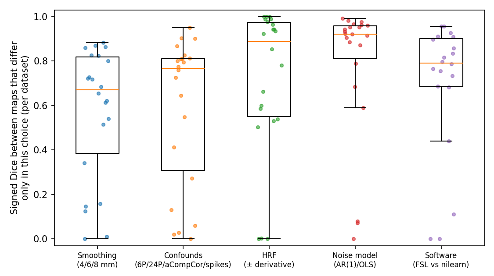

# How robust are OpenNeuro task-fMRI group maps to routine first-level choices? Median robustness is 0.65 over 22 datasets; sample size and tSNR explain only 14% of the variation, too uncertain to rule out more

*Each of 24 public OpenNeuro datasets with a published BIDS Stats Model and fMRIPrep derivatives (736 subjects) was
reanalysed 48 ways: smoothing (4, 6, 8 mm) × HRF (canonical, + derivative) × motion confounds (6P, 24P,
24P + aCompCor, 6P + spikes) × noise model (AR(1), OLS), keeping the spec's own contrast. Robustness R is the mean
pairwise signed Dice of the 48 FDR-thresholded group maps. A reduced FSL arm compared software on up to 20 subjects
per dataset. The plan was committed before any image was read; eleven deviations are listed below. Two were made after
the first group results: D10 (two consistency fixes) and D11 (fixes after the independent review: in three datasets
the HRF choice had not actually been varied, and one dataset had no drift regressors; all four were rerun).*

**Verdict: H1 Inconclusive; H2 Inconclusive.**

- **H1 (log10 N and tSNR together explain robustness, R² > 0.4): Inconclusive.**
  - Across the 22 datasets where robustness is defined, R² = **0.14** (95% bootstrap interval 0.02 to 0.48; adjusted
    for two predictors, 0.05). The upper bound passes 0.4, so the rule gives Inconclusive, but the estimate is low.
  - With the secondary threshold (|z| > 3.1, clusters ≥ 20 voxels) R² = 0.05 (0.00 to 0.34), and with the
    unthresholded correlation index in place of R, 0.03 (0.00 to 0.27): **both Refuted**.
  - Setting R to 0 for the two datasets where it is undefined (no configuration finds a voxel; the plan has no rule
    for this) gives 0.12 (0.01 to 0.45): still Inconclusive.
  - On their own, robustness has a non-significant association with N (Spearman 0.38, p = 0.08) and none
    with tSNR (0.02).
- **H2 (datasets with fewer than 25 subjects are majority-fragile, median R < 0.5): Inconclusive.**
  - The 11 small datasets have median R **0.43** (0.05 to 0.72); with R set to 0 for ds000052, 0.40 (0.03 to 0.67,
    12 datasets). Their values spread widely: six from 0.00 to 0.43 and five from 0.62 to 0.84 (ds000051, 13
    subjects: 0.82; ds000002, 17: 0.84). The 11 larger datasets have median 0.70.
- **What R measures.** A pair of maps with one empty map scores 0 (the plan's rule), so where some configurations
  find no suprathreshold voxel, R mostly measures how many configurations cross the FDR threshold at all (ds000120:
  3 of 48, R 0.003). Where all 48 find voxels, it measures how far the maps overlap.
  - Six datasets have R below 0.2; in four of them most configurations find no suprathreshold voxel, and two more
    (ds000052, ds000212) have none in any configuration. All 13 datasets with R of 0.6 or more find voxels in all 48
    configurations, and in each of them the strongest voxel of the most typical configuration (the one that
    correlates best with the rest) is suprathreshold with the same sign in all 48: what varies is the map's extent
    and its weaker regions.
  - Post hoc, R follows the median number of suprathreshold voxels (Spearman 0.89). This is largely expected from
    how Dice and the empty-map rule work, so it describes the results rather than explaining them. Among the 16
    datasets with voxels in all 48 configurations it is 0.73, still partly by construction. The correlation index
    rises with signal strength in the same way (0.63 against extent), so it is not an independent check.
- **Which choice matters:** pooled over datasets, the mean signed Dice between maps that differ only in that choice
  is 0.57 for smoothing, 0.59 for confounds, 0.71 for the HRF and 0.78 for the noise model. The means are pulled
  down by the weak-effect datasets, where any change can empty or flip a map; the per-dataset medians are 0.67,
  0.78, 0.89 and 0.92. Smoothing is the most influential choice in 11 of 22 datasets, confounds in 6, the HRF in 5,
  the noise model in none. (6P and 6P + spikes coincide for a subject with no volume above 0.5 mm framewise
  displacement, so some confound pairs are identical by design.)
- **Software:** on the 18 datasets where both comparisons are defined, FSL and nilearn maps that differ only in
  software agree with mean signed Dice **0.77** (median 0.81), against **0.65** (median 0.74) for nilearn maps on the
  same subjects that differ only in confounds; software agreement is the higher in 16 of 18. On those 18 datasets, switching first-level
  software moved thresholded maps less than switching motion confounds. In the other two datasets (ds000008,
  ds000120) one package finds suprathreshold voxels where the other finds none (Dice 0.00), and every nilearn
  confound pair is empty. "Software" here bundles several differences: SUSAN against Gaussian smoothing, FSL's
  double-gamma against SPM's HRF, FSL's `-bptf` high-pass against cosine regressors, and grand-mean against voxelwise
  scaling. (Bowring et al. 2019 found Dice of 0.00 to 0.68 between whole AFNI, FSL and SPM pipelines; here, with
  preprocessing and the group model shared, 0.00 to 0.96.)
- **External check (G4):** the configuration closest to each spec (6 mm, canonical, 24P, AR(1)) correlates with the
  group map published by the openneuro_glmfitlins project (FitLins, 5 mm by its workflow's default) at r ≥ 0.7 in
  **23 of 23** datasets (median **0.98**, thresholded Dice 0.82; ds003397 has no published map). For ds000148, whose
  spec has no motion or drift terms, the 24P configuration with cosine regressors is not close to the spec; its r
  (0.91) and Dice (0.71) are among the lowest of the strong-effect datasets.
  - Where that configuration finds nothing, the published map has at most 2 suprathreshold voxels. The other way
    round, in ds000114 ours has 11,342 and the published map none (r 0.86): the published maps are per session (the
    check uses the retest session), and ours pools both sessions' runs.
  - The matching FSL configuration, on up to 20 subjects, reaches r ≥ 0.7 in 21 of 23 (median 0.91); the two below
    are null datasets (ds000144, 0.68; ds000212, 0.56), where half the sample gives a noise-dominated map.
  - The check shows that the specs were applied as their authors applied them, for one of the 48 configurations. The
    reference shares the specs, the fMRIPrep derivatives and the GLM engine (FitLins uses nilearn), so it cannot
    detect a defect common to both, such as the two the review found (D11).


## In plain terms

Brain-imaging studies make many small analysis choices before they show a map of "where the brain responded": how
much to blur the images, how to correct for head movement, how to model the slow blood-flow response, and how to
handle noise. Each choice is defensible, and published studies make them differently. We asked how much the final
group map depends on them.

We took 24 public experiments (736 people in total) for which a standard analysis had already been published (by
the openneuro_glmfitlins project, which wrote model specifications for many OpenNeuro datasets), and re-ran each one
48 ways, combining three amounts of blurring, two blood-flow models, four kinds of motion correction and two noise
models. For each experiment we then measured how much the 48 maps overlap, from 0 (no agreement) to 1 (identical).
The typical experiment scored 0.65.

We expected bigger and cleaner datasets to be more robust, and small ones mostly fragile. The data do not settle
either expectation: in these 22 experiments, size and image quality account for only about 14% of the differences,
though with so few experiments we cannot rule out more. In a pattern we had not planned to look for, the maps
that hold up come from experiments with a strong, widespread response: their strongest spot is found whichever way they are analysed, even with 13 participants, and
what changes is how far the map extends. Experiments with a weak response give maps that change a lot, or vanish,
depending on the choices. That pattern is partly built into how overlap is measured, so it describes the results
rather than explaining them. Blurring and motion correction are the choices that move maps most; in most experiments, switching to
a different analysis package moved maps less than switching motion correction. The version closest to the published
standard analysis matched it closely (a typical correlation of 0.98), which shows we applied the published models as
their authors did, not that both analyses are right.

An independent review found that in three experiments one of the four choices had not actually been varied, and
that one experiment had been analysed without a filter for slow drifts. These were fixed and rerun, and the numbers barely moved. The review also found
that our first comparison of analysis packages used mismatched sets of experiments; done properly, a different
package moves maps less than a different motion correction, not about as much as we first wrote.

## What was asked

The lead (`extra-open-neuroimaging-reanalysis-openneuro-multiverse-robustness-atlas`) asked for a per-dataset
robustness score for OpenNeuro task-fMRI group maps under defensible first-level choices, and predicted that dataset
size and data quality would explain it (H1) and that small datasets would mostly be fragile (H2).
- **Analytic variability** in fMRI is well documented for single datasets: 70 teams analysing one dataset used 70
  different workflows, and their hypothesis tests varied sizeably even where their maps correlated highly
  (Botvinik-Nezer et al. 2020, NARPS); AFNI, FSL and SPM gave thresholded maps with Dice from 0.00 to 0.68 on three
  published datasets (Bowring et al. 2019). Multi-pipeline resources exist for one dataset at a time (Germani et al.
  2025), and other recent work curates pipelines into a codebase for exploring variability (Atay et al. 2026,
  preprint).
- **What was missing** (novelty search, 2026-11-10, in `plan.md`): a robustness score per dataset across many
  datasets, which this study provides for the 24 OpenNeuro datasets with published BIDS Stats Models
  (`demidenm/openneuro_glmfitlins`) and fMRIPrep derivatives.

## How it was done

- **Datasets** (`code/eligible.py`): the 57 BIDS Stats Model specs in `openneuro_glmfitlins` (commit `e624fec`); 24
  had MNI 2 mm fMRIPrep BOLD, confounds and brain masks in `s3://openneuro-derivatives` and at least 10 spec
  subjects (30 lacked derivatives, 3 had fewer than 10 subjects). One task per dataset, the spec's first contrast,
  at most 100 subjects (a seeded subset; only ds001734 has more).
- **First level** (`code/firstlevel.py`): pybids (pinned to the spec repository's commit) applies the spec's
  transformations to the events, after the spec authors' own events preparation (vendored, MIT). nilearn's
  `run_glm` fits each run; runs are combined by fixed effects.
  - Confounds replace the spec's motion terms. fMRIPrep's cosine regressors stay in every configuration; for
    ds000148, whose spec lists none, they are appended from the confounds file (D11).
  - The HRF derivative is set explicitly at both levels (D11: two specs switch it on themselves).
  - Smoothing (nilearn's Gaussian) is applied to the whole volume and the result masked, not within the brain mask
    as the plan says (D11).
  - Maps are stored per subject on the template's 235,840 brain voxels.
- **Software arm** (D3): FSL 6.0.7 (`film_gls`) on the first 20 subjects of each dataset's seeded order, at 6 mm,
  canonical HRF, each of the four confound sets, prewhitening off, matched against nilearn's OLS maps. ds003397 is
  excluded (D9).
- **Group level** (`code/grouplevel.py`): per configuration, a one-sample t-test across subjects, written with scipy
  (equivalent to nilearn's `SecondLevelModel` with an intercept, which the plan names; D11), within the voxels every
  subject covers (44% of the template's brain voxels in ds002422, where every subject has partial coverage, to 93%;
  median 82%). Voxelwise FDR q < 0.05 two-sided (primary), |z| > 3.1 with ≥ 20-voxel clusters (secondary). R is the
  mean signed Dice over the 1,128 configuration pairs; pairs where both maps are empty are excluded and counted, and
  a pair with one empty map scores 0. The two datasets where every pair is empty have no R and are left out of H1
  and H2 (D11), with R := 0 as a sensitivity analysis.
- **Predictors:** N, and tSNR (median over brain voxels of the temporal mean over standard deviation of the
  unsmoothed BOLD after the cosine regressors, median over runs).
- **Statistics** (`code/analyse.py`): OLS of R on log10 N and tSNR, 2,000 bootstrap resamples of datasets (seed
  20261110); for H2, 2,000 resamples of the datasets with N < 25.
- **Gates:**
  - G2 coverage (`results/tables/coverage.json`): 736 of 739 subjects analysed (3 had no usable run); 2,038 of
    2,097 runs (45 outside the spec's run list, 10 too short for the design, 4 covering less than 90% of their
    events); 407 FSL-arm subjects used (ds003397's 15 excluded, D9; 2 of them have FSL maps from before D9,
    unused).
  - G3 (`results/plausibility.md`): three datasets and one subject traced and recomputed, and, added after the
    review, a check that configurations differing on an axis give different maps (`code/axis_check.py`; it flags
    exactly the three datasets the review found before D11, and none after).
  - G4: the FitLins check above (`code/external_check.py`); a first run compared the 6P configuration by mistake
    (the specs' motion terms are 24P, D2; ds000148's spec has none) and gave median r 0.91.

## Results

| Dataset | Task: contrast | N | tSNR | Brain covered | R | Correlation index | Configurations with any voxel | Most influential choice | FSL vs nilearn Dice | FitLins r |
|---|---|---|---|---|---|---|---|---|---|---|
| ds002422 | arithm: arithmeticvcontrol | 45 | 39 | 44% | 0.89 | 0.98 | 48/48 | smoothing | 0.96 | 0.99 |
| ds000002 | deterministicclassification: feedback | 17 | 76 | 86% | 0.84 | 0.97 | 48/48 | smoothing | 0.96 | 0.99 |
| ds000051 | abstractconcretejudgment: presentspanish | 13 | 87 | 84% | 0.82 | 0.97 | 48/48 | smoothing | 0.91 | 0.99 |
| ds000148 | figure2backwith1backlures: distractcorr | 49 | 99 | 78% | 0.81 | 0.96 | 48/48 | confounds | 0.77 | 0.91 |
| ds000115 | letter0backtask: zeroback | 90 | 122 | 77% | 0.79 | 0.95 | 48/48 | confounds | 0.79 | 0.89 |
| ds000109 | theoryofmindwithmanualresponse: storybelief | 33 | 56 | 82% | 0.79 | 0.95 | 48/48 | smoothing | 0.93 | 0.99 |
| ds000157 | passiveimageviewing: foodvnonfood | 30 | 143 | 77% | 0.73 | 0.96 | 48/48 | smoothing | 0.86 | 1.00 |
| ds003397 | checkerboard: checkerboard | 15 | 47 | 84% | 0.72 | 0.93 | 48/48 | smoothing | – | – |
| ds001734 | MGT: alltrials | 100 | 32 | 92% | 0.70 | 0.77 | 48/48 | HRF | 0.90 | 0.99 |
| ds000171 | music: musicvsounds | 39 | 75 | 91% | 0.69 | 0.93 | 48/48 | smoothing | 0.91 | 0.98 |
| ds000213 | socialcomparison: fatvscramble | 26 | 80 | 79% | 0.68 | 0.94 | 48/48 | smoothing | 0.73 | 0.99 |
| ds000001 | balloonanalogrisktask: pumpsvcontrol | 16 | 75 | 87% | 0.63 | 0.92 | 48/48 | HRF | 0.83 | 0.99 |
| ds000009 | balloonanalogrisktask: explodevcash | 24 | 88 | 80% | 0.62 | 0.94 | 48/48 | smoothing | 0.82 | 0.99 |
| ds000108 | Emotionregulation: StimReappNegvLookNeg | 30 | 93 | 71% | 0.47 | 0.88 | 48/48 | HRF | 0.77 | 0.96 |
| ds000170 | TrainedHandTrainedSequence: perf1 | 15 | 128 | 79% | 0.43 | 0.84 | 48/48 | confounds | 0.69 | 0.93 |
| ds000117 | facerecognition: allfacesvscrambled | 16 | 74 | 93% | 0.36 | 0.91 | 48/48 | smoothing | 0.76 | 0.94 |
| ds000114 | covertverbgeneration: task | 10 | 55 | 76% | 0.19 | 0.88 | 24/48 | confounds | 0.80 | 0.86 |
| ds000102 | flanker: inVcon | 26 | 62 | 89% | 0.07 | 0.65 | 32/48 | HRF | 0.44 | 0.98 |
| ds000005 | mixedgamblestask: paragain | 16 | 74 | 88% | 0.05 | 0.88 | 16/48 | confounds | 0.11 | 0.97 |
| ds000144 | emotionalfaces: angryvfearful | 38 | 117 | 71% | 0.02 | 0.82 | 5/48 | confounds | – | 0.99 |
| ds000008 | conditionalstopsignal: failstopcritvnoncrit | 13 | 78 | 88% | 0.01 | 0.87 | 6/48 | smoothing | 0.00 | 0.96 |
| ds000120 | antisaccadetaskwithfixedorder: allphaserewardvneutral | 23 | 74 | 82% | 0.00 | 0.53 | 3/48 | HRF | 0.00 | 0.96 |
| ds000052 | reversalweatherprediction: neg | 13 | 76 | 82% | – | 0.95 | 0/48 | – | – | 0.99 |
| ds000212 | dis: harmvpurity | 39 | 84 | 77% | – | 0.56 | 0/48 | – | – | 0.82 |

*Generated by `code/report_table.py` from `results/tables/atlas.csv` and `external_fitlins.csv`. Brain covered: the
share of the template's 235,840 brain voxels inside every subject's coverage, where R is computed (ds002422's R is
for 44% of the brain). R: mean pairwise signed Dice of the FDR-thresholded maps; undefined where no configuration has
a suprathreshold voxel. Most influential choice: the axis with the lowest mean Dice between configurations that
differ only on it. FSL: on up to 20 subjects, where both packages found suprathreshold voxels in at least one matched
pair; "–" where not run (ds003397) or both maps were empty. FitLins r: correlation of the spec-closest configuration
(6 mm, canonical, 24P, AR(1)) with the published group map.*

| Hypothesis or analysis | Estimate | 95% interval | Verdict |
|---|---|---|---|
| **H1:** R² of R on log10 N + tSNR (22 datasets) | **0.14** (adjusted 0.05) | 0.02–0.48 | **Inconclusive** |
| H1, undefined R set to 0 (24) | 0.12 | 0.01–0.45 | Inconclusive |
| H1 with the secondary threshold (24 datasets) | 0.05 | 0.00–0.34 | Refuted |
| H1 with the correlation index (24) | 0.03 | 0.00–0.27 | Refuted |
| H1 with the task-positive contrast (14) | 0.12 | 0.01–0.79 | Inconclusive |
| **H2:** median R, N < 25 (11 datasets) | **0.43** | 0.05–0.72 | **Inconclusive** |
| H2, undefined R set to 0 (12) | 0.40 | 0.03–0.67 | Inconclusive |
| H2 with the secondary threshold (12) | 0.55 | 0.40–0.69 | Inconclusive |



- **The task-positive contrast** (every condition of the primary contrast against baseline, equal weights) was
  expected to be more robust than the primary contrast in most datasets (G3). It is in 7 of 14 (6 where both are
  defined, plus ds000212, whose primary contrast finds no voxel), identical in ds000051 (its contrast already weights
  its conditions equally) and less robust in 6.
  - The draft explained the drops by designs with little rest. A post hoc look across the 13 datasets with both
    defined (`code/g3_baseline.py`) is consistent with that, but weak. The gap between the two contrasts goes with
    how much the summed, convolved event train varies over the run (Spearman 0.66, p = 0.01 uncorrected, the better
    of two measures tried; flat means little rest), less clearly with the share of the run covered by events (−0.40,
    p = 0.17). But the task-positive R itself does not go with flatness (−0.03); part of the gap's association comes
    from the primary R, which tends to be higher in the flatter designs (−0.48), and the gap is bounded near 0 and 1
    (holding the primary R fixed, the gap's association is 0.55). Both measures are approximate: they use every row
    of the events files, not the spec's modelled subset, and the first 10 subjects of each dataset.
  - ds000171, ds000213 and ds002422 fit: events cover 88% to 99% of the run, and their summed regressors are among
    the four flattest of the 13 (the fourth is ds000008, where both contrasts score near 0). ds000117, the fourth
    sharp drop, does not: its stimuli are brief and leave rest by both measures,
    and its task-positive maps are almost all empty (2 of 48 configurations find a voxel) for a reason not found.
- **Effect of the deviations made after the first results:**
  - D10 moved H1 from R² 0.145 (0.02 to 0.49) to 0.141 (0.02 to 0.48) and H2 not at all; ds000001's R rose from
    0.56 to 0.63 with its restored runs, ds000108's from 0.43 to 0.47 (`results/tables/primary_before_D10.json`).
  - D11 left H1 at 0.141 (upper bound 0.478 to 0.484) and H2 at 0.43. ds000148, now with drift regressors, rose from
    R 0.79 to 0.81 (tSNR 81 to 99, FSL Dice 0.68 to 0.77, FitLins r 0.90 to 0.91). In the three datasets where the
    HRF had not been varied, the derivative barely changes the maps (HRF-axis Dice 0.98 to 1.00), and their R is
    unchanged to two decimals (`results/tables/primary_before_D11.json`, `before_D11/`).

## What this does and does not show

- **First-level choices only.** Preprocessing (fMRIPrep 21.0.1 to 23.0.2 as published by the OpenNeuro
  Preprocessing Team, `results/tables/fmriprep_versions.csv`; the plan said 20.2, wrongly) and the group model
  (one-sample t-test, parametric FDR) are fixed; both are known to matter, so R probably overstates robustness to
  everything a lab might change.
- **One contrast per dataset**, the spec authors' first, which is not always the dataset's headline effect; a weak
  contrast in a dataset with strong effects elsewhere scores low here.
- **R depends on map size.** Dice is unstable for small suprathreshold sets, and the empty-map rule makes R mostly a
  count of the configurations that cross the threshold when some do not. A dataset can agree well before
  thresholding and still score low or have no R (ds000052: correlation index 0.95, no suprathreshold voxel in any
  configuration). The link between effect strength and R is therefore largely built into the measure.
- **Few datasets.** With 22 to 24 datasets, the H1 interval is wide (0.02 to 0.48), and H2 rests on 11 datasets; the
  data cannot rule out a moderate role for N.
- **Not a random sample of OpenNeuro:** datasets with published specs and fMRIPrep derivatives, mostly early OpenNeuro
  accessions (21 of 24 are ds000xxx), with a median of 25 subjects.
- **The software comparison is partial and bundled:** FSL on up to 20 subjects, one smoothing level and HRF,
  prewhitening off, not for ds003397, and differing from nilearn in smoothing kernel, HRF shape, high-pass filter
  and scaling at once.
- **The external check covers one configuration** against a reference built from the same specs, derivatives and
  GLM engine; it confirms the specs were applied as intended, not that the pipeline is free of shared defects.
- **Smoothing before masking** blurs signal from outside the brain into edge voxels, in every configuration (more
  at 8 mm than at 4 mm).

## Process and deviations

All deviations are in `deviations.md`; D1–D9 were made before any group result.
- **D1:** the FSL software axis restored (FSL in a container), and compute moved from a borrowed machine to the lab's
  VM, before any data.
- **D2:** implementation details settled on one timing subject, among them that the specs' motion terms are 24P, so
  the spec-closest configuration is 24P, not 6P.
- **D3:** after the timing run (FSL: about 55 days projected), the FSL arm cut to 4 configurations on at most 20
  subjects per dataset; the planned 96-configuration index dropped.
- **D4:** the task-positive contrast added to the first level.
- **D5:** fixes during the run: an upstream bug in the vendored events preparation (ds000002), dataset-level JSON
  sidecars for the TR, and spec subjects without derivatives counted as dropped.
- **D6/D8:** a run-usability rule (scan must cover 90% of the events and have more volumes than the design), first
  too strict (D6), then revised (D8).
- **D7:** mechanical event fixes for three datasets (condition-name characters, a condition column, response times
  given as "n/a").
- **D9:** ds003397 (1,360-volume runs: 12 h and over 19 GB per subject in FSL) without the FSL arm; a memory
  estimate fixed after an out-of-memory crash that stopped the run for three days.
- **D10 (after the first group results):** the G2 reconciliation found 19 subjects whose partial runs were still
  dropped under D6's superseded rule, and one subject whose maps came from the timing run before D5–D8. D8's rule was
  applied to them, they were recomputed, and the affected datasets were rebuilt. The earlier results are kept.
- **D11 (after the independent review):** in ds000002 and ds003397 the spec itself switches the HRF derivative on,
  and in ds000213 the spec names its regressors so that no derivative was added; in all three the "canonical" and
  "+ derivative" maps were identical. ds000148's spec lists no drift regressors, so it had run without a high-pass
  filter. The code was fixed and the nilearn arm of all four datasets rerun (FSL maps kept). Departures from the plan
  that had not been recorded are now listed: the scipy group test, smoothing before masking, leaving out the two
  datasets without R, and the wording of the 45 runs outside the spec's run list. The software comparison is now
  made on matched datasets. The earlier results are kept.

## Reproducing it

```bash
python -m venv venv && venv/bin/pip install -r code/requirements.txt   # nilearn 0.11, pybids at the spec repo's commit
venv/bin/python -I code/eligible.py            # datasets and contrasts
docker build -t omv-fsl:6.0.7-slim code/docker   # FSL 6.0.7 first-level tools (FSL arm)
venv/bin/python -I code/driver.py 8            # first level, all subjects (streams from the public buckets)
venv/bin/python -I code/grouplevel.py ds000001 ...   # group maps per dataset
venv/bin/python -I code/analyse.py             # H1, H2, secondary analyses
venv/bin/python -I code/external_check.py      # FitLins comparison (G4)
venv/bin/python -I code/coverage_final.py      # coverage (G2)
venv/bin/python -I code/axis_check.py          # axes give different maps (G3)
venv/bin/python -I code/g3_trace.py            # traced units (G3)
venv/bin/python -I code/g3_baseline.py         # task-positive gap against design rest (G3, post hoc)
venv/bin/python -I code/figures.py             # figures and tiles
venv/bin/python -I code/report_table.py        # the report's table
```
