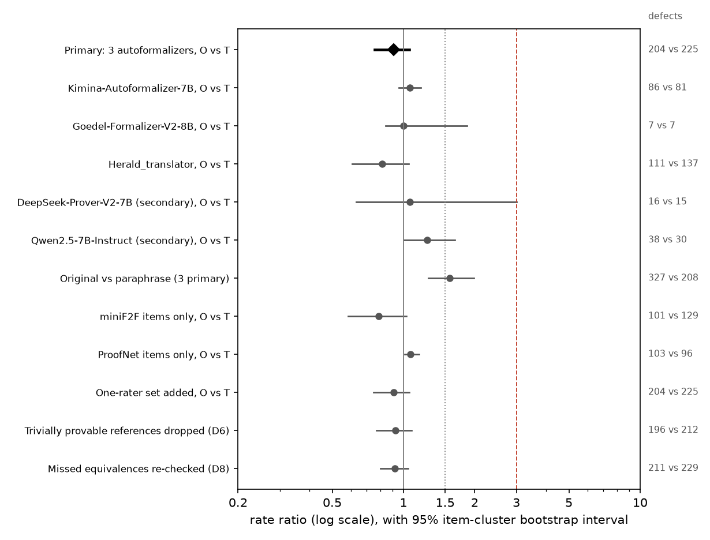
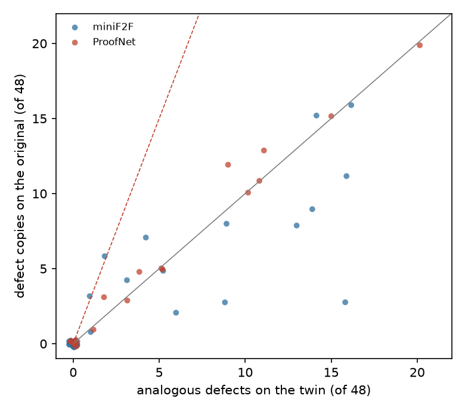
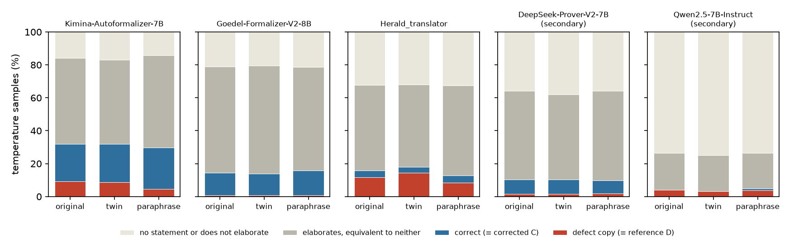

# Do AI autoformalizers copy the known mistakes in miniF2F and ProofNet?

*A preregistered error-copying test. Open autoformalizers were given benchmark problems whose official Lean statements
have documented mistakes, and number-perturbed twins of the same problems, and the Lean kernel decided which outputs
reproduce the mistake.*

Run directory: `research-lab/runs/formal-math-autoformalizer-error-copying` · Preregistration: [`plan.md`](plan.md)
(commit 9afb62b) · Departures from it: [`deviations.md`](deviations.md) (D1-D8) · Independent review:
[`review/review.md`](review/review.md), confirmation pass [`review/confirmation.md`](review/confirmation.md) · 12 October
2026, revised after review

**Verdict: Refuted.** Three open autoformalizers reproduce the benchmarks' documented defects in 7.2% of samples on the
original problems and the analogous defect in 7.9% on number-perturbed twins. That is a rate ratio of 0.91 (95% CI
0.76-1.06), where the hypothesis needed at least 3. So the copying is not recall tied to a problem's numbers. It is not
evidence against memorized benchmark statements, though. One model, Kimina, reproduces the ProofNet Lean port's header
lines and, on one problem, a wrong constant that only the port contains, on twins as often as on originals. That is
memory of a statement's template, which this design cannot detect.

## In plain terms

AI "autoformalizers" translate a maths problem written in words into Lean, a language a computer can check. Two
benchmarks they are tested on, miniF2F and ProofNet, have official Lean versions that were later found to contain many
mistakes, such as a missing condition or a claim weaker than the problem's. A model that had memorised those versions
might reproduce their mistakes.

We tested 59 such problems that contain numbers. For each we made a twin with different numbers and carried the mistake
over to the twin's official-style version. A model recalling an official statement together with its numbers should
copy the mistake on the original but not on the twin. A model falling into a common trap should make it on both.

Three autoformalizers wrote 16 versions of every problem and every twin. The Lean checker certified which ones say the
same thing as the flawed official statement: 7.2% of attempts on originals and 7.9% on twins. The prediction was at
least three times as often on originals. **It is refuted.**

That rules out recall tied to the numbers, but not memory of a statement's shape. One model, Kimina, shows clear signs
of that. In about half of its answers to ProofNet problems it writes the exact header lines of the official ProofNet
Lean files, which nothing in the problem asks for. On one problem it repeats a wrong constant from the official version
on the twin as well. The other four models never write those headers.

Rewording the problems cut Kimina's copied mistakes by half, where changing the numbers did not. Herald's fell too,
though on one problem only because the reworded text led it to write something Lean rejects.

## What was done

### The defect catalogue

**Pairs of statements.** Each candidate item pairs a defective original formal statement D with a corrected reference C
for the same informal problem N (plan 2.1):

| Source | Defective original D | Corrected reference C | Informal input N |
|---|---|---|---|
| miniF2F | the v1 Lean 4 statement (DeepSeek-Prover-V1.5's `minif2f.jsonl`) | the miniF2F-v2s statement of the same name | the v1 informal statement |
| ProofNet | the original Lean 4 port (DeepSeek-Prover-V1.5's `proofnet.jsonl`) | the ProofNet# statement | the original informal statement |

An item is a candidate if D and C differ after normalisation: 228 of 488 miniF2F items and 147 of the 369 matched
ProofNet items (D1 item 5).

**Lean filters** (plan 2.2; Lean 4.9 with DeepSeek-Prover-V1.5's Mathlib, autoImplicit off). Both statements must
elaborate, and they must not be certified equivalent in both directions by the tactic portfolio (20 s per direction).
Every pair that survived elaborated in Lean 4.9, the first environment, so the Lean 4.15 fallback was never used.

| Source | Candidates | Do not elaborate | Certified equivalent (rewrites) | Kept |
|---|---:|---:|---:|---:|
| miniF2F | 228 | 8 | 42 | 178 |
| ProofNet | 147 | 32 | 4 | 111 |
| Negative controls | 8 | 0 | 0 | 8 |

**Blind defect tagging** (plan 2.3). Two raters tagged all 289 kept pairs: a Claude Opus 5.5 subagent (rater A) and a
Claude Fable 5.1 subagent (rater B). Each saw only the informal statement and the two formal statements, labelled A
and B in a seeded random order, with the theorem name replaced by `X`. Neither knew which statement was the original.

- Agreement on whether D is faithful: Cohen's κ = 0.957.
- **Included** (both raters: D unfaithful and C faithful): **129 items**, 46 miniF2F and 83 ProofNet.
- **One-rater set** (exactly one rater says so): 6 items.
- The raters gave the same defect category to 120 of the 129 included items (93%).

### Twins and paraphrases

**Number-perturbed twins** (plan 3.1). A builder subagent (Claude Opus 5.5) was given N, D, C and the raters' defect
reasons. It changed the problem's numbers consistently in all three, recomputed the answer with a script, and carried
the defect over to the twin's defective statement D′. For example:

> **N:** What is the smallest integer greater than 10 that is both a perfect square and a perfect cube? Show that it
> is 64.
>
> **D:** `(n : ℕ) (h₀ : 10 ≤ n) (h₁ : ∃ x, x ^ 2 = n) (h₂ : ∃ t, t ^ 3 = n) : 64 ≤ n`. This is only a lower bound: it
> does not say that 64 qualifies.
>
> **N′:** What is the smallest integer greater than 100 that is both a perfect square and a perfect cube? Show that it
> is 729.
>
> **D′:** `(n : ℕ) (h₀ : 100 ≤ n) (h₁ : ∃ x, x ^ 2 = n) (h₂ : ∃ t, t ^ 3 = n) : 729 ≤ n`.

A twin was kept only if it passed five scripted checks (plan 3.1):

1. D′ and the corrected twin C′ elaborate.
2. D′ and C′ are not certified equivalent, so the defect survives.
3. The three diffs (N→N′, D→D′, C→C′) change only numerals, apart from a declared answer span.
4. The answer script reruns to the stated answer.
5. The portfolio cannot refute C′.

**Twin attrition.**

- Builders built 63 twins and declined 72 items, almost all because the problem has no numerical parameter to change.
  That is true of most ProofNet items, which are abstract statements about groups, rings and spaces: 64 of the 83
  included ProofNet items have no twin.
- All 63 built twins passed all five checks.
- **The primary set is the 59 included items with a valid twin: 40 miniF2F and 19 ProofNet.** It is above the plan's
  floor of 40 items, below which the power calculation would not hold.
- Four more twins belong to the one-rater set (sensitivity analysis).

**Meaning-preserving paraphrases** (plan 3.2; secondary). Another subagent reworded every one of the 135 informal
statements, keeping every number, object and claim. A blind Fable 5.1 judge, shown the two texts in random order,
judged all 135 to state the same problem.

**Negative controls.** These are the eight miniF2F items whose v2 edit *introduced* a defect (minif2f-v2-audit,
`v2_miscorrection`). Here D is the defective v2s statement and C the faithful v1 statement. No model in the study can
have seen v2, so outputting those defects estimates the natural rate of those particular mistakes.

The catalogue was committed and frozen (commit d0f4aea) before any model was sampled.

### Models and sampling

| Model | Role | Prompt |
|---|---|---|
| Kimina-Autoformalizer-7B | primary | model card |
| Goedel-Formalizer-V2-8B | primary | model card (thinks first; 16,384-token limit) |
| Herald_translator | primary | repository template |
| DeepSeek-Prover-V2-7B | secondary | a plain instruction (4,096-token limit, D4) |
| Qwen2.5-7B-Instruct | secondary, general-model control | the same instruction with three handwritten examples |

- **Neutral theorem name.** It was always `my_favorite_theorem`. A benchmark name such as `mathd_algebra_478` would
  itself be a memorization cue that twins cannot carry.
- **Release dates.** Every model was released before miniF2F-v2 (November 2025).
- **Samples.** For every model, item and condition there were 16 samples at temperature 0.8 and one greedy sample.
- **Conditions.**
  - O: the original text, 143 texts including the 8 controls;
  - T: the twin, 63 texts;
  - P: the paraphrase, 135 texts.
- **Total.** 5,797 outputs per model, 28,985 in all.
- **Sampling quality.** No request failed. A statement was extracted from 98.3% (DeepSeek-Prover-V2) to 99.9%
  (Goedel) of outputs. 204 of DeepSeek-Prover-V2's 5,797 outputs hit the 4,096-token limit, as did 19 of Herald's and 4
  of Goedel's.

### Classifying outputs

Each output's statement was extracted (the last Lean code block, after any thinking) and checked in Lean against the
condition's references (D and C for originals and paraphrases; D′ and C′ for twins):

- **defect copy:** certified equivalent to D (or D′) in both directions;
- **correct:** certified equivalent to C (or C′);
- **other:** elaborates, but is equivalent to neither;
- **does not elaborate:** includes outputs with no statement.

Identical statements within an item and condition were checked once (19,807 unique statements).

### The test

The test follows plan section 6. It is computed over the three primary models' temperature samples on the 59 primary
items:

- x_O is the number of defect copies on originals;
- x_T is the number of analogous defects on twins;
- each is out of n = 59 × 3 × 16 = 2,832.

RR = ((x_O + 0.5) / n) / ((x_T + 0.5) / n), with a 95% item-cluster bootstrap interval (2,000 draws).

- **Supported:** RR ≥ 3 and a lower bound above 1.5.
- **Refuted:** an upper bound below 3.
- **Inconclusive:** otherwise, or if x_O + x_T < 20.

## Results

### The preregistered test: Refuted



| | Originals (O) | Twins (T) |
|---|---:|---:|
| Defect copies (≡ D, or ≡ D′ on twins) | 204 of 2,832 (7.2%) | 225 of 2,832 (7.9%) |
| **Rate ratio O / T** | **0.91 (95% CI 0.76-1.06)** | |

The upper bound, 1.06, is far below 3, so the hypothesis is **Refuted**. The lower bound is not even above 1: there is
no detectable excess of copying on the originals at all. With 429 defect outputs, the test is well above the rule's
20-output floor. The twin defect rate, about 8%, is higher than the 3-5% assumed in the power simulation, which only
tightens the interval.

**By model, no autoformalizer comes close to the threshold.**

| Model | Copies on O | Analogous defects on T | RR (95% CI) |
|---|---:|---:|---|
| Kimina-Autoformalizer-7B | 86 | 81 | 1.06 (0.96-1.18) |
| Goedel-Formalizer-V2-8B | 7 | 7 | 1.00 (0.84-1.86) |
| Herald_translator | 111 | 137 | 0.81 (0.61-1.05) |
| DeepSeek-Prover-V2-7B (secondary) | 16 | 15 | 1.06 (0.63-3.00) |
| Qwen2.5-7B-Instruct (secondary) | 38 | 30 | 1.26 (1.00-1.65) |

Each model has 944 samples per condition. Goedel-Formalizer-V2 rarely reproduces any defect (under 1% of samples).
Herald reproduces defects most often (12% on originals, 15% on twins).

**Per item, copies on originals and analogous defects on twins track each other closely.**



- **Concentration.** Defect outputs fall on 27 of the 59 items; the other 32 have none in either condition.
- **Counts on the busiest items** are often identical in the two conditions:
  - Putnam 2010 A4: 20 vs 20;
  - AMC 12 2000 P12: 16 vs 16;
  - Dummit-Foote 4.5.14: 15 vs 15.

Two typical cases:

- **Putnam 2010 A4,** "for each positive integer n, 10^10^10^n + 10^10^n + 10^n − 1 is not prime". The original ProofNet
  port drops `n > 0`. Herald drops it in all 16 samples of the original, and in all 16 samples of the twin, which has
  base 12.
- **AMC 12 2000 P12,** "what is the maximum value of …? Show that it is 112". miniF2F v1 states only the upper bound
  (`… ≤ 112`). Herald does the same in all 16 samples of the original, and states `… ≤ 200` in all 16 samples of the
  twin (sum 15).

### By source and defect category

| Subset | Items | O | T | RR (95% CI) |
|---|---:|---:|---:|---|
| miniF2F | 40 | 101 | 129 | 0.78 (0.58-1.03) |
| ProofNet | 19 | 103 | 96 | 1.07 (1.01-1.16) |
| Weakened or trivial conclusion (category 7) | 30 | 110 | 115 | 0.96 (0.80-1.14) |
| Missing hypothesis (2) | 8 | 45 | 61 | 0.74 (0.36-1.15) |
| Wrong domain or type (4) | 3 | 21 | 24 | 0.88 (0.62-1.18) |
| Wrong constant (1): every defect output is on Dummit-Foote 8.3.6a | 4 | 11 | 11 | 1.00 (1.00-1.00) |
| Wrong quantifier or binding (5) | 6 | 8 | 7 | 1.13 (1.00-1.24) |
| Wrong relation or formula (6) | 6 | 9 | 7 | 1.27 (1.00-2.60) |
| Extra hypothesis (3), vacuous hypotheses (8) | 1 each | 0 | 0 | — |

**Weakened conclusions dominate.** Half of the primary items, and just over half of all defect outputs (225 of 429),
are "weakened conclusion" defects. Typically a "find the least (or greatest) value" problem is stated as a one-sided
bound. That is the single most common pattern in miniF2F v1's defects, and the models write it just as readily for the
twin.

**The "wrong constant" row is one item.** Its interval is degenerate (1.00-1.00) because that one item has identical
counts in the two conditions, so every bootstrap draw does. A ratio of 1 does not mean "no copying" here: 8.3.6a is
the clearest case of a memorized statement in the study (next section).

**ProofNet.** Its lower bound of 1.01 is barely above 1 and rests on 19 items whose counts are nearly identical in the
two conditions. Its ratio, 1.07, is far from the hypothesised 3. The 19 items come from eight sources (seven textbooks
and the Putnam), and eight of them come from abstract algebra (Dummit-Foote, Artin, Herstein).

### Kimina reproduces the ProofNet port's templates (exploratory; found by the review, D8)

**Why the twins cannot see it.** The twin design assumes that a memorized statement is recalled together with its
numbers. Suppose instead a model has memorized a statement as a template and fills in whatever numbers it is given. It
then produces the analogous defect on the twin just as often, so RR ≈ 1 by construction. The independent review found
that Kimina does this. Three observations show it.

**1. The port's header lines.** The ProofNet Lean 4 port starts each textbook's statements with fixed `open` lines:
for example `open Fintype Subgroup Set Polynomial Ideal` for Dummit-Foote, and
`open Topology Filter Real Complex TopologicalSpace Finset` for Rudin. Nothing in an informal statement asks for them.
The table gives the share of extracted temperature samples whose `open` lines include every line of the item's port
header:

| Model | ProofNet items without a twin (64): O | P | Items with a twin (19): O | T | P |
|---|---:|---:|---:|---:|---:|
| Kimina-Autoformalizer-7B | 54% (547 of 1,022) | 51% | 40% (121 of 304) | 37% | 38% |
| Goedel, Herald, DeepSeek-Prover-V2, Qwen | 0% | 0% | 0% | 0% | 0% |

- **Rate by split.** On originals the rate is about the same for ProofNet's test items (48%) as for its validation
  items (53%).
- **Which header.** Kimina usually writes the header of the item's own textbook:
  - Rudin items: 167 of 224 outputs;
  - Munkres items: 113 of 144;
  - Shakarchi items: 32 of 32.

  For algebra items it sometimes writes another algebra textbook's header instead. On Dummit-Foote items it wrote the
  Dummit-Foote header 175 times and the Herstein header 87 times (`header_by_textbook.csv`).
- **The same with new numbers.** The rate is about the same on originals, twins and paraphrases of the same items.

**2. A constant only the port contains.** Dummit-Foote 8.3.6a reads "Prove that the quotient ring Z[i]/(1+i) is a field
of order 2".

- **The port's error.** The port writes the ideal as `span ({⟨0, 1⟩} : Set GaussianInt)`, the ideal generated by *i*.
  Since *i* is a unit, the quotient is the zero ring and the statement is false.
- **On the original.** Kimina writes exactly this, with the port's header, in 11 of 16 samples.
- **On the twin**, "Z[i]/(2+i) is a field of order 5", it writes `⟨0, 1⟩` again in 11 of 16 samples and changes only the
  order, to 5. Nothing in the twin's text yields `⟨0, 1⟩`. The reviewer confirmed in Lean that this output is
  equivalent to D′, and that an output with the right generator `⟨2, 1⟩` is equivalent to C′.
- **On the paraphrase** it writes `⟨0, 1⟩` in 5 of 16 samples.

**3. The port's statement bodies.** Dummit-Foote 4.5.13, 4.5.14, 4.5.15 and 4.5.17 ask for "a normal Sylow p-subgroup
for some prime p dividing its order". For these, Kimina writes the port's body `∃ (p : ℕ) (P : Sylow p G), P.Normal`,
which drops "p prime" and "p divides |G|". It does so 42 times on originals and 39 times on twins.

**Where the copies sit.** Kimina's copies are almost all on ProofNet items: 80 of its 86 on originals and 74 of its 81
on twins. Most of Herald's (93 of 111) are on miniF2F items, where the defects are the one-sided bounds and dropped
conditions shown above. There is no comparable fingerprint for miniF2F: its header, `open BigOperators Real Nat
Topology Rat`, is shared by many training sets.

**What this shows and what it does not.** Kimina's training data evidently included the ProofNet port's statements, or
data copied from them. None of the three observations shows which items were seen:

- **The header** depends only on the textbook.
- **The 8.3.6a constant** is item-specific, but that item is in ProofNet's validation split, which a model may
  legitimately train on.
- **The Sylow bodies** do include test-split items (4.5.13, 4.5.15, 4.5.17). But the four statements share one
  template, so recall of the validation item 4.5.14 would produce them too.

**Where the port entered training data.** The study does not know Kimina's training data item by item. One documented
route by which the port entered the open training lineage is the Lean Workbook pipeline. Its first translation model
was trained on all miniF2F and ProofNet statement pairs, both splits, the ProofNet pairs taken from this same port
(arXiv 2406.03847, section 4.1).

### Originals against paraphrases (secondary; partly exploratory)



**The preregistered comparison.** On the 129 included items with a paraphrase, the three primary models reproduced the
defect 327 times on originals and 208 times on paraphrases (6,192 samples each): RR 1.57 (1.28-1.99). Three items have
a portfolio-provable D (mathd_algebra_188, mathd_algebra_314 and Rudin 1.1a). Without them (D6 applied, D8), the count
is 319 vs 208 on 126 items: 1.53 (1.26-1.96).

**Exploratory (D7, D8).**

- **The same 59 items in all three conditions.** The counts are 204 (originals), 225 (twins) and 129 (paraphrases):
  - O vs P: RR 1.58 (1.20-2.21);
  - P vs T: RR 0.57 (0.40-0.77).

  The originals and the twins share their wording and differ in their numbers; the paraphrases share the numbers and
  differ in wording. **Changing the wording lowers the defect rate. Changing the numbers does not.**
- **By model on the same 59 items,** the excess comes from Kimina and, less clearly, Herald:

| Model | Copies on O | Copies on P | RR (95% CI) |
|---|---:|---:|---|
| Kimina-Autoformalizer-7B | 86 | 43 | 1.99 (1.27-3.30) |
| Herald_translator | 111 | 80 | 1.39 (1.00-2.26) |
| Goedel-Formalizer-V2-8B | 7 | 6 | 1.15 (0.68-1.62) |
| DeepSeek-Prover-V2-7B | 16 | 17 | 0.94 (0.39-1.62) |
| Qwen2.5-7B-Instruct | 38 | 35 | 1.08 (0.04-3.40) |

On all 129 items the ratios for Kimina and Herald are 1.69 (1.31-2.27) and 1.41 (1.02-2.26).

**What drives it, item by item** (`results/tables/review/per_item_OTP.csv`):

- **Kimina's Sylow items.** On Dummit-Foote 4.5.14 and 4.5.15, its copies fall from 15 and 12 on originals (15 and 9
  on twins) to 1 and 1 on paraphrases. The paraphrases keep the same content: 4.5.14's reads "possesses, for at least
  one prime p dividing |G|, a Sylow p-subgroup that is normal". So clearer content does not explain the drop. With the
  original wording, numbers changed or not, Kimina writes the port's statement body; with new wording, it mostly writes
  a correct one. Together with the port fingerprint, which is about as common on paraphrases as on originals, this
  favours **wording-keyed recall** of the port's statements for Kimina's ProofNet items.
- **Herald.** Part of its drop is an artefact of what elaborates. On amc12a_2021_p7, "the least possible value of
  (xy−1)² + (x+y)²", it writes `(xy - 1)` in 10 of 16 paraphrase samples, against 1 of 16 on the original. Lean reads
  `xy` as an unknown identifier, so those outputs do not elaborate.
- **Not uniform.** On some items paraphrases draw more copies than originals, for example mathd_algebra_410 (5 on the
  original, 12 on the paraphrase).
- **The paraphrase check is weak.** The paraphrase judge accepted all 135 paraphrases. A judge that accepts everything
  gives no evidence that it can tell a changed problem from an unchanged one.

### Accuracy against the defective reference

On the 59 primary items, the three primary models' outputs are certified correct (≡ C) in 13.5% of samples on
originals and 13.4% on twins. They are equivalent to the defective reference (≡ D) in 7.2% and 7.9%. So scoring against
the v1 or original-port statement would credit about 7% of samples for reproducing its defect. That credit is as large
on twins as on originals, so it does not depend on recall tied to the numbers.

### Negative control: defects no model can have seen

The eight control items carry a defect that miniF2F-v2's edit introduced; their faithful statement is the v1 one.

- **Herald reproduced the v2 defect in 11 of its 128 samples** on these items. Eight of those are on mathd_algebra_393,
  "if f(x) = 4x³ + 1, find f⁻¹(33)", whose v2s statement writes `f⁻¹ 33`. In Lean that is the pointwise reciprocal
  1/f(33), not the inverse function.
- **DeepSeek-Prover-V2** reproduced a v2 defect once.
- **Kimina, Goedel and Qwen** never did.
- **Outputs equivalent to the faithful v1 statement** were rare on these eight items: 1 of 640 samples. Several of
  these v1 statements use idiosyncratic forms (`σ : Equiv ℝ ℝ`), and elaboration on these items is low (Herald 85 of
  128, Qwen 75 of 128).

So a natural pitfall can reproduce even a defect that no model can have memorized, at least for Herald.

### Sensitivities

| Analysis | Items | O | T | RR (95% CI) |
|---|---:|---:|---:|---|
| Primary | 59 | 204 | 225 | 0.91 (0.76-1.06) |
| One-rater items added (plan 8) | 63 | 204 | 225 | 0.91 (0.75-1.06) |
| Trivially provable references dropped (D6) | 57 | 196 | 212 | 0.93 (0.77-1.08) |
| Builder-flagged twins dropped (D7, exploratory) | 56 | 183 | 207 | 0.88 (0.73-1.04) |
| Missed equivalences re-checked with a normalising portfolio (D8) | 59 | 211 | 229 | 0.92 (0.80-1.05) |

- **One-rater items added.** The four extra items produced no defect output.
- **Trivially provable references dropped (D6).** If the tactic portfolio can prove a defective reference outright,
  any output the portfolio can prove counts as "equivalent" to it. Two primary items are like this, mathd_algebra_188
  and mathd_algebra_314: their D and D′ are both provable. No primary item's reference was refuted.

  D6 was written at 13:21. The three primary models' classification files had been complete since 11:44-12:05, but
  only their elaboration, error and timing fields had been read (deviations.md, D6 timeline).
- **Builder-flagged twins dropped.** This sensitivity was decided after the per-item results had been seen. The builders
  raised the flags before sampling:
  - two twins they called borderline (Ireland-Rosen 3.10, Rudin 1.11a);
  - one where the twin's defective statement became true while the original's was false (Shakarchi 1.19b).
- **Missed equivalences** (D8; next section). 16 more unique statements, all Herald's, are certified as copies. They
  account for 27 more temperature outputs: 7 on originals, 4 on twins and 16 on paraphrases.
- **Truth-certified twins.** The plan's truth-certified-twin sensitivity cannot be computed: the portfolio proved none
  of the 59 primary twins' C′. The one twin whose C′ it proved is in the one-rater set.
- **Among elaborating outputs only.** The defect rate is 9.4% on originals (204 of 2,180), 10.3% on twins (225 of
  2,179) and 5.9% on paraphrases (129 of 2,190).
- **Greedy outputs.** 14 of 177 on originals, 16 of 177 on twins, and 8 of 177 on paraphrases of the same items.
- **Verbatim copies.** These are outputs whose binders and conclusion, with runs of whitespace collapsed, equal those
  of D (or D′). `(x:ℝ)` and `(x : ℝ)` count as different. There are 35 on originals, 31 on twins, and 11 on
  paraphrases of the same items.

### Is the classifier biased between conditions? (plan 8, item 9; D8)

A certifier that recognised the benchmark's own wording more readily than a reworded equivalent would favour
condition O. In aggregate it does not appear to. Among elaborating outputs, the share equivalent to neither reference
is almost the same on originals and twins for every model:

| Model | O | T |
|---|---:|---:|
| Kimina | 0.62 | 0.62 |
| Goedel | 0.82 | 0.82 |
| Herald | 0.77 | 0.74 |
| DeepSeek-Prover-V2 | 0.84 | 0.83 |
| Qwen | 0.84 | 0.87 |

Elaboration rates are also nearly the same across conditions:

| Model | O | T |
|---|---:|---:|
| Kimina | 84% | 83% |
| Goedel | 79% | 80% |
| Herald | 68% | 68% |
| DeepSeek-Prover-V2 | 64% | 62% |
| Qwen | 26% | 25% |

Herald's lower rate comes partly from statements that rely on auto-bound implicit variables, which the plan turns off
for every model and every reference.

**The certifier does miss identical statements, though.** The review found that Herald's
`∑ k in Finset.range n, (1 : ℝ) / (k + 1) / (k + 2) = n / (n + 1)` is not certified equivalent to D's
`1 / ((k + 1) * (k + 2))`, although the two are the same statement: `div_div` under a binder is out of the portfolio's
reach. On induction_sum_1oktkp1, Herald writes the division chain on most originals and the product form on all 16
twins, so the item's 3 vs 16 was partly an artefact of the certifier.

The re-check (D8, `code/recheck_near.py`):

- **What was re-checked.** Every unique "other" statement on the 59 items that is textually close to the defective
  reference (difflib ratio ≥ 0.8): 674 statements from all five models. The portfolio first normalises both sides with
  `ring_nf`, `field_simp`, and `simp only` with `div_div` and commutativity, and it allows 40 s per direction.
- **Result.** It certifies 16 more unique statements (27 temperature outputs) as equivalent to the reference, all
  Herald's, on two items:
  - induction_sum_1oktkp1: 5 more on originals, now 8 vs 16;
  - aime_1983_p9: 2 more on originals and 4 on twins.
- **Equivalent to both?** None of the 16 is equivalent to the corrected reference C (or C′) under the same portfolio,
  so plan section 5's rule (equivalent to both counts as "other") does not apply. This was tested after the
  confirmation pass asked for it.
- **Effect on the primary result.** It becomes 211 vs 229, RR 0.92 (0.80-1.05). O vs P on the 59 items becomes 211 vs
  145, 1.45 (1.09-2.05).
- **Near-identical "other" outputs** (ratio ≥ 0.9; `near_D_other.csv`) are about as common on originals as on twins:
  Herald 33 vs 31, Kimina 30 vs 25, Qwen 7 vs 7, DeepSeek-Prover-V2 1 vs 4, Goedel 0 vs 0.

**Outputs certified equivalent to both D and C.** Plan section 5 counts these as "other" and says they are logged.
There are 97, from 33 unique statements across all five models, all on Rudin 1.1a. That item's D and C are both
portfolio-provable. It is not in the primary set; D6 now drops it from the O vs P comparison above.

## What this means

**The fingerprint does not fire, in the form tested.** The hypothesis treated reproduced benchmark defects as a
fingerprint of memorized benchmark statements. Open autoformalizers do reproduce those defects, in 7-8% of samples, and
in nearly every sample on some items. But they reproduce them just as often when the problem's numbers are changed. So
the defects are not recalled together with the problem's numbers.

**Two different things give RR ≈ 1, and the design cannot tell them apart.**

- **Shared formalization habits.** These are one-sided bounds for "least" or "greatest" problems, and dropped
  positivity conditions. Most of Herald's copies are of this kind, on miniF2F. The negative control shows that such a
  pitfall reproduces even a defect no model can have seen.
- **Template recall.** Here a memorized statement has its numbers filled in afresh. Kimina does this on ProofNet: the
  port's headers, its Sylow statement bodies, and its wrong constant on 8.3.6a, on twins as on originals.

The header fingerprint and the 8.3.6a constant separate the two for Kimina. Nothing in this study separates them for
Herald's miniF2F copies.

**The miniF2F-v2 paper** (arXiv 2511.03108) says the decline it reports "suggests that current autoformalizers may
suffer from data contamination". Its human-judged formalization accuracy, from v1 to v2s:

| Model | Test | Validation |
|---|---|---|
| Kimina | 88.1% → 79.5% | 82.0% → 78.7% |
| Herald | 55.3% → 51.6% | 59.4% → 48.0% |
| o4-mini | 46.3% → 51.6% (rises) | 47.1% → 52.5% (rises) |

These are the paper's @1 figures (its Table 3). Its @128 comparison (Table 2) shows no consistent decline in
human-judged accuracy (Kimina 90.6% → 91.0% on test; Herald 62.7% → 66.0%), so the contamination remark rests on the
@1 results. This study bears on that remark in two ways:

- **On miniF2F,** where most of Herald's copies are, the defects are copied as often on twins, so there they look like
  shared habits. A v1 reference credits those habits whether or not the model has seen the benchmark.
- **On ProofNet,** Kimina's reproduction of the port is the kind of contamination the paper suspects.

The study has no miniF2F counterpart of the header fingerprint, so it cannot say whether Kimina's miniF2F accuracy is
affected the same way.

**What a better test would need.** The twins keep the original wording, so they detect only recall tied to the
numbers. The paraphrase comparison points to wording-keyed recall for Kimina, but paraphrases could also change
difficulty, and the judge did not check that. A sharper design would use:

- format fingerprints such as the port's headers;
- twins that also change the wording;
- paraphrases matched for explicitness.

Best of all would be the models' training-data provenance.

## Limitations

- **Twins exist only for problems with numbers, and this biases the primary set towards RR ≈ 1.** 59 of the 129
  included items have a valid twin, but only 19 of the 83 included ProofNet items do.
  - **What was excluded.** The 64 ProofNet items without a twin are abstract statements, where Kimina's port
    fingerprint is strongest: 54% of its outputs on those items, against 40% on the items with a twin.
  - **What was kept.** The primary set keeps miniF2F's "find the value" problems, whose defect, a one-sided bound, is
    the most natural pitfall of all.
  - **The result.** The primary set leans towards items where RR ≈ 1 is expected under both readings. The result
    speaks mostly to problems with numerical parameters.
- **Few items carry the signal.** Defect outputs come from 27 items. The item-cluster bootstrap accounts for this, but
  per-model and per-category intervals rest on a handful of items. Several intervals have a degenerate bound (1.00)
  because every defect output in that subset sits on one or two items with equal counts in both conditions.
- **Machine raters, builders and judges.** The defect tags come from two LLM raters (κ 0.957 on D), not from the
  benchmark authors.
  - Some "defects" are faithfulness gaps that leave the statement true. Putnam 2010 A4 without `n > 0` is still true
    at n = 0, for example. Those are among the defects most naturally reproduced.
  - Twins were built by an LLM and checked by script, not by hand.
  - The paraphrase judge accepted every paraphrase.
- **Twin texts keep the source's formats.** On the AIME twin of aime_1988_p3, Herald read the three-digit answer "016"
  as 0.16 in 8 of 16 samples. That item's counts (7 on the original, 4 on the twin) partly reflect this.
- **Equivalence is certified by a tactic portfolio with a 20 s limit.** Equivalent outputs the portfolio cannot connect
  are counted as "other", in either condition. A normalising re-check of near-identical outputs changes little (D8),
  but misses beyond its reach remain possible.
- **One environment.** Lean 4.9 with DeepSeek-Prover-V1.5's Mathlib. Models trained on newer Mathlib produce some
  statements that do not elaborate there, in every condition alike.
- **Five open 7-8B models.** Closed or larger autoformalizers were not tested.

## Independent review and what changed

An independent Claude Fable 5.1 reviewer ([`review/review.md`](review/review.md)) recommended **fix first**, with 17
issues.

**What it confirmed.**

- It recomputed every number from the classification files and found them right.
- It confirmed that each stage's code and the frozen catalogue were committed before the outcomes they could affect.
- It read about 40 "copy" and 40 "other" outputs by hand and found no wrong "copy".

**What it found.** The draft overstated what the result means. Its headline said the reproduced defects were "habits,
not recall of the benchmark's statement". But the study's own data show Kimina reproducing the ProofNet port as a
template, which the twin design classifies as a habit.

**What changed.**

- **Scope.** The verdict, the plain-terms summary and "What this means" now limit the result to recall tied to the
  numbers.
- **New results.**
  - a section on Kimina's template recall, with the header fingerprint and 8.3.6a;
  - the per-item O/T/P comparison, and Kimina's O vs P ratio on the 59 items (1.99);
  - a corrected reading of the paraphrase result: the 4.5.14 example had been cited for the wrong reading;
  - the certifier's missed equivalences, with a normalising re-check;
  - the 97 outputs equivalent to both references;
  - D6 applied to the O vs P set;
  - the D6 timeline, and the post-hoc status of the flagged-twin sensitivity;
  - the selection bias's direction;
  - the twin answer-format quirk.
- **Narrower claims.** The negative-control claim is narrowed to the eight items.

**Two review points were checked against the sources and corrected.**

- **The size of the miniF2F-v2 drop.** The reviewer called it small (Herald −0.8 pp). That figure comes from the
  paper's other table, which scores Herald's automated judge. The paper's sentence about contamination refers to the
  formalization-accuracy table quoted above, where the drops are 3-11 points.
- **The Lean Workbook premise.** The reviewer said plan section 1's premise was inaccurate. The Lean Workbook paper
  does train its first translator on all miniF2F and ProofNet pairs, so the premise holds. Its wording is made precise
  in D8.

**The confirmation pass.** The revised report went back to the same reviewer
([`review/confirmation.md`](review/confirmation.md)). It recommended **publish with edits**:

- **All 17 issues resolved.** On points (a) and (b) above, it agreed the report was right against the saved sources.
- **New numbers.** It reproduced every new number independently.
- **Five small points**, all addressed:
  - the re-check now also tests the 16 statements against C;
  - the re-check's statement and output counts are separated;
  - the caveat on test-split Sylow items is added;
  - the paper's @128 table is noted;
  - a scratch file is removed.

## Deviations

All are timestamped in [`deviations.md`](deviations.md).

- **D1:** implementation of the Lean checks. Statements are wrapped as `def` per statement with their own `open` lines,
  and `Type*` is read as `Type`.
- **D2:** twins and paraphrases are also built for the one-rater set; controls are sampled in O only; sampling and
  extraction details.
- **D3:** Herald's tokenizer was repaired before sampling. It dropped spaces and Unicode in the vLLM image.
- **D4:** a format pilot on non-catalogue items. DeepSeek-Prover-V2's token limit was raised to 4,096.
- **D5:** two fixes to twin check 3 (numerals-only diffs), before any twin was checked.
- **D6:** the informativeness check on the references, a sensitivity only.
  - It was written before any outcome was tabulated.
  - It came after the primary models' classification files existed; see its timeline.
- **D7:** exploratory analyses added after the outcomes:
  - all three conditions on the same items;
  - O vs P by model;
  - the classification figure on the same items;
  - dropping the flagged twins.

  It also covers the release of the outputs.
- **D8:** the analyses the review requested. All come after the outcomes and are exploratory:
  - the port-header fingerprint;
  - per-item O/T/P;
  - D6 applied to O vs P;
  - outputs equivalent to both references;
  - greedy and verbatim counts for P on the 59 items;
  - the normalising re-check.

  D8 also makes the plan's Lean Workbook premise precise and gives the study's timeline.

## Reproduce

```
code/run_lean_filter.sh                      # candidates (code/candidates.py build) and the Lean filters, plan 2.2
python code/tagging.py prepare               # blinded tagging batches; raters write results/catalogue/tagging/rater*.json
python code/tagging.py collect
python code/twins.py prepare                 # builders write twins/out_*.json, paraphrase/out_*.json
python code/twins.py diffcheck && VAC_TOOLCHAIN=v49 python code/twins.py lean 22
python code/twins.py judge_prepare           # judges write paraphrase/judge_out_*.json
python code/twins.py freeze                  # results/catalogue/frozen.jsonl
code/run_gpu.sh main                         # sampling (stops and restarts the owner's vLLM container)
code/run_classify.sh                         # Lean classification, per model
VAC_TOOLCHAIN=v49 python code/refcheck.py 22 # D6
python code/analysis.py
VAC_TOOLCHAIN=v49 python code/recheck_near.py 24  # D8: normalising re-check of near-identical 'other' outputs
python code/review_analyses.py              # D8: review-requested analyses -> results/tables/review/
python code/figures.py && python code/build_report_html.py
```

`python` is the contamination run's venv (`../formal-math-certified-contamination-did/venv/bin/python`). The Lean REPL
and toolchains are those of `../formal-math-selfplay-vacuity-drift`.

## Released

Everything released is derived from open data and open-weight models.

- **The frozen catalogue** (`results/catalogue/`): candidate pairs, Lean filter results, the blinded tagging batches
  with both raters' tags and the key, twins with their checks, paraphrases with the judges' verdicts, and the reference
  check (`refcheck.jsonl`).
- **Every model output** (`results/outputs/<model>.jsonl.gz`).
- **Every classification** (`results/classified/`).
- **The tables behind every number** (`results/tables/`, with the review-requested analyses in `results/tables/review/`).

## Data and citations

- **miniF2F:** Zheng, K., Han, J. M., Polu, S. (2022). *miniF2F: a cross-system benchmark for formal Olympiad-level
  mathematics.* ICLR. Lean 4 v1 statements as distributed with DeepSeek-Prover-V1.5 (`datasets/minif2f.jsonl`, commit
  2c4ba91).
- **miniF2F-v2:** arXiv 2511.03108 (`roozbeh-mohit/miniF2F_v2`, commit 905eca8). The audit of v2 is
  `ibrahimmian36/minif2f-v2-audit` (commit 9e38e22).
- **ProofNet:** Azerbayev, Z. et al. (2023). *ProofNet: autoformalizing and formally proving undergraduate-level
  mathematics.* arXiv 2302.12433. The Lean 4 port is as distributed with DeepSeek-Prover-V1.5
  (`datasets/proofnet.jsonl`). ProofNet# is `PAug/ProofNetSharp` (a8da405fbd).
- **Models:**
  - Kimina-Autoformalizer-7B (ddd47cb);
  - Goedel-Formalizer-V2-8B (fe2d362);
  - Herald_translator (c819f87);
  - DeepSeek-Prover-V2-7B (a8d9e14);
  - Qwen2.5-7B-Instruct (a09a354).
