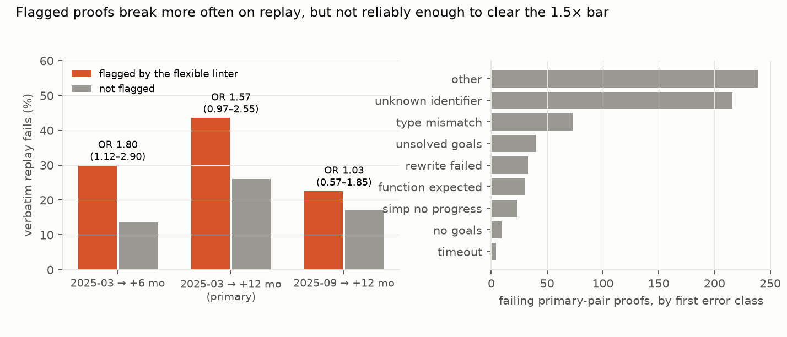

# Do "flexible-then-rigid" proofs rot faster in mathlib? Replaying 2,500 old proofs a year later: flagged proofs fail more often, mostly because a tactic many of them used lost its default import; the effect is not reliably 1.5×, and few failures carry the errors the linter's rationale predicts

*Mathlib proofs containing a non-terminal unrestricted `simp`, from the 31 March 2025 master snapshot, were replayed
verbatim into the files of 31 March 2026 wherever the statement text was unchanged, then compiled against that
snapshot's prebuilt library. The flexible linter's warnings in the old snapshot define "flagged". The plan and all
analysis code were committed before any replay result.*

**Verdict: H1 Inconclusive.**

- **H1 (flagged proofs fail on 12-month replay with odds at least 1.5 times unflagged ones): Inconclusive.**
  - Flagged proofs fail **43.6%** of the time against **26.0%** for unflagged ones.
  - Adjusted for tactic count and simp-call count, with clustering by file, the odds ratio is **1.57** (95% 0.97 to
    2.55; p = 0.07).
  - Population: 2,488 proofs in 1,203 files, of which 110 are flagged. These numbers are corrected after review: the
    first draft counted 231 terminal `simp` calls with a multi-line argument list as non-terminal (OR 1.48, 0.92 to
    2.39 on 2,723 proofs).
  - The adjustment matters. The unadjusted odds ratio is 2.20, and with an independence working correlation the
    adjusted ratio is 1.70 (1.01 to 2.85).
- **Two first-year comparisons clear 1.0, but both rest on one import change:**
  - six months later: OR 1.80 (1.12 to 2.90), with 30% against 14% failing;
  - setting aside failures whose only error is an unknown identifier (a removed or renamed name): OR 1.73 (1.07 to 2.77);
  - **the `induction'` confound** (found at confirmation, post hoc). All 119 population proofs that use `induction'`
    fail, because Mathlib.Tactic.Common stopped importing it between the snapshots. Flagged proofs use it four times
    as often (18 of 110 against 101 of 2,378). Excluding them, no comparison clears 1.0: primary 1.43 (0.84 to 2.43),
    six months 1.57 (0.88 to 2.78), without unknown-identifier failures 1.55 (0.92 to 2.62), pooled 1.27 (0.83 to
    1.95);
  - the second pair (September 2025 to September 2026): OR 1.03 (0.57 to 1.85). Its flagged proofs are what was left
    after mathlib adopted the linter and rewrote nearly every flagged proof (below), so this is not a replication.
- **Mathlib had already rewritten almost every flagged proof.**
  - Between the two snapshots, mathlib changed the body of 109 of 110 flagged proofs (99%), against 1,195 of 2,378
    unflagged ones (50%). The linter entered mathlib's defaults during that year.
  - This does not bias H1: failure depends only on the old body and the new library.
  - The first draft also reported that "proofs whose text mathlib left alone never fail", which is true by
    construction (such a body is the new file's own). It is withdrawn.
- **How proofs rot** (first reported error of the 667 failing proofs; corrected after review):
  - unknown identifier, a removed or renamed name (32%);
  - type mismatch (11%), unsolved goals (6%), rewrite failed (5%), "function expected" (4%, typically a changed
    signature), simp, dsimp or field_simp made no progress (3%), no goals (1%) and timeouts (4 proofs);
  - other messages (36%). Of these, 118 are "unknown tactic", the `induction'` import change (18 of the 48 flagged
    failures). Another 47 are "invalid field … environment does not contain", renamed names reached by dot notation.
  - **The linter's own failure modes are rare among flagged failures.** The two classes its rationale predicts are
    simp making no progress and a rewrite pattern no longer found. They are the first error for 3 of 48 failing
    flagged proofs (6%), against 53 of 619 unflagged ones (9%). The first draft's patterns missed both classes
    entirely, because newer Lean writes "`simp` made no progress" and "Did not find an occurrence of the pattern".
- **The pipeline is valid.** In the old snapshot, 99.94% of population proofs compile without error.

## In plain terms

Mathlib is a huge, shared library of formally verified mathematics written in the Lean proof assistant. Its proofs
must keep compiling as the library changes, and when the library changes, some proofs break. Mathlib has a style
check, the "flexible linter", based on the belief that a common pattern is fragile: an automatic simplification
step (`simp`) followed by a precise step that depends on exactly what `simp` produced. If `simp` changes, the
precise step breaks.

We tested that belief by taking about 2,500 proofs from March 2025 and pasting them, unchanged, into the March 2026
library wherever the theorem itself was unchanged. Proofs the style check had warned about broke more often: 44%
against 26%. After allowing for proof length, the odds of breaking were about one and a half times higher. That is
close to what was predicted, but the uncertainty is wide enough that we can't confirm it, and a second year-long
comparison showed no difference.

So the extra breakage of flagged proofs is real but mostly comes from one change: a tactic many of them used stopped being imported by default. Without those proofs the difference is small and uncertain, and the flagged proofs that broke rarely did so in the way the rule's rationale describes.

## What was asked

The lead (`formal-math-mathlib-proof-rot-flexible-linter`) asked whether proofs that mathlib's FlexibleLinter flags
break more often when replayed in a later library. Its prediction was an odds ratio of at least 1.5.

The linter's docstring asserts this, and the style guide's "non-terminal simp should be simp only" rule rests on it.
No replay measurement was found. Related work covers Isabelle/AFP version compatibility (TOSEM 2025) and LLM proofs
across Lean versions (arXiv 2605.20244).

## How it was done

- **Snapshots** (depth-1 checkouts with prebuilt olean caches):
  - primary: O = `9bed6a56` (2025-03-31) and N = `08fd1302` (2026-03-31);
  - secondary: O₂ = `bb6ed240` (2025-09-30), which is also O + 6 months, and N₂ = `2a885768` (2026-09-30).
- **Declarations.** `theorem` and `lemma` commands with tactic proofs, from a line-based parser, unit-tested.
  - **Features:** tactic count, simp-call count, and non-terminal unrestricted `simp` (not `simp only`, not the last
    tactic of its block).
  - **Population:** proofs with at least one non-terminal unrestricted simp, whose file exists at the same path later
    with a declaration of the same name and identical statement text. A more-indented line after `simp [...,` is a
    continuation of the same call (corrected after review). Four declarations with a comment before `:= by` are
    dropped, because their replayed bodies were extracted at a shifted offset.
- **Flag.** Each population file was compiled in O with the flexible linter enabled (`-Dweak.linter.flexible=true`).
  The linter module is injected for O, whose `Init` does not import it (D1). A declaration is flagged if a warning
  falls in its span.
- **Replay.** O's proof bodies were substituted into N's file and the file compiled with `lake env lean` (30-minute
  limit). A proof fails if any error falls in its span. 14 files were compiled in parallel.
- **Model.** Logistic GEE, fail ~ flagged + log(tactics) + simp calls, exchangeable correlation within file.

## Results (`results/figures/F1_rot.png`)

| comparison | proofs (flagged) | fail: flagged / unflagged | odds ratio (95% CI) |
|---|---|---|---|
| **2025-03 → 2026-03 (primary)** | 2,488 (110) | 43.6% / 26.0% | **1.57 (0.97–2.55)** |
| primary, excluding failures whose only error is an unknown identifier | 2,488 (110) | 41.8% / 23.3% | 1.73 (1.07–2.77) |
| 2025-03 → 2025-09 (6 months) | 2,854 (130) | 30.0% / 13.5% | 1.80 (1.12–2.90) |
| 2025-09 → 2026-09 (second pair) | 3,566 (115) | 22.6% / 17.1% | 1.03 (0.57–1.85) |
| both 12-month pairs, clustered by file across pairs | 6,054 (225) | 32.9% / 20.7% | 1.45 (1.00–2.10) |

The two 12-month pairs share 2,209 declarations, so the pooled row clusters by file across pairs. The first draft
prefixed file names by pair, which counted shared proofs as independent. The second pair's flagged set is
post-clean-up, so the pooled row mixes two different populations and is descriptive only.

**Error classes of failing primary-pair proofs** (667), by the first reported error: other 246, unknown identifier 216,
type mismatch 73, unsolved goals 40, rewrite failed 33, function expected 30, simp made no progress 16, no goals 9,
timeout 4. By the highest-priority class among all of a proof's errors (the first draft's definition, now with the
corrected patterns): unknown identifier 236, unsolved goals 165, other 80, type mismatch 68, rewrite failed 35,
function expected 30, no goals 26, simp made no progress 23, timeout 4. The class is read from the first three stored
error messages of each proof.

## What this does and does not show

- **The first-year excess is mostly one import change.** The six-month comparison and the primary analysis without
  renamed-lemma failures clear a 1.0 lower bound only because of the 119 `induction'` proofs, which fail when
  mathlib stops importing the tactic by default. That is rot under the preregistered definition, but not the simp
  fragility the linter targets. Without them, no comparison clears 1.0. The second pair has no `induction'` proofs
  and shows nothing. Flagged proofs are rare (4% of the population), which limits power.
- **The mechanism is not visible in the errors.** If flagged proofs broke because `simp` changed what it produced,
  their failures should often be simp making no progress or a rewrite pattern not found. Only 3 of 48 are. Error
  messages are a coarse proxy, though: a changed simp normal form can also surface as unsolved goals or a type
  mismatch.
- **Proof rot is dominated by library churn, not tactic style.** A removed or renamed name is the most
  common first error. Mathlib's maintainers rewrote about half of the unflagged population, and nearly all flagged
  proofs, within the year.
- **Not shown:**
  - **Causation.** Flagged proofs may differ in other ways, such as the areas they sit in.
  - **Moved files and changed statements,** which are excluded.
  - **Linter coverage.** The linter's behaviour and the syntactic feature detection are approximate.
  - **Comparison with LLM proofs.** The lead's Lean-workbook comparison was not run.

## Process and deviations

- **Preregistration:** `plan.md`.
- **Deviations** (`deviations.md`):
  - D1, before any population or replay: the `weak.` option prefix, linter injection for O, and section parsing;
  - D2, after the first results: case-insensitive error classes, two added classes and stored messages. This affects
    only the error-class composition and the unknown-identifier sensitivity. The first version is
    `results/tables/primary_v1.json`;
  - D3, after the independent review (post hoc): the multi-line `simp` continuation, comment-offset declarations,
    error-class patterns and first-error classes, cross-pair clustering, and the body-change rates. The draft the
    review saw is `results/tables/primary_v2_pre_d3.json`.
- **Independent review:** fix first (four moderate findings); the fixes are in D3.

## Reproducing it

1. `code/fetch_snap.sh` for each of the four commits. This needs elan, and each cache is about 5 GB.
2. `code/rot.py decls O N` for each pair.
3. `code/run_all.sh` (labelling, then replays).
4. `code/analyse.py`.
5. `code/figures.py`.
