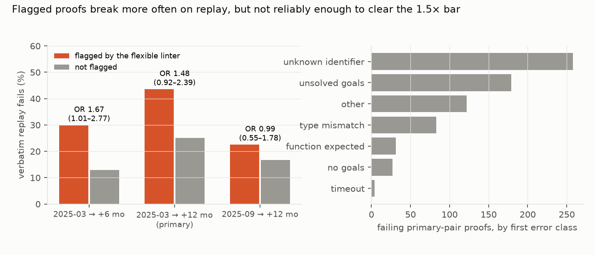

# Do "flexible-then-rigid" proofs rot faster in mathlib? Replaying 2,700 old proofs a year later: flagged proofs fail more often, but the effect is not reliably 1.5×

*Mathlib proofs containing a non-terminal unrestricted `simp`, from the 31 March 2025 master snapshot, were replayed
verbatim into the files of 31 March 2026 wherever the statement text was unchanged, then compiled against that
snapshot's prebuilt library. The flexible linter's warnings in the old snapshot define "flagged". The plan and all
analysis code were committed before any replay result.*

**Verdict: H1 Inconclusive.**

- **H1 (flagged proofs fail on 12-month replay with odds at least 1.5 times unflagged ones): Inconclusive.**
  - Flagged proofs fail **43.6%** of the time against **25.1%** for unflagged ones.
  - Adjusted for tactic count and simp-call count, with clustering by file, the odds ratio is **1.48** (95% 0.92 to
    2.39; p = 0.11).
  - Population: 2,723 proofs in 1,294 files, of which 110 are flagged.
- **The direction is consistent, but not across every comparison:**
  - six months later: OR 1.67 (1.01 to 2.77), with 30% against 13% failing;
  - setting aside failures whose only error is an unknown identifier (a removed or renamed name): OR 1.62 (1.01 to 2.59);
  - the second pair (September 2025 to September 2026): OR 0.99 (0.55 to 1.78);
  - pooled: 1.29 (0.89 to 1.88).
- **How proofs rot.**
  - A quarter of proofs fail verbatim a year later. Half of those whose text mathlib itself changed fail; none whose
    text mathlib left alone do.
  - The most common first error is an unknown identifier, a name the proof uses (usually a lemma) having been removed or renamed (37% of failures). Then come unsolved goals (25%), type mismatches (12%), "function expected" errors (4%, typically a changed signature) and "no goals" (4%).
- **The pipeline is valid.** In the old snapshot, 99.94% of population proofs compile without error.

## In plain terms

Mathlib is a huge, shared library of formally verified mathematics written in the Lean proof assistant. Its proofs
must keep compiling as the library changes, and when the library changes, some proofs break. Mathlib has a style
check, the "flexible linter", based on the belief that a common pattern is fragile: an automatic simplification
step (`simp`) followed by a precise step that depends on exactly what `simp` produced. If `simp` changes, the
precise step breaks.

We tested that belief by taking about 2,700 proofs from March 2025 and pasting them, unchanged, into the March 2026
library wherever the theorem itself was unchanged. Proofs the style check had warned about broke more often: 44%
against 25%. After allowing for proof length, the odds of breaking were about one and a half times higher. That is
close to what was predicted, but the uncertainty is wide enough that we can't confirm it, and a second year-long
comparison showed no difference.

So the style rule points the right way, but its effect is modest next to the most common reason proofs break: names, usually lemmas, being renamed or removed.

## What was asked

The lead (`formal-math-mathlib-proof-rot-flexible-linter`) asked whether proofs that mathlib's FlexibleLinter flags
break more often when replayed in a later library. Its prediction was an odds ratio of at least 1.5.

The linter's docstring asserts this, and the style guide's "non-terminal simp should be simp only" rule rests on it.
No replay measurement was found. Related work covers Isabelle/AFP version compatibility (TOSEM 2025) and LLM proofs
across Lean versions (arXiv 2605.20244).

## How it was done

- **Snapshots** (depth-1 checkouts with prebuilt olean caches):
  - primary: O = `9bed6a56` (2025-03-31) and N = `08fd1302` (2026-03-31);
  - secondary: O₂ = `bb6ed240` (2025-09-30), which is also O + 6 months, and N₂ = `2a885768` (2026-09-30).
- **Declarations.** `theorem` and `lemma` commands with tactic proofs, from a line-based parser, unit-tested.
  - **Features:** tactic count, simp-call count, and non-terminal unrestricted `simp` (not `simp only`, not the last
    tactic of its block).
  - **Population:** proofs with at least one non-terminal unrestricted simp, whose file exists at the same path later
    with a declaration of the same name and identical statement text.
- **Flag.** Each population file was compiled in O with the flexible linter enabled (`-Dweak.linter.flexible=true`).
  The linter module is injected for O, whose `Init` does not import it (D1). A declaration is flagged if a warning
  falls in its span.
- **Replay.** O's proof bodies were substituted into N's file and the file compiled with `lake env lean` (30-minute
  limit). A proof fails if any error falls in its span. 14 files were compiled in parallel.
- **Model.** Logistic GEE, fail ~ flagged + log(tactics) + simp calls, exchangeable correlation within file.

## Results (`results/figures/F1_rot.png`)

| comparison | proofs (flagged) | fail: flagged / unflagged | odds ratio (95% CI) |
|---|---|---|---|
| **2025-03 → 2026-03 (primary)** | 2,723 (110) | 43.6% / 25.1% | **1.48 (0.92–2.39)** |
| primary, excluding failures caused only by unknown identifiers | 2,723 (110) | 41.8% / 22.5% | 1.62 (1.01–2.59) |
| 2025-03 → 2025-09 (6 months) | 3,115 (130) | 30.0% / 13.0% | 1.67 (1.01–2.77) |
| 2025-09 → 2026-09 (second pair) | 3,930 (115) | 22.6% / 16.7% | 0.99 (0.55–1.78) |
| both 12-month pairs pooled | 6,653 (225) | 32.9% / 20.1% | 1.29 (0.89–1.88) |

**Error classes of failing primary-pair proofs**, in priority order: unknown identifier 258, unsolved goals 179, other
122, type mismatch 83, function expected 31, no goals 27, timeout 4. Proofs whose bodies mathlib left unchanged never
fail on replay (0%). Among proofs whose bodies mathlib changed, 49.6% fail.

## What this does and does not show

- **The style rule points the right way.** In three of four comparisons, flagged proofs fail more. The six-month
  comparison and the primary analysis without renamed-lemma failures clear a 1.0 lower bound, but the preregistered
  primary does not, and the second year-long pair shows nothing. Flagged proofs are rare (4% of the population), which
  limits power.
- **Proof rot is dominated by library churn, not tactic style.** Removed or renamed lemmas cause more failures than
  anything else. Mathlib's maintainers already rewrite about half of these proofs when they change the library.
- **Not shown:**
  - **Causation.** Flagged proofs may differ in other ways, such as the areas they sit in.
  - **Moved files and changed statements,** which are excluded.
  - **Linter coverage.** The linter's behaviour and the syntactic feature detection are approximate.
  - **Comparison with LLM proofs.** The lead's Lean-workbook comparison was not run.

## Process and deviations

- **Preregistration:** `plan.md`.
- **Deviations** (`deviations.md`):
  - D1, before any population or replay: the `weak.` option prefix, linter injection for O, and section parsing;
  - D2, after the first results: case-insensitive error classes, two added classes and stored messages. This affects
    only the error-class composition and the unknown-identifier sensitivity. The first version is
    `results/tables/primary_v1.json`.
- **Independent review:** queued (Fable), per the lab's pacing rule.

## Reproducing it

1. `code/fetch_snap.sh` for each of the four commits. This needs elan, and each cache is about 5 GB.
2. `code/rot.py decls O N` for each pair.
3. `code/run_all.sh` (labelling, then replays).
4. `code/analyse.py`.
5. `code/figures.py`.
