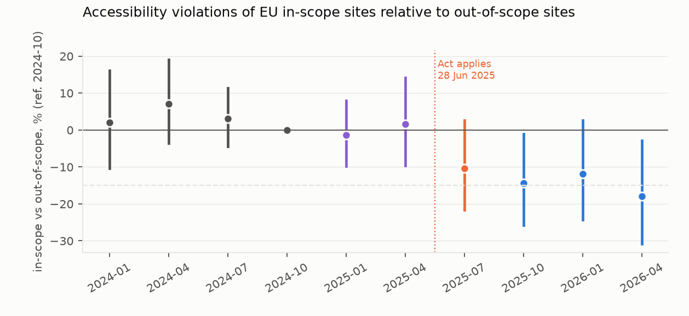
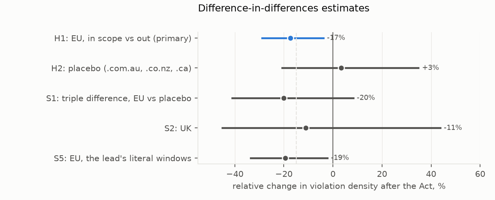

# Did the European Accessibility Act change the web?

*A difference-in-differences on archived homepages. It compares sites in the consumer sectors the European
Accessibility Act covers with sites it does not, across 14 EU country domains, before and after the Act applied on
28 June 2025, and repeats the comparison outside the EU as a placebo.*

**Verdict: Supported.** Measured accessibility failures on in-scope EU sites fell relative to out-of-scope sites once
the Act applied. The placebo is too imprecise to rule out a global trend.

- **H1 (the EU in-scope relative change is −15% or larger): Supported.**
  - Violation density on in-scope EU homepages fell 17% relative to out-of-scope ones: 95% CI −29% to −4%. That is
    1,023 sites, 230 of them in scope, and 6,645 snapshots.
  - **The event study has the shape the Act predicts.**
    - Pre-period differences are close to zero (+2%, +7%, +3% relative to 2024-10).
    - The anticipation quarters are flat (−1%, +2%).
    - The gap opens at the transition quarter (−10%) and stays open afterwards (−14%, −12%, −18%).
- **H2 (the placebo contrast changes by less than 5%): Inconclusive.**
  - The same contrast on .com.au, .co.nz and .ca sites gives +3%, but the interval runs from −21% to +35%.
  - With 221 placebo sites the study could not have detected less than about a 32% change.
- **H3 (sites newly installing an overlay improve less): not testable.** Only one in-scope EU site newly installed an
  accessibility overlay script, so the preregistered rule's "Refuted" reading rests on a single site. Overlay use
  barely moved at all: about 0.5% of EU snapshots before and about 1% after.

**How much the placebo leaves open.** The triple difference (the EU change minus the placebo change) is −20%, but its
interval (−41% to +8%) includes zero. The pattern fits an effect of the Act: no pre-trend, a break at the deadline,
and nothing similar outside the EU. But the data cannot exclude a worldwide shift in in-scope sectors' markup over the
same months.

## In plain terms

Since 28 June 2025, EU law has required online shops, banks, transport operators, telecoms and e-book sellers to make
their websites and apps accessible to people with disabilities. Other kinds of websites, such as news sites or
company brochures, are not covered.

We used that boundary as a natural experiment. We took about 1,000 EU websites from the Internet Archive and checked
their homepages each quarter from early 2024 to April 2026. The check counted accessibility errors that can be
detected automatically, such as images without text descriptions, form fields without labels, and buttons without
names.

Covered sites and uncovered sites tracked each other closely through 2024 and early 2025. After the law applied, the
covered sites' error rate fell about 17% relative to the others, and stayed lower.

We ran the same comparison for Australian, New Zealand and Canadian sites, where the EU law does not apply. That
comparison showed no clear change, but it was too small to rule one out.

So the evidence is consistent with the law making a difference to the code these sites send. It cannot prove it,
because a global change in how shops and banks build websites could produce a similar pattern.

These checks catch only some accessibility problems. They miss colour contrast and keyboard use, for example, and say
nothing about whether disabled people can actually complete a purchase.

## What was asked

The European Accessibility Act (Directive (EU) 2019/882) has applied to private-sector consumer services since
28 June 2025. The study asks three preregistered questions (`plan.md`):

- **H1:** among EU sites, did automatically detectable failures fall by at least 15% in covered sectors relative to
  uncovered ones?
- **H2:** is the same contrast flat (within ±5%) outside the EU?
- **H3:** did in-scope sites that newly installed an "overlay" widget improve their underlying markup less?

## What was already known

The novelty search (2026-10-17) found:
- vendor scans comparing the EU with the US at one point in time;
- single-time-point audits that describe themselves as pre-deadline baselines (Slovenian e-commerce, Austrian video
  platforms).

No before-after design with a comparison group was found.

## How it was done

**Sites.**
- **Frame.** The Tranco list, restricted to:
  - 14 EU country-code domains;
  - .co.uk, reported separately;
  - .com.au, .co.nz and .ca as the placebo.
- **Sample.** A seeded half-sample of 150 sites per jurisdiction (D5): 2,700 sites. 1,741 had enough archived
  homepages to be eligible: at least 2 of 4 pre-period and 2 of 3 post-period quarters.
- **Exclusions.** Public-sector domains were excluded.

**Snapshots.**
- **Source.** Internet Archive homepage captures closest to the 15th of each target month (D5), fetched politely, one
  request at a time.
- **Months.**
  - Pre: 2024-01, -04, -07, -10.
  - Anticipation: 2025-01, -04.
  - Transition: 2025-07.
  - Post: 2025-10, 2026-01, 2026-04.
- **Volume.** 16,666 snapshots were measured.

**Outcome.**
- **The measure.** log(1 + violation nodes per 1,000 DOM elements). It is measured by axe-core 4.10.2 under jsdom,
  with no page scripts run, on a frozen set of 19 rules a static page can evaluate (alt text, labels, names, language,
  ARIA validity, heading order, lists and others).
- **Drops.** Snapshots with fewer than 50 elements or an axe error were dropped and counted: 619 EU, 151 placebo,
  43 UK. These include the 79 pages whose axe run timed out (D7).

**Sector.** Sector was assigned once, from the site's earliest eligible snapshot, by fixed multilingual marker rules
(cart and checkout terms; online banking; timetables and tickets; tariffs and e-books).
- **Labels.** In scope 322, out of scope 1,045, ambiguous 321 (excluded), public 50 (excluded).
- **Blind check.** 120 sites (D6) gave precision 0.87 for in scope and 0.88 for out of scope. Both are above the 0.80
  bar that would have downgraded a Refuted H1.

**Model.**
- **Specification.** Site and period fixed effects, with InScope × Post, and standard errors clustered by site.
  Anticipation and transition quarters are excluded from H1–H3 and kept in the event study.
- **Decision rules:**
  - H1 needs the point estimate at −15% or below and the upper bound below 0;
  - H2 needs the interval inside ±5%.

## Results

### H1: the EU contrast (`results/tables/primary.json`, `results/figures/F1_event_study.png`)

| | relative change after the Act | 95% CI | sites (in scope) |
|---|---|---|---|
| **H1: EU** | **−17.3%** | **−28.8% to −3.9%** | 1,023 (230) |
| S5: EU, the lead's literal windows (2024-01/04 vs 2026-01/04) | −19.4% | −33.5% to −2.3% | 1,022 (230) |
| S2: UK (partly treated) | −11.2% | −45.1% to +43.7% | 82 (24) |

- **H1 is Supported.** The point estimate (−17.3%) is below −15%, and the interval's upper end (−3.9%) is below zero.
- **Detectable effect.** At 80% power the achieved minimum detectable effect is about 19% (SE of b = 0.077), so the
  study was powered close to the preregistered threshold.

### H2 and the triple difference (`results/figures/F2_estimates.png`)

| | relative change | 95% CI |
|---|---|---|
| H2: placebo (.com.au, .co.nz, .ca; 221 sites, 68 in scope) | +3.4% | −20.7% to +34.8% |
| S1: triple difference, EU vs placebo | −20.1% | −41.1% to +8.2% |

- **H2 is Inconclusive.** The interval is far wider than the ±5% band, with a minimum detectable effect of about
  32%.
- **The triple difference has the expected sign and size, but its interval includes zero.**

### H3 and overlays

- **Hardly any overlays, and no shift towards them.**
  - Overlay scripts (accessiBe, UserWay, EqualWeb and similar) were detected in 188 of 16,666 snapshots.
  - Among EU sites the share went from about 0.5% of snapshots in 2024 to about 1% in 2026.
  - Overlay adoption as an outcome (S4) shows no in-scope difference: EU +0.0 points (−1.0 to +0.8), placebo −0.5
    (−4.8 to +3.8).
- **H3 rests on one site.** Only one in-scope EU site newly installed an overlay between the periods. Its estimate
  (−75%) and the preregistered rule's "Refuted" say nothing beyond that one site, so H3 is reported as not testable.

## What this does and does not show

- **It shows that the EAA boundary separated EU homepages' measured accessibility after June 2025.** In-scope sites'
  automatically detectable failures fell about a sixth relative to out-of-scope sites, with flat pre-trends and the
  change starting at the deadline.
- **It does not establish that the Act caused it.** The placebo is too small to exclude a worldwide change in how
  shops, banks and transport sites are built. Platform-level fixes, such as theme or CMS updates, would reach in-scope
  sites everywhere. The triple difference points the right way but is not significant.
- **It measures markup, not accessibility.**
  - The 19 static rules are a fraction of WCAG. Contrast, keyboard, focus and dynamic content are not measured.
  - Homepages are not checkouts.
  - Scripts were not run, so the measure is the server-delivered page.
- **Selection.**
  - Archived homepages only; sites without enough captures drop out.
  - Sector rules misclassify about one site in eight, which biases the estimate towards zero.
  - Microenterprises, which the Act exempts, cannot be identified.
- **Half-sample.** Power is lower than planned (D5).

## Process and deviations

- **Preregistration.** The plan and its code were committed before any archived page was fetched.
- **Data source (D1–D5).** The study moved from the Wayback Machine to Common Crawl and back, because of access
  blocks. It finally used one polite request at a time on a seeded half-sample. All of this was before any page was
  fetched.
- **D6:** the sector check was adjudicated blind by a subagent, and a snapshot-id type fix was made in the validation
  code.
- **D7:** the metrics run was made timeout-safe and resumable. Pages whose axe run still timed out are counted as axe
  errors.
- **Exploratory, added after the results:** the figure code, and the achieved minimum detectable effects (promised in
  D5).

## Reproducing it

`code/frame.py`, `code/cdx_v2.py`, `code/fetch.py`, `code/sector.py`, `code/validate_sector.py sample` and `merge`,
`code/metrics.py` (Node and axe in `code/axe_run.js`), `code/did.py`, `code/figures.py`.

- **Results** are in `results/tables/`: `primary.json`, `sector_validation.csv` and the frame samples.
