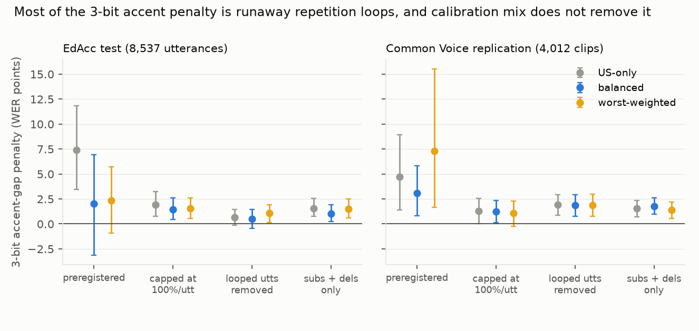

# Compressing Whisper for devices: no accent penalty at 4 bits, and the 3-bit penalty is mostly runaway repetition loops that accent-aware calibration does not reliably fix

*Whisper-small and Whisper-large-v3 were quantized with an in-house GPTQ implementation (groups of 128), calibrated
on three accent mixes of EdAcc validation speakers (three random draws each), and decoded on the EdAcc test set:
8,537 scored utterances, 60 speakers, 14 named accent groups. A preregistered replication used 4,012 accent-labelled
Common Voice 17.0 clips (D5). This version incorporates an independent review (`review/review.md`; analyses added
as D4 and D5).*

**Verdict: Inconclusive.**
- **H1:** Inconclusive.
- **H2:** Supported by the preregistered rule, but not robust. It does not survive loop-robust scoring or calibration-draw
  uncertainty, and it does not replicate on Common Voice.
- **H3:** Refuted, for this allocation rule.
- **H4 (Whisper-large-v3):** not testable, because there is no penalty to repair at 4 or 3 bits.

- **At 4 bits there is no accent penalty.**
  - With US-only calibration, the preregistered statistic is −2.7 points (−8.9 to +2.6), so the positive control
    fails.
  - That number rests on one utterance. On one Latin American speaker's 31.9-second clip, the 4-bit model emits a
    500-word "na na na …" against 83 reference words, in all three calibration draws.
  - Scored robustly, the 4-bit penalty is +0.1 (−0.6 to +0.8) with errors capped at each utterance's reference length,
    and +0.1 (−0.2 to +0.5) with looped utterances removed.
- **At 3 bits, the preregistered penalty is +7.4 points (+3.5 to +11.8), and most of it is loops.**
  - Greedy decoding with Whisper's fallbacks switched off (as preregistered) lets a few hypotheses run to the
    440-token cap. 0.44–0.75% of utterances loop at 3 bits, against 0.33% in FP16, and they carry 21–27% of all
    errors.
  - Scored robustly, the 3-bit penalty is +0.6 to +1.9 points.
- **H1 (accent-balanced calibration repairs half the 3-bit penalty): Inconclusive.**
  - The penalty difference is +5.4 (−0.9 to +12.1).
  - Under robust scoring the repair is 0.1–0.5 points.
- **H2 (worst-group-weighted calibration repairs half): Supported by the rule, but not robust.**
  - **By the rule:** R = 0.68, difference +5.1 (+1.2 to +9.1).
  - **Calibration draws:** the effect is one of the three draws. Resampled with speakers, the interval is −1.5 to
    +13.3.
  - **Robust scoring:** Inconclusive with errors capped (R 0.19), and Refuted with substitutions and deletions only
    (R 0.02).
  - **Common Voice:** the worst-weighted arm is worse than US-only (difference −2.6, −10.8 to +4.0), and with loops
    removed both arms are Refuted (R 0.03).
- **H3 (accent-aware mixed precision): Refuted for this rule.**
  - Promoting 5% of weights to 8 bits forces 26% down to 2 bits, and the model breaks (aggregate WER 47–54%).
  - The layer ranking's signal is about 0.2% of the error it ranks.
- **H4 (Whisper-large-v3): not testable.**
  - The penalty is +0.4 (−0.1 to +1.2) at 4 bits and −0.04 (−0.5 to +0.5) at 3 bits.
  - Loop rates stay at FP16 levels (0.25–0.33%).

## In plain terms

To run speech recognition on a phone or offline device, the model is shrunk by storing its numbers with fewer bits.
Earlier work found that shrinking hurts speakers with less common accents more. The shrinking is tuned on a small
sample of recordings, usually American English, so we tried tuning it on a mix of accents instead.

At 4 bits, the usual level for devices, we found no extra harm to less common accents in Whisper-small. The
apparent effects in either direction were one recording on which the shrunk model got stuck repeating a sound
hundreds of times. At 3 bits, the extra harm we first measured turned out to be mostly a handful of such runaway
repetitions, which tend to land on a few short recordings from a few speakers. Counted sensibly, the extra harm is
about 1–2 percentage points.

Tuning on accented speech seemed to fix two-thirds of it. But that depended on which recordings happened to be
picked, it vanished when the runaway repetitions were set aside, and it did not hold up when we repeated the test on
a different collection of accented speech (Mozilla Common Voice). The larger Whisper model showed no extra harm at
all. The practical lesson is to keep the decoder's safeguards against repetition switched on, and to check for
repetition loops before blaming compression for unfairness.

## What was asked

The lead (`frontier-edge-asr-quantization-accent-parity`) asked whether the compression penalty that post-training
quantization imposes on under-served accents can be repaired within the quantization recipe, at unchanged model size.
It proposed two routes: calibration composition, and accent-aware mixed precision.

**Closest prior work:**
- arXiv 2609.28739, which finds INT4 HQQ compounding transcript loops 5–7-fold on West African accents
  (AfriSpeech-200), and accent-gap doubling under 50% Wanda pruning of large-v3;
- TARQ (calibration for rare words);
- Edge-ASR (a fixed English calibration set).

The plan was committed before any model was quantized.

## How it was done

- **Data.**
  - EdAcc test (60 speakers) for evaluation. 9,228 segments, of which 691 have empty references after tag removal and
    are dropped, as the plan specifies, leaving 8,537.
  - EdAcc validation (62 speakers, disjoint) for calibration.
  - **Named groups:** accents with at least 2 test speakers and 10 minutes.
  - **Gap groups**, fixed from FP16:
    - Whisper-small: worst Jamaican, Kenyan and Vietnamese; best Bulgarian, Latin American and Irish English;
    - Whisper-large-v3: worst Spanish, Jamaican and Vietnamese; best Bulgarian, Indian and Irish English.
  - **Test-only accents:** Nigerian, Kenyan, Ghanaian, Lithuanian, Israeli, Indonesian and Romanian have no validation
    speakers. (The validation label "Indonesian English" probably names the same accent as the test label
    "Indonesian".)
- **Calibration sets.** 48 windows of 20–30 s (about 21 minutes), three random draws per composition:
  - US-only;
  - balanced: 2 windows per accent;
  - worst-weighted: windows in proportion to FP16 validation WER.
- **Quantizers:**
  - GPTQ (in-house: FP16-input Hessian, 1% damping, non-sequential);
  - round-to-nearest at W8 and W4;
  - an AWQ-style scale search at W4. This simulates the per-channel input scale as free for every layer, which it is
    not for fc2 and out_proj in Whisper.
- **Mixed precision:**
  - at W4, 5.1% of weights promoted to W8 and 20.5% demoted to W3;
  - at W3 (D1), 5.1% to W8 and 25.6% to W2.
- **Decoding.** Greedy, English, with no temperature or compression-ratio fallback, and a 440-token cap (all
  preregistered). Segments over 30 s use the long-form algorithm.
- **Statistics.**
  - **Gap:** pooled WER of the worst 3 minus the best 3 FP16 groups.
  - **Penalty:** the gap minus the FP16 gap, averaged over three draws.
  - **Intervals:** a speaker-clustered bootstrap (B = 2,000).
  - **R** is now left null when the control fails or the reference penalty is not positive (D4). The verdicts are
    unchanged.
- **Added after review** (D4, `code/robustness.py`):
  - **scoring variants:** capped at 100% per utterance; looped utterances removed; substitutions + deletions; short-
    and long-form separately;
  - a bootstrap that resamples calibration draws as well as speakers;
  - the literal re-ranked gap;
  - a split-half check of group selection;
  - per-utterance drivers.
- **Common Voice replication** (D5, preregistered before decoding):
  - 4,012 single-label accented clips from the test and dev splits, through the CC0 mirror `fsicoli/common_voice_17_0`.
    The official repository was emptied in October 2025.
  - 10 named groups with at least 30 clips.
  - The same W3 conditions and calibration sets.

## Results

### Whisper-small on EdAcc (`results/figures/F1_penalty_small.png`, `F2_groups_small.png`, `F3_robust_w3.png`)

Penalty in WER points, three-draw means (95% speaker bootstrap):

| condition | preregistered | capped | loops removed | substitutions + deletions |
|---|---|---|---|---|
| GPTQ W4, US-only | −2.7 (−8.9 to +2.6) | +0.1 (−0.6 to +0.8) | +0.1 (−0.2 to +0.5) | +0.3 (−0.0 to +0.6) |
| GPTQ W3, US-only | **+7.4 (+3.5 to +11.8)** | +1.9 (+0.8 to +3.3) | +0.6 (−0.1 to +1.5) | +1.5 (+0.8 to +2.6) |
| GPTQ W3, balanced | +2.0 (−3.2 to +6.9) | +1.4 (+0.5 to +2.6) | +0.5 (−0.5 to +1.4) | +1.0 (+0.2 to +1.9) |
| GPTQ W3, worst-weighted | +2.3 (−0.9 to +5.7) | +1.6 (+0.6 to +2.6) | +1.1 (+0.1 to +1.9) | +1.5 (+0.6 to +2.5) |
| mixed precision W3, US-only | +19.3 (+6.3 to +34.3) | +1.5 (−2.9 to +7.6) | +1.9 (−1.7 to +5.3) | +1.4 (−2.2 to +6.6) |

- **The decision rules under each scoring.** In the variants, the worst-3 and best-3 groups are re-fixed from FP16 on
  that variant's data; the preregistered groups give the same verdicts.
  - **H1:** Inconclusive everywhere.
  - **H2:** Supported (fragile) under the preregistered scoring only. It is Inconclusive capped (R 0.19) and with loops
    removed (control fails), and Refuted on substitutions and deletions (R 0.02).
  - **Short-form segments only:** both are Inconclusive.
- **Calibration draws.** H2's per-draw differences are +1.1, +12.6 and +1.6 points. With draws resampled, the 95%
  interval is −1.5 to +13.3 (speakers only: +1.2 to +9.1). For H1 it is −2.6 to +14.9.
- **The two "repairing" compositions are nearly the same set** (review).
  - Worst-weighted gives 1–3 windows per accent where balanced gives 2, so only 5 of 48 windows differ.
  - Validation accent WER does not predict test accent WER (Spearman 0.05 over the 11 shared accents).
  - H1 against H2 is therefore noise, not a composition effect.
- **What the loops are.**
  - Looped utterances carry 7.5% of errors in FP16, 11–13% at W4, 21–27% at W3 and 39–54% under 3-bit mixed
    precision.
  - One to three utterances carry most of each large group swing. Examples include a 439-word repetition on a
    10-word, 3.4-second Scottish clip, and 220 repetitions of "no" on a 3-word Jamaican one.
  - Loop rates: 0.33–0.43% at W4, 0.44–0.75% at W3, 1.15–2.30% under 3-bit mixed precision.
  - 4 of the 331 FP16 teacher-forcing transcripts used for calibration are themselves loops.
- **Literal re-ranked gap** (preregistered secondary). It is biased upward by noise, because it takes the maximum
  minus the minimum of noisy groups.
  - W3 US-only: +16.6 (+6.4 to +44.8);
  - balanced: +9.1;
  - worst-weighted: +8.3;
  - W4 compositions: +1.2 to +3.6.
- **Group selection.** The groups are chosen on the same FP16 data on which the penalties are measured. A split-half
  check puts that selection bias at −1.3 to +0.6 points on average, with a wide spread. The review's version put it
  at +0.6 to +1.8. Its direction is not established.
- **Mixed precision.**
  - At W3 the allocation rule follows the plan, but demoting 25.6% of weights to 2 bits breaks the model. Other
    readings of "the same design" would not have.
  - The accent-differential layer scores (median difference 1.5 × 10⁻⁵ on errors of about 6 × 10⁻³) are mostly
    noise.
  - At W4 the rule widens the gap (+2.8).

### Whisper-large-v3 (H4)

| | aggregate WER | penalty, US-only | penalty difference, US − balanced | penalty difference, US − worst |
|---|---|---|---|---|
| FP16 | 18.1% | — | — | — |
| GPTQ W4 | 18.6–18.8% | +0.4 (−0.1 to +1.2) | +0.3 | +0.4 |
| GPTQ W3 | 18.7–19.0% | −0.04 (−0.5 to +0.5) | −0.6 | −0.8 |

- Both positive controls fail, so H4 is not testable: there is no penalty to repair.
- Robust scoring agrees. Its largest penalty is +0.5 (0.0 to 0.9) at W3, with errors capped.
- Loop rates are flat (0.25–0.33%).

### Common Voice replication (D5; `results/tables/analysis_small_cv.json`, `robustness_small_cv.json`)

| | preregistered | capped | loops removed |
|---|---|---|---|
| W3 US-only penalty | +4.7 (+1.4 to +8.9) | +1.3 (0.0 to 2.5) | +1.9 (+0.9 to +2.9) |
| H1 (balanced): difference, R | +1.6 (−1.7 to +5.6), 0.35: Inconclusive | +0.0, 0.03: Inconclusive | +0.1, 0.03: Refuted |
| H2 (worst-weighted): difference, R | −2.6 (−10.8 to +4.0), −0.54: Inconclusive | +0.2, 0.17: Inconclusive | +0.1, 0.03: Refuted |

- **Groups.** Worst: India and South Asia, Southern Africa, Hong Kong. Best: New Zealand, Australia, Ireland.
- **The result.** The positive control holds on Common Voice, but no calibration composition repairs the penalty. By
  D5's rule, **H2 does not replicate**.

## What this does and does not show

- **No measurable accent penalty at 4 bits** in Whisper-small or Whisper-large-v3, and none at 3 bits in large-v3,
  with GPTQ g128 on EdAcc.
- **Whisper-small's 3-bit penalty is mostly repetition loops.** That matches the mechanism arXiv 2609.28739 reports for
  INT4 HQQ, which compounds transcript loops on West African accents. There the loops appear at 4 bits with HQQ; here
  only at 3 bits with GPTQ g128.
  - **Not compared:** this study did not reproduce the HQQ recipe, and EdAcc's West African speakers are test-only
    (Nigerian, 5 speakers; Ghanaian pooled), so it cannot speak to that paper's population.
  - **The Wanda result there is pruning, not quantization.**
- **Calibration composition is not a reliable lever.**
  - Its apparent repair at 3 bits depends on one calibration draw and on how loops are scored, and it fails on
    Common Voice.
  - Practical advice: keep Whisper's compression-ratio fallback on, score with loop-aware diagnostics, and average
    over calibration draws.
- **This mixed-precision rule fails;** mixed precision in general was not tested. Promoting to 8 bits at a 3-bit
  budget forces too much to 2 bits, and the layer ranking is mostly noise.
- **Limits.**
  - Groups have 2–5 test speakers. Penalties are coarse, and group selection on FP16 data carries a bias of unclear
    sign.
  - Quantization is simulated, so latency was not measured.
  - EdAcc has no Māori- or Pacific-identified group.

## Process and deviations

- **Preregistration:** `plan.md`.
- **Deviations** (`deviations.md`):
  - D1: the W3 fallback and mixed precision at W3;
  - D2: H4 follows the same fallback;
  - D3: large-v3 batch sizes;
  - D4 (after the review): the robustness analyses, and R left null when it is not meaningful;
  - D5 (after the review, before decoding): the Common Voice protocol.
- **Independent review:** Fable, 2026-10-23, "fix first" (`review/review.md`). Its recomputation reproduced every
  preregistered number. The robustness analyses here independently reproduce its loop-robust results. A confirmation
  pass follows.

## Reproducing it

1. **Data:** `code/manifest.py build`, `code/audio.py test validation`, `code/cv.py build`.
2. **Decodes:** `code/run_queue.sh`, `code/run_large.sh`, `code/run_cv.sh`.
3. **Scoring:**
   - `code/score.py valgroups small`, `code/manifest.py worst small` and `code/mp_alloc.py small [3]`;
   - `code/score.py analyze small|large-v3`, and `code/score.py analyze small cv`.
4. **Robustness:** `code/robustness.py utt|analyze small|large-v3`, and `code/robustness.py utt|analyze small cv`.
5. **Figures:** `code/figures.py small` and `code/figures_robust.py`, with any Python that has matplotlib.
