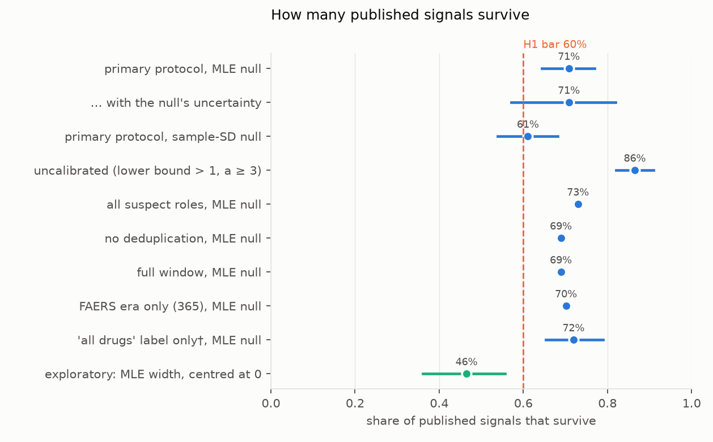
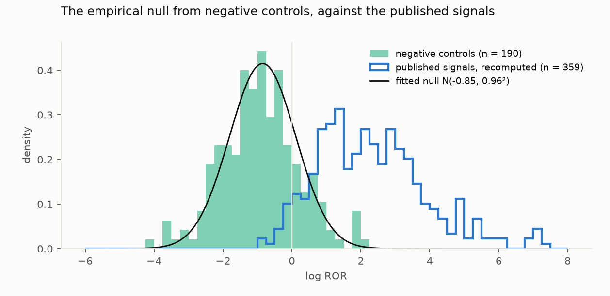
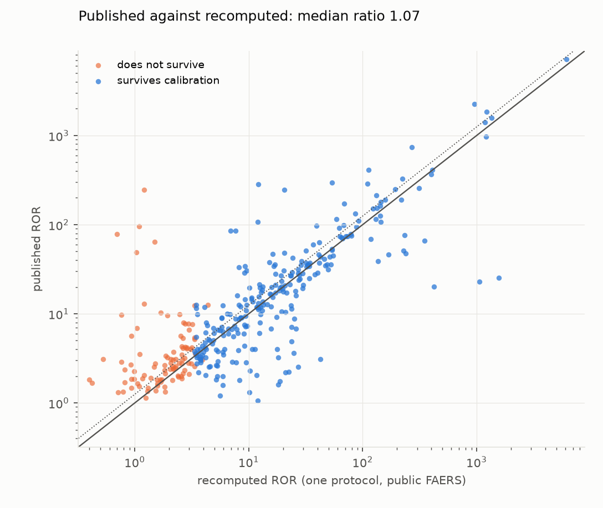

# Do published FAERS safety signals survive an independent, calibrated recomputation?

*370 drug–event signals from 132 papers published in 2023–2025 were recomputed from the FDA's public adverse-event
files under one fixed protocol. They were then calibrated against an empirical null built from 190 negative-control
drug–event pairs.*

**Verdict: Inconclusive.** Whether most published signals survive depends on how the null is built, more than on
anything in the papers.

- **H1 (fewer than 60% survive).**
  - **The preregistered test reads Refuted.** 71% of signals survive, meaning they stay significant after
    recomputation and calibration (262 of 370). The paper-cluster bootstrap 95% CI is 64–77%, above the 60% bar.
  - **That interval ignores the null's own uncertainty.** Resampling the negative controls as well, and refitting the
    null each time, widens it to 57–82%. That is Inconclusive under the plan's thresholds.
  - **The other nulls disagree.** The sample-SD null, reported beside the primary one, gives 61% (54–68%). Exploratory
    nulls built in other defensible ways give 32–61%.
  - **The plan's safeguard failed.** It assumed its two null fits would bracket the bias in the controls, but both
    are centred far below "no association".
- **H2 (published RORs at least 25% larger than recomputed ones): Refuted.** The median ratio of published to
  recomputed ROR is 1.07 (1.01–1.16).

**What "survive" means here.** The null is wide (σ = 0.96 on the log scale) compared with any signal's own standard
error, so calibration acts almost as a fixed effect-size bar. In practice a signal survives if its recomputed ROR is
above about 3.35.
- The smallest survivor is 3.34; the largest non-survivor with at least 3 reports is 3.38.
- With the null centred at zero instead, the bar would be about 7, and 46% would survive (36–56%).

**What holds regardless of the null:**

- **Strong signals reappear.**
  - 93% of signals published with an ROR above 20 survive, and 81% of those between 5 and 20.
  - Only 50% survive between 2 and 5, and 26% at 2 or below.
- **The recomputation matches the papers on average but not one by one.**
  - The median ratio is near 1.
  - But 101 of 359 recomputed RORs differ from the published value by more than a factor of 2. Only 141 (39%) are
    within 0.8–1.25 of it.

**Corrections.**
- **Before review (D3).** After the first analysis, two implementation errors were found and corrected: the per-paper
  cap ran before one eligibility rule, and the spelling map broke two UK spellings.
- **After review (D4).** The independent review found 26 of the analysed signals to be wrong, through extraction or
  drug mapping. They were removed, the mapping rules were tightened, and a preregistered sensitivity analysis that had
  been missed was added.
- **None of these changed the direction of any result.** The headline survival share went from 72% (first pass) to
  71% (D3) to 71% (D4).

## In plain terms

Thousands of papers mine the FDA's public database of adverse-event reports. They flag a drug as "reported
disproportionately often" with some side effect, using a statistic called the reporting odds ratio. These flags are
meant to prompt closer study, but how often do they hold up?

We took 370 such flags from 132 recent papers. We recomputed each one from the same public database, using one fixed
and fully published recipe. We then asked whether each flag still stood out once we allowed for the background noise
this kind of data produces.

To measure that noise we used 190 drug and side-effect pairs that earlier research, mostly in insurance and hospital
records, had chosen as unrelated.

About 7 in 10 flags held up. In practice, "held up" meant the recomputed ratio was above about 3.3.

Flags that were very strong in the paper almost always held up. Weaker ones (a ratio under about 5) held up only half
the time or less.

But the "7 in 10" rests on a judgement call. The unrelated pairs were reported together *less* often than average,
which makes the bar for a real flag lower. Measured against other reasonable baselines, anywhere from about 3 to 6 in
10 flags hold up. So we cannot say whether most published flags are robust.

Our recomputed numbers matched the papers' numbers on average. For more than a quarter of flags, though, they
differed by more than a factor of two.

None of this says whether any drug causes any side effect. These are reporting patterns, not rates of harm.

## What was asked

Disproportionality analyses of the FDA Adverse Event Reporting System (FAERS) are among the most common pharmacovigilance
publications. Each paper makes its own choices: which reports, which drug roles, which comparison group, how to remove
duplicates, which years. It then reports reporting odds ratios (RORs) whose lower confidence bound exceeds 1.

The study asks two preregistered questions (`plan.md`):

- **H1:** Under one fixed protocol and an empirical null from negative controls, do fewer than 60% of published
  significant signals remain significant (Benjamini–Hochberg q < 0.05)?
- **H2:** Is the median published ROR at least 1.25 times the recomputed one?

## What was already known

- **Calibration with negative controls** is established for observational database studies (Schuemie et al. 2014,
  the OHDSI programme).
- **In FAERS**, one 2026 study (İnkaya & Güngör, *Pharmaceuticals*) calibrated a single drug class against 72
  negative-control pairs.
- **No population-level re-analysis** of published FAERS signals was found (search 2026-10-18).

## How it was done

**The published signals:**
- **Search.** A saved Europe PMC search for FAERS disproportionality papers published 2023–2025 returned 2,265
  records. The plan's pre-check had counted 2,228 hits; the index grew between the two queries. 1,830 research
  abstracts were processed.
- **Extraction.** A locally served open-weight model (Nemotron 3 Nano, temperature 0, JSON-schema-constrained output)
  extracted every reported drug–event estimate with its CI, case count and stated FAERS window.
- **The extraction checks:**
  - **Round 1 failed.** Precision on fully eligible signals was 51/71 = 0.72, against a bar of 0.90.
  - **Round 2 passed.** The prompt and schema were revised once (D2), and precision on a fresh sample was 68/71 = 0.96.
    This round was adjudicated by the same agent that wrote the revision.
  - **The independent review drew a further fresh sample.** Its precision was 63/70 = 0.90 (paper-cluster CI
    0.74–1.00).
    - The error types D2 targeted still occur: estimates from the Japanese JADER database labelled FAERS, and
      interaction estimates attributed to one drug.
    - The extracted `comparison` label was right for only 53/70 (0.76), not the 0.97 found in round 2.
    - The 26 analysed signals the review found to be wrong were removed (D4).
- **Eligibility.** All of the following:
  - a ROR with a point estimate and 95% CI, and a lower bound above 1;
  - one active ingredient, mapped through RxNorm. After D4, abbreviations under 4 characters or in all capitals are
    not mapped, and antibody–drug conjugates that map only to their antibody are excluded;
  - an event that is a MedDRA Preferred Term (PT) after a fixed US-to-UK spelling map;
  - a stated window;
  - the FAERS database, and a comparison other than an interaction.
- **Result.** 443 signals were eligible. At most 5 per paper were kept at random (seed 20261018), giving 370 signals
  from 132 papers.

**The recomputation** (`code/recompute.py`):
- **Data.** All FDA quarterly ASCII files, 2004Q1–2026Q2: 24.8 million report versions, in DuckDB.
- **Deduplication.** The latest version of each case.
- **Drug.** The drug as primary suspect, matched on the active-ingredient field or on its RxNorm brand names.
  Combination products containing the ingredient count as exposure. Many papers exclude them; the review found this
  changes some counts substantially (tenofovir–vitamin D deficiency: 1,144 reports to 373) without changing survival.
- **Event.** The event PT.
- **Statistic.** A report-level 2×2 table over the paper's own window. The 34 windows that start before 2004Q1 are
  recomputed from 2004Q1, the first public quarter.
- **Variants:**
  - all suspect roles;
  - no deduplication;
  - the full window up to the paper's publication;
  - the FAERS era only (from 2012Q4). This sensitivity was preregistered, missed in the first draft, and run after
    review.
- **The pipeline check.** For the 10 eligible signals with the largest published case counts, the recomputed count is
  a median 1.00 times the published one (`results/tables/pipeline_check.csv`). 8 of the 10 are within about 15%.
  - **Hydroxychloroquine–pemphigus** is a known cluster of duplicated co-suspect reports: 84 primary-suspect cases
    recomputed against 1,545 published, and 5,990 with all suspect roles.
  - **Lanreotide–cholelithiasis** is the other exception.
- **The review's independent SQL** reproduced the 2×2 counts for 21 of 22 signals exactly, and the last differed by
  one report.

**The empirical null** (`code/negative_controls.py`, `code/analysis.py`):
- **Controls.** The OHDSI MethodEvaluation negative controls: 332 drug–PT pairs from 119 drugs and 64 PTs, mapped by a
  table fixed before any control was computed.
- **Computation.** Each pair over 2004Q1–2025Q4.
  - As the plan specified, only the 190 pairs with at least one report enter the fit.
  - The 142 pairs with no report are dropped. They are the most negative, so dropping them pulls the fitted centre
    towards zero.
- **Fits.**
  - **Primary:** maximum likelihood with each pair's standard error (Schuemie). μ = −0.85, σ = 0.96, so the fitted
    centre is an ROR of 0.43. The median control ROR is 0.38.
  - **Beside it:** the sample mean and SD. μ = −0.92, σ = 1.12.
- **Calibration and survival.** A calibrated p-value, then BH-FDR across the 359 signals with a finite recomputed ROR.
  A signal survives if its recomputed ROR exceeds 1 and its calibrated q is below 0.05. The 11 signals with a zero
  cell count as not surviving.
- **Inference.** Intervals come from a paper-cluster bootstrap, 2,000 resamples. After review, a joint bootstrap
  also resamples the controls and refits the null.

## Results

### H1: survival (`results/tables/primary.json`, `results/figures/F3_survival.png`)

| | survive | 95% CI |
|---|---|---|
| **Primary: MLE null (preregistered)** | **71% (262/370)** | **64–77%** |
| … with the null's own uncertainty (D4) | 71% | 57–82% |
| Sample-SD null | 61% | 54–68% |
| Uncalibrated (recomputed lower bound > 1, a ≥ 3) | 86% | 82–91% |
| All suspect roles, MLE null | 73% | |
| No deduplication, MLE null | 69% | |
| Full window, MLE null | 69% | |
| FAERS era only (365 computable), MLE null | 70% | |
| "All drugs" comparison label only (317)† | 72% | 65–79% |
| *Exploratory: MLE width, centred at 0* | *46%* | *36–56%* |

†The label was right for only 76% of the review's sample, so this subset is not cleanly "all drugs" comparisons.

- **The preregistered rule.** The paper-cluster lower bound, 64%, is above the 60% bar, so the test reads Refuted.
- **With the null's uncertainty** the lower bound is 57%, and the result is Inconclusive.
- **The study's verdict is Inconclusive**, for this reason and the null's dependence on its construction (next
  section).

Where the 108 non-survivors come from:
- **45 are not significant even before calibration.** Of these:
  - 11 have a zero cell;
  - 16 have a recomputed ROR at or below 1;
  - 6 have an ROR above 1 but fewer than 3 reports;
  - 12 have an interval that includes 1.
- **63 are significant before calibration but not after.** These are signals with recomputed RORs between about 1
  and 3.35.

Five signals with only 1 or 2 recomputed reports survive calibration. The preregistered survival rule has no case
minimum.

### The null and why it decides the answer (`results/figures/F2_null.png`, `results/tables/null_sensitivity.json`)

The negative controls sit mostly below zero on the log scale. Only 14 of the 190 (7%) are significant before
calibration.

The review showed why:
- **It is not an artefact of the PT mapping.** Leaving out any one PT or drug moves μ only between −0.91 and −0.76.
- **It is not mainly the chronic outcomes.** Acute-type and chronic-type control outcomes give μ = −0.73 and −1.01.
- **It is a property of the primary-suspect ROR for unrelated pairs.** A drug's primary-suspect reports concentrate on
  the events it is suspected of, so an unrelated event turns up in them less often than in the rest of FAERS. The drug
  explains more of the variation in control RORs than the event does.

Calibrating against a null centred at an ROR of about 0.4 lowers the bar for a positive signal. The exploratory grid
shows survival depending on both the null's centre and its width:

| centre μ \ width σ | 0.50 | 0.75 | 0.96 (fitted) | 1.12 (sample SD) |
|---|---|---|---|---|
| −0.85 (fitted) | 91% | 83% | **71%** | 61% |
| −0.50 | 85% | 71% | 60% | 51% |
| −0.25 | 78% | 65% | 53% | 43% |
| 0 | 72% | 58% | 46% | 36% |

The review built exploratory nulls closer to the published signals' own events. It paired the 119 control drugs with
the published signals' PTs: 12,236 pairs, contaminated by some true associations.
- The pooled centre is μ = −0.16, and survival under it is 32%.
- After trimming the top decile the centre is −0.42, and survival is 61%.
- With a centre for each event, survival is 38%.
- These figures were computed on the pre-review set of 406 signals (`review/reviewer_checks/pseudo_null.json`).
- Per-event centres range from −2.5 to above +2.

Every alternative puts survival between 32% and 61%, around or below the 60% bar. The designated control pairs give
the most lenient null of all. The plan's assumption (§7) that its two null fits would bracket notoriety bias did not hold.

### H2: inflation (`results/figures/F1_published_vs_recomputed.png`)

- **The median.** The published ROR is a median 1.07 times the recomputed one (359 signals with a finite recomputed
  ROR; 95% CI 1.01–1.16). The upper bound is below 1.25, so **H2 is Refuted**. H2 does not depend on the null.
- **The spread.**
  - 57 published RORs are more than twice the recomputed value, and 44 are less than half of it.
  - Papers' own choices plausibly account for much of this: comparators, roles, deduplication, combination products,
    and MedDRA version.
  - On MedDRA version: FAERS keeps each quarter in the version current at release. So for 48 of the pre-review 406
    signals, the event's PT did not exist for part of the window, for example "acute kidney injury" before 2013. Papers
    that recode to a current version count reports this protocol misses. Survival among those 48 was 73%, against
    71% overall, so this did not bias survival.

### Who survives (secondary, preregistered)

- **Logistic regression of non-survival** on the log published ROR, window length, top-5 journal and publication year
  (370 signals, paper-clustered SEs):
  - A larger published ROR strongly predicts survival (coefficient −0.96 per log unit, p < 0.001). This is expected,
    given the effect-size bar above.
  - Later publication years survive somewhat more often (coefficient −0.52 per year, p = 0.017). By year: 2023 62%,
    2024 66%, 2025 77%.
  - Window length and journal show nothing detectable.
- **Adding the published case count** is possible only for the 69 signals that report one. A larger count also
  predicts survival (coefficient −0.63 per log unit, p = 0.023).
- **By paper.** 17 of the 132 papers have no surviving signal, and 72 have all of theirs survive.

## What this does and does not show

- **It shows:**
  - published FAERS signals with large RORs almost always reappear under one transparent protocol;
  - published and recomputed RORs agree on average, so there is no systematic inflation;
  - weak published signals (ROR below about 5) survive about half the time or less.
- **It does not show whether most published signals are robust.** The share is 71% under the preregistered null and
  32–61% under others. No FAERS-specific null is established, and the designated negative controls give the most
  lenient one.
- **One protocol by design.** A paper's comparator, subgroup or role choices can explain non-replication. This
  measures robustness to one fixed recipe plus calibration, not error or misconduct.
- **Selection.**
  - Only abstract-level signals with a single ingredient, a PT-named event and a stated window are included.
    Class-level, SMQ-level and grouped-event signals are excluded, and they may behave differently.
  - The spelling map misses some US spellings: 19 of 313 rejected events would pass with a fuller map.
- **Extraction.** Precision was 0.90 in the review's sample, with errors clustered by paper. The 26 known-wrong
  signals are removed, but similar errors likely remain among the rest at a few per cent.
- **Pharmacovigilance limits.** FAERS reports are not incidences. No causal claim about any drug is made.

## Process and deviations

- **Preregistration.** The plan (`plan.md`, 2f4c30d) was committed before any signal was extracted.
  - The negative-control mapping and the primary pipeline's code were committed before the outputs they produced.
  - The exploratory `null_sensitivity.py`, a revision of `figures.py` and the report builder were committed with
    their outputs (d62a942).
- **D1:** a larger token budget for 64 extraction failures.
- **D2:** the round-1 extraction check failed. The prompt and schema were revised once, and the revision passed on a
  fresh sample. This happened before any signal was recomputed.
- **D3:** after the first analysis, two implementation errors were found and corrected.
  - The plan's per-paper cap applies to fully eligible signals, but the code capped before the PT rule.
  - The spelling map doubled a leading "o" ("ooesophagitis").
  - The fix drew 68 new signals, and one more was re-keyed by the spelling fix. Both the as-run results
    (`results/asrun/`) and the corrected ones were kept. The verdicts were the same.
- **The independent review** (`review/review.md`) recommended "fix first". It found:
  - the 26 wrong signals;
  - the mapping errors;
  - the missed FAERS-only sensitivity;
  - the H1 interval's omission of null uncertainty;
  - and it recommended the Inconclusive tag.
- **D4 records the post-review work.** The verdicts of the preregistered tests did not change, and the study's tag
  became Inconclusive.
- **Exploratory, added after results were seen:** the null-centre sensitivity (`code/null_sensitivity.py`), the
  last row of F3, the null-propagated interval, and the review's event-matched nulls.

## Reproducing it

`code/fetch_epmc.py`, `code/extract_signals.py v2`, `code/fetch_faers.py`, `code/faers_db.py`,
`code/negative_controls.py`, `code/eligible.py`, `code/recompute.py`, `code/validate_pipeline.py`, `code/analysis.py`,
`code/null_sensitivity.py`, `code/figures.py`.

- **The extraction validation** is in `code/validation_adjudication.py` (rounds 1 and 2) and
  `results/tables/extraction_validation*.{csv,json}`. The review's fresh sample is in
  `review/reviewer_checks/fresh_sample_adjudication.csv`.
- **Results** are in `results/tables/`: `primary.json`, `signals_results.csv`, `pipeline_check.csv` and
  `null_sensitivity.json`.
