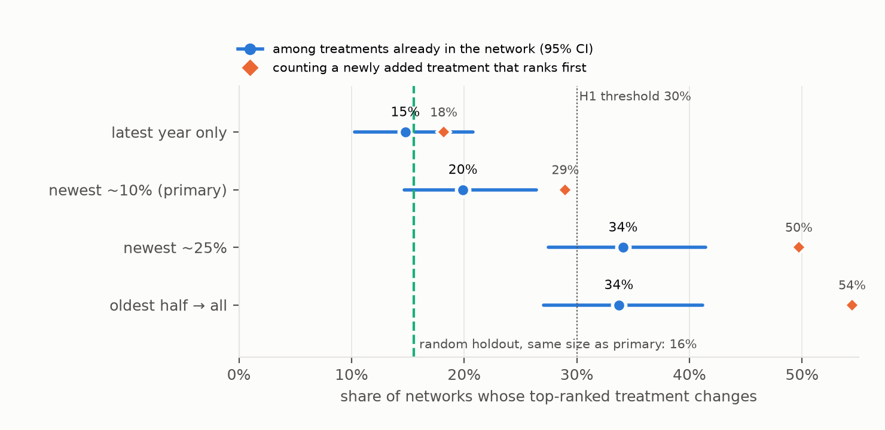
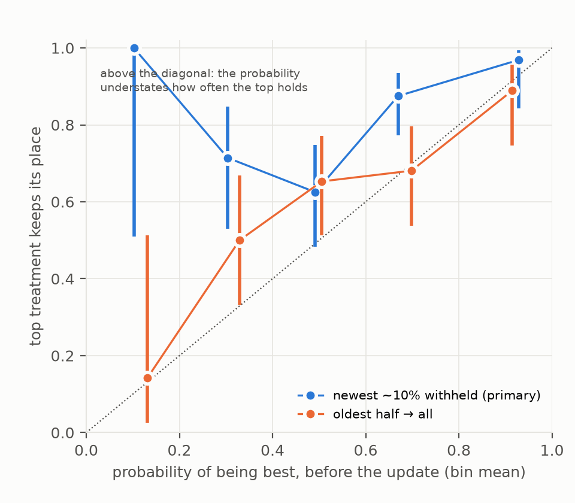
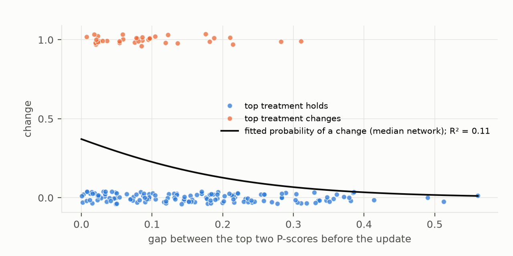

# Are network meta-analysis rankings a forecast or a snapshot?

*A temporal holdout across 177 published network meta-analyses from the open nmadb database. How often does the
top-ranked treatment change when the newest studies are added back, and is the stated probability of being best
calibrated against that?*

**Verdict: Refuted.** Two of the lead's three claims fail; the third holds.
- **Rankings are less fragile than predicted (H1).**
- **For treatments already compared, the probability of being best errs on the cautious side (H2).**
- **Which networks flip is hard to predict (H3, Supported).**

- **One ranking in five changes when the newest studies arrive (H1, Refuted).**
  - **The test.** The newest tranche of studies was withheld: about 10% by plan, a median of 15% of studies (20% of
    participants) once whole publication years are kept together. When it is added back, the top-ranked treatment
    changes in **19.8%** of networks (95% CI 14.6–26.3%). The prediction was at least 30%.
  - **Counting new treatments.** The preregistered count looks only at treatments that were already in the network.
    Counting a newly added treatment that goes straight to the top, the leader changes in **29%** of networks.
- **Among treatments already compared, the probability of being best understates how often the top holds (H2,
  Refuted in the opposite direction).**
  - **The size of the gap.** Before the update, the top treatment's average probability of being best is 0.61. Among
    incumbents, it keeps its place in 80% of networks. The stated probability understates that by 20 points (13–26),
    where the lead predicted an overstatement of at least 20.
  - **Counting new entrants as losses,** retention is 71%, and the probability still understates it.
  - **Over a longer horizon** (the oldest half of the studies, then all of them), the probability is close to
    calibrated among incumbents: 0.59 against 67% retention. Counting new entrants, retention falls to 46%, and the
    probability overstates it.
- **Which networks flip is hard to predict (H3, Supported).** The gap between the top two treatments and the network's
  size together explain a Nagelkerke R² of **0.11** (0.04–0.24) of which networks flip. A small gap is the one
  consistent warning sign.
- **Newest studies against random ones.** We could not distinguish withholding the newest studies from withholding
  random studies of the same number.
  - Random holdouts change the top treatment 15.4% of the time, against 19.8% for the newest: a difference of 4.4
    points (−0.8 to 9.7).
  - The temporal tranche also removes more participants than the random holdouts (24% against 18%), so part of any
    difference is simply more evidence removed.

## In plain terms

When doctors and funding agencies compare many treatments for the same condition, they often rely on a "network
meta-analysis". This combines all the trials into a ranking, and usually reports the chance that each treatment is the
best. We asked whether that ranking behaves like a forecast: does the top treatment stay on top when more trials
arrive?

We took 177 published analyses from an open database and replayed history. In each, we hid the most recent trials,
ranked the treatments without them, then added them back.

- **How often the winner changed.** Among the treatments already compared, the top treatment changed about one time
  in five. If a brand-new treatment that went straight to the top is counted, it was closer to three in ten.
- **Starting from only the oldest half of the trials,** the winner changed one time in three, or about half the time
  counting newcomers.
- **The newest trials were not clearly more disruptive** than hiding the same number of trials at random.
- **The stated chance of being best was cautious for small updates.** A treatment given a 60% chance of being best
  usually kept its place. Over a longer horizon that included new treatments, the stated chance was too high.
- **The warning sign.** Rankings were most likely to change when the top two treatments were close. Even so, the
  closeness of the race and the number of trials together predicted poorly which rankings would change.

So a ranking is a reasonable but fallible snapshot. A narrow lead at the top, and the arrival of new treatments,
deserve the least confidence.

## What was asked

The lead (`future-health-nma-rank-temporal-fragility`) asked whether NMA treatment rankings behave like forecasts.
Three preregistered hypotheses (`plan.md`):
- **H1:** withholding and restoring the newest tranche of studies changes the top-ranked treatment in at least 30% of
  networks.
- **H2:** the pre-update probability that the top treatment is best overstates its empirical retention rate by at least
  20 percentage points.
- **H3:** the top-two gap and network size explain less than half of the variation in which networks flip.

## What was already known

| Work | What it established | What it left open |
| --- | --- | --- |
| Daly et al., BMJ Open 2019 | rank agreement when studies are removed one at a time, in five data sets (quadratic-weighted kappa down to 0.40) | five data sets; one-at-a-time, not temporal, removal; no calibration |
| Trinquart and colleagues; Salanti and colleagues | ranking statistics carry large uncertainty and must be read with the certainty of evidence | no comparison of stated probabilities with realised rank retention |
| Petropoulou et al., J Clin Epidemiol 2016 (nmadb) | a curated database of published NMAs with downloadable data | not used for temporal holdouts |

No study had run a temporal holdout across hundreds of real networks, or reported a calibration curve for the
probability of being best.

## How it was done

**Data.**
- **Source.** The Network Meta-Analysis Database (nmadb) catalogue and all 278 "Verified" datasets, downloaded through
  its public REDCap API. The public token is read at run time from the archived CRAN package and not stored. The
  datasets come with checksums.
- **Era.** The networks were published 2000–2015, and their newest studies are a median of 2010.

**Inclusion.**

| step | networks |
| --- | --- |
| verified datasets | 278 |
| parsed into one schema (one has no study id) | 277 |
| at least 3 treatments and 10 studies | 236 |
| a publication year for at least 90% of studies (29 from the study label, D1) | 208 |
| a direction of benefit that could be determined (D2) | 207 |
| arm-level networks (primary) / contrast-level networks (sensitivity) | 178 / 29 |
| the full-network fit succeeds | **177** / 29 |

**Holdouts (plan §4).**
- **The tranche.** Studies were ordered by publication year. The newest tranche is the smallest set of whole latest
  years holding at least 10% of studies. Same-year studies are never split.
- **Secondary holdouts:**
  - the newest 25%;
  - the latest year alone;
  - a longer horizon: the oldest half of the studies, then all of them.
- **The control.** 200 random holdouts of the same number of studies as the primary tranche, per network.
- **Disconnection.** A pre-update network that the withheld studies disconnect is reduced to its connected component
  with the most studies. The independent review found that this rule had failed to run in the first analysis; it was
  fixed and the affected 44 networks were refitted (D4).

**Ranking.**
- **The fit.** Random-effects frequentist NMA (netmeta 3.6.1, DerSimonian–Laird), on each network's published effect
  measure.
- **The ranking metric.** The P-score, the frequentist SUCRA. It equals netmeta's own P-score exactly.
- **The flip.** The pre-update top treatment differs from the full-data top treatment, compared over the treatments
  in the pre-update network.
- **The probability of being best.** From netmeta's resampling rankogram (10,000 draws, seeded).

**Validation.**
- **V1, parsing.** 23 networks, oversampling the label-year ones, were compared with their raw sheets. 22 were right;
  the one error, a missed year in one study, is fixed.
  - The independent review re-parsed 32 networks: 31 match exactly, and one could not be compared by its parser.
  - Empty arms (n = 0) were later dropped (D4).
- **Direction of benefit (D2, D4).** The catalogue's "harmful/beneficial" label and the sheets' own labels often
  disagree.
  - **Arm-level networks.** Every disagreement, and every continuous network, was checked against the outcome and
    the arm data. The catalogue was right in all but one. The per-network record is released
    (`direction_arm_record.csv`), and the review re-adjudicated 116 arm-level networks and agreed with every call.
  - **Contrast-level networks.** The label describes the outcome concept, the sheets do not say which way round the
    contrast runs, and both conventions occur.
  - **Calls in that set.** Each network was adjudicated from placebo-controlled contrasts and landmark trials whose
    estimates appear in the data. Two of 29 calls were inverted, both by misreading which treatment was t1. The review
    found them, and they are corrected. These networks form a sensitivity set.
- **V2, counts.** Parsed study counts match the catalogue in 165 of 207 networks, and treatment counts in 106 of 168.
  Most differences are reviews whose catalogue entry counts every outcome.
- **V3, the published best.** For 30 random networks, the authors' abstract was read.
  - Where the authors name a best treatment (13 networks), the full-network top treatment matches in 9.
  - Placebo or no treatment ranks at or near the bottom in all 19 networks where that could be checked.

## Results

### H1: how often the top treatment changes

**H1, Refuted.** In the primary holdout, 35 of 177 networks (**19.8%**, 95% CI 14.6–26.3%) have a different top
treatment once the newest tranche is added back. Supported needed at least 30% with a lower bound of at least 25%;
the upper bound is below 30%.

| update | flips (preregistered) | with a new treatment ranking first |
| --- | --- | --- |
| the latest year only | 15% (10–21%) | 18% |
| **the newest ~10% (primary)** | **20% (15–26%)** | **29%** |
| the newest ~25% | 34% (27–41%) | 50% |
| the oldest half → all | 33% (26–40%) | 54% |

**New entrants.** In 19 of 177 networks, the full-data top treatment did not exist in the pre-update network. The
plan counts these separately, because the decision before the update could not have chosen them. Counting them, the
top changes in 52 of 177 networks (29%).

**The control.** We could not distinguish the newest studies from random studies of the same number.
- **The rates.** Random holdouts flip a mean of **15.4%** of networks, against 19.8% for the newest tranche: a
  difference of 4.4 points (95% CI −0.8 to 9.7). That is a 28% relative excess at the point estimate, and the interval
  allows up to about 60%.
- **The participant asymmetry.** The temporal tranche removes a mean of 24% of participants against 18% for the random
  holdouts, so part of any excess reflects more evidence removed rather than newer evidence.

**Rank agreement beyond the top.** Kendall's τ between the pre-update and full P-scores has a median of 0.90. The
top-two set changes in 43 networks (24%).

**Robustness.** The rate barely moves under other choices:
- a common-effect model: 19.2%;
- the resampling SUCRA in place of the P-score: 21.5%;
- adding the 29 contrast-level networks: 18.9%;
- adding only their high-confidence direction calls: 19.1%.



*Figure 1. Share of networks whose top-ranked treatment changes, by size of the update. Circles: the preregistered
definition (treatments already in the network), with 95% intervals. Diamonds: also counting a newly added treatment
that ranks first. Dashed line: random holdouts of the primary size.*

### H2: is the probability of being best calibrated?

**H2, Refuted, in the opposite direction.**
- **The numbers.** The pre-update top treatment's mean probability of being best is **0.61**. Among the treatments
  already compared, it keeps top rank in **80%** of networks. The stated probability understates retention by 20
  points (95% CI 13–26). The lead predicted an overstatement of at least 20 points.
- **By bin.**
  - Bins near 0.3 and 0.7 retain 71% and 88%.
  - The 0.5 bin is closest (0.50 against 63%).
  - Of the 32 networks with a probability above 0.8, 31 kept their top treatment.

**Two qualifications.**
- **Counting new entrants.** If a newly added treatment that ranks first counts as a loss, retention over the primary
  update is 71%. The probability (0.61) still understates it, by about 10 points.
- **Partly by construction.** The probability estimates the chance that a treatment is *truly* best given current
  evidence. Retention after a small update is higher than that, because the updated analysis shares most of its data
  with the old one.
  - **The fairer test** is the longer horizon, where the evidence roughly doubles. Among incumbents there, the mean
    probability is 0.59 against 67% retention (a gap of 8 points, −15 to −1), close to the diagonal (Figure 2).
  - **Counting new entrants,** longer-horizon retention is 46%, and the stated probability *overstates* it by about 13
    points.



*Figure 2. Calibration of the pre-update probability of being best against the share of networks whose top treatment
keeps its place among the treatments already compared. Bins of width 0.2 with at least 3 networks; bars are 95%
Wilson intervals.*

### H3: can fragile rankings be spotted in advance?

**H3, Supported.** A logistic model of the flip on the pre-update top-two P-score gap and the log number of studies
explains a Nagelkerke R² of **0.11** (95% CI 0.04–0.24; AUC 0.69).
- **The gap is the signal.** Networks with a gap below 0.05 flip 24% of the time, and those with a gap of 0.2 or more
  flip 7% of the time.
- **Size is not.** Network size adds little (p = 0.18 in the full model).
- **The full preregistered predictor set.** Number of treatments, I², the direct-evidence share of the top
  comparison, the withheld share of participants and the outcome type raise R² to 0.17 (AUC 0.73).
  - Only the gap (p < 0.001) and, weakly, the number of treatments (p = 0.04) carry signal.



*Figure 3. Each network by its pre-update top-two P-score gap and whether its top treatment changed. The curve is the H3
model at the median network size.*

## What this does and does not show

- **Rankings from published NMAs are moderately stable among the treatments already compared.** About one in five top
  treatments changes when the newest studies are added back, and about one in three over a longer horizon. A newly
  available treatment that goes straight to the top is a separate and common route to a changed recommendation.
- **For the treatments already compared, over an update of this size, the stated probability was, if anything,
  conservative.** It is not a forecast of the next analysis's winner once new treatments can enter. Over a longer
  horizon with new entrants, it is overconfident.
- **The newest studies could not be distinguished from random ones of the same number.** That does not support a
  strong "late-arriving evidence overturns early winners" pattern in this era of networks, but the data cannot rule out
  a moderate one.
- **A narrow lead at the top is the warning sign, and a weak one.** No simple feature of a network reliably separates
  fragile rankings from stable ones.

**Limitations.**
- **Retrospective.** The "next tranche" is the last tranche the authors included, not evidence published after the
  review. Networks from 2000–2015 may differ from current practice.
- **Publication years come from the sheets and were not validated against the literature.** They are sometimes wrong.
  In 479888, a contrast-level network, MPACT (published 2013) is dated 2002 and a 2005 trial is dated 2013, so that
  network's tranche holds the wrong studies. The holdouts inherit such errors.
- **Whole-year tranches.** Keeping same-year studies together makes the primary tranche larger than 10% (median 15%).
  The latest-year-only holdout (15% flips) brackets this from below.
- **Frequentist ranking.** P-scores and resampled probabilities stand in for the Bayesian SUCRA and probability of
  being best that many published networks reported. V3 shows the top treatment usually matches the authors'.
- **Direction of benefit.** It is adjudicated for the contrast-level networks, which are therefore a sensitivity set;
  two of those calls needed correction after review. In D2, "high confidence" meant that a landmark trial or a sheet
  note pinned the call. It did not guarantee the call: the two errors were readings of the display, not uncertain
  calls.
- **Not attempted.** Reproducing each network's published estimates; the database does not store them.

## Process and deviations

Preregistered in `plan.md` (6152aa8), with all code committed before the outputs it produces. An independent
adversarial review (`review/review.md`) recommended "fix first". Its corrections are D4.
- **D1:** year-column variants, and a study-label fallback for networks with no year column.
- **D2:** the direction of benefit adjudicated per network; contrast-level networks moved to a sensitivity set; an
  explicit list of natural-scale sheets.
- **D3:** a split fallback for contrast-level multi-arm studies whose variances netmeta cannot invert (13 networks).
- **D4:** review corrections. The largest-component rule now runs (it had errored on every disconnected pre-update
  network). Empty arms are dropped. Two contrast-level direction calls are corrected. The contrast-level withheld share
  is fixed. 44 networks were refitted.

## Reproducing it

```
venv/bin/python code/fetch.py                  # nmadb catalogue + datasets (public token read from the CRAN source)
venv/bin/python code/standardise.py; venv/bin/python code/direction.py; venv/bin/python code/direction_record.py
venv/bin/python code/validate_parse.py         # V1 evidence; adjudication in results/tables/v1_parse_validation.csv
venv/bin/python code/holdouts.py full_only; Rscript code/nma.R data/jobs_full.json data/fits_full.jsonl 24
venv/bin/python code/validate_counts.py; venv/bin/python code/validate_published.py   # V2, V3
venv/bin/python code/holdouts.py; Rscript code/nma.R data/jobs.json data/fits.jsonl 24   # 42,435 fits, about 5 h on 24 cores
venv/bin/python code/analysis.py; venv/bin/python code/figures.py
```

R 4.4.3 and netmeta 3.6.1 come from conda-forge. The D4 refit used `data/jobs_refit.json` and `code/merge_refit.py`.
**Released** in `results/tables/`:
- `primary.json`;
- the per-network results (`network_results.csv`);
- the direction tables;
- the three validation files.
