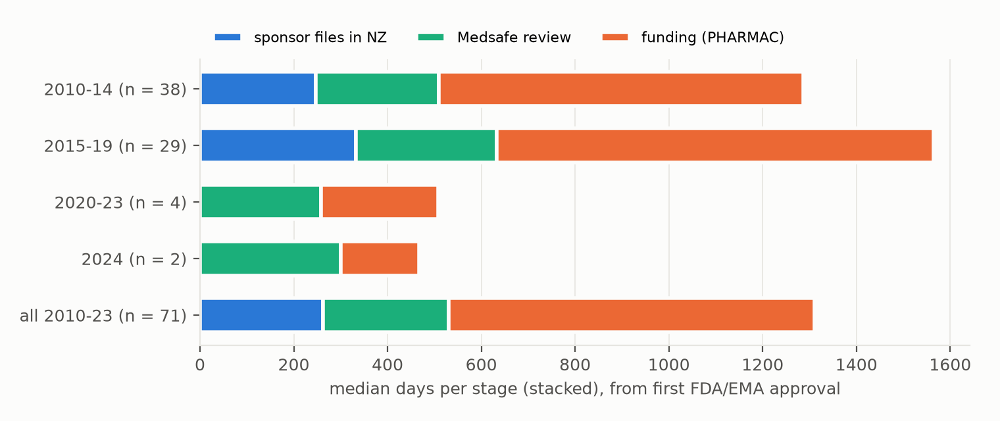
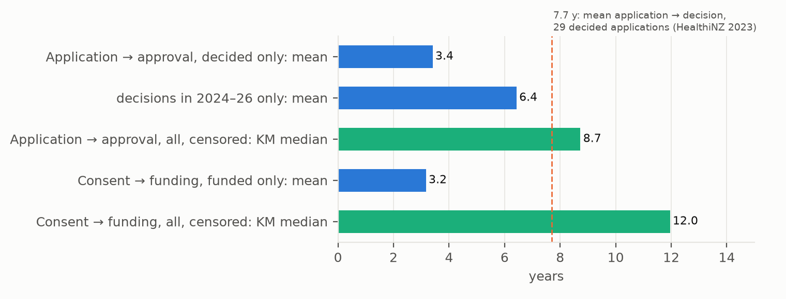
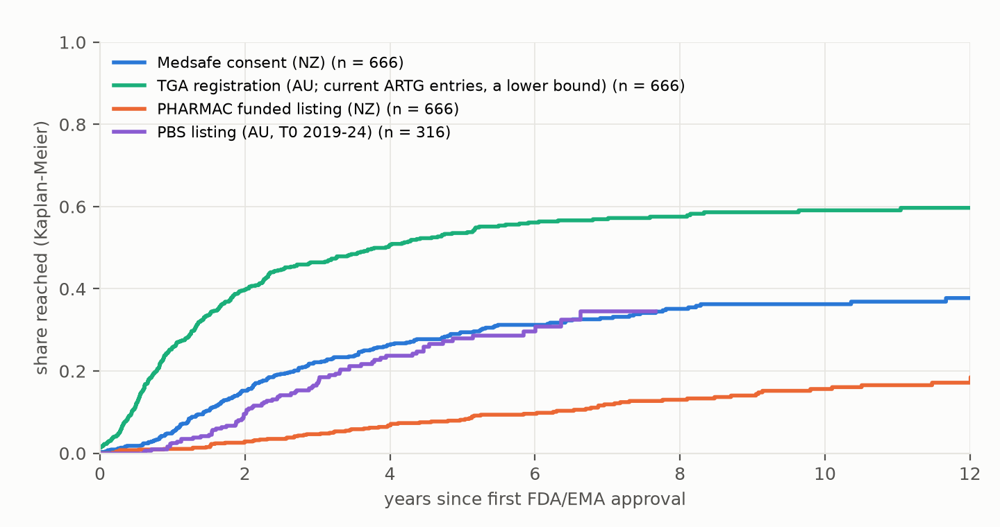

# How long does a new medicine take to reach New Zealanders, and which stage takes the time?

*An open, stage-by-stage timeline for 694 new active substances first approved by the FDA (including CBER biologics)
or the EMA in 2010–2024. For each: when it was first approved abroad, when its sponsor applied to Medsafe, when
Medsafe consented, and when PHARMAC first funded it.*

**Verdict: Refuted as preregistered, with one claim holding for the regulator alone.**
- **The regulatory stage as the plan defined it is about 40% of the wait, not under 25% (H1a, Refuted).** Most of
  it is the sponsor's delay before applying in NZ.
- **Medsafe's own review is about 17%**, with the whole interval below 25%, so the lead's claim holds for the
  regulator itself.
- **The industry's "7.7 years" cannot be reproduced** from this cohort's decided funding applications.

- **Where the time goes (H1a).** Among substances first approved 2010–2023 and funded:
  - **Plan's regulatory stage.** The time from first approval abroad to Medsafe consent is **40%** of the time to
    funding (95% interval 33–48%, n = 77). This is the preregistered test, and it is Refuted.
  - **Splitting the stage.** On the 71 substances with every date, it divides into the **sponsor's delay before
    applying in NZ (25%, interval 19–32%)** and **Medsafe's own review (17%, interval 14–20%)**. Funding takes the
    remaining **58%** (interval 50–66%).
  - **Early filers.** 22 of the 71 sponsors applied in NZ before the first FDA or EMA approval.
- **The median total wait for funded substances is 1,668 days**, about 4½ years (H1b, Inconclusive: interval
  1,329–2,134 days, where Supported needed the lower end at or above 1,350).
- **"7.7 years" (H3, Refuted under the preregistered rule).**
  - **What the figure is.** Its source defines it as the mean time from a PHARMAC funding application to a funding
    decision, for 29 applications that had been decided. It counts decided applications only.
  - **This cohort's equivalent.** The same measure here (application to approval, decided only) is **3.4 years**
    (median 2.2, n = 75). For decisions made in 2024–26 alone it is **6.4 years** (n = 18), as long-waiting
    applications were decided.
  - **Counting applications still waiting**, the Kaplan–Meier median is **8.7 years**.
  - **The earlier claim is withdrawn.** The pre-review draft said the figure was "not survivor-weighted, the
    reverse".
- **Australia (H2, not testable as stated).** Australia's open listing records start in 2019. For substances first
  approved in 2019–2024, neither country's median is reached yet. Three years after first approval, 3.6% were funded
  in NZ and 16.9% PBS-listed in Australia.
- **A frozen forecast (H4)** of which of 125 consented but unfunded medicines PHARMAC will fund by October 2027 was
  committed and pushed before any later Schedule edition was used. It will be scored then.

This measures process timing. It does not judge whether any funding decision was right.

## In plain terms

New Zealanders often hear that new medicines take years longer to arrive here, with figures from industry reports
whose workings are not public. We built an open timeline from public records for 694 medicines first approved in the
US or Europe between 2010 and 2024. For each we recorded four dates:
- first approval overseas;
- the company's application to New Zealand's regulator, Medsafe;
- Medsafe's approval;
- PHARMAC's first funding.

Most never complete the journey: roughly three in ten have been approved by Medsafe, and about one in eight funded.
For those that were funded, the whole journey took a median of about four and a half years:
- **Waiting for the company to apply in New Zealand:** about a quarter of the time. Almost a third of companies applied
  here before the first US or European approval.
- **Medsafe's own review:** about a sixth.
- **Waiting for funding after approval:** the rest, almost 60%.

So the regulator itself is a small part of the wait, as the lead suggested. But the "regulatory stage" as we defined
it in advance, which includes the company's delay in applying, is about 40%.

The often-quoted "7.7 years" is the average time from a funding application to a decision, for 29 applications that
had been decided. In our data, decided applications took about 3.4 years on average. Decisions made since 2024
averaged 6.4 years, as long-waiting applications were cleared. Counting applications still waiting, half wait more
than 8.7 years.

Australia's open funding records only start in 2019, so a fair comparison with its funding was not yet possible.

## What was asked

The lead (`future-health-nz-medicine-access-lag`) asked how long new medicines take to reach NZ and which agency is the
bottleneck. Four preregistered hypotheses:
- **H1a:** among substances first approved 2010–2023 and funded, the regulatory stage (first approval abroad to
  Medsafe consent) is under 25% of the total time to funding.
- **H1b:** the median total time is at least 1,500 days.
- **H2:** NZ's median exceeds Australia's PBS median by at least 400 days.
- **H3:** the "7.7 years to a funding decision" figure is reproduced only when unfunded medicines are excluded.

A fifth, prospective test, H4, forecasts which consented, unfunded medicines are funded in the next 12 months.

## What was already known

| Work | What it established | What it left open |
| --- | --- | --- |
| HealthiNZ for Medicines NZ (2023), quoted by Shawview (2023) | mean 7.7 years (median 6.5) from PHARMAC application to funding decision, for 29 decided applications | industry-commissioned; data not released |
| IQVIA via Medicines NZ (2025) | funded medicines waited an average of 1,050 days from registration to funding, against 481 in Australia | funded-only; data not released |
| BMS-sponsored review (2026, tabled in Parliament) | "delays of 7–10 years between Medsafe approval and funding occur for many medicines" | no denominator |
| NZMJ waiting-list study (industry-funded) | some recommended medicines waited more than 8 years | no regulatory stage, no matched cohort |
| CSIRO-published analysis (J Prim Health Care) | much of the delay reflects PHARMAC's assessment; agency roles overlap | no open decomposition |

No open, stage-decomposed, reproducible dataset existed.

## How it was done

**Cohort.**
- **Definition.** Every substance whose first approval by the FDA or the EU fell in 2010–2024:
  - FDA: Drugs@FDA, plus CBER biologics from the FDA Purple Book, which Drugs@FDA omits (D8b, D8c);
  - EU: EMA centralised approvals, excluding generics and biosimilars.
- **FDA-first entries** had to come through a new-molecular-entity NDA or an original BLA.
- **Excluded:** vaccines, diagnostics, allergens, and old substance concepts under new names (D8b).
- **Names** were normalised (salts and hydrates removed). The same drug under FDA and EMA name variants was merged with
  the earliest date, and a multi-component product counts once (D6, D8b).
- **Size.** **694 substances** (FDA first 550, EMA first 144).
- **Old substances.** 28 more were excluded because Medsafe consented them, or PHARMAC listed them, more than a year
  before their first FDA or EMA approval. 8 of these were already in PHARMAC's first Hospital Medicines List (October
  2013), so their first funding date is unknown. That leaves **666** for analysis.

**Sources, all public.**

| date | source |
| --- | --- |
| T0 | Drugs@FDA, the EMA medicines table, and the FDA Purple Book (September 2026 export, sha256 in `results/tables/purplebook_SHA256SUMS`) |
| T1, T2 | Medsafe's Product and Application searches, queried substance by substance in a headless browser, since the search is an interactive web app. T1 counts new-medicine and Section 23 provisional-consent applications |
| T3 | PHARMAC's monthly XML archives of the community Pharmaceutical Schedule (2006–2026) and the Hospital Medicines List (October 2013–2026), with Schedule Update PDFs filling the archive's gap (June 2024 to December 2025, January 2018) |
| T3_AU | the PBS Medicine Status Website (submissions considered from July 2019) |
| T_app, T_dec, T_TGA | from the [UoA-eResearch/pharmac](https://github.com/UoA-eResearch/pharmac) repository (commit 3e3e850): PHARMAC application-tracker data, a Medsafe register snapshot and the TGA register |

**Data cutoff.** The October 2026 Schedule (1 October 2026). The plan said 1 November 2026, but no November edition
existed when the analysis ran.

**Validation, before any lag was computed (plan §4).**
- **First check.** 150 random substances were adjudicated against the saved evidence.
  - Precision as first scored: T1 0.985, T2 0.966, T3 0.979.
  - What it exposed: duplicate substances, and names Medsafe shortens ("Polatuzumab" for polatuzumab vedotin). These
    were fixed (D6).
- **Re-validation.** A fresh 100 then gave T1 1.000, T2 0.990, T3 1.000.
- **Re-scoring after review.** The review found four cells in these samples where a Section 23 provisional-consent
  application was visible in the evidence but had been scored correct or "cannot tell" (D8b.5). Re-scored:
  - first check: 0.970 / 0.959 / 0.979;
  - re-validation: 0.980 / 0.980 / 1.000.
- **The reviewer's own re-adjudication** of 70 substances gave T1 0.89, T2 0.94, T3 1.00. That sample was enriched
  for present dates, so it is not a precision estimate.
  - Its disagreements were provisional-consent cases, two T1s missed for the same reason, and tenofovir alafenamide,
    which Medsafe lists as "Tenofovir".
  - The linking now finds those T1s. The full-consent T2s of converted products are bounded (see Limitations).
    Tenofovir alafenamide's T2 now comes from a brand-name match, but its T1 is still missing.
- **Crawl completeness check.** Against the Medsafe register snapshot (the same register, the same name matcher), 663
  of 664 comparable substances agree. The exception is tenofovir alafenamide, whose consent comes from a brand-name
  match (D8b.7).
- **Recall.** A sample of 50 new PHARMAC listings was checked.
  - The 10 that were cohort substances were all in the cohort, with the right date.
  - Of the other 40, 28 were first approved by the FDA or EMA before 2010. The remaining 12 were vaccines, nutritional
    products, or old medicines under NZ names (cefalexin, chlortalidone, benzbromarone, epoetin alfa).

**Cohort corrections after review (D8b, D8c).** The review found that the cohort's error was larger than the draft's
"about 2%".
- **Wrong entries.** Of the 705 pre-review entries, **62 (8.8%) were wrong**:
  - 30 were duplicates, extra components of one product, old substances, diagnostics, or misnamed;
  - 32 had a late first-approval date, a median 266 days late: 28 CBER biologics, and 4 FDA/EMA name pairs not
    yet merged.
- **Missing substances.** 17 were missing: 14 CBER-only products and 3 that an earlier CBER date brings into the window.
- **What changed downstream.** Among entries present both before and after correction, 9 T1s moved (all provisional
  consent), 1 T2 (tenofovir alafenamide) and no T3.

**Analysis.**
- **H1a:** the aggregate share Σ(T2−T0) / Σ(T3−T0), with a 2,000-resample substance bootstrap.
- **Censoring-aware measures:** Kaplan–Meier and restricted mean survival to 10 years, censored at the cutoff.
- **Competing risks:** funding against consent lapsing first (Aalen–Johansen).

## Results

### H1: where the time goes

Of 612 substances first approved 2010–2023, 84 have been funded. 77 have the dates in order (first approval, then
consent, then funding) and form the H1 population. Of the other 7:
- 4 were funded before Medsafe consent;
- 2 were funded with no consent;
- 1 was consented in NZ before its first FDA or EMA approval.

**H1a, Refuted.** The regulatory stage (T0→T2) is **40%** of the total time to funding (aggregate 0.40, 95% interval
0.33–0.48; median per substance 0.40). The plan's threshold was below 25%.
- **Provisional-consent bound.** For 2 of the 77, the first consent may have been a provisional one that the register
  no longer shows. Taking T2 no later than the Section 23 application gives 0.40.
- **Pre-review value.** As run before review, the share was also 0.40 (n = 74).

**H1b, Inconclusive.** The median total time is **1,668 days** (interval 1,329–2,134) for the 77. It is 1,483 for all
84 funded. Supported needed the interval's lower end at or above 1,350.
- **Pre-review values.** As run before review: 1,556 days (1,329–2,200), also Inconclusive.

**The stage split (Figure 1).** 71 of the 77 have a Medsafe application date. A sponsor that applied in NZ before the
first FDA or EMA approval is given a sponsor delay of 0. That applies to **22 of the 71 (31%)**: for almost a third
of funded medicines, NZ was not waiting for the sponsor at all.

| stage (n = 71) | median days | share of total | 95% interval |
| --- | --- | --- | --- |
| sponsor's delay before applying in NZ (T0→T1) | 262 | 25% | 19–32% |
| Medsafe's review (T1→T2) | 269 | 17% | 14–20% |
| funding (T2→T3) | 780 | 58% | 50–66% |
| regulatory stage as preregistered (T0→T2) | — | 42% | 34–50% |

- **Read with care.** The median total for these 71 is 1,610 days, and stacked medians do not sum to it.
- **What Medsafe's review includes.** The Medsafe stage is calendar time, including time the sponsor takes to answer
  Medsafe's questions.
- **The lead's claim for the regulator alone holds.** Read as "Medsafe's review is under 25% of the wait", it holds
  with the whole interval below 25%. The preregistered stage includes the sponsor's choice of when to apply, and the
  plan fixed that definition in advance (D1.2).
- **Correction.** The pre-review draft's stage table dropped the 22 early filers. That had inflated the sponsor delay
  to 30% and shrunk Medsafe's share to 14%.

**Inside the funding stage.**
- **Application between consent and funding (34 substances).** It took 129 days from consent to the PHARMAC
  application, and **984 days** from application to listing: 88% of the funding stage.
- **Application before consent.** A further 40 funded substances had a PHARMAC application before Medsafe consent, so
  the two processes often run in parallel.



*Figure 1. Median days per stage for funded new active substances with all four dates, by period of first approval.
Sponsors that applied in NZ first have a sponsor delay of 0. Stacked medians do not sum to the median total. 2020–23
has only 4 substances so far.*

### H3: what "7.7 years" measures

**The source's definition.** HealthiNZ's April 2023 report for Medicines NZ, quoted by Shawview (2023, pp. 10 and 26),
defines the figure.
- **The figure.** For the 29 applications that achieved a funding decision, the decision came on average 7.7 years
  after the application was submitted to PHARMAC (median 6.5).
- **What that makes it.** An application-to-decision statistic that counts decided applications only.
- **What the plan tested.** The preregistered test used a different interval, Medsafe consent to funding.

| measure (years) | PHARMAC application → approval to fund | Medsafe consent → funding (preregistered) |
| --- | --- | --- |
| decided or funded only: mean | **3.4** (n = 75) | 3.2 (n = 80) |
| decided or funded only: median | 2.2 | 2.1 |
| decided only, decisions in 2022–23: mean / median | 4.1 / 3.6 (n = 10) | — |
| decided only, decisions in 2024–26: mean / median | **6.4 / 5.6** (n = 18) | — |
| all, censored: Kaplan–Meier median | **8.7** (n = 175) | 12.0 (n = 205) |
| all, censored: restricted mean to 10 years | 6.6 | 7.0 |

**H3, Refuted under the preregistered rule.** The rule asked whether the funded-only consent-to-funding mean falls
within 7.7 ± 1 years. It does not (3.2).

**What can be said about the figure.**
- **Survivorship cannot explain 7.7 years.** The source counts decided applications only, as the lead suspected. But
  this cohort's decided-only equivalent is 3.4 years, so leaving out undecided applications does not produce it here.
- **Recent decisions come closest.** Decisions made in 2024–26 averaged 6.4 years, and decisions in 2022–23 averaged
  4.1. A mean taken over a window in which long-waiting applications are being decided can be much longer than the
  typical wait.
- **The populations differ.** HealthiNZ's 29 applications came from PHARMAC's waiting lists. These are the first
  approvals of new active substances, and this study counts approvals only, not declines. That difference may account
  for the rest.
- **The horizon matters.** The censoring-aware restricted mean depends on the chosen horizon: 4.0, 5.6, 7.0 and 8.0
  years for horizons of 5, 7.7, 10 and 12 years. The pre-review draft's statement that "7.7 fits" a censoring-aware
  measure rested on the preregistered 10-year horizon, and is withdrawn.
- **The whole cohort.** Counting from first approval abroad, fewer than half the cohort is funded within the
  follow-up, so the median is not reached. The restricted mean to 10 years is 9.2 years.

**Of the consented medicines (n = 205):**
- 33% were funded within 5 years and 44% within 10;
- 24 had their consent lapse or be revoked before any funding (Aalen–Johansen cumulative incidence of funding: 0.33 at
  5 years, 0.44 at 10).

**The other industry figures, as their sources define them:**
- **"Delays of 7–10 years between Medsafe approval and funding occur for many medicines" (2026).**
  - Among funded medicines, 9 of 80 waited at least 7 years: 4 waited 7–10 years and 5 waited more than 10.
  - Counting medicines still waiting, 60% of consented medicines are unfunded 7 years after consent (Kaplan–Meier).
- **"1,050 days" (IQVIA): a funded-only average from registration to funding.**
  - The like-for-like figure here is the funded-only mean from consent to funding, **1,156 days**, a little above
    1,050. The median is 778 days.



*Figure 3. The 7.7-year figure against this cohort's decided-only and censoring-aware equivalents.*

### H2: Australia, and the two regulators

**H2, not testable as stated.**
- **Coverage.** The PBS Medicine Status Website records submissions considered from July 2019. H2 was therefore
  restricted to substances first approved 2019–2024 (316).
- **Events so far.** 15 have been funded in NZ and 77 PBS-listed in Australia. Neither median is reached.
- **Three years after first approval:** **3.6%** funded in NZ against **16.9%** PBS-listed in Australia.

**A secondary regulator comparison (D3.3)** covers the whole cohort, with a large caveat.
- **The caveat.** The TGA register file lists current entries only. The review found at least 18 NZ-consented
  substances that were registered in Australia and later cancelled (Sovaldi, Daklinza and Praluent among them), and are missing. Some
  dated entries are later replacements.
- **What the comparison can say.** The Australian curve is therefore a lower bound on TGA registration.
  - By 2 years after first approval: 15% were Medsafe-consented, against at least 40% TGA-registered.
  - By 5 years: 30% against at least 54%.
- **What was dropped.** The pre-review draft's paired median ("Medsafe 427 days after the TGA") compared a
  full-history register with a current-only one, and is dropped.



*Figure 2. Cumulative share of new active substances reaching each milestone, by years since first FDA/EMA
approval (Kaplan–Meier). The PBS curve covers only substances first approved 2019–2024. The TGA curve uses current
register entries only and is a lower bound.*

### H4: the frozen forecast

**The model.** A logistic model was trained on 977 substance-years: 2012–2024 snapshots, with a base rate of 6.9%
funded within 12 months. It gives a probability for each of the 125 substances consented but unfunded at the cutoff.

**Freezing.** The forecast file (`results/forecast_2026.csv`, sha256 70b7aec5…) was committed and pushed before any
Schedule edition after the origin was used. The 16 October 2026 Schedule Update (effective 1 November) had been parsed
for the gap fill, and it contains none of the 125.

**Scoring.** After October 2027, `code/score_forecast.py` scores it against the base rate. It matches funding by the
names the linking used, frozen in `results/forecast_2026_match_names.csv` (sha256 6cc3392c…, D8a), so that, for
example, a 2027 listing of "isavuconazonium" counts for isavuconazole.

**Caveats for the scoring:**
- 24 of the 125 have a lapsed or revoked consent.
- One, alpha1-proteinase inhibitor, has since been excluded from the cohort as an old substance; it stays in the frozen
  forecast.
- The review found that the model's time trend is extrapolated at the origin, and that its leave-one-snapshot-out
  skill is about zero. A null result in 2027 would not be a surprise.

## What this does and does not show

- **It shows where the time goes for medicines that complete the journey.**
  - The largest single block is the wait for funding.
  - The next is the sponsor's delay before applying in NZ, and almost a third of sponsors apply before the first
    approval abroad.
  - Medsafe's own review is the smallest. "Regulatory delay" in public debate often lumps the sponsor's choice in
    with the regulator.
- **It shows that the definition decides the headline.**
  - Decided-only averages say about 2–3 years, unless the averaging window is one in which a backlog is being cleared.
  - Censoring-aware measures that count medicines still waiting say half of applications wait more than 8.7 years.
- **Not shown:**
  - whether any decision was right;
  - what the delays mean for patients;
  - how access differs between communities. That would need Māori and Pacific health leadership, as the lead's
    engagement note says.
- **Limitations:**
  - **Late T2.** Medsafe's register records the full consent. For the 5 of 209 consented substances known to have
    converted from provisional consent, T2 is late by 1–4 years. A lower bound is reported.
  - **Missing T1.** The Application search failed persistently for 16 substances, which leaves their T1 missing.
  - **Prodrugs and esters of older moieties.** Medsafe can list these under the old moiety. A brand-name match
    recovered one consent (tenofovir alafenamide). Others may remain.
  - **The old-substance rule.** It also excludes medicines that NZ consented first. Prochymal (remestemcel-L), for
    example, was consented in NZ in 2012, 12 years before FDA licensure.
  - **Funding routes.** Hospital and community listings are both counted as funding. Named Patient Pharmaceutical
    Assessment is not.
  - **The gap fill.** The Schedule Update gap fill (D4) set no T3. In each of the 16 gap-window cases, the Hospital
    Medicines List gives the same or an earlier month.
  - **Recent approvals.** The 54 substances first approved in 2024 are too recent for the primary analysis: 3 are
    consented and 2 funded.
  - **Policy change.** Parallel PHARMAC–Medsafe assessment (2024) and the 2026 "Rule of Two" change the process after
    the primary window.

## Process and deviations

Preregistered in `plan.md` (8d0bc67), with all code committed before the outputs it produces. An independent
adversarial review (`review/review.md`) recommended "fix first" with 24 issues. Responses are in deviations D8a–D8c,
`code/review_response.py` and `results/tables/review_response.json`. The pre-review results are kept as
`results/tables/primary_asrun_prereview.json`.

- **D1:** the Australian benchmark restricted to 2019–2024; the regulatory stage split into sponsor and Medsafe;
  the 2010–2023 primary window.
- **D2:** PHARMAC's XML archive used for T3; the old-substance exclusion.
- **D3:** applications, the Medsafe register and the TGA register from the user-suggested UoA-eResearch/pharmac
  repository.
- **D4:** the XML archive gap filled from Schedule Update PDFs.
- **D5:** nine non-new entries excluded; Medsafe retries.
- **D6:** the first validation; duplicate merging, T0 overrides, alias matching.
- **D7:** the fresh-sample re-validation.
- **D8a:** forecast scoring uses the frozen match names. This was committed and pushed before any 2027 data.
- **D8b:** review corrections:
  - CBER first-licensure dates from the Purple Book;
  - more merges and exclusions;
  - dimethyl fumarate;
  - Section 23 applications;
  - left-censoring at the first Hospital Medicines List;
  - brand-name matching;
  - the stage table on one population.
- **D8c:** CBER-only new active substances added to the cohort; the left-censoring rule refined.

## Reproducing it

```
venv/bin/python code/cohort.py                 # cohort from Drugs@FDA, EMA and the Purple Book (data/raw/purplebook)
venv/bin/python code/medsafe.py                # Medsafe searches (Playwright, PLAYWRIGHT_BROWSERS_PATH)
venv/bin/python code/medsafe_parse.py
venv/bin/python code/fetch_xml.py; venv/bin/python code/pharmac.py      # PHARMAC XML archives
venv/bin/python code/fetch_pharmac.py; venv/bin/python code/su_text.py; venv/bin/python code/su_listings.py
venv/bin/python code/msw.py                    # PBS Medicine Status Website
venv/bin/python code/link.py; venv/bin/python code/crosscheck_medsafe.py
venv/bin/python code/validate.py sample|merge; venv/bin/python code/validate.py sample_v2|merge_v2
venv/bin/python code/analysis.py; venv/bin/python code/forecast.py; venv/bin/python code/supplementary.py
venv/bin/python code/review_response.py; venv/bin/python code/figures.py
# after 2027-10-01: fetch_xml.py; pharmac.py; score_forecast.py
```

**Released** in `results/tables/`:
- the result JSONs;
- the stage table;
- both validation adjudications, as scored and re-scored;
- the frozen forecast and its match names;
- the pre-review results.

The linked per-substance table is released as `results/tables/linked.csv`. Its Australian listing column is the first
listing date recorded by the Medicine Status Website, 2019 onwards.
