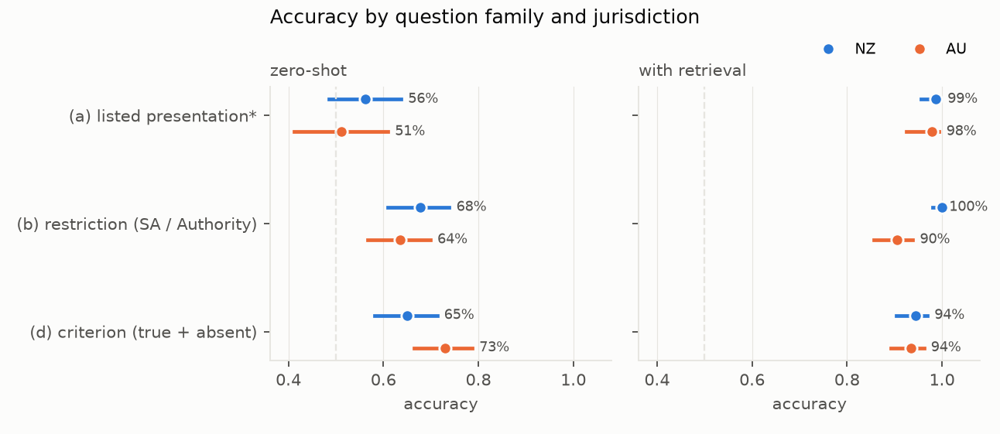
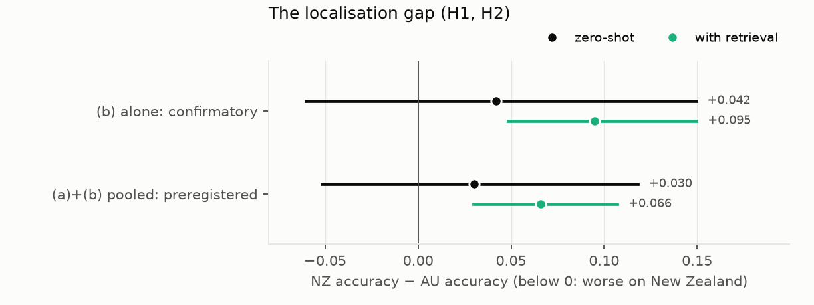
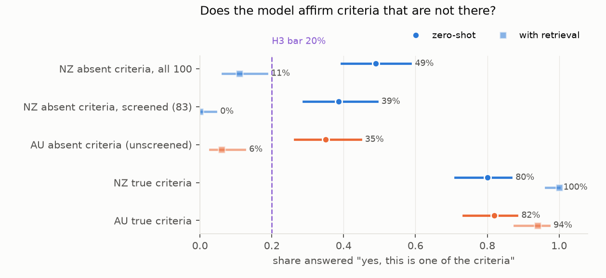

# Does a general language model know which medicines New Zealand funds?

*1,049 yes/no questions about New Zealand's Pharmaceutical Schedule and Australia's PBS, built from the two countries'
structured data and asked of one locally served open model, Nemotron 3 Nano Omni. The questions cover which tablets
and capsules are listed, which need prior approval, and what the eligibility criteria say.*

**Verdict: Inconclusive on the localisation gap; fabrication Supported.**

- **H1 (New Zealand answered worse than Australia): Inconclusive.**
  - The test uses the restriction family (b), as fixed in D5 before any output was read. Zero-shot accuracy is 67.7%
    for New Zealand and 63.5% for Australia: a gap of +4.2 points (95% CI −6.0 to +14.9).
  - The preregistered pooled analysis of families (a) and (b) agrees: +3.0 points (−5.2 to +11.8).
  - The point estimates favour New Zealand. No gap against it was detected.
- **H2 (retrieval closes the gap): Inconclusive**, because the plan only evaluates it when H1 is Supported.
- **H3 (the model affirms invented criteria for at least 20% of NZ items): Supported.**
  - Zero-shot, the model affirms 49 of 100 NZ criteria that are not in the chemical's Special Authority (95% CI
    39–59%).
  - Among the 83 that a hand screen found clearly distinct from the chemical's own criteria, it affirms 32 (39%,
    29–49%).
  - The independent reviewer's blind re-screen of the NZ items agrees on 98 of 100. On its 81 distinct items the rate
    is 37% (27–48%).
  - For Australia the rate is 35% (26–45%) unscreened. On the 86 items the reviewer's screen judged distinct it is
    28% (19.5–38%), whose lower bound falls just below the 20% bar.
  - Family (d) is mostly about cancer medicines: about two-thirds of the counterfactual targets are chemotherapeutic
    agents.

**What else the data show:**

- **Zero-shot answers are dominated by a response bias, not knowledge.**
  - **Restriction questions (b).** The model says "approval required" for 60% of NZ and 68% of AU presentations that
    need none. Accuracy is high on the "yes" items only.
  - **Listing questions (a).** It barely discriminates listed from unlisted presentations: for Australia it says
    "listed" to 75% of listed and 72% of unlisted ones. Family (a)'s answer key also failed its check (D5), so these
    numbers are descriptive.
- **When retrieval finds the right entry, the model reads it correctly.** With three BM25 passages from the
  country's own document, listing and restriction answers are 100% correct in both countries whenever the item's own
  chemical passage is among the three.
  - **The unconditional retrieval figures measure the retriever.** These include an apparent NZ lead of +9.5 points on
    restriction questions. For 21 of 200 Australian restriction items, the long passages of oncology drugs were ranked
    out of the top 3, and those items account for all 19 AU errors.
  - **The passages are rendered from the same structured data as the answer key.** So this is the easiest possible
    lookup.
- **With retrieval, the model affirmed none of the 83 screened NZ counterfactuals.** But this is not evidence that it
  checked the target drug's criteria.
  - The target drug's passage was retrieved for only 39% of NZ counterfactuals (26% AU).
  - The passage of the drug the sentence came from, containing it word for word, was retrieved for 90% (58% AU).
  - So the model mostly saw the sentence filed under a different drug.
- **Rewording changes answers.** Asking 100 items again in different words changes 23% of the answers.
- **The benchmark was harder to build than to run.** The plan's 200-item answer-key check passed overall (2.0%
  wrong) but hid two weak cells:
  - **Family (a) negatives.** 2 of 24 sampled were wrong. An exhaustive check of the AU ones finds at least 5 of 47
    (10.6%).
  - **Counterfactual criteria.** About one in six restate one of the chemical's real criteria in other words: 17 of
    100 NZ items in our screen, and 14 of 100 AU items in the reviewer's. The model affirmed all 17 NZ ones.

## In plain terms

People increasingly ask chatbots whether a medicine is funded and who qualifies. We wanted to know whether a typical
open AI model answers these questions worse for New Zealand than for Australia, whose scheme is larger and more
written about.

We built about a thousand yes/no questions in all from the two countries' official funding data and asked them of one model. The
questions were of three kinds: is this tablet funded, does it need special approval, and is this one of the
eligibility rules.

We found no sign that New Zealand questions were answered worse. If anything they were answered slightly better, but
not by a clear margin. The bigger problem was the same in both countries: the model mostly guessed. It tended to say
"approval needed" whether or not it was. It could barely tell a funded tablet from an unfunded one.

It also often agreed that a made-up eligibility rule was real. We took a genuine rule from a similar medicine and
asked whether it applied. The model said yes about 4 times in 10 for New Zealand, and roughly 1 time in 4 to 1 in 3
for Australia.

When our search handed the model the right entry from the funding document, it answered correctly. That text came
straight from the same data we marked the answers against, so this is the easiest possible version of "looking it
up". Our simple search sometimes failed to find the entry, especially for cancer medicines with long rules.

The practical lesson: for funding questions, a model like this should be made to read the actual Schedule entry, not
answer from memory. This is one model, and it says nothing about clinical advice.
## What was asked

General-purpose language models are increasingly asked practical questions about medicines, including whether a
medicine is funded and what a patient must meet to get it. Funding rules are national. New Zealand's Pharmaceutical
Schedule is far smaller than Australia's Pharmaceutical Benefits Scheme (PBS), and far less written about. A model
trained mostly on international text might know Australia's rules better.

The study asks three preregistered questions (`plan.md`) of one locally served open model, Nemotron 3 Nano Omni:

- **H1 (localisation gap):** is zero-shot accuracy lower on New Zealand questions than on matched Australian ones?
- **H2 (retrieval closes it):** if so, does giving the model three passages from the jurisdiction's own document
  close at least half the gap?
- **H3 (fabrication):** does the model affirm a plausible but absent eligibility criterion for at least 20% of New
  Zealand counterfactual items?

## What was already known

The novelty search (2026-10-18) found one close relative: a Korean benchmark of reimbursement eligibility for
anticancer drugs (*JMIR* 2026), in which models filled information gaps rather than abstain. No benchmark of New
Zealand or Australian funding rules was found.

## How it was done

**Sources.**
- **New Zealand.** The Pharmac Schedule XML, Community section, October 2026 for the answers and November 2025 for the
  stability rule.
- **Australia.** The PBS API v3 (public key), General Schedule items, restrictions and prescribing texts for October
  2026 (schedule 4751), and November 2025 (the API's earliest) for the stability rule.
- Chemicals are matched across the two by normalised INN name; only the 201 chemicals present in both are used.
- An item's answer must be the same in both editions of its jurisdiction.

**Question families** (`code/generate.py`), each a yes/no question with a key from the structured data:
- **(a) Listed presentation.** "Is [chemical strength form] listed …?" Single-ingredient tablets and capsules only.
  Negatives are presentations listed in the other jurisdiction but not in this one. NZ 80 yes / 80 no; AU 47 / 47.
- **(b) Restriction.** "Does subsidy of [presentation] require a Special Authority / an authority prescription?"
  NZ 95 yes / 100 no; AU 100 / 100.
- **(d) Criterion.** "Under the criteria for [chemical], is '[sentence]' one of the criteria?" 100 true criteria
  (the chemical's own) and 100 counterfactuals (a sentence from another chemical's restriction in the same ATC level-2
  group, absent from this chemical's text by normalised string match) per jurisdiction.
- 1,049 items in all (NZ 555, AU 494), at most 3 per chemical per family and answer, so up to 6 per chemical in a
  family.
- **Snapshot.** The family (d) sample depends on Python's string-hash order as well as the seed. The items, passages
  and answers used are therefore committed as a snapshot (`results/snapshot/`, with SHA-256 sums), which defines the
  benchmark (D6).
- **Scope of the AU universe.** The parser treats "containing" as a combination marker. So 272 AU single-ingredient
  presentations listed as "Tablet containing …" are left out, and some AU family (a) negatives are actually listed.

**The answer-key check.** 200 random items were checked by hand. The NZ half was checked against the Schedule PDF,
which the generator did not parse. The AU half was checked against the raw PBS API records, which it did. So that half
checks the generator's parsing, not the API against the printed Schedule (D3).
- **Round 1:** 9 of 200 wrong (4.5%), but 7 of the 29 family (a) negatives. The plan's one allowed fix was applied
  (D4) and the items regenerated.
- **Round 2** (a fresh 200): 4 of 200 wrong (2.0%), passing the plan's 5% bar. But 2 of 24 family (a) negatives were
  wrong, failing the stricter bar D4 set for that cell, and 2 of 31 counterfactuals restated one of the chemical's own
  criteria in other words.
- **Consequences, fixed before any model output (D5):**
  - family (a) is descriptive only;
  - H1 and H2 are decided on family (b), with the preregistered pooled (a)+(b) analysis reported alongside;
  - all 100 NZ counterfactuals were screened by hand: 17 overlap the chemical's own criteria (12 equivalent, 5
    overlapping). H3 is tested on all 100 and on the 83 distinct ones, and is decided only if both agree.

**Model runs** (`code/run.py`). Nemotron 3 Nano Omni on the lab's local vLLM server, temperature 0, JSON-schema
answers (yes / no, plus "not stated" when abstention is offered), up to 16,384 tokens, under three conditions:
- **zero-shot:** the question alone;
- **retrieval:** the question with the top 3 passages from a BM25 index of the jurisdiction's own document (one
  passage per chemical, rendering its listed presentations, restriction flag and criteria);
- **retrieval with abstention.**
- A paraphrase check re-asks 100 random items zero-shot in different words.

**Analysis** (`code/analysis.py`). Exact-match accuracy. The NZ − AU gap uses a chemical-cluster bootstrap (2,000
resamples). Fabrication rates use Wilson intervals.

## Results

### Accuracy (`results/tables/accuracy.csv`, `results/figures/F1_accuracy.png`)

| family | NZ zero-shot | AU zero-shot | NZ retrieval | AU retrieval |
|---|---|---|---|---|
| (a) listed presentation* | 56.3% (160) | 51.1% (94) | 98.8% | 97.9% |
| (b) restriction | 67.7% (195) | 63.5% (200) | 100% | 90.5% |
| (d) criterion, true and absent | 65.0% (200) | 73.0% (200) | 94.5% | 93.5% |

*Descriptive only: family (a)'s key failed its check on negatives (D5).

- **Errors.** Five of the 3,247 calls returned empty content from the server after one retry. As preregistered, they
  are scored as incorrect.
- **Retrieval misses** (`code/retrieval_diagnostics.py`, `results/tables/post_review.json`).
  - BM25 put the item's own passage in the top 3 for:
    - restriction items: NZ 100%, AU 89.5%;
    - listing items: 96% in both;
    - criterion items: NZ 70%, AU 60%.
  - When it did, listing and restriction accuracy was 100% in both countries.
  - All 19 Australian restriction errors are among the 21 items whose long oncology or immunology passages were
    ranked out.

### H1 and H2: the localisation gap (`results/tables/primary.json`, `results/figures/F2_gap.png`)

| | NZ − AU, zero-shot | NZ − AU, retrieval | H1 |
|---|---|---|---|
| **(b) alone: confirmatory (170 chemicals)** | **+4.2 points (−6.0 to +14.9)** | +9.5 (+4.8 to +15.0) | **Inconclusive** |
| (a)+(b) pooled: preregistered (184 chemicals) | +3.0 (−5.2 to +11.8) | +6.6 (+3.0 to +10.7) | Inconclusive |

- **H1.** Neither interval excludes zero, so H1 is Inconclusive under both analyses.
  - Its Supported condition, an upper bound below 0, is far from met: the data lean the other way.
  - H1 could not be Refuted either, because the lower bounds are below zero.
- **H2** is evaluated only if H1 is Supported, so it is Inconclusive.
- **The retrieval column describes the retriever, not the model.** Conditional on the own passage being retrieved,
  the NZ − AU gap on restriction items is 0.
- **Youden's J removes the yes-bias** (yes-rate on true "yes" minus yes-rate on true "no", zero-shot). It gives the
  same picture: NZ − AU +0.10 (−0.04 to +0.24) for (b), and +0.06 (−0.08 to +0.22) pooled.

### H3: affirming criteria that are not there (`results/figures/F3_fabrication.png`)

| criteria shown | zero-shot "yes" | with retrieval |
|---|---|---|
| **NZ absent, all 100 (preregistered)** | **49% (39–59%)** | 11% |
| **NZ absent, screened 83 (D5)** | **39% (29–49%)** | 0% |
| NZ absent, the 17 that overlap own criteria | 17 of 17 | 11 of 17 |
| NZ absent, reviewer's blind screen (81) | 37% (27–48%) | |
| AU absent, unscreened 100 | 35% (26–45%) | 6% |
| AU absent, reviewer's blind screen (86) | 28% (19.5–38%) | |
| NZ true criteria (controls) | 80% | 100% |
| AU true criteria (controls) | 82% | 94% |

- **H3 is Supported.** Both Wilson lower bounds are above 20%: 39% on all items and 29% on the screened ones. The
  reviewer's screen gives 27%.
- **The control rows show the source.** Affirming true criteria 80% of the time and absent ones 39–49% of the time
  is a yes-leaning model with some, but limited, knowledge of the rules.
- **The screen worked as intended.** Every one of the 17 overlapping NZ items was affirmed. Without the screen, the
  fabrication rate would be overstated by about 10 points.
- **We did not screen the AU counterfactuals; the reviewer did.** On its screen the AU rate is 28%, with a lower bound
  just below 20%, so the AU equivalent of H3 would not clearly pass.
- **The retrieval column for counterfactuals mostly shows source attribution.** The sentence's source drug's passage
  was retrieved for 90% of NZ and 58% of AU counterfactuals; the target drug's for 39% and 26%.
  - When the target drug's passage was retrieved, the model affirmed 26% (NZ) and 23% (AU) of counterfactuals.
  - On NZ, all 10 were among the 17 equivalent or overlapping items.

### Response bias, abstention and wording

**Yes-rates, zero-shot.** A model with no knowledge would show the same rate in both columns.

| | yes when truly "yes" | yes when truly "no" |
|---|---|---|
| (a) NZ | 45% | 33% |
| (a) AU | 75% | 72% |
| (b) NZ | 97% | 60% |
| (b) AU | 95% | 68% |
| (d) NZ | 80% | 49% |
| (d) AU | 82% | 35% |

- **Accuracy comparisons between countries mix knowledge and bias.**
  - In family (a), the model leans to "not listed" for New Zealand and to "listed" for Australia.
  - So family (a)'s NZ advantage reflects how the questions are balanced, not knowledge.
- **Abstention.** When "not stated" is allowed alongside retrieval, the model uses it mostly where the passages
  genuinely lack the answer:
  - 79–98% of family (a) negatives;
  - 69–88% of family (d) negatives.

  When it does answer, it is right 97% (NZ) and 98% (AU) of the time.
- **Paraphrase.** Re-asking 100 random items zero-shot in different words gives the same answer for 77.

## What this does and does not show

- **One model.** These results describe Nemotron 3 Nano Omni at temperature 0 with fixed prompts, not language models
  in general. Larger or newer models may know these rules better, or show a gap this one does not.
- **No New Zealand penalty was detected, but none was ruled out.** The confirmatory interval runs from 6 points worse
  for New Zealand to 15 points better.
- **Accuracy mixes knowledge with response bias.** The model's "yes" habit sets much of each accuracy figure. A
  benchmark with a different yes/no balance would give different accuracies with the same model.
- **The answer keys are the structured data.**
  - The NZ keys were checked against the Schedule PDF. The AU check verified only the generator's parsing of the API
    records.
  - Family (a) failed that check.
  - The NZ counterfactuals needed a full hand screen. We did not screen the AU ones; the reviewer's blind screen is
    reported alongside.
- **Retrieval here is the best case for reading, but not for search.** The passages are rendered from the same data
  as the key. Even so, BM25 missed the right chemical for 30–40% of criterion items and for a tenth of AU restriction
  items. A real deployment retrieving from the published PDF or website would face both problems.
- **The wording differs between countries.** The AU restriction question names "Authority Required, including
  Streamlined Authority". The NZ question does not gloss "Special Authority". Streamlined codes make the AU "yes"
  class broad. This cannot be separated from knowledge without a wording ablation.
- **Training staleness** applies to both countries. The stability rule removes listing changes within the 11 months
  before October 2026, not older ones.
- **Scope.**
  - Single-ingredient tablets and capsules for families (a) and (b), minus the AU "Tablet containing …"
    presentations.
  - Family (d) is dominated by cancer medicines.
  - The NZ Community section and the PBS General Schedule.
  - The 201 chemicals funded in both countries.
- **No clinical advice** was evaluated. These are facts about funding rules.

## Process and deviations

- **Preregistration.** The plan (`plan.md`) was committed at 6bd3e3c, before any item was generated or model queried.
- **D1:** generator details fixed before generation. These include the November 2025 stability edition (the PBS API's
  earliest), tablets and capsules only, and the AU authority definition (benefit A or S).
- **D2:** family (a) balanced within each jurisdiction.
- **D3:** the evidence used for the AU half of the key check is the raw API records, because the PBS website is
  rendered by JavaScript.
- **D4:** the round-1 key check found generator bugs (units, separators, release labels, wafers, ion-only names,
  generic counterfactuals). The plan's one fix was applied, and a fresh 200 was drawn.
- **D5:** round 2 passed overall but failed the D4 bar for family (a) negatives.
  - Family (a) became descriptive, and H1 and H2 were decided on family (b).
  - The NZ counterfactual screen was added for H3.
  - The model runs started after D5 was committed (17:56). The screen (0cc4cba), the analysis code implementing D5
    (b405223) and the figure code (6f0063a) were committed while the runs were in progress, before any output was
    opened.
- **Errors.** Five calls failed after a retry and are scored as incorrect, as preregistered.
- **D2's counts** (NZ 100/100, AU 66/66) predate D4's regeneration. The final family (a) counts are NZ 80/80 and
  AU 47/47.
- **Independent review** (`review/review.md`): "fix first". The review reproduced every number and confirmed all
  three verdicts. It found:
  - the retrieval results misattributed to the model;
  - a false claim about BM25;
  - the unscreened AU fabrication rate;
  - the inaccurate key-check description;
  - the irreproducible family (d) sample.
- **D6 records the post-review work:**
  - the retrieval diagnostics;
  - Youden's J;
  - the reviewer's screens reported beside ours;
  - the snapshot;
  - the corrected descriptions.

  It also notes that the NZ inheritance code's ATC and brand branches are never exercised on this XML.

## Reproducing it

`code/fetch.py` (needs the public PBS key in `PBS_KEY`), `code/generate.py`, `code/validate.py 2`, `code/run.py`,
`code/analysis.py`, `code/retrieval_diagnostics.py`, `code/figures.py`.

- **The family (d) sample** cannot be regenerated exactly from `generate.py` (string-hash order). Use the committed
  snapshot `results/snapshot/` (items, passages and answers, with SHA-256 sums).

- **The answer-key checks** are in `results/tables/key_validation_round{1,2}.{csv,json}`, and the NZ counterfactual
  screen in `results/tables/nz_counterfactual_screen.csv`.
- **The model** is served by vLLM on localhost:8000 as `nemotron_3_nano_omni`.
- **Results** are in `results/tables/primary.json`, `results/tables/accuracy.csv` and
  `results/tables/post_review.json`. The raw answers are in `results/snapshot/runs.jsonl`.
