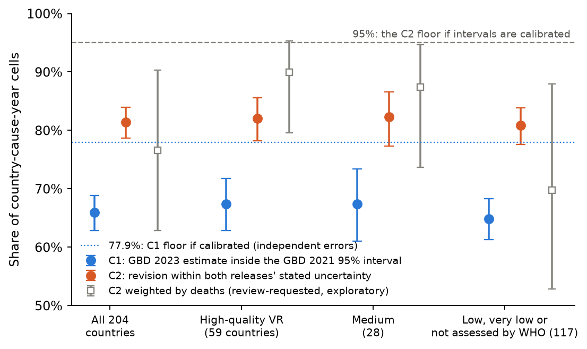
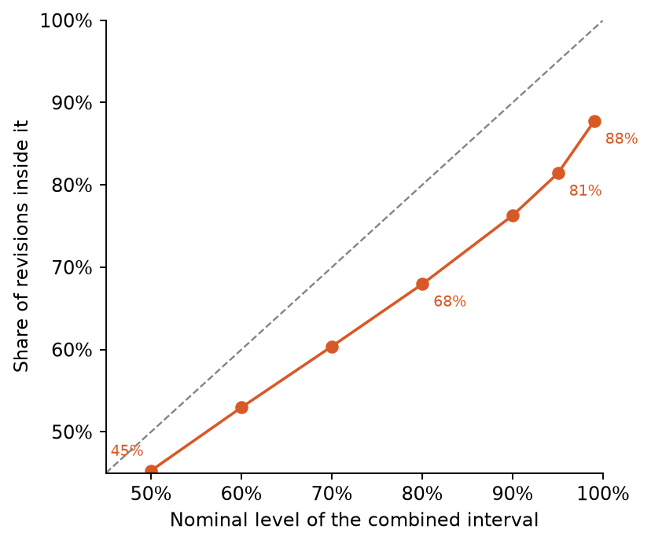
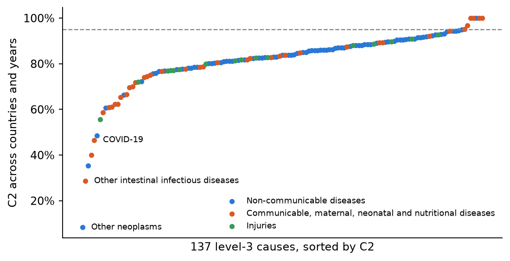
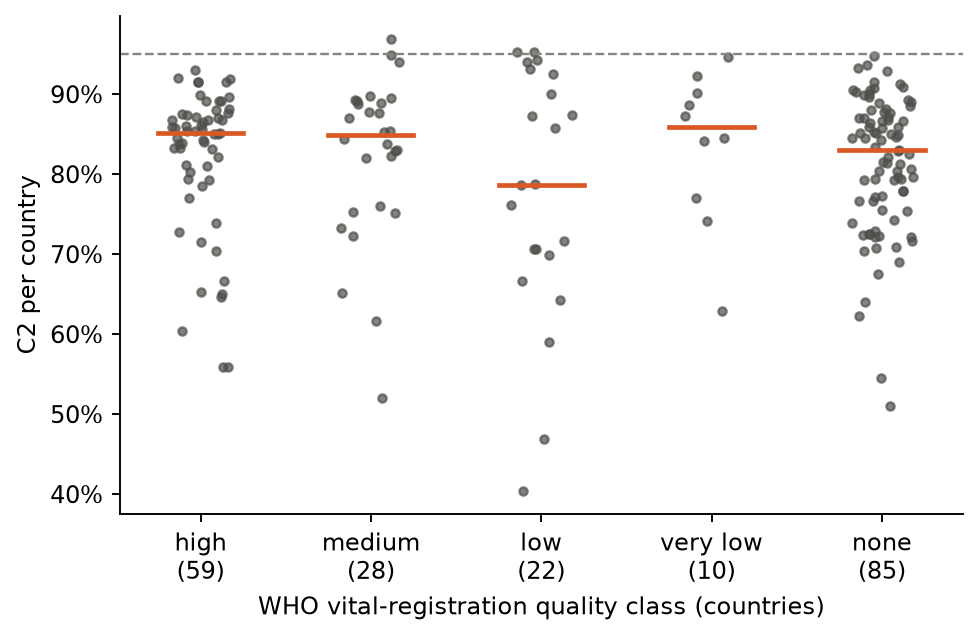

# Do GBD's uncertainty intervals anticipate the next revision?

*A preregistered calibration audit: how often GBD 2023's cause-of-death estimates fall within the uncertainty that GBD
2021 stated, for 204 countries × 137 causes × 2019 and 2021, and whether that depends on the quality of a country's
death registration.*

Run directory: `research-lab/runs/health-econ-gbd-revision-calibration` · Preregistration: [`plan.md`](plan.md)
(commit 6b7a3e2; erratum appended after review) · Departures from it: [`deviations.md`](deviations.md) (D1-D3) ·
Independent review: [`review/review.md`](review/review.md) · 12 October 2026, revised after review

**Verdict: Inconclusive (preregistered headline rule).**

- **The intervals are too narrow (H3 Supported).** In about one cell in five, the GBD 2023 revision is larger than
  both releases' stated uncertainty together allows. Calibrated intervals would allow at most one in twenty.
- **The preregistered data-quality test is a near-null (H4 Inconclusive).** Counting every country-cause cell
  equally, the shortfall is about the same in countries with excellent death registration as in the rest. The gap is
  +1.2 points (95% CI −2.8 to +5.2). Whether that is "Inconclusive" or "Refuted" depends on bootstrap noise and on
  the grouping.
- **Weighting by deaths gives a different picture.** As a review-requested alternative, weighting by deaths, the
  low-quality group's coverage drops to 70% against 90% in the high group. That gap is almost entirely large
  revisions to major causes in China and India.

## In plain terms

The Global Burden of Disease study (GBD) estimates how many people die of each cause in every country. Each estimate
has a 95% uncertainty range, and every two years or so a new round revises the old years.

We checked GBD 2021's ranges against GBD 2023's revised estimates for 2019 and 2021: 204 countries and 137 causes,
about 26,000 country-cause pairs over two years. Both rounds are estimates, so the test allows for both rounds'
uncertainty. If the ranges were honest, at least 95% of revisions would fit. **Only 81% did.** Leaving out the
smallest cells (under one death) gives 83%.

In an exploratory follow-up, most revisions were about the expected size. The problem is a minority of large jumps.
Some are known method changes, and one is a bug that GBD 2023 fixed. Others, such as a near-tripling for "other
intestinal infections", came with no stated change of method.

We expected the ranges to fail most where death registration is poor. **Counting every country and cause equally,
they did not:** well-registered countries fell short just as often. Weighting by number of deaths, the poor-data group
looks much worse. That is almost all China and India, where GBD revised major causes such as stroke, heart disease and
lung disease by more than its ranges allowed.

**For users:** a GBD range understates how far the next round may move the number, in rich and poor countries alike.

## The data

- **Two releases.** GBD 2021 (archived Results tool, version 8016) and GBD 2023 (current tool, version 8352, October
  2025).
- **What was downloaded.** Deaths (number), all ages, both sexes, for 204 countries and territories, for 2019 and
  2021, from each release. The 137 level-3 causes with the same cause ID in both releases are compared.
- **Why this scope.** GBD 2019 can no longer be downloaded, and each release allows about 100,000 rows per user. The
  lab owner ran the downloads through their own IHME account; file checksums are kept with the data.
- **Cells.**
  - 55,896 cells in total, with 52,310 eligible for the naive test (zero-width intervals removed) and 52,219 for the
    calibration test.
  - They make about 26,000 country-cause pairs over two years. The two years are near-duplicates: 91.5% of pairs have
    the same outcome in both.
  - 16% of eligible cells have fewer than one estimated death, mostly rare causes in small countries.
- **Data-quality groups.** These come from the WHO Global Health Estimates 2021 methods report, Table 4.1.
  - **high:** 59 countries, with at least 5 years of data and at least 80% "usable", meaning completeness × the share
    of well-defined causes.
  - **medium:** 28 countries.
  - **low:** 117 countries. Of these, 22 are rated "low" and 10 "very low", and 85 are **not assessed** in Table 4.1.
- **Correction after review.** The draft said those 85 have no data in the WHO Mortality Database. That is wrong.
  Table 4.1 covers only WHO's estimation scope, which leaves out small states and non-member territories. Of the 85:
  - 17 have registration data in GBD's own garbage-code table for 2010-2021: China, India, Taiwan, Bermuda, Guam,
    San Marino, Andorra, Monaco, and others listed in `results/tables/none_class_audit.csv`;
  - 9 have national WHO Mortality Database data since 2010.

  GBD's star ratings are published only as a colour map, so WHO's classes stand in for them.

## Two tests, and what they assume

**C1, the naive test.** Is the GBD 2023 estimate inside the GBD 2021 95% interval? This is what the lead hypothesis
asked. Both releases are estimates with error, so even perfectly calibrated intervals catch the next release's
estimate less than 95% of the time. With the published intervals and independent errors, the expected share is
**77.9%**. That is a floor. With errors correlated at 0.5 it rises to 88.9%, and at 0.8 to 95.6%. The two releases
share most data and methods, so positive correlation is the realistic case.

**C2, the calibration test.** Each release's interval implies a log-scale standard error s, and
z = (ln p₂₀₂₃ − ln p₂₀₂₁) / √(s₂₀₂₁² + s₂₀₂₃²). If both releases' intervals are calibrated, approximately
log-normal, and their errors are not negatively correlated, then |z| ≤ 1.96 at least 95% of the time. The expected
share is 99.2% at a correlation of 0.5.

**An assumption-free version (review-requested).** If both 95% intervals are calibrated, the truth lies in both at
least 90% of the time, so the two intervals must overlap at least 90% of the time. This needs no assumption about
error shape or dependence.

- **Observed overlap:** 88.6% (86.2-90.6), below the floor but not decisively.
- **Under C2's assumptions**, calibrated intervals would overlap 99.3% of the time or more.

The sharp H3 verdict therefore rests on the log-normal and non-negative-correlation assumptions. The assumption-free
check points the same way, but weakly.

## Results



| Preregistered test | Estimate (95% CI) | Rule | Verdict |
|---|---|---|---|
| **H1** C1 < 95% | 65.9% (62.8-68.8) | upper bound < 95% | **Supported** |
| **H2** C1 < 80% in low-quality countries and > 90% in high-quality ones | low 64.9% (61.3-68.3); high 67.4% (62.8-71.8) | high's upper bound ≤ 90% refutes | **Refuted** |
| **H3** C2 < 95% | **81.4% (78.7-84.0)** | upper bound < 95% | **Supported** |
| **H4** C2 gap, high − low quality, at least 5 points | **+1.2 points (−2.8 to +5.2)**; high 82.1%, low 80.9% | Supported needs a lower bound > 0 and a gap ≥ 5; Refuted needs an upper bound < 5 | **Inconclusive** |

CIs are two-way (country × cause) cluster bootstraps, 2,000 draws.

**Headline.** The preregistered rule gives Supported only if H3 and H4 are both Supported, and Refuted if H4 is
Refuted, so the headline is **Inconclusive**.

**The H4 label is fragile.**

- **Bootstrap noise.** H4's upper bound sits within resampling noise of the 5-point line: 4.9 to 5.4 across ten other
  seeds, one of which falls below 5, and 5.3 with 20,000 draws.
- **Other intervals and groupings.** The country-only bootstrap gives −1.8 to +4.1. Three alternative groupings of the
  85 not-assessed countries give gaps of +0.9, −0.2 and +0.2, all with upper bounds below 5 (see the review-requested
  table below).

The substantive reading: with cells weighted equally, a gap of 5 points or more is excluded only at the margin, and a
gap near zero fits the data best. The precision was also worse than planned. The H4 interval is ±4.0 points against
the ±1.9 the synthetic power check predicted, because real between-country and between-cause variation is larger than
assumed.

### Secondary analyses (preregistered; 1,000 bootstrap draws)

| Analysis | C1 | C2 |
|---|---|---|
| Country-only bootstrap (all countries) | 65.9% (64.2-67.7) | 81.4% (80.0-82.8) |
| 2019 only: high / low quality | 71.4% / 66.2% | 85.5% / 81.5% |
| 2021 only: high / low quality | 63.3% / 63.6% | 78.7% / 80.2% |
| All-age death rates (removes population revisions): high / low | 66.6% / 64.7% | 81.5% / 80.8% |
| Communicable, maternal, neonatal and nutritional | 60.0% (54.5-65.8) | 76.0% (70.8-81.1) |
| Non-communicable diseases | 68.8% (65.2-72.4) | 83.3% (79.9-86.3) |
| Injuries | 61.8% (56.6-67.2) | 81.9% (77.5-85.9) |
| Excluding COVID-19: high / low | 67.5% / 65.0% | 82.2% / 81.0% |
| Cells with ≥ 10 deaths in GBD 2021: high / low | 71.9% / 68.0% | 85.6% / 83.8% |
| WHO class high / medium / low / very low / not assessed | 67.4 / 67.4 / 63.8 / 67.9 / 64.8% | 82.1 / 82.3 / 77.7 / 83.6 / 81.3% |
| GBD garbage-code tertile low / mid / high / no registration data | 66.9 / 67.6 / 64.5 / 65.2% | 81.7 / 81.6 / 80.1 / 81.9% |

**Diagnostics.**

- **C1 against its floor E1.** Over the cells eligible for both tests, C1 is 66.0% against a floor of 77.9%. By group:
  high 67.5% vs 77.0%, low 64.9% vs 78.5%.
- **Direction of misses.** Of the C1 misses, 64.5% are upward revisions.
- **Interval widths.** GBD 2023's intervals are slightly wider than GBD 2021's: the median ratio of s is 1.08, similar
  in each group. A narrowing of the later release's intervals does not explain the result.
- **Mixed model** (miss(C2) ~ group + year + cause group, with country and cause variance components): the odds of a
  miss are 1.06 times higher in the low group (1.03-1.10). That is about a 1-point difference, in line with the
  bootstrap. The variational-Bayes interval is much narrower than the bootstrap's, as is usual for this approximation.

### Review-requested analyses (exploratory; deviations.md D3; `code/review_checks.py`)

| Analysis | Result |
|---|---|
| Distribution-free: the two 95% UIs overlap (≥ 90% if both are calibrated) | 88.6% (86.2-90.6); high 88.2%, medium 89.1%, low 88.7%; gap −0.4 (−3.4 to +2.5) |
| C2 weighted by GBD 2021 deaths | all 76.5% (62.9-90.3); high 89.9% (79.5-95.3); medium 87.4%; low 69.7% (52.8-87.9) |
| Death-weighted C2 gap, high − low | **+20.2 points (+2.1 to +37.2)** |
| Death-weighted C2, low group without China and India | 83.3% (74.4-90.4) |
| Share of the low group's death-weighted misses from China and India | 75%; its ten largest country-cause misses are all in China or India and make up 65% |
| Median per-country death-weighted C2: high / low | 91.4% / 83.1% |
| H4 gap, country-only bootstrap | +1.2 (−1.8 to +4.1) |
| H4 upper bound, ten other seeds / 20,000 draws | 4.9 to 5.4 (one of ten below 5) / 5.3 |
| H4 gap, low = WHO low/very low + not-assessed countries without GBD registration data (100 countries) | +0.9 (−3.1 to +4.9) |
| As above, and the 10 not-assessed countries with GBD registration data and garbage share < 20% moved to high (69 countries) | −0.2 (−4.4 to +3.7) |
| H4 gap, low = only the 68 not-assessed countries without GBD registration data | +0.2 (−4.2 to +4.6) |
| C2 by GBD 2021 deaths in the cell: < 1 / 1-10 / 10-100 / 100-1,000 / 1,000-10,000 / ≥ 10,000 | 71.7 / 77.3 / 83.0 / 85.5 / 86.1 / 86.1% |
| C2 excluding cells with < 1 death | 83.2% (80.7-85.5), 43,855 cells |
| Median stated log-SD s₂₀₂₁: high / medium / low | 0.075 / 0.109 / 0.200 |
| Median absolute log-revision: high / medium / low | 0.084 / 0.116 / 0.262 |
| SD of z: high / medium / low (1 if calibrated) | 4.16 / 2.63 / 2.54; share with \|z\| > 5: 3.8 / 3.8 / 3.6% |

**Why the cell-weighted gap is near zero.** In poorly registered countries GBD states much wider intervals: the median
log-SD is 2.7 times that in high-quality countries. Revisions there are also larger, 3.1 times, so intervals and
revisions scale together. This partly answers Byass et al. (2013), who noted that GBD 2010's intervals for diabetes
mortality were "not appreciably wider" in data-sparse regions. In this panel they are wider, by about the right
factor for typical cells. The heaviest tail of revisions is in well-registered countries (SD of z 4.2). In the 2021
data year that matches the arrival of new registration data and GBD 2023's COVID-19 misclassification correction
(GBD 2023 appendix §3.8). The exploratory year split (X5) shows a +4.0 gap in 2019 and −1.5 in 2021.

**Why the death-weighted gap is large.** A few very large cells dominate the low group's weighted share: stroke,
chronic obstructive pulmonary disease, ischaemic heart disease, COVID-19, diabetes, oesophageal cancer, road injuries
and lower respiratory infections in China and India. Both countries are "not assessed" in WHO Table 4.1. China does
have well-coded registration in GBD's table (garbage share 9.6% for 2010-21); India's is weaker (44%). Their GBD inputs
also include China's Disease Surveillance Points and India's Sample Registration System. So the weighted gap says more
about two countries than about registration quality.

Both weightings are legitimate answers to different questions. Equal cells ask whether the typical country-cause
interval is calibrated. Death weights ask whether the intervals around the deaths that matter are calibrated.

### Exploratory analyses added before review (deviations.md D2)



- **X4, where the misses are.** The combined interval at nominal 50% holds 45.3% of revisions, close to nominal. At
  80% it holds 67.9%, at 95% 81.4%, and at 99% only 87.7%. The SD of z is 3.1 (1 if calibrated), but the median |z| is
  0.77 (0.67 if calibrated). Most revisions are about the size the intervals imply. What breaks calibration is a heavy
  tail of large revisions.
  - **Widening needed.** For 80%, 90% and 95% of revisions to fit, the combined spread on the log scale would need
    widening by 1.5×, 1.8× and 2.2×.
  - **On the natural scale,** 2.2× turns an interval running from 17% below to 20% above the estimate into one from
    33% below to 49% above.
- **X1, Other neoplasms.** This cause has the lowest C2 (8%). Its GBD 2023 estimates are higher by a median factor of
  4.0, and 98% of cells were revised up. The GBD 2023 appendix (p. 361) gives two reasons: fixing "an error during the
  CoDCorrect process that was excluding deaths in the underlying cause 'Other benign and in situ neoplasms' in previous
  cycles", and restoring brain-tumour codes "inadvertently dropped in previous rounds". Excluding it, C2 is 82.0%
  (79.4-84.3).
- **Other intestinal infectious diseases** (review-requested). The second-lowest cause (C2 29%) was revised up by a
  median factor of 2.7, upward in 76% of cells. Yet the GBD 2023 appendix (p. 634) says: "We have made no substantive
  changes to the modelling strategy in GBD 2023." Large revisions are not confined to announced method changes.
- **X2, residual causes.** Excluding the 13 causes whose names start with "Other", C2 is 82.8% (80.6-84.7) and the
  high − low gap is +1.7 (−2.2 to +5.6). One of the 13, "Other pharynx cancer", is a site group rather than a residual.
- **X3, per cause.** The median cause has C2 84%, and only 7 of 137 causes reach 95%. The ten worst causes account for
  18% of all C2 misses: Other neoplasms 3.9%, other intestinal infectious diseases 3.0%, COVID-19 1.1%. The shortfall
  is broad.
- **X5, by year.** The high − low C2 gap is +4.0 points in 2019 (−0.2 to +8.0) and −1.5 in 2021 (−6.0 to +2.7). This
  was not preregistered and needs testing on a future release pair.
- **X6, lopsided intervals.** Using each side's own half-width gives essentially the same results: high 82.1%, low
  80.7%.





## What this means

**The intervals are too narrow, and not just in data-poor places.** In about 19% of country-cause-years the GBD 2023
revision is outside what both releases' stated uncertainty allows. That compares with at most 5% if the intervals were
calibrated, and nearer 1% if, as is likely, the two releases' errors are correlated. The assumption-free overlap check
agrees in direction but only marginally, so how strong this conclusion is depends on the C2 assumptions.

**What GBD says its intervals capture.** GBD describes its modelling as designed to capture uncertainty from
"stochastic variation in input data, age and sex splitting of data, corrections for alternative case definitions or
uninformative cause of death codes, other data manipulations, and model choice". It adds: "it remains a challenge to
fully represent the UIs around estimates, particularly in locations with sparse or absent data" (GBD 2019, *Lancet*
2020). IHME's own check of its cause-of-death models is that "ideally, the 95% UI would capture 95%" of held-out data
(GBD 2023 appendix §4.1.6). That criterion concerns held-out data points, not the next release's estimates.

**The fair reply from IHME.** Each GBD round "supersede[s]" the previous one, and its intervals are conditional on that
round's data and models. Revisions that fix errors (Other neoplasms), add new data, or recode causes are corrections
that no conditional interval claims to cover. We accept that. The point here is narrower. A reader of GBD 2021 had no
way to know that the next round would put a third of its estimates outside the published intervals (C1 66%), or move a
fifth of them further than both rounds' uncertainty allows. The intervals describe model uncertainty, not revision
risk, and users should not read them as the latter.

**Data quality does not explain the typical shortfall.** Counting each country-cause equally, well-registered countries
miss about as often as the rest. GBD's wider intervals in data-poor countries keep pace with their larger revisions. In
well-registered countries the misses are likely to come from recoding, garbage-code redistribution, new years of data
and cause-model changes, but this study does not show which. Weighted by deaths the picture differs, because GBD 2023
moved several of China's and India's largest causes outside their GBD 2021 intervals.

**Precedents.** Dorrington and Bradshaw (*Bull WHO* 2016) found that "the most recent estimates from IHME and WHO lie
outside the respective 95% uncertainty intervals about their previous estimates" for maternal mortality. Zavalis,
Pezzullo and Ioannidis (*JAMA Health Forum* 2026) found this for global risk-factor burden across eight GBD rounds.
This study adds country × cause-of-death detail, a calibration benchmark that allows for both rounds' uncertainty, and
the test against data quality.

## Limitations

- **A later estimate is not the truth.** C2 tests whether the releases' intervals are consistent with the revisions
  between them, not whether either release is accurate.
- **C2 assumes** log-normal errors that are not negatively correlated. The assumption-free overlap check agrees only
  weakly (88.6% against a 90% floor). X6 shows the symmetry assumption is not driving the result.
- **Scope:** two years, which are near-duplicates; level-3 causes; all ages and both sexes; one release pair. All-age
  counts mix revisions to age structure and to population. The rate analysis removes only the population part.
- **Small cells:** 16% of cells have fewer than one estimated death, and their coverage is the lowest (72%). Without
  them C2 is 83%.
- **The data-quality measure** is WHO's classification of what WHO received, not GBD's inputs or star rating. The
  "not assessed" group mixes countries without registration with places that have it but are outside WHO's scope. The
  alternative groupings and the GBD garbage-code measure give the same equal-cell answer.
- **No raw-registration check.** The comparison with raw WHO Mortality Database counts, planned in the original lead,
  was dropped.
- **Same ID, different content.** Causes share IDs across releases but can still change in content: Other neoplasms;
  Other intestinal infectious diseases; Other neurological disorders; Motor neuron disease; Chagas disease.

## Deviations

- **D1:** a one-line crash in the secondary-analysis code. The primary results reproduce exactly.
- **D2:** the exploratory analyses X1-X6.
- **D3:** the review-requested analyses and corrections: the not-assessed class (with an erratum to plan section 4),
  death weighting, bootstrap sensitivity, the overlap check, cell size, and the counts of rows outside their own
  interval. The raw files have 21 such rows in GBD 2021 (5 with a relative excess above 10⁻⁶) and 13 in GBD 2023
  (none above 10⁻⁶), not the 5 and 6 stated in the plan.

See [`deviations.md`](deviations.md).

## Reproduce

```
code/run_all.sh            # build.py -> quality.py -> tests/synthetic_test.py -> analysis.py
cd code && ../venv/bin/python exploratory.py && ../venv/bin/python review_checks.py && ../venv/bin/python figures.py
```

The raw IHME files are not redistributed. `data/raw/ihme/SOURCES.tsv` lists each file's query, checksum and download
date. The tables in `results/tables/` hold only derived shares, never GBD estimates.

## Data and citations

- Global Burden of Disease Collaborative Network. *Global Burden of Disease Study 2021 (GBD 2021) Results.* Seattle,
  United States: Institute for Health Metrics and Evaluation (IHME), 2022. https://vizhub.healthdata.org/gbd-results/
- Global Burden of Disease Collaborative Network. *Global Burden of Disease Study 2023 (GBD 2023) Results.* Seattle,
  United States: IHME, 2024. https://vizhub.healthdata.org/gbd-results/
- GBD 2021 Causes of Death Collaborators. *Lancet* 2024;403:2100-32, appendix 1 (PMC11126520).
- GBD 2023 Causes of Death Collaborators. *Lancet* 2025;406:1811-72, appendix 1 (PMC12535838).
- GBD 2019 Diseases and Injuries Collaborators. *Lancet* 2020;396:1204-22 (PMC7567026).
- World Health Organization. *WHO methods and data sources for country-level causes of death 2000-2021* (Global
  Health Estimates Technical Paper), sections 3.1 and 4, Tables 4.1 and 8.1.
- Zavalis EA, Pezzullo AM, Ioannidis JPA. Instability of Global Burden of Disease estimates of deaths and DALYs from
  major risk factors: a meta-epidemiological analysis. *JAMA Health Forum*, 2026 (PMC12988449).
- Dorrington RE, Bradshaw D. Acknowledging uncertainty about maternal mortality estimates. *Bull World Health Organ*
  2016;94:155-6 (PMC4750434).
- Byass P, de Courten M, Graham WJ, et al. Reflections on the global burden of disease 2010 estimates. *PLoS Med*
  2013;10:e1001477 (PMC3699446).

Used under IHME's non-commercial terms. Results are derived statistics only.
