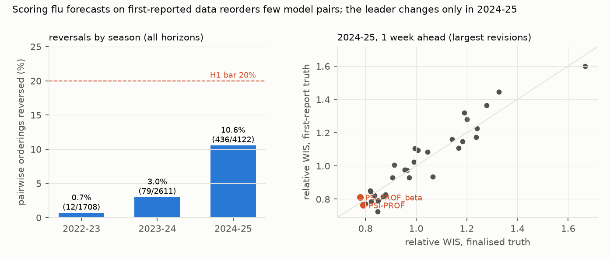

# Re-scoring FluSight forecasts against the data forecasters actually saw barely changes the leaderboard, except in 2024–25, when first reports ran low and the top model changed

*FluSight weekly influenza hospital-admission forecasts, 2022–23 to 2024–25 (33–51 models a season, 563,252 scored
forecasts), were scored by WIS twice: against each location-week's first-reported value, taken from the git history
of the hub's truth file, and against the finalised value. The plan and scoring code were committed before any
forecast was scored.*

**Verdict: H1 Refuted; H2 Supported.**

- **H1 (first-report scoring reverses at least 20% of within-season pairwise model orderings): Refuted.**
  - **6.2%** of 8,441 model pairs reverse (95% bootstrap over reference dates 4.9% to 7.4%).
  - By season: 0.7% (2022–23), 3.0% (2023–24) and 10.6% (2024–25).
  - Rank agreement between the two scorings is high: the Spearman correlation of relative WIS is 0.85–1.00 across
    season × horizons.
- **H2 (the best non-ensemble model changes in at least one season × horizon): Supported, narrowly.**
  - In 2024–25, the leader at 1 week ahead changes from PSI-PROF (first report) to PSI-PROF_beta (finalised), two
    variants from the same team. At 2 weeks ahead it changes from CEPH-Rtrend_fluH to PSI-PROF_beta.
  - These changes appear in 61% and 53% of bootstrap resamples. No other season changes its leader.
- **Revisions explain where it matters.**
  - In 2024–25, first reports were a median 4.1% below final values, and 36% of location-weeks were revised by more
    than 10% (2023–24: 10%).
  - Mean WIS is 144 against first reports and 156 against final values: forecasts sat closer to what was first
    reported.

## In plain terms

Each week during flu season, dozens of teams forecast how many people will be admitted to hospital with flu in every
US state. The CDC's FluSight hub collects the forecasts and ranks the teams. The ranking uses the final hospital
counts, but those counts are often revised in the weeks after they are first reported. Forecasters only ever saw the
first, provisional numbers.

We re-scored three seasons of forecasts against the first-reported numbers. In most seasons, almost nothing changed:
fewer than 1 in 30 head-to-head comparisons between teams flipped. In 2024–25, when early reports ran several percent
low and were often revised substantially, about 1 in 10 flipped, and the top-ranked team changed at two of four
forecast horizons.

So hub leaderboards mostly reflect forecasting skill, not luck with data revisions. When the data are revised
heavily, as in 2024–25, the close calls at the top can depend on which version of the truth is used.

## What was asked

The lead (`health-econ-hub-vintage-rescore`) asked whether published hub leaderboards partly reflect data-revision
artefacts. It predicted at least 20% of pairwise rankings reversing and at least one change of best model.

Prior work, including the hubs' own evaluations and Mathis et al.'s sensitivity checks, scores mostly against
finalised data. This study scores every forecast against reconstructed first reports.

## How it was done

- **Forecasts.** Quantile forecasts with 23 levels, for 50 states, DC, Puerto Rico and the US:
  - 2022–23 from `cdcepi/Flusight-forecast-data`, horizons 1–4 weeks;
  - 2023–24 and 2024–25 from `cdcepi/FluSight-forecast-hub`, horizons 0–3.
- **Truth vintages.** Every commit of each hub's truth file (531 commits in the 2022–23 repository, 126 in the current
  hub).
  - **First report:** the earliest version containing a location-week. Its median lag after the week's end is 2 days
    in 2022–23 and 11 days later; none precedes the week's end.
  - **Finalised:** the latest version.
- **Score.** WIS (Bracher et al. 2021), checked against the pinball-loss identity on 200 random cases.
- **Pairwise orderings.** Pairs with at least 100 common forecasts within a season × horizon. A reversal is a change
  in which model has the lower mean WIS on their common set.
- **Best model.** Lowest relative WIS (Cramer et al. 2022) among models covering at least 80% of cells, excluding
  ensembles and baselines by name.
- **Bootstrap.** Reference dates resampled within season (B = 500).

## Results (`results/figures/F1_reversals.png`)

| season | model pairs | reversed | share | revisions > 10% | median revision (first vs final) |
|---|---|---|---|---|---|
| 2022–23 | 1,708 | 12 | 0.7% | 27% | 0.0% |
| 2023–24 | 2,611 | 79 | 3.0% | 10% | 0.0% |
| 2024–25 | 4,122 | 436 | 10.6% | 36% | −4.1% |
| all | 8,441 | 527 | 6.2% (4.9–7.4) | | |

**Best non-ensemble model, first report → finalised:**
- **2022–23:** PSI-DICE (h1), MOBS-GLEAM_FLUH (h2–h4), unchanged.
- **2023–24:** UMass-flusion at all horizons, unchanged.
- **2024–25:**
  - h0: PSI-PROF, unchanged, though the bootstrap differs in 78% of resamples (a close call);
  - h1: PSI-PROF → PSI-PROF_beta;
  - h2: CEPH-Rtrend_fluH → PSI-PROF_beta;
  - h3: PSI-PROF_beta, unchanged.

## What this does and does not show

- **Leaderboards are robust to revision when revisions are modest.** That held in 2022–23 and 2023–24.
- **Heavier revisions reorder close competitors.** In 2024–25, after national reporting rules changed in late 2024,
  first reports ran low and the top spots at short horizons depended on the truth version. The changes involve
  near-tied models, including two variants of one team's model.
- **First-report scoring favours forecasts that track provisional data.** That may be the right target for a
  real-time decision-support hub, a choice this study informs but does not make.
- **Not shown:**
  - **The COVID-19 Forecast Hub,** not run (D1).
  - **What forecasters actually saw.** They may have used other data streams.
  - **Ensembles produced by the hub under other names.** One (FluSight-lop_norm) is not caught by the name rule,
    but it is never the best model.

## Process and deviations

- **Preregistration:** `plan.md`.
- **Deviations** (`deviations.md`): D1, the COVID-19 hub secondary not run (13.8 GB repository).
- **Independent review:** queued (Fable), per the lab's pacing rule.

## Reproducing it

1. Clone `cdcepi/FluSight-forecast-hub` and `cdcepi/Flusight-forecast-data` into `data/raw/`.
2. `code/build.py vintages`, then `code/build.py forecasts`.
3. `code/score.py test`, then `code/score.py run`.
4. `code/figures.py`.
