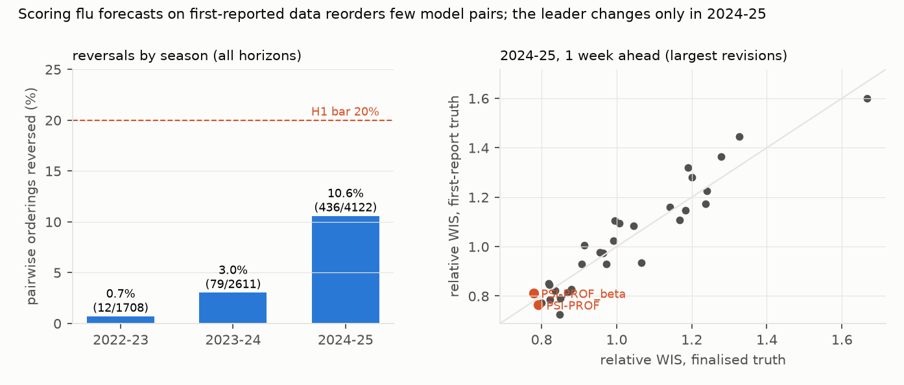

# Re-scoring FluSight forecasts against first-reported data reverses 6% of model pairings; in 2024–25, when first reports ran about 8% low, the top model changed at short horizons, but no more often than it wobbles under a single truth

*FluSight weekly influenza hospital-admission forecasts, 2022–23 to 2024–25 (33–51 models a season, 563,252 scored
forecasts), were scored by WIS twice: against each location-week's first-reported value, taken from the git history
of the hub's truth file, and against the finalised value. The plan and scoring code were committed before any
forecast was scored.*

**Verdict: H1 Refuted; H2 Supported under the preregistered name rule, but not robust to that rule and not
distinguishable from the leader's sampling instability.**

- **H1 (first-report scoring reverses at least 20% of within-season pairwise model orderings): Refuted.**
  - **6.2%** of 8,441 model pairs reverse (95% bootstrap over reference dates 4.9% to 7.4%).
  - By season: 0.7% (2022–23), 3.0% (2023–24) and 10.6% (2024–25).
  - **Late first reports do not change this.** For 8.1% of 2023–24 and 4.6% of 2024–25 scored forecasts, the
    location-week's first hub version came more than 7 days after the week's end. Most of these first appeared a
    month or more later, when the values were largely settled: first and final are identical for 84–98% of such weeks. Dropping them gives 6.4%
    (4.9% to 7.6%), post hoc.
  - Rank agreement between the two scorings is high: the Spearman correlation of relative WIS is 0.85–1.00 across
    season × horizons.
- **H2 (the best non-ensemble model changes in at least one season × horizon): Supported under the name rule.**
  - **Under the preregistered rule** (ensembles and baselines excluded by name), the 2024–25 leader changes at
    1 week ahead, from PSI-PROF (first report) to PSI-PROF_beta (finalised), two variants from the same team. It
    also changes at 2 weeks ahead, from CEPH-Rtrend_fluH to PSI-PROF_beta. No other season changes its leader.
  - **The rule excludes the strongest model** (post hoc). NEU_ISI-AdaptiveEnsemble is a single team's submission,
    removed only because its name contains "ensemble". It has the lowest relative WIS in 2024–25 at h1–h3 under
    first-report truth (0.73, 0.65, 0.62), and at h2–h3 under final truth. If only the hub's own models
    (FluSight-*) and baselines are excluded, the leader changes only at h1 (NEU_ISI-AdaptiveEnsemble →
    PSI-PROF_beta). The name rule is also inconsistent: MIGHTE-Nsemble and the hub's FluSight-lop_norm,
    -trained_mean and -trained_med are ensembles that it does not catch.
  - **The leader is just as unstable under a single truth** (post hoc). In bootstrap resamples, the 2024–25 leader
    at h0–h2 differs from its own point estimate in 55–63% of resamples under first-report truth and 59–65% under
    final truth. The first-report and final leaders differ from each other in 50–77% of resamples. So the change is
    a near-tie at the top, not evidence that revisions pick the winner.
- **Revisions: bias, not size, goes with reversals** (computed per scoring hub on forecast target weeks; corrected
  after review).

  | season (hub) | target weeks | revised > 10% | median \|revision\| | median signed | mean signed | median lag |
  |---|---|---|---|---|---|---|
  | 2022–23 (old) | 1,841 | 47.5% | 9.3% | 0.0% | +4.3% | 1.5 days |
  | 2023–24 (new) | 1,748 | 13.6% | 1.0% | 0.0% | +0.3% | 4.5 days |
  | 2024–25 (new) | 1,625 | 44.1% | 8.6% | −8.0% | −10.5% | 4.5 days |

  - 2022–23 revisions were as large as 2024–25's, without a median bias, and 0.7% of pairs reversed. In 2024–25,
    first reports ran a median 8% below final values and 10.6% reversed. Across three seasons this is an
    observation, not a test.
  - Mean WIS is 144 against first reports and 156 against final values: forecasts sat closer to what was first
    reported.

## In plain terms

Each week during flu season, dozens of teams forecast how many people will be admitted to hospital with flu in every
US state. The CDC's FluSight hub collects the forecasts and ranks the teams. The ranking uses the final hospital
counts, but those counts are often revised in the weeks after they are first reported. Forecasters only ever saw the
first, provisional numbers.

We re-scored three seasons of forecasts against the first-reported numbers. In most seasons, almost nothing changed:
fewer than 1 in 30 head-to-head comparisons between teams flipped. In 2024–25, when early reports ran several percent
low and were often revised substantially, about 1 in 10 flipped, and the top-ranked model changed at two of four forecast horizons (at one of them, between two variants from the same team). But the top few models were so close that the leader also changed in more than half of reshuffled versions of the same season scored against a single truth.

So hub leaderboards are mostly not an artefact of data revisions. When first reports are biased, as in 2024–25, the order of near-tied models can depend on which version of the truth is used, and the rule for which models are eligible matters as much.

## What was asked

The lead (`health-econ-hub-vintage-rescore`) asked whether published hub leaderboards partly reflect data-revision
artefacts. It predicted at least 20% of pairwise rankings reversing and at least one change of best model.

Prior work, including the hubs' own evaluations and Mathis et al.'s sensitivity checks, scores mostly against
finalised data. This study scores every forecast against reconstructed first reports.

## How it was done

- **Forecasts.** Quantile forecasts with 23 levels, for 50 states, DC, Puerto Rico and the US:
  - 2022–23 from `cdcepi/Flusight-forecast-data`, horizons 1–4 weeks;
  - 2023–24 and 2024–25 from `cdcepi/FluSight-forecast-hub`, horizons 0–3.
- **Truth vintages.** Every commit of each hub's truth file (531 commits in the 2022–23 repository, 126 in the current
  hub).
  - **First report:** the earliest version containing a location-week. On forecast target weeks its median lag
    after the week's end is 1.5 days in 2022–23, when the old repository regenerated the file from a daily feed, and
    4.5 days later, at the Wednesday NHSN release. None precedes the week's end. In the new hub, 10% of 2023–24 and
    6% of 2024–25 target weeks first appear more than 7 days late (corrected after review). The two seasons' "first
    reports" are therefore different objects: a Sunday aggregate of a backfilled daily feed, and a weekly release.
  - **Finalised:** the latest version.
- **Score.** WIS (Bracher et al. 2021), checked against the pinball-loss identity on 200 random cases.
- **Pairwise orderings.** Pairs with at least 100 common forecasts within a season × horizon. A reversal is a change
  in which model has the lower mean WIS on their common set.
- **Best model.** Lowest relative WIS (Cramer et al. 2022) among models covering at least 80% of cells, excluding
  ensembles and baselines by name. The relative WIS itself uses every well-covered model.
- **Units.**
  - 186 forecast units were dropped for missing truth values: 179 in 2023–24 (Minnesota 91, Massachusetts 88) and 7
    in 2022–23.
  - Two models submit no quantile forecasts of weekly admissions and are not loaded: SigSci-BECAM (a rate-change
    pmf) and FluSight-base_seasonal (peak targets).
  - One Metaculus-cp file (2025-05-03) was not loaded by the build step.
- **Bootstrap.** Reference dates resampled within season (B = 500).

## Results (`results/figures/F1_reversals.png`)

| season | model pairs | reversed | share | share, late first reports dropped (post hoc) |
|---|---|---|---|---|
| 2022–23 | 1,708 | 12 | 0.7% | 0.7% |
| 2023–24 | 2,611 | 79 | 3.0% | 3.4% |
| 2024–25 | 4,122 | 436 | 10.6% | 10.7% |
| all | 8,441 | 527 | 6.2% (4.9–7.4) | 6.4% (4.9–7.6) |

Revision sizes are in the verdict table above.

**Best non-ensemble model, first report → finalised:**
- **2022–23:** PSI-DICE (h1), MOBS-GLEAM_FLUH (h2–h4), unchanged.
- **2023–24:** UMass-flusion at all horizons, unchanged.
- **2024–25:**
  - h0: PSI-PROF, unchanged, though the bootstrap differs in 78% of resamples (a close call); with late first reports
    dropped, it also changes;
  - h1: PSI-PROF → PSI-PROF_beta;
  - h2: CEPH-Rtrend_fluH → PSI-PROF_beta;
  - h3: PSI-PROF_beta, unchanged.
- **Under one truth** (post hoc, B = 200): how often the 2024–25 leader differs from its own point estimate.

  | horizon | first-report truth | final truth | first vs final (the H2 criterion) |
  |---|---|---|---|
  | h0 | 63% | 59% | 77% |
  | h1 | 61% | 65% | 54% |
  | h2 | 55% | 60% | 50% |
  | h3 | 56% | 38% | 36% |

## What this does and does not show

- **Leaderboards are robust to revision when revisions are modest.** That held in 2022–23 and 2023–24.
- **Biased revisions reorder close competitors.** In 2024–25, after national reporting rules changed in late 2024,
  first reports ran low and 1 in 10 pairs reversed. The leader changes involve near-tied models, including two
  variants of one team's model, and the leader is as unstable across resamples under one truth.
- **2022–23's "final" values are not final.** They are the old repository's last version (November 2023). For the
  same 2,540 location-weeks, the new hub's latest values are identical for only 23% and differ by more than 10% for
  40% (median 0, mean +3.5%). Scored against the new hub's latest values instead, 2022–23 reverses 0.5% of pairs
  (8 of 1,708) and no leader changes (post hoc).
- **First-report scoring favours forecasts that track provisional data.** That may be the right target for a
  real-time decision-support hub, a choice this study informs but does not make.
- **Not shown:**
  - **The COVID-19 Forecast Hub,** not run (D1).
  - **What forecasters actually saw.** They may have used other data streams.
  - **A metadata-based eligibility rule.** Ensembles were defined by name, as preregistered. A future study should use
    the hubs' own model metadata.

## Process and deviations

- **Preregistration:** `plan.md`.
- **Deviations** (`deviations.md`): D1, the COVID-19 hub secondary not run (13.8 GB repository); D2, the fixes after
  review (post hoc).
- **Independent review:** fix first (four major or moderate findings); the fixes are in D2.

## Reproducing it

1. Clone `cdcepi/FluSight-forecast-hub` and `cdcepi/Flusight-forecast-data` into `data/raw/`.
2. `code/build.py vintages`, then `code/build.py forecasts`.
3. `code/score.py test`, then `code/score.py run` and `code/score.py late7`.
4. `code/posthoc_review.py`.
5. `code/figures.py`.
