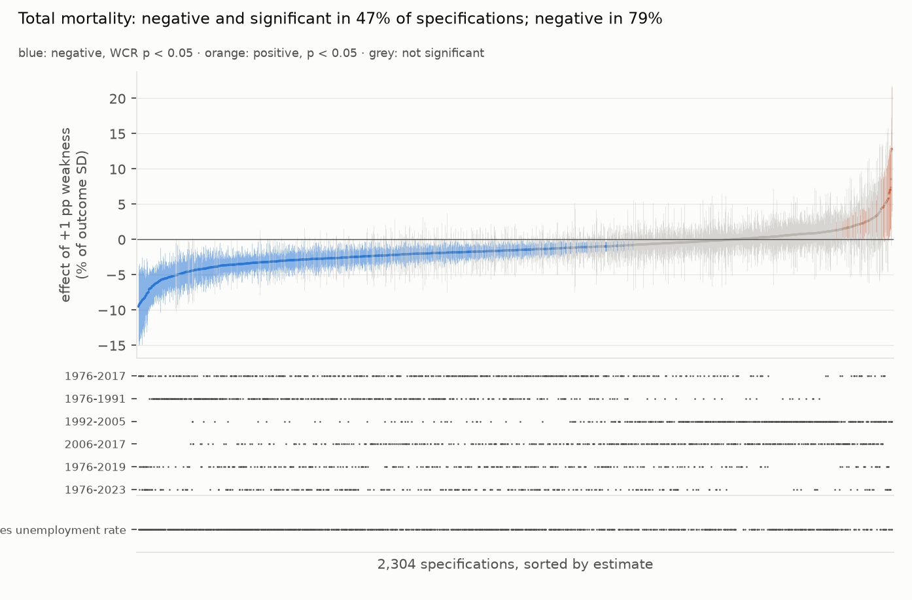
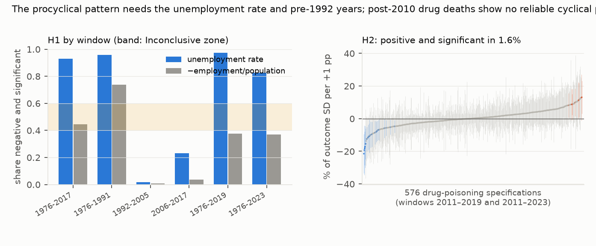

# Do US deaths fall in recessions? Across 2,304 defensible specifications, yes before 1992 and with the unemployment rate; post-2010 drug deaths show no reliable cyclical pattern

*US states and DC, 1976–2023. Deaths come from NBER microdata to 1998, then CDC state counts, spliced and validated
on the overlap years. Economic weakness is the BLS unemployment rate or the negative employment-to-population ratio.
A preregistered specification multiverse varies the outcome, measure, weighting, trends, lags, sample window,
estimator and controls, with wild cluster bootstrap inference by state. The plan was committed before any panel was
built.*

**Verdict: H1 Inconclusive; H2 Refuted.**

- **H1 (the procyclical coefficient is negative and significant in fewer than half of defensible specifications):
  Inconclusive.**
  - **47.4%** of the 2,304 total-mortality specifications are negative and significant under the wild cluster
    restricted bootstrap, inside the preregistered 40–60% band. 79% are negative; 1.7% are positive and significant.
  - **A joint test rules out chance.** Under the null, the median share significant is 1.8% (95th percentile 10%),
    against 49% observed (p < 0.002).
- **The answer depends on two choices.**
  - **The window.** In 1976–1991, 85% of specifications are negative and significant. In 1992–2005 it is 1.4% (about
    40% negative), and in 2006–2017, 13%. The full-period windows owe their significance largely to the pre-1992
    years.
  - **The measure.** With the unemployment rate, the long windows are 83–97% negative and significant. With the
    employment-to-population ratio, 37–44%.
  - Together they account for most of what the choices explain. The main effects of all eight choices explain 43%
    of the variation across specifications; dropping the window loses 28 points and dropping the measure 11.
    Weighting, lags, trends, outcome, estimator and controls lose 0.1–2 points each.
- **The canonical Ruhm specification reproduces the classic result.** Log crude mortality falls 0.52% per point of
  unemployment for 1976–2017 (95% CI −0.92% to −0.13%; bootstrap p = 0.018). The sub-periods split: +0.21% in
  1992–2005 (not significant) and −0.57% in 2006–2017.
- **H2 (post-2010 drug-poisoning deaths are significantly countercyclical in most specifications): Refuted.**
  - Only **1.6%** of 576 specifications are positive and significant; 3.5% are negative and significant.
  - Half the estimates are positive, two thirds in 2011–2019 and one third in 2011–2023.
  - For 1999–2010, 79% are positive but only 8% significant.

## In plain terms

For decades economists have reported a surprising pattern: in the United States, deaths fall during recessions and
rise in booms. Proposed reasons include fewer road crashes, less pollution, and better-staffed care homes when
jobs are scarce.
Later work suggested the pattern had faded, and that deaths from drug overdoses might move the other way.

We rebuilt the state-by-year data from 1976 to 2023. Instead of one analysis, we ran every combination of the
reasonable choices a researcher could make, 2,304 analyses in all. We then counted how many find the classic
pattern.

About half do, which our preregistered rule calls inconclusive. But the split is not random. The pattern is strong in
1976–1991 and largely absent in 1992–2005. It is also much stronger when the economy is measured by the unemployment
rate than by the share of people in work. Overdose deaths after 2010 did not reliably rise with unemployment in
almost any analysis.

So "deaths fall in recessions" holds for the late 1970s and 1980s, and mostly with one way of measuring the
economy. It is not a stable law.

## What was asked

The lead (`health-econ-procyclical-mortality-multiverse`) asked whether the canonical procyclical result survives a
systematic specification curve. Prior work:
- Ruhm (2000) established the pattern for 1972–1991, and Ruhm (2015, *Journal of Health Economics*) showed it
  weakening, with drug poisoning countercyclical.
- Studies elsewhere, such as Brüning and Thuilliez (2019) for France, are mixed.

No specification curve with joint inference over this panel was found.

## How it was done

- **Deaths.**
  - **1976–1998:** NBER Multiple Cause of Death microdata (1.9–2.3 million records a year), counted by state of
    residence, with foreign residents excluded.
  - **1999–2017:** CDC "Leading Causes of Death", all causes.
  - **2018–2022:** CDC weekly counts by state of occurrence, apportioned to calendar years and calibrated to
    residence on 2014–2017.
  - **2023:** CDC's quarterly provisional all-cause rate (D1).
  - **Validation.** NBER and CDC counts for 1999–2004 agree exactly, and age-adjusted rates by a median 0.004%. The
    calibrated weekly series varies by a median 0.16% around its calibration.
- **Drug-poisoning deaths:** NCHS 1999–2018, then VSRR provisional counts for 2019–2023, calibrated to NCHS on
  2015–2018 (D1).
- **Economic weakness:** BLS LAUS annual unemployment rate, or −100 × LAUS employment / population aged 15+.
  Populations and demographic shares come from SEER.
- **The multiverse.** It is fully crossed:

  | dimension | options |
  |---|---|
  | outcome | log crude rate, log age-adjusted rate, crude rate |
  | measure | unemployment rate, −employment/population |
  | weights | population, none |
  | state trends | none, linear, quadratic |
  | lags | contemporaneous, cumulative with one lag |
  | window | six |
  | estimator | TWFE, first differences, division × year effects |
  | controls | none, shares under 5 / 65+ / 85+ / Black |

  The age-adjusted rate is undefined after 2017, which removes 288 combinations and leaves 2,304. The plan misstated
  the total (D2).
- **Inference.** A wild cluster restricted bootstrap by state (Rademacher, 9,999 draws) is computed in closed form.
  It was checked against a brute-force bootstrap on synthetic panels, matching exactly, and has 5.0% size under the
  null.
- **The joint test** uses 500 null datasets with shared draws across specifications.

## Results

### The H1 specification curve (`results/figures/F1_spec_curve_h1.png`)

### By window and measure (`results/figures/F2_windows_h2.png`, left)

| window | specifications | negative and significant: unemployment rate | −employment/population | negative, either |
|---|---|---|---|---|
| 1976–1991 | 432 | 96% | 74% | 97% |
| 1976–2017 | 432 | 93% | 44% | 93% |
| 1976–2019 | 288 | 97% | 38% | 90% |
| 1976–2023 | 288 | 83% | 37% | 92% |
| 1992–2005 | 432 | 2% | 1% | 42% |
| 2006–2017 | 432 | 23% | 4% | 67% |

### The canonical specification by window

Log crude rate, unemployment rate, population weights, state and year effects, demographic controls:

| window | effect of +1 point unemployment | 95% CI (CR1) | WCR p |
|---|---|---|---|
| 1976–2017 | −0.52% | −0.92% to −0.13% | 0.018 |
| 1976–1991 | −0.41% | −0.53% to −0.29% | < 0.001 |
| 1992–2005 | +0.21% | −0.18% to +0.60% | 0.30 |
| 2006–2017 | −0.57% | −0.81% to −0.33% | < 0.001 |
| 1976–2019 | −0.50% | −0.90% to −0.10% | 0.025 |
| 1976–2023 | −0.64% | −1.05% to −0.24% | 0.003 |

The canonical model finds a significant 2006–2017 effect that only 13% of that window's specifications share. The
canonical choices (no trends, the unemployment rate, demographic controls) are among the most favourable.

### Drug poisoning (H2; F2, right)

| | 2011–2019 | 2011–2023 | 1999–2010 (contrast) |
|---|---|---|---|
| positive and significant | 3.1% | 0.0% | 8.3% |
| positive | 67% | 35% | 79% |
| negative and significant | 1.4% | 5.6% | 0.0% |

## What this does and does not show

- **The procyclical pattern is real but period- and measure-bound.**
  - It is overwhelming in 1976–1991, and in long windows that include those years, when weakness is measured by
    unemployment.
  - It mostly disappears for 1992–2005, and is weak and fragile for 2006–2017.
  - The employment-to-population ratio, arguably a cleaner measure of activity, gives it far less support.
  - These two choices, not estimator or weighting details, decide the answer.
- **H2's countercyclical overdose story does not hold in this panel.** After 2010, overdose deaths rose almost
  everywhere for reasons largely unrelated to the business cycle, above all the spread of
  illicit fentanyl. Year effects absorb that, and the
  remaining state variation does not track unemployment.
- **Not shown:**
  - **Causal identification beyond the standard design.** This is the established state-year fixed-effects design,
    with no new source of exogenous variation.
  - **Heterogeneity-robust continuous-treatment estimators,** which were not in the multiverse.
  - **Cause-specific mechanisms**, apart from drug poisoning.
  - **Data quality after 2017.** 2018–2023 rests on calibrated occurrence-based counts and a provisional 2023 rate.
    Windows ending in 2017 avoid this and give the same picture.

## Process and deviations

- **Preregistration:** `plan.md`.
- **Deviations** (`deviations.md`):
  - D1 (before estimation): 2023 from the CDC quarterly rate, because the weekly file ends in September 2023; VSRR
    drug counts calibrated to NCHS;
  - D2: the plan's specification count was arithmetically wrong, with no choice changed; and the pyfixest
    cross-check.
- **Independent review:** queued (Fable), per the lab's pacing rule.

## Reproducing it

1. Run `code/download.sh` (raw files), fetch the FRED LAUS series (`LAUST{fips}0000000000003A` and `…005A`), and fetch `489q-934x` from data.cdc.gov.
2. `code/build.py nber`, then `code/build.py panel`.
3. `code/multiverse.py test`, then `code/multiverse.py run`.
4. `code/figures.py`.
